# 约翰霍普金斯大学《入侵检测｜Intrusion Detection》中英字幕 - P36：4_基于图分析的事件检测.zh_en - GPT中英字幕课程资源 - BV1sGu1z5E2J

When we start to think about network situational awareness and NIDs。

 and you're looking at IP data flows that connect a source to a destination。

 you can see pretty quickly that what we're going to end up with is forming various kinds of graphs and by forming these graphs and understanding how we can run these analytics to determine anomalies and other kinds of attack basis。

 what we're finding is that graph analytics are a really important interaction between what NeSA is doing and what we're doing in the NIDs world。

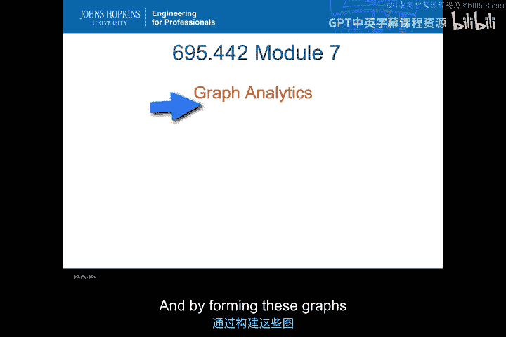

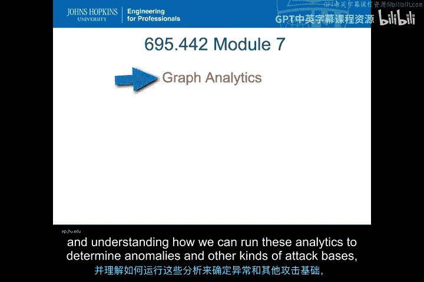

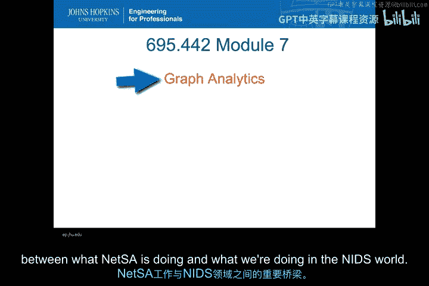

So in this video， we're actually going to get into a little bit of an introduction into graph analytics very。

 very lightly。 This is not a class in graph analytics。 If this is of interest to you。

 there are other classes that will get more deeply into the specific areas of graph analytics in particular。

 there is a network analysis class that spends a lot of time talking about various kinds of graph analytics。

 But for the purposes of this class， we're going to talk about what is a graph how to construct it from netflow data。

 why to start really simple with regard to forming these kinds of graphs。

 some simple ways of analyzing these graphs， then we're going to use these。

Types of analysis on graphs and connectivity to define normal behavior。

 and finally we're going to talk a little bit more in terms of how a property of graphs called locality can be very useful with regard to understanding when we see anomalies at the network layer。

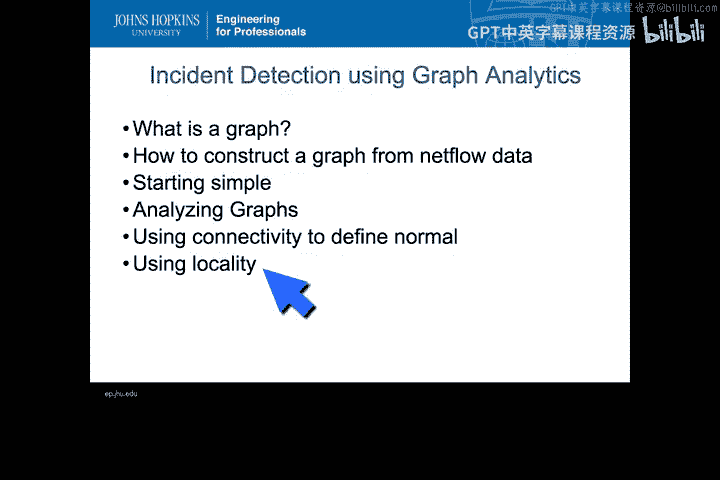

So first of all， what is a graph at the very simplest area it's just a collection of objects and their interrelationships。

 the concept of a graph has actually been around since 1736 where we talked about using bridges to connect various kinds of areas where literally the bridges were the links between various land masses and those were the first kinds of graphs that were actually created。

So there are objects which are the nodes and the interrelationships between those objects are called the edges of these particular graphs graphs can be directional or non-directional In other words。

 you can say that you flow from one node to another。

 or there's just a relationship between the two nodes。

 you don't necessarily have to have a directionality。

 but as we'll find with IP data flow directional graphs are extremely useful。

 the main challenge when we start to talk about graph analytics and what is a graph。

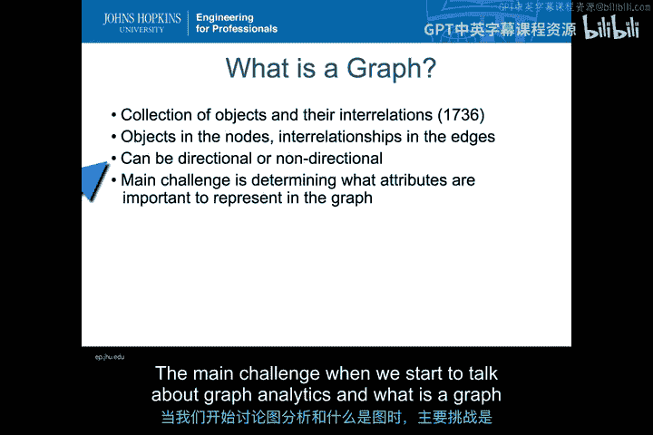

Is really determining what attributes make up unique nodes and what relationships do you want to represent with regard to the links between those nodes。

 Even with something as simple as netflow， there are many different ways to characterize what the nodes are and what the interrelationships are and picking the right things is absolutely essential to understanding how I can begin to get anomalies and understand normal behavior of the interaction of my network nodes。

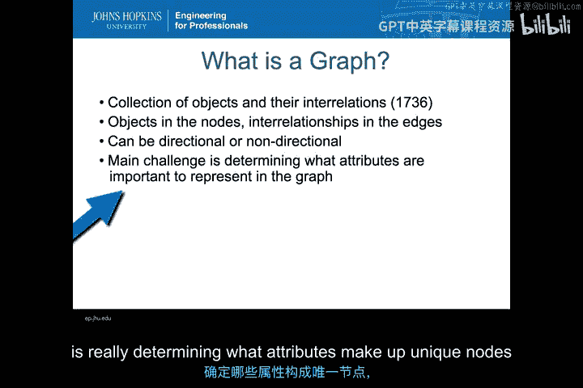

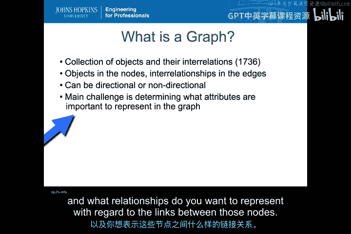

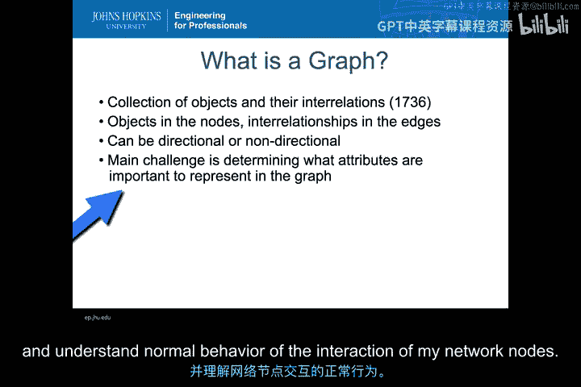

So here's a sample graph that we just sort of put up to talk through a couple of things。

 This is a graph very similar to the kind that you see sort of in the readings that you have this week in this case I've got a directional graph so if these nodes are properties of some kind lines or relationship and the relationship is such that H has a relationship to B sending something to B in terms of IP dataflow you can think of it as node H is sending data packets to B but not the other way around B is not sending packets to H in this particular case。

 everything is going in a simple direction so each line each one of these lines is a relationship it represents the same kind of parameters inside of the relationship so that all of the links represent say an IP data flow or some common attribute that would link these two nodes together so it's not that。

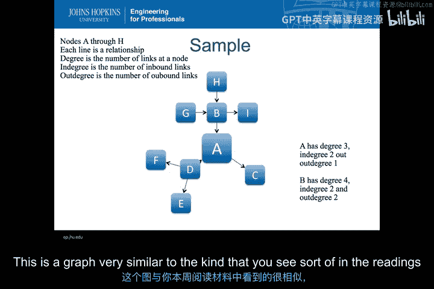

H is linked to B in a different way that A is linked to C。

 These are linked in the same kinds of ways。 And then we have things like properties of the graph itself。

 which are things like the degree So the degree is basically very simply counting the number of links。

 within a within a node。 So B in this particular case。 If I look at the at B B has four links。

 There are different directions， but it has degree 4 because it's got four links。

 If I want to separate in degree versus out degree then what I'm going to do is I'm going to count the individual types of links and call them in degree or out degree。

 So a in this particular case。 it's a little difficult to see。

 but this arrow sort of down here is pointing from D to a So the in degree of a is going to be3。

 sorry， it's going to be two。 the degree of a is 3。 the in degree is 2， the。

Degrreee is one because there's only a single node going from A to C。

 whereas I have two nodes going from D to A and from B to a。

 So I'm going to break my degree down into an in degree and an out degree。

 This is a really important characteristic for intrusion detection and for network situational awareness。

 because the character of nodes usually has a relatively common set of degrees in degree and out degree。

 So a server has a different kind of degree characteristic than a client would have。

 And these are things that we can pick up just by looking at I dataflow and representing that as a graph。

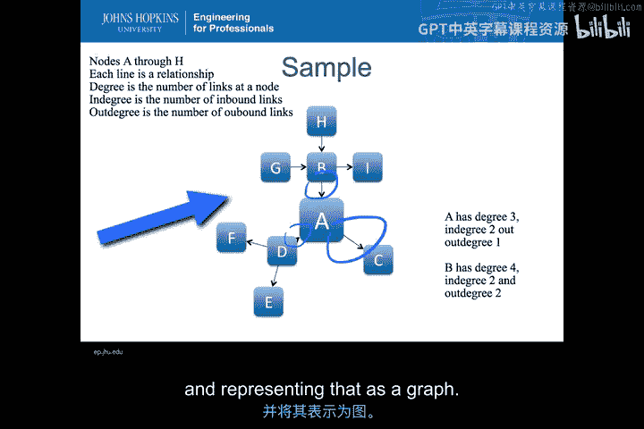

So where any identifier can be associated with a node and any connection between these can be identified as an edge。

 typicallyy nodes are going to be things like the source IP as designated as a node label。

 So you could talk about an I address as associated with a node and then everything coming into that I address essentially shows that I as the destination everything coming out of that node would be things coming out as a source。

 So the in degree would be all of the different other IP addresses that are actually sending traffic to the particular IP address。

 the out degree would be all the places that I address is sending to other unique Is。

 So these edges are often related specifically to I data flows or to the part or the collection of I data flows that simply goes from the host。

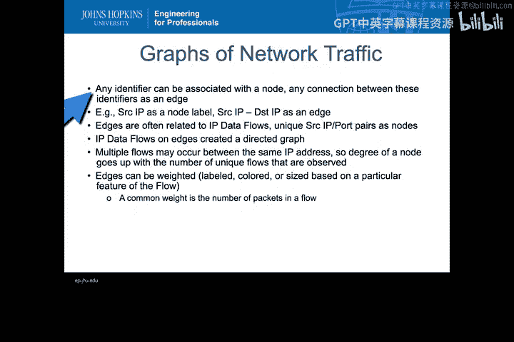

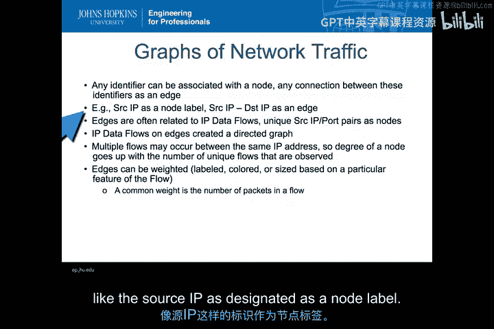

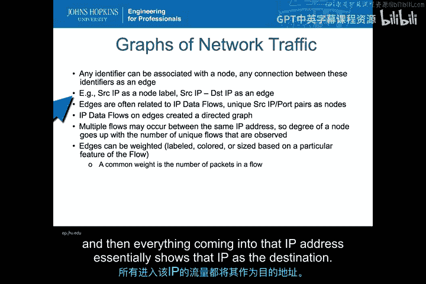

To one from one host to another， irregardless of port number。

So I can construct these edges unique to port number。

 or I can construct them as nonun to port number And I get different kinds of characteristics。

 depending on which way I choose to do that。 But important that Ip data flows on edges does create a directed graph。

 So in degree and out degree are two important elements from most Ip data flow oriented graphs。 And。

 of course， I can have multiple flows between the same I addresses。

 So the degree of a node goes up with the number of unique flows that are observed or the number of unique other nodes that are connected。

 So I can do two different ways here， I can actually create a node。 So if I have a node A。

 and I've got nodes B and C。Maybe A talks to B and B talks back to A。 Those are two different ways。

 and maybe A talks to C and C talks to B and B talks to C and sort of back in that way。

 But maybe A talks to C along the number of different ports。

 so I could have multiple data flow connections， depending on which port number I have to C。

 whereas to B， I only have one data flow connection。

 So now my in degree of C is going to not only include one connection from a。

 but each unique connection that's flowing into C。 So I count the in degree of C based on the number of unique flows that are coming into C or I can just collect all of those flows and count just A to C as one particular flow。

 So I can really do that either way。

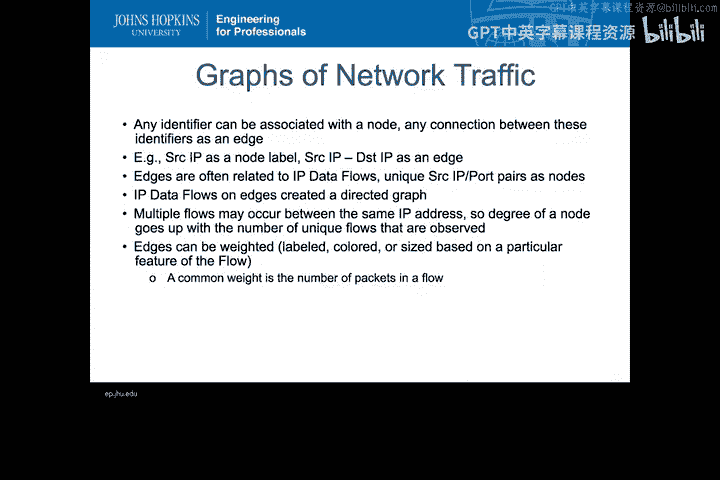

Now， the other important element of this is that edges can be weighted in terms of。

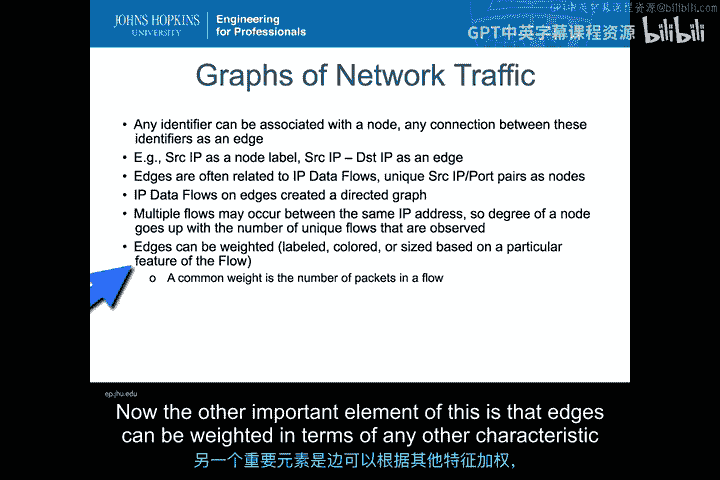

Any other characteristic that would sort of be a numeric weight that you could add to it。

 So one very， very common way to do it is to say how many packets were as part of that flow。

 So once again， if I'm going to have my three nodes in the same way I just had them a moment ago， A。

 B and C， I might have a very thin connection in saying that there aren't many packets going from A to B。

 but I could have a very thick connection。Going back in from B to A。

 which would represent many more packets are going along this flow than are coming in。

 So I might have just a few packets coming from A to B and a lot of packets flowing back from B to C。

 So this is one way for me to weight the nodes and get some characteristic within my graph that I can also then use to know whether this is a normal or an abnormal way for A and B to communicate with each other。

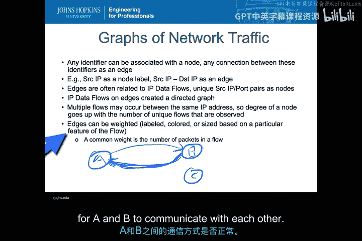

So graph characteristics are also areas within the way we can look at graphs that can indicate anomalies or attacks or other things of interest when we start to map IP data flows into a graph structure。

 So if a graph is partially or fully connected that tells us something about the normal behavior about where nodes talk to other nodes within those graphs。

 So if I have a partially connected graph， and suddenly I'm getting new connections between those areas。

 that might be an anomaly that I would want to look into So I could partition these into subgraphs that are never connected over a particular port over particular kinds of ports。

 So maybe I have nodes that are talking to each other on some ports but never on other ports。

 So again， by having connections that are colored or labeled by port number I can also look at graphs that are partitioned based on the kind of connection that would be port number related。

 and again， I can look at things where a always talks to B and B never talks back。

And these sort of unidirectional or bidirectional connections between nodes can also be taken as a normal way or an abnormal way that my system might be operating。

 Now， the trouble with this is that these edges may change depending on different time periods。

 So it could be that some days of the week。 you get different kinds of connections in other days of the week。

 So it may be difficult to characterize this without going into the detail of understanding how these normal behaviors of the graph connectivity change based on time。

 just like we talked about the volume metrics， we talked about the volume of data changing over time。

 Well， the connectivity of these nodes could change over time as well。

 complicating a little bit where I would want to say this is an unusual or a different kind of connection。

 But all of these are relevant for finding the various kinds of attacks that we would be looking for using these graph analytics。

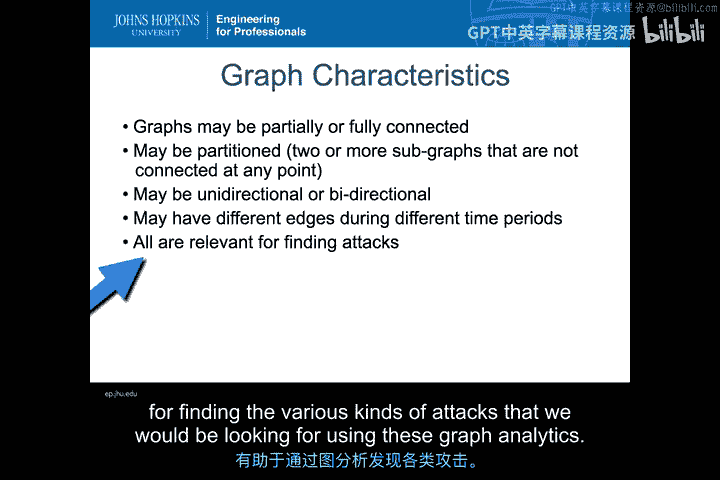

And there are plenty of tools out there to help us do this。 This is an image from a tool called FVz。

 which was a tool essentially that uses IP flow data in a visualization to help you visually understand how these various nodes are talking to each other。

 This is a form of looking at graph connectivity and understanding how the graph changes based on coloring and weight of the number of packets that are flowing from one node。

 which the nodes are represented along these edges to other nodes represented in the other destination IP part。

 So graphs don't always have to be represented exactly the way that I have drawn them before with sort of know the grid A connected to B connected to C。

 you can have these sorts of representations of graphs as well。

 And often they're easier to use in order to spot the kinds of graph anomalies that we would be looking for。

 especially within network situational awareness。

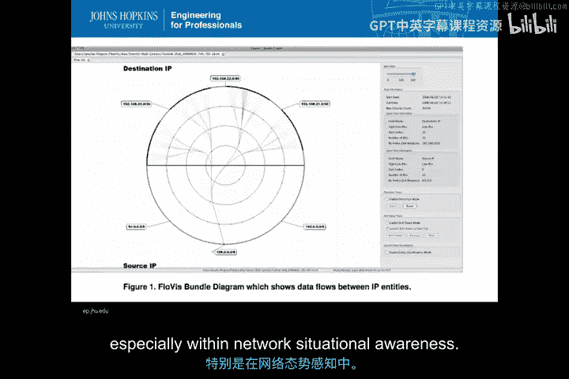

The idea with most of these graph analytics is you really want to start simply just use the IP as the node number。

 use the source IP destination IP as an edge and look for partitions of the graph。

 This begins to get back to how do we originally start to organize the data that we have within the IP data flows。

 If we start with just using IP as a node， and then we want to refine the graph by essentially making refined versions of the node we can always then expand each of those node elements into other elements or other properties that would make sense and expand the node out。

 So this is like starting a graph that I'm going to have。

 so I'm going to have my very simple graph where a is talking to B。 So I've got a talking to B。

 and I've got flows in this direction and I've got flows sort of back in this direction but a really consists of a number of sub nodes internally depending on court number So what I'm really finding is this connection happens within another。

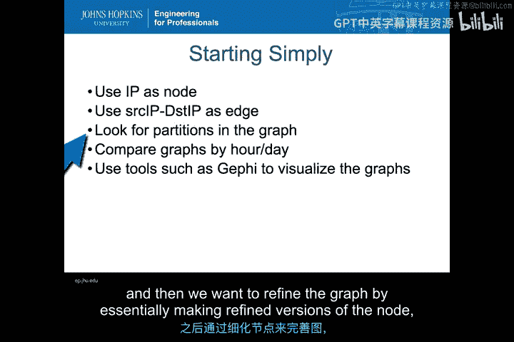

Set of port numbers that are connected in B and I've got this connection back over here。

 but these other ones never talk between A and B。 So if I look at this graph I say well this IP address and this IP address and these never talk between A and B that I sort of have down in this way so now I can be more refined after I've set up my original IP A talking to B B talking to A and then I can get more refined in terms of what is anomalous in the ways that A and B might be talking to each other。

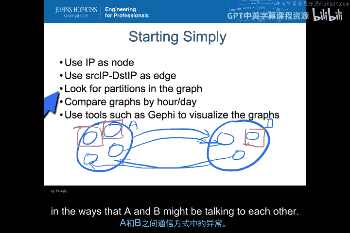

Now， of course， this can get much more complex in terms of the kinds of graph analytics that you actually want to run。

 Once the graph is represented， you can do all kinds of very complex analytics。

 Just one example that I'll talk through right here is you can look at what's called the clustering coefficient。

 This is essentially the probability that any two neighbors of a particular note on a graph are neighbors to each other。

So in this case， if I have a very simple graph。and i'm going have four nodes in this graph。

And these two are connecting like this within the graph。 So both of these are neighbors to A。

 So B and C are neighbors to A。 So the question is。

 what is the probability that B and C are also neighbors to each other。

So this would be the probability here if I don't know what that probability is。

 I can guess what a probability for that might be under normal behavior。

So this is a very useful measure for something called peerishness。

 in other words how many elements are peered with another thing。

 it's essentially zero when clients only talk to servers and servers only talk to clients because therefore clients are not talking to clients and don't have a degree that essentially goes except to servers so this is a way of really characterizing what's the difference in peerishness between what a server does and what a client does。

This is the subject of Michael Collins's book on page 271272。

 which is part of your reading assignment for this week。

 and there's some code in there specifically designed to calculate the clustering coefficient。

 so you can look and see it's actually not that difficult to calculate once you have represented all of this as a graph。

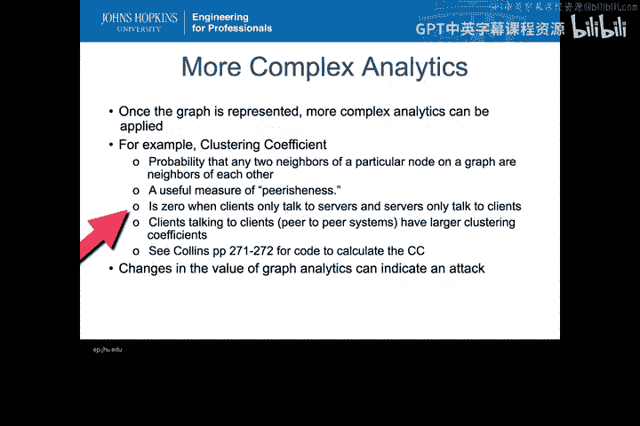

So now that I have IP data flows that are represented in a graph。

 I can use anomalies that would be detected in graph analytics for alarms to make essentially these alerts to begin to turn graph analytics and a network situational awareness tool into a NIDs by creating alarms using my graph analytics now this really relies on the fact that as I'm reading more and more data flows and I'm adding those data flows to my graph。

 I can recognize in pretty close to real time， that the adding of a particular flow into a graph would create an anomalous graph or create a condition within the graph that would make it anomalous and interesting for me to investigate in this particular case。

 So if I'm looking at sort of partitions of IP data flow graphs indicating a separation of function within the network that every new connection that I get can begin to say does this new connection connect up these isolated areas within my graph。

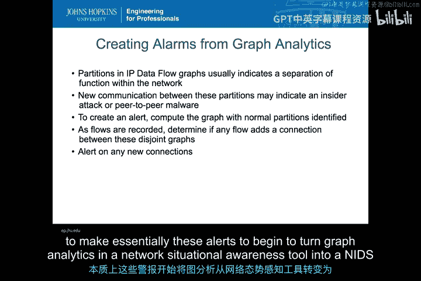

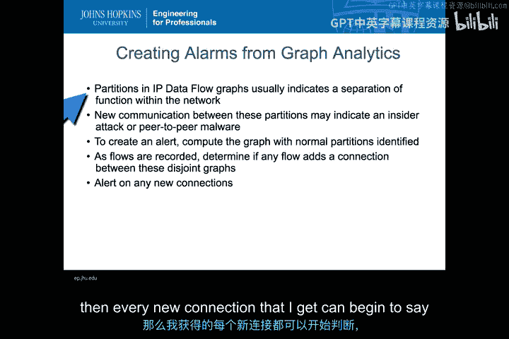

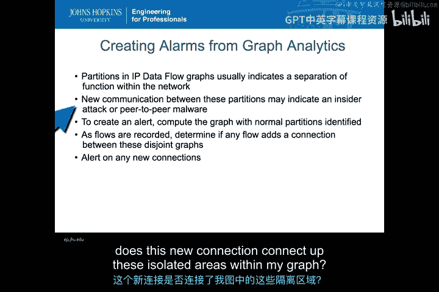

So to create the alert， I compute the graph with the normal partitions identified。

 I record each of the individual flows， determine if any of those flows adds a connection between the disjoint group。

 and if they do put out an alert， essentially associating those two particular node parameters along with the new connection that's made back out as a NDS alert that would be coming from my IP data flow collection。

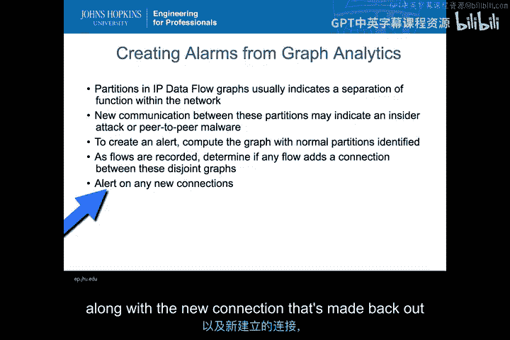

So here's an example of how that works。 Within my enterprise。

 I have basically two partition subsets in here。 I have my a group of networks。

 and I've got my B group of nodes down here， And it turns out when I look at the way that these nodes interact。

 the A nodes never actually interact with the B nodes。

 So I can look at this and say any kind of connections that I get that are sort of within this area and any connections that I get within this area。

 these are all normal。 It's not even especially abnormal to have three talking to one or six talking to four。

 because after all， they do indirectly talk to each other within this cluster already。

 So they probably would not make a reasonable alert to fire。

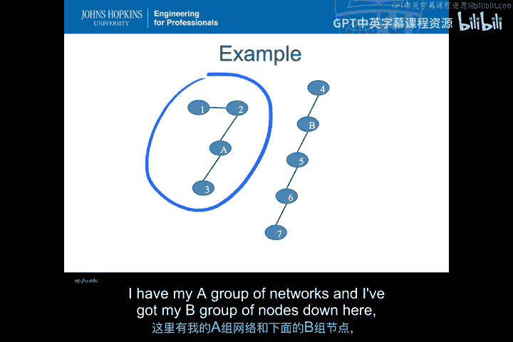

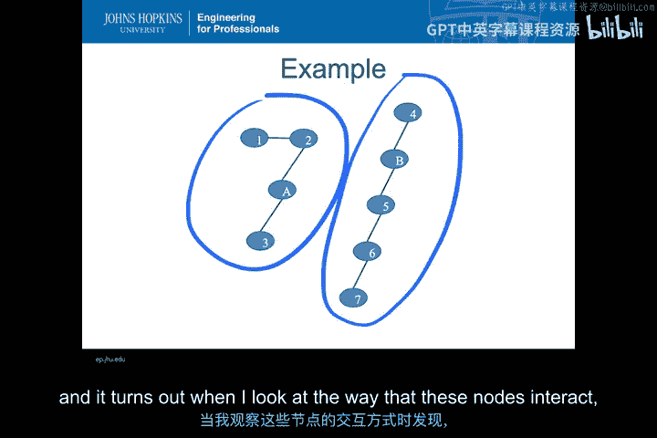

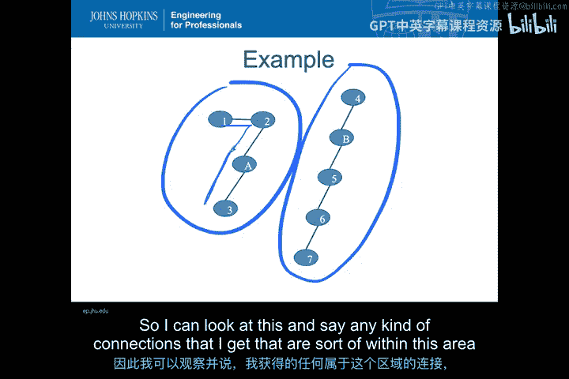

However， if I suddenly have a node that turns out to be an intermediary between these B group and the a group sort of in this area。

 now I have a clusters that are talking to each other that have never talked to each other before。

 So these three data flows can now be the subject of an alert that's generated as they're added to the graph to show that A and B。

 and in this case，6 are connected in a way that they have never been connected before。

 and that could be done in very close to real time because these flows were added to the graph in close to real time and they created an anomalous condition within my graph。

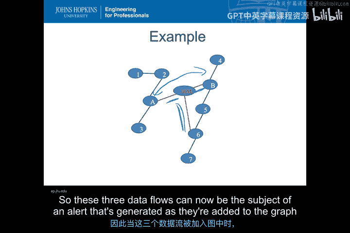

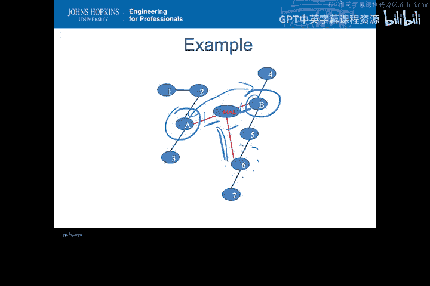

I can go further with this kind of analysis and use these flows to even sort of determine what type of node am I talking about。

 So for an example， nodes with different functions are going to have different flow graph characteristics and if I know what the flow graph characteristics are for a specific function that I can identify whether that node is operating that function。

 whether or not the host really was supposed to do it。 So for example。

 if I have a server in my DMZ that has sort of one port 25 destination and many。

 many of these external host that are communicating with my port 25 system down here。

 I can say well this is because my mail server is running a service on this particular port and all of these external and potentially internal hosts are on port 25。

 So if all of these lines basically deal with looking at any type of source port number connecting to a destination port number。

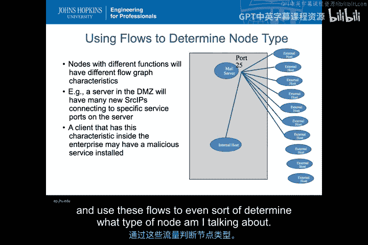

Port 25。 So I use that characteristic to say。 that's what defines a mail server。

 So now I've got an internal host。 And suddenly it's receiving on port 25。

 it's getting all of a sudden connections from a series of other hosts that are in here。

 some of which might even be the same host that are connecting to my regular mail server。

 I can conclude just from the graph that this internal host is operating as a mail server。

 whether or not it was ever designated to be a mail server So this can be really important。

 if I think maybe I have a malicious service installed that's bypassing the security parameters of my official mail server by running a secondary mail server on an internal host。

 This could be the same whether I'm talking about email web。

 any service you can think about would have the same other type of detection that you could do using these very simple kinds of graph analytics。

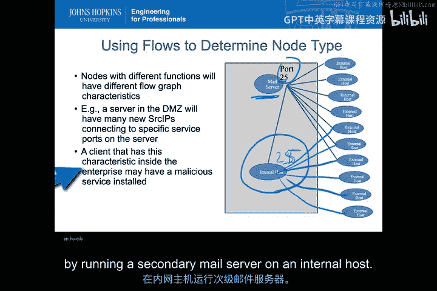

So moving beyond just looking at characterizing nodes based on the type of ports and IP addresses that are connecting to them。

 I can actually begin to use something called locality to as a generalization of looking at new connections between disjoint graphs。

 So this locality takes into account that most systems communicate with mostly the same set of systems over time。

 So it takes about7 to 10 days， usually to build up what would be the normal behavior of a new node introduced into a system。

 So a sudden increase of new system connections way beyond that point might indicate that there's some kind of malicious behavior that's suddenly operating within your network。

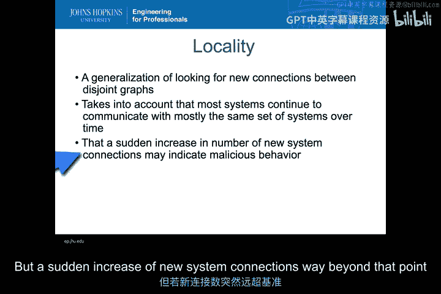

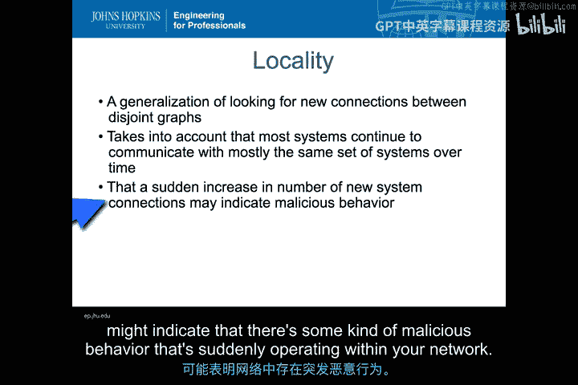

This more generalized version of doing a graph analytic to understand whether。

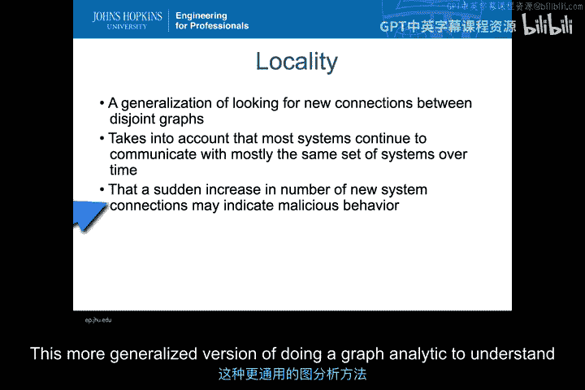

Subgraphs are changing based on the connectivity patterns is grouped under this area called locality。

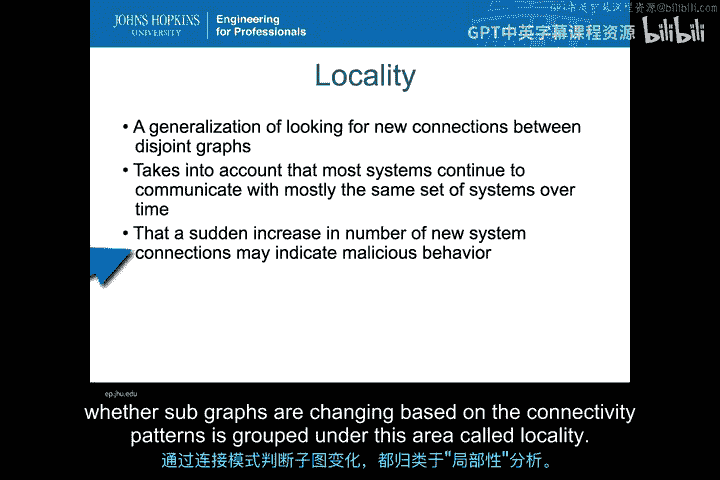

So in this case， I can think of locality as being related to the rate at which new connections are being made。

 So when a note is no， I don't know much about it。 the rate of new connections is very high。

 but it quickly gets very down to a low level as the normal behavior of the systems begin to take place。

 So at that point， I can say， well， the rate of new connections now is going to be stable and very small。

 and a spike in that rate just like a spike in volumetrics looking for a Ddos attack could represent that I have malware installed or other kinds of software that I don't expect that's going into that particular way。

 So using IP data flows in a graph this can be very effective and efficient at finding malware that's attempting to propagate inside of your enterprise。

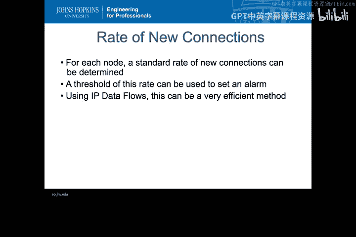

But I can even take this one step further。 I can say that if I'm going to introduce a new node into a system。

 it normally takes several weeks for these new connections to stabilize。

 But if I know that this new system is going to be similar to other systems that I already have。

 I can accelerate the process by presuming that this new system that's going to go in place is going to have the same IP locality as any other of the systems that are very similar to others in that IP set。

 So while I may get some additional false positives and that positive type 1 error rate might start out a bit higher。

 this is going to give me a better probability of detecting attacks from nodes。

 even when they're very first introduced within my system so I can use the concept of locality and similarity to say that I have nodes that are similar in terms of locality within a graph so that I can automatically insert it in the graph with the same locality parameters that I would expect。

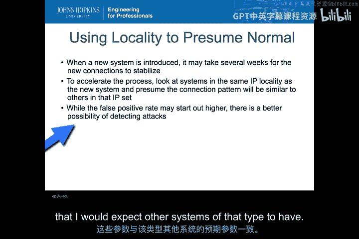

Other systems of that type to have。This is only a very brief introduction to the kinds of graph analytics and that you could really run across all of these IP data connects。

 It's become a very popular way within the network situational awareness。

 tools to understand behavior of your system。 It's now beginning to combine graph analytics and big data as we get larger and larger enterprises and begin to combine the data from multiple enterprises。

 organizations like Kada are really leading the way in this kind of regard。

 This is the sort of organization that gets a lot of netflow style data and IP data flow graphs and applies graph analytics to understand the propagation of malware and the understanding of what attacks look like from a graph analytics standpoint。

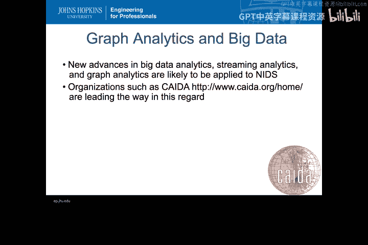

So the KaA website is one that I would certainly recommend that you keep in mind and use as they more and more begin to develop some of the tools and techniques that are related today。

 more to situational awareness， but can be turned into alerts and future versions of NIDs analysis as we've seen the relationship between the sort of large scale network situational awareness and the ability to create alerts and more advanced types of network intrusion detection systems。

