# 约翰霍普金斯大学《入侵检测｜Intrusion Detection》中英字幕 - P37：5_Security Onion与Bro实验.zh_en - GPT中英字幕课程资源 - BV1sGu1z5E2J

Hi。I am Philip Chin。🎼I am presenting to you the security oning。

🎼Security onlying is a powerful platform for studying intrusion detection system。

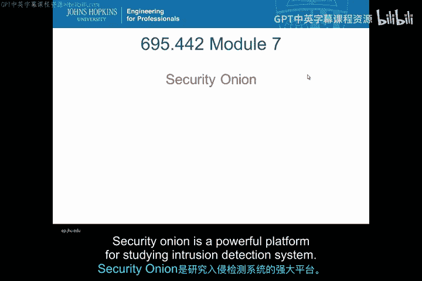

In a summary， security oning。🎼Can perform full pack capture。Which x。

🎼Like a video camera for your network。🎼You can tell who came in and went。

And what they brought with them。

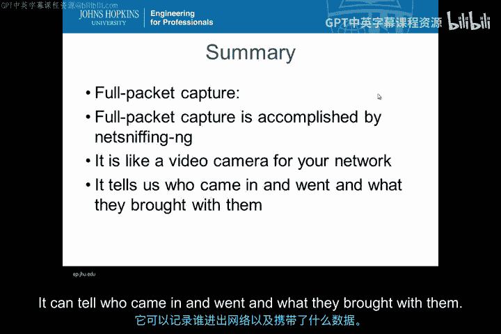

There are three components。😔，🎼In the security onlying， the first component。

🎼Is the intrusion detection system， which are network intrusion detection system。

🎼And host inrusion detection system。The second。포는。Conist of。🎼powerfulowful analysis tools。

🎼And the third component。🎼Is the full pack capital。

🎼For rule driving network intrusion detection says security onlying。🎼Offers snow and sacutta。

🎼For analysis driving network intrusion detection system， security oning offers the role。🎼Ids。

🎼Bole monitors。🎼Network activities。🎼And logs， any connections。🎼Including the DNA S request。

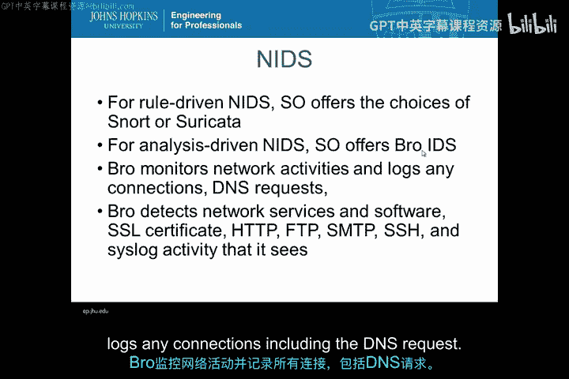

🎼For host based intrusion detection。🎼Security onlying offers O Z。🎼O can perform log analysis。

File integrity check。🎼Policy monitoring and real time alerts。🎼Fu pack capture。

🎼Ex like a video camera。🎼It tells us who came in and went。🎼And what they brought with them。

🎼The full analysis tools。🎼In the security onlying are scale squad， snowb。🎼And Elsa。

🎼Elsa stands for Enterprise Lo Search and Arch。🎼We shall discuss each one in more detail。

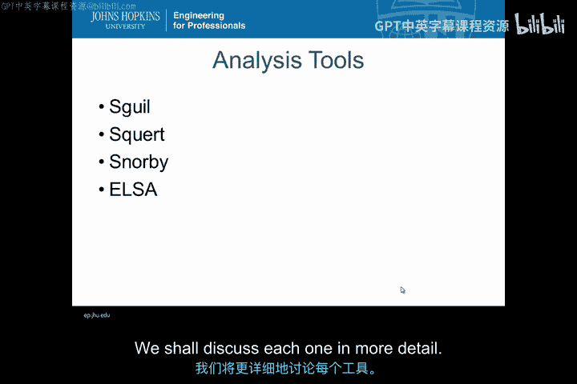

🎼Skill provides a good interface。🎼To view snow。🎼And sorryta alerts。🎼All the alerts and broad events。

 for example， it allows you to correlate from alerts to a pack capture。

🎼School allows you to view all associated traffic。

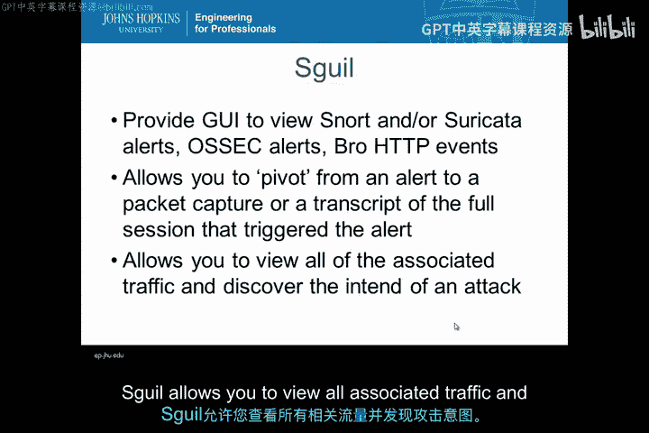

🎼And discover the intent of an attack。Square。🎼Is a web application of the skill。Database。

🎼It provides visualization of the network data。🎼Snowb is a wave interface to view。

 search and classify alerts， and also journalist reports。🎼It allows you to trace。

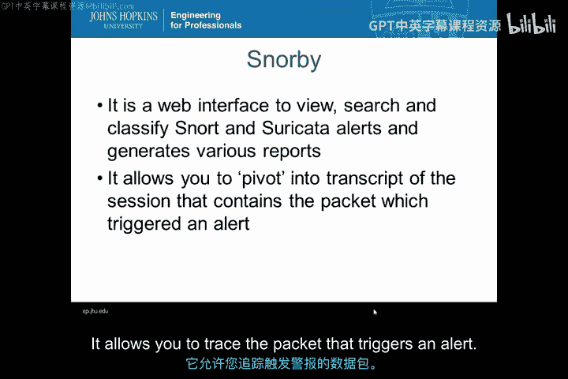

The packet that。🎼Triggers an alert。🎼Elsa stands for Enterprise， Long Search and Archive。

🎼It allows you to comb。🎼The data collected by the security onlying。

🎼Elsa provides visibility into relevant cilog data。🎼And offers powerful。🎼Graphic displays。

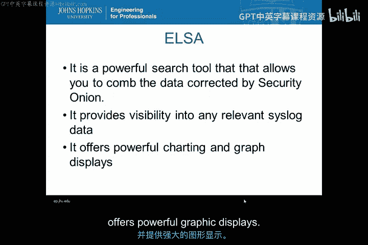

🎼This is a display of security earnings services status。🎼You can log into your。

🎼Security only virtual machine。 and get display。🎼By entering the command， as indicated in this slide。

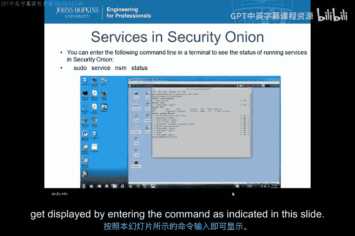

🎼There are values。🎼Diploment scenarios for the security onlying depends on your application and your organization。

🎼For your security on virtual machine， it was set up。

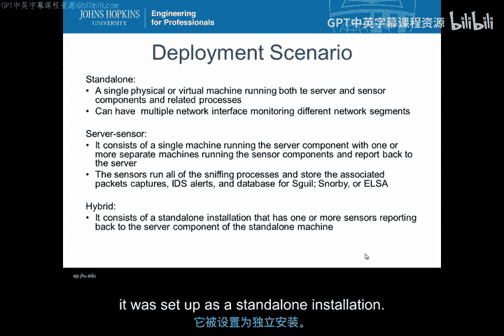

🎼S S stand alone installation。🎼In the next few slides。🎼We should discuss。

🎼More on bra as a network intrusion detection system。B。🎼I's a network traffic analyzer。

🎼It is an event driven intrusion detection system。🎼B includes many protocol analyzers。

🎼B provides real time correlation of network。🎼With community intelligence。Now， listen。

🎼You areing a great idea。🎼And let me repeat。🎼Bro provides real time correlation of network with community intelligence。

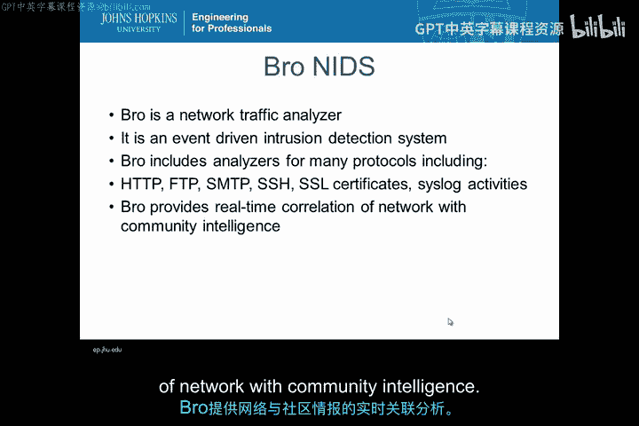

🎼This slide describes important filess within the security onlying。

🎼You should get some idea on where are browses configuration file。🎼Browse log 5。

🎼Bse many built in scripts。🎼Since you are using a security only virtual machine that we prepared for you。

 You do not need to worry about。

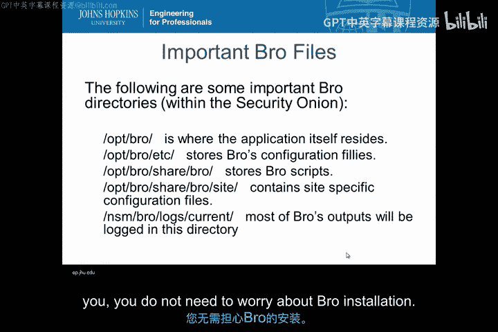

🎼Bad installation。🎼This slide provides you some links， and reference。🎼For your own reading on bra。

🎼I have included a YouTube video for you to watch where you can watch the creator of the security Onwning。

 His name is Doug Burke。🎼He's a young and guy。

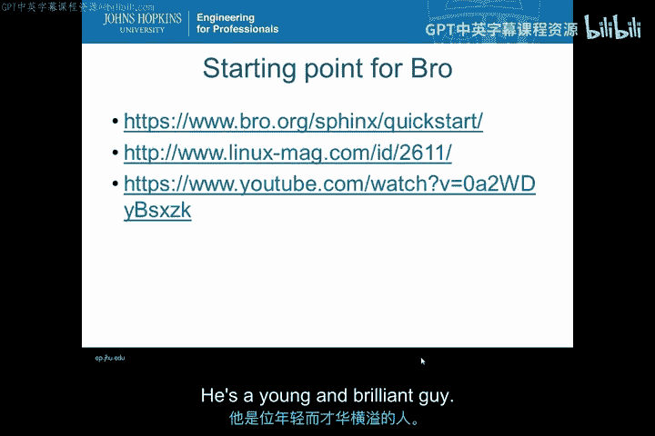

🎼This slide summarize browse log file within the security only。

 browse log files are located in the directlyy slash N S M。🎼Slash broad， slash logs slash。

🎼You should log in to your security only virtual machine and see what files are and this log directly。

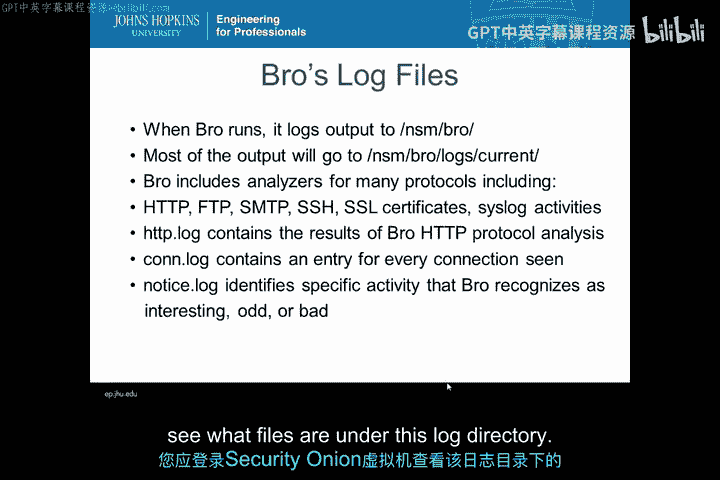

🎼B is actually a programming language。🎼It uses the dot B，R。

 O file extension to indicate that a I is a broad script。

🎼Brow provides many building in scripts for network analysis。

🎼This slide describes about Brook's manuscript type。🎼Andwhere。对啊，located。

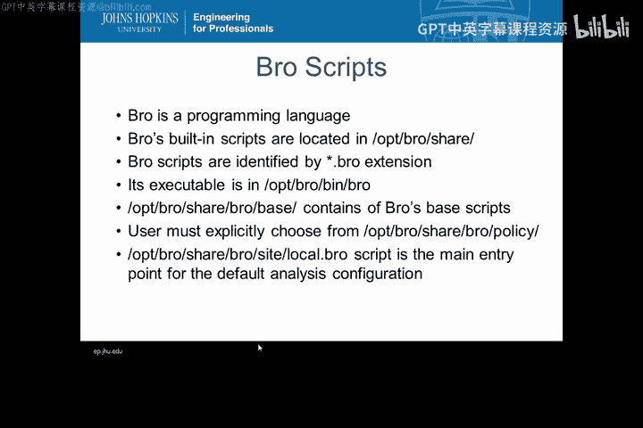

This last slide。🎼It's an example of how broad does DNA and normally detection。

🎼We should discuss this example later on， in a lab assignment。

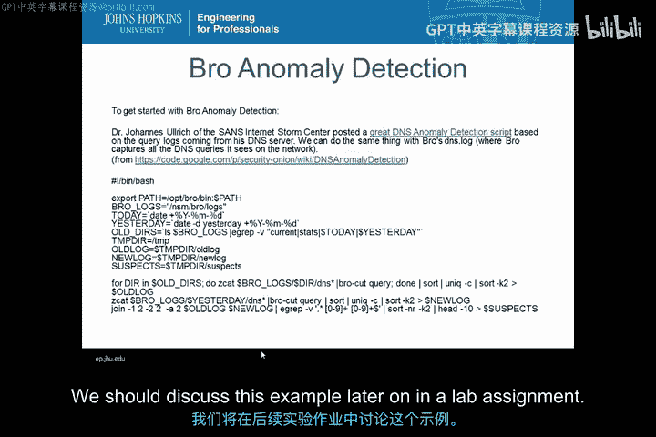