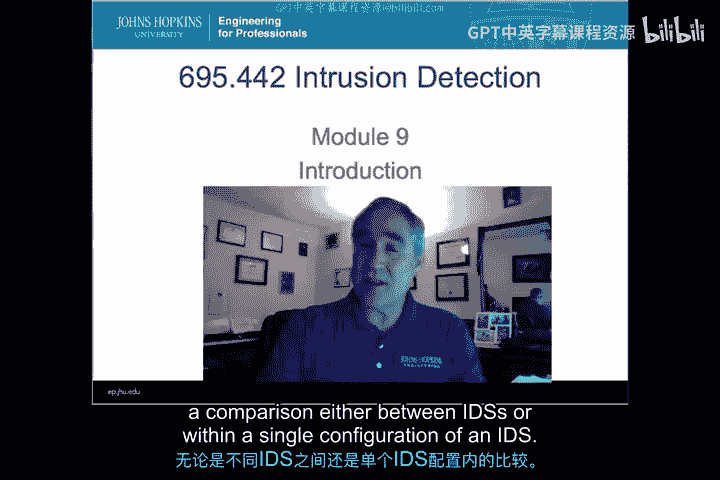
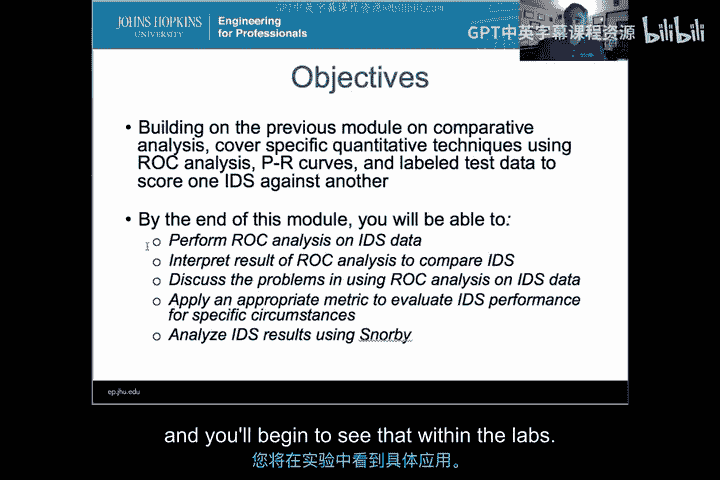
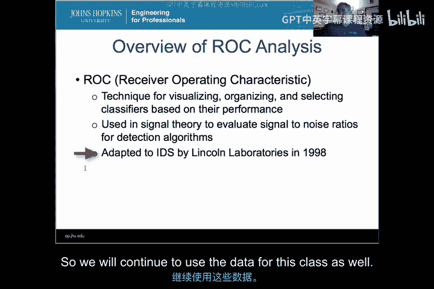
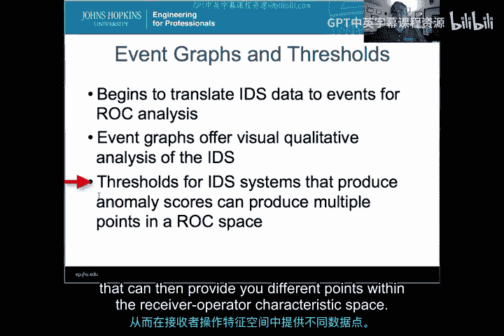
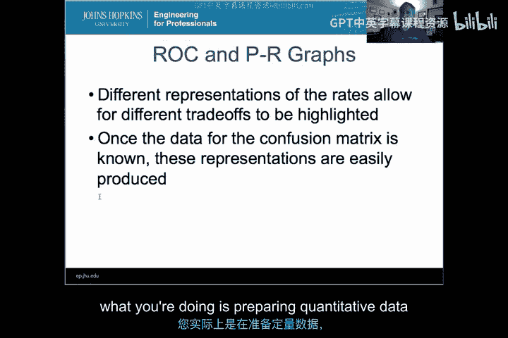
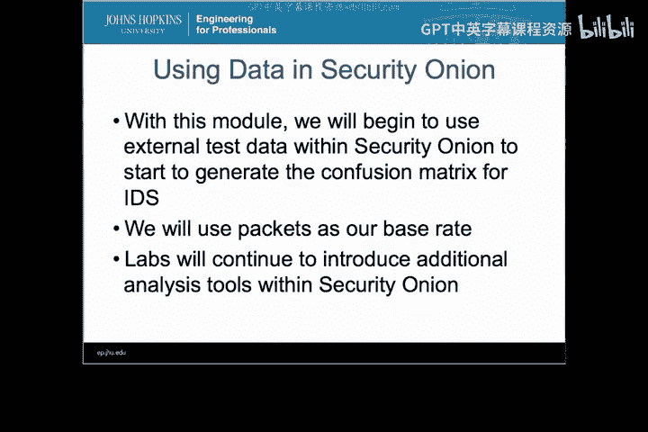

# 约翰霍普金斯大学《入侵检测｜Intrusion Detection》中英字幕 - P38：6_导论.zh_en - GPT中英字幕课程资源 - BV1sGu1z5E2J

Okay well welcome to module 9， this is our module that's going to focus in on rock analysis。

 receiver operator characteristics， this will allow us to really get into quantitative analysis of the performance of intrusion detection systems using values that you can create from test data to actually generate very quantitatively a comparison either between IDSs or within a single configuration of an IDS。

So the objectives of this module are we're going to build upon all of the previous techniques that we've talked about。

 everything that we've talked about with regard to using intrusion detection systems。

 plus all the labs that you've been working on within security onion and within your VMs so that by the end of this module you'll be able to perform rock analysis on IDS data will still walk through the elements of doing that in future modules。

 but this is going to give you the basis for actually producing the kind of data that will allow you to do rock analysis moving ahead we're going to interpret the results of these rock analyses to compare different intrusion detection systems together。

 discussing the problems and using rock analysis and IDS data that will come in a lot in our discussions for this particular module we're going apply the appropriate metric for evaluating IDS whether it is accuracy or precision recall or receive operator characteristics and finally。

Going to within your lab， begin to use Snnoory to start to analyze IDS results and youll begin to see that within the labs。

So the first video past this one is going to be just an overview of rock analysis an introduction to what we're going to be doing this begins to show that rockC really is a technique for visualizing organizing and selecting classifiers based on performance it was used originally in signal theory to study different classifiers in signal to noise reduction this was adapted by Lincoln laboratories in 1998 to begin to perform comparative analysis against different intrusion detection systems that were being funded by DARPA at the time。

 so this was really the first attempt at doing quantitative analysis of intrusion detection systems in the history of IDS。

Even though not everything was right， the data that was created for this IDS comparison is still in use today despite the fact that it's quite old and there's a number of difficulties with the data。

 so we will continue to use the data for this class as well。

We're going to start after the introduction with just talking a little bit more about event graphs and the use of thresholds within event graphs in order to translate IDS events into the kind of data that we would want to use for rock analysis Even graphs in general office offer a visual qualitative analysis you can look at event graphs visually and say。

 oh， I think the classifier is pretty good but has some problems or it's a very good classifier。

 it's a way of doing sort of just visual recognition of the way an IDS system might cluster events and data but from that we're going to generate quantitative data using thresholds to produce anomaly scores that can then provide you different points within the receiver operator characteristics space。

We'll talk about how multiple confusion matrices based on this IDdeS configuration。

Can be compared we're going to talk more about how rock analysis is really in the IDS world a cost benefit analysis and what do we mean by costs and benefits with regard to the kind of data that's being collected within the rock analysis and well also show how multiple IDSs can be quantitatively compared in this video then we'll take a little diversion into talking more about error rates and why the rates are more important than the raw data with regard to the analysis that we're doing of IDS and some of how we're beginning to characterize those particular error rates that'll be just a relatively short video module and finally we'll get into more of the generation of rock and precision recall graphs to show how these different representations allow the different kinds of tradeoffs to be highlighted the data for the confusion matrix is the basis of all of this analysis so as you collect data and populate the four elements。

Of the confusion matrix， which you're doing is preparing quantitative data for all of these different analysis techniques。

And then of course we're going to be beginning to collect and use some external test data within security Onion to start to generate a real confusion matrix for the IDSs that are included in security Onion。

 we're going to be really focused in on this for the rest of the semester in using what you've built up already in security Onion to do the analysis of specific data that we will pull in in order to generate a confusion matrix。

😡，For all of our analysis， we're going to use packets as our base rate。

 these are going to be for network based IDS， so you can apply the same techniques to host based IDS or to things that don't have packets as their base rate。

 but in this class we're just going to assume packets has the base rate and do all of our calculations around that as you read the McC report you'll begin to understand how important selecting the right base rate really is to this kind of analysis and of course the labs will continue to introduce additional tools within security onion。

So that's the structure of the way this module is going to go。

 it is a very detail oriented module with regard to how to get into quantitative analysis。

 take some time to look at the videos to do the exercises to do the assignments it will really benefit you in trying to prepare you for using real data in order to do the kind of quantitative analysis that you might do within secure onion or any other test environment that you would create for intrusion detection systems。

 so hope you enjoy this module and lets let's get into it now。

