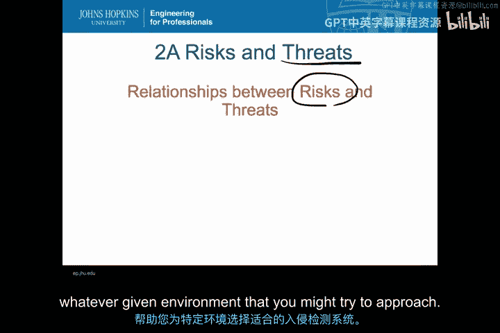
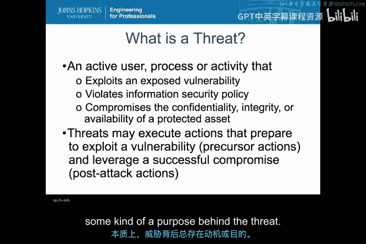
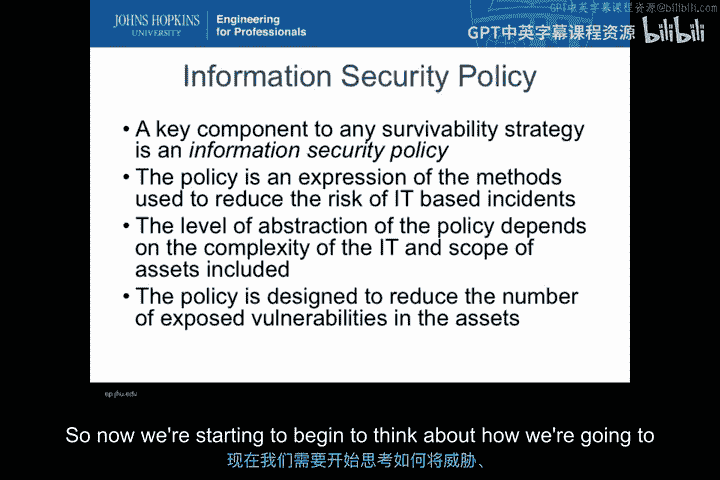
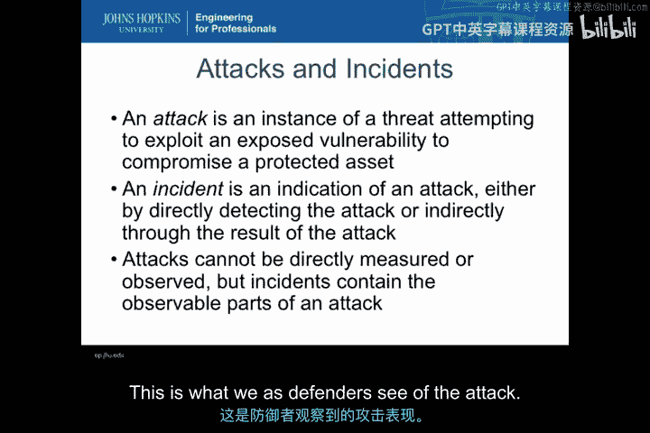
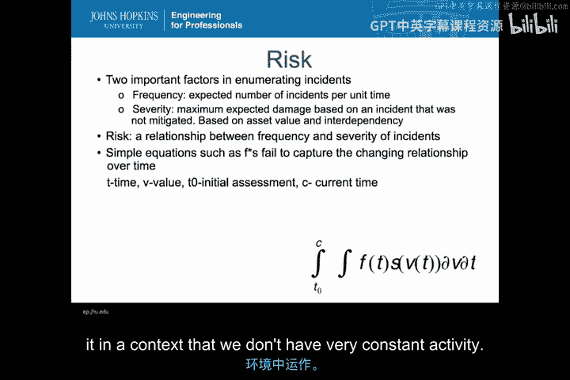
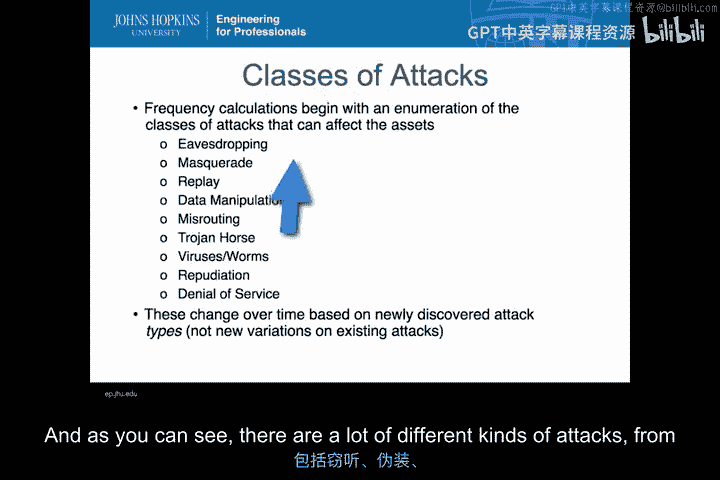
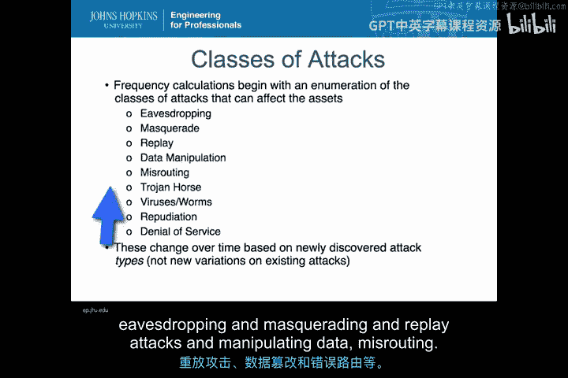
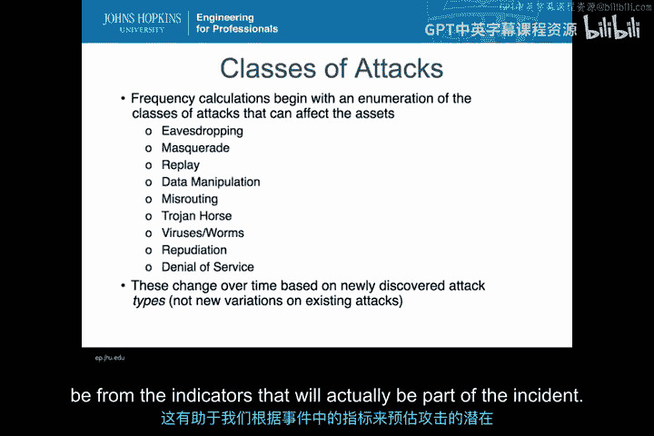
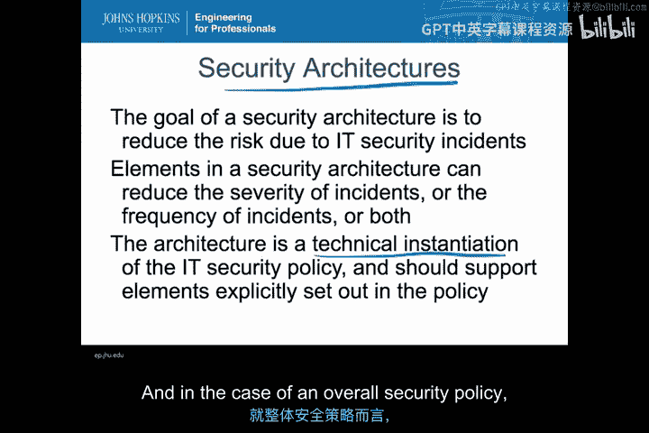
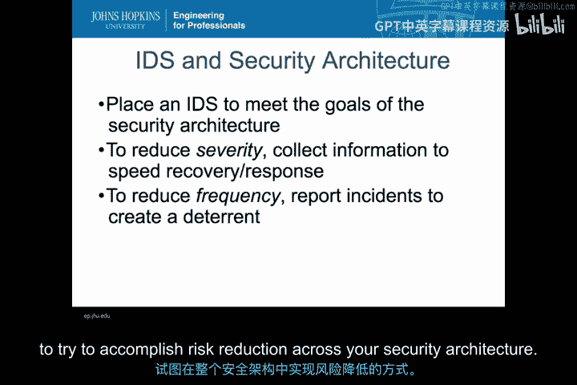

# 约翰霍普金斯大学《入侵检测｜Intrusion Detection》中英字幕 - P3：2_网络风险与威胁类型.zh_en - GPT中英字幕课程资源 - BV1sGu1z5E2J

In this module we're going to start to explore the relationship between the use of an intrusion detection system and the way that risk is actually reduced。

 the important thing about applying intrusion detection system is really you want to make sure you're reducing risk in your organization and in order to understand whether or not the IDS is helping you to reduce that risk。

 we're going to talk a little bit more about some specifics about the threats。

 the relationships between risk and threats and some of the case studies and ideas that would help us select the right kind of intrusion detection system for whatever given environment that you might try to approach。

So let's start with a really fundamental question。 when I say threat， what are we talking about。

 What is a threat。So threat is one of those very overused words。

 but when we talk about threat in the context of an intrusion detection system。

 we mean an active user， something that is。In particular。

 a user process activity that's actually doing something to the system It is not a passive thing。

 it's not abstract， it's not a remote individual necessarily。

 it's not any particular kind of demographic a threat in our case is going to be this idea of the active user process or activity Now it isn't just any active user process activity to be a threat you've got to basically exploit and exploit vulnerability this is a really important point because when we talk about what do threats do they exploit some kind of vulnerability Now this vulnerability doesn't have to be a technical vulnerability It could be a vulnerability and policy。

 it could be one that's you know the very kind of fundamental nature of the way an organization is put together。

 It could be a lack of some kind of controls that。But in each case。

 the active threat is exploiting some kind of exposed vulnerability。

Now of course the threat doesn't exploit this vulnerability you know for no reason at all。

 so basically there's always a motivation or some kind of a purpose behind the threat。

 so in this case we're talking about a threat that's going to try to violate or compromise some aspect of information security policy this doesn't necessarily have to be an explicit policy it could be implicit。

 but the idea is that a threat is going to try to do something that would normally be disallowed in a normal part of your information security policy and the kind of focus area that we have for the specific information security policy or compromises around the confidentiality。

 integrity or availability of some kind of protected asset。

Now a threat can actually execute actions that do more than just compromise the system or exploit the vulnerability。

 there could be actions both before and after the exploitation of some kind of exposed vulnerability these are a precursor and or post attack actions that can sort of either prepare a system to exploit the vulnerability or leverage a successful compromise once the vulnerability has already been done。

 So in essence a threat is the active component， it's the thing that's actually going to do the penetration of your system。

 it's what you really want to be able to understand and have an IDS help you to deal with。Now。

 of course， information security policy is really at the heart of what it means to have a security incident if you have a threat and they're violating something within your system。

 this is basically a strategy that's going to be centered around your information security policy The policy itself is an expression of the methods that you're using to reduce risk。

 so now we're starting to begin to think about how we're going to relate the threat。

 the information security policy and the risk that you have of IT based incidents。

And these policies that are being violated， the level of abstraction can be very different。

 depending on the context and complexity of the organization that you're in。

 So there's no one way to think about how this policy gets written。

 It could be any number of techniques that are sort of either written or nonwritten in order to understand how you're protecting assets。

 but in all cases， the policy is designed to reduce the number of exposed vulnerabilities and thus reduce the actual level of penetration that a threat can achieve。

So we've been talking about what threats do and threats basically attack。

 So what's the relationship between an attack and an incident in this case。

 Because we're not actually talking about an intact detection system。

 we're talking about an incident detection system。 So what's the difference between an incident and an attack Well。

 in this case， an attack specifically is an instance of a threat attempting to exploit some kind of exposed vulnerability to compromise a protected asset。

 This brings together all of the definitions that we were just talking about。

 So an attack is from the perspective of the attacker。 from the intruder。

 The attack can incorporate what the motivation of the attack is。

 what the attempted result is going to be what the attacker is really trying to do。

 That's really in star contrast to an incident。 An incident is the indications that we have an attack。

 This is what we as defenders see of the attack。

An incident gives us indicators of what the attacker might be doing。

 either directly by looking at the activity that we can see on the system or indirectly through looking at some other result of an attack。

So this means that the attack itself cannot be directly measured or observed。

 The incidents containing observable parts of an attack are what the IS system can actually see。

 So what are things that we can't see from attacks。 We can't see the motivation。

 We can't see the intent of what the attackers trying to do。

 Those things are not directly observable。 What we can see is the specific technical indicators that the attackers have to leave behind as they try to achieve their goals。

So that leads us straight into talking about risk really risk is a combination of two things。

 frequency and severity， where frequency is just the expected number of incidents that I'm going to get per unit time and severity is the maximum expected damage on a successful you know provided that an incident was successful in terms of the threat achieving through the incident。

 some kind of maximum damage， so that's usually based on asset value and some kind of interdependency that's sort of there so risk itself is the relationship between frequency and severity of incidents。

Now sadly， it's not really quite as simple as just taking two simple constants on frequency and severity and calculating a risk because both frequency and severity tend to change over time。

 and in particular severity also changes based on the changing value of the assets that you actually worry about over time。

 so assets become more or less valuable， depending on context， interdependency。

 even something as simple as the market going up and down。

 whereas frequency really this is going to change based in time。

 depending on what the intruders actually know， so frequency can go up when new vulnerabilities are exposed frequency can down when you become a less attractive target but in any case there's some complicated relationship between frequency severity time and value so these very simple equations you know that you see sort of these frequency time severity。

They really fail to capture this changing relationship over time this is especially important when we talk about things like you know intrusion detection because a lot of IDS talks about trying to get normal behavior or normal expected values of frequency and severity but understand that because of the complicated nature of the way cyberspace really changes over time。

 these are very difficult concepts to be to actually solve in closed form so there are in the research literature。

 some of these sort of partial differential equations that begin to try to get at this this is going to be beyond the scope of this class to begin to get into some of the more advanced math of risk management if you're interested in this I really do suggest you start taking a look at more of the literature around risk analysis and some of the way these can be calculated for。

The purposes of this class， the important thing here is that when we talk about risk。

 we know that it changes over time， we know that IDS systems that rely on reducing risk have to do it in a context that we don't have very constant activity。

The other complicating nature of risk is that we don't just have one kind of attack。

 We have all kinds of different types of attacks that can actually happen。

 So our frequency calculations begin with this idea of an enumeration of just the classes of attacks and things that can affect the various assets。

 And as you can see， there are a lot of different kinds of attacks from eavesdropping and masquerading and replay attacks and manipulating data misrouting。

 these。

Are different classes， not even just individual attacks， but different classes of attacks。

And of course， each of these attack classes has very different kinds of effects on the targets that they actually have。

 So the severity of these attacks differ depending on exactly what acid is being manipulated and how things are being attacked by the intruder。

 But the nice thing about these different classes of attacks is they can actually give us different ways of looking at observables and classifying observables into attack types。

 This can help us begin to estimate what the potential severity of an attack might be from the indicators that will actually be part of the incident。

So bringing this all together， you're going to try to create a security architecture in order to reduce the risk。

 Now remember what it means to reduce risk is reducing the severity or the frequency of the incidence that you're actually detecting。

 so the elements of a security architecture can reduce either the severity or the frequency or both。

As each component works together to try to eliminate risk。So in this case。

 the architecture that you put together that will include intrusion detection systems is technological the technical instantiation of the IT security policy。

 they are the elements。The security architecture are the elements that enforce what your information security policy is supposed to achieve。

And in the case of an overall security policy， intrusion detection systems are just one element of an overall security architecture that you might want to put together。

 So that's the element that we're concentrating all within this class。

 But it's always important to keep in mind that you have to try to put。

The instantiation of IS in the context with the other elements that you might include as well。

 they should work together to achieve the information security policy that you're trying to put in place。

 because of that， the intrusion detection systems we describe are not designed to do everything。

 They're not designed to enforce every element of an I security policy。

 So what we're looking at is in where is the appropriate niche within the security architecture for the IS to operate。

The main way that an I D S works within the security architecture to reduce risk。

 The primary way that it operates is to reduce the severity and to reduce the frequency of incidents。

 To reduce the severity in particular， you want to collect information to speed the recovery or response efforts that you have。

For severity， it's all about trying to get response recovery actions to happen more quickly than they would without an I S。

 How does this reduce risk to reduce risk， I'm reducing severity。

 because I don't allow the intruder free access for a long enough period of time to complete all of the potential damage that would happen。

 And even in cases where my Is is only alerting me after the fact。

 the faster I can recover my original asset value， the lower the overall severity is going to be from that particular incident。

Now， for frequency， that's a little bit trickier because with frequency。

 what we're really trying to do is to operate on the threat side to get the threat to attempt to get in less frequently to essentially deter create deterrent so that our threat won't necessarily want to come and attack us。

 that can be very difficult on external threats。 Most of the frequency for external threats is going to be controlled by externalities。

 discovered vulnerabilities and the attractiveness of the target。For insiders， however。

 or for partners or for areas in which we can have really good attribution from the attack。

 we can use an IDS to help us reduce frequency by reporting incidents back to the users so they understand that the IS is watching them。

This is the case where， you know， if I have an insider and they know those 90 S that they can't really get to and in control。

 it can deter some of the insider threat activity。 Now， that's not a panacea。 of course。

 with regard to security， because you still also want to work even on insider threats with reducing the severity by collecting information to speed or recovering response。

 that works just as well with insiders as it does for external threats。 But with。

you know threats that we can essentially get good attribution we can use is to reduce the frequency as a deterrent。

Now， external threats where we don't have good we really don't have good attribution。

 it's difficult to apply some kind of deterrent effect to an external threat。

 but it can be done through law enforcement and other kinds of activities that would likely deter an external threat。

 especially a casual external threat if they understand that you're going to use an IDS in order to take some kind of legal action。

So that's basically how an obtrusion detection system ties threats， risks， and vulnerabilities。

 and security policies together into one hole to try to accomplish risk reduction across your security architecture。

