# 约翰霍普金斯大学《入侵检测｜Intrusion Detection》中英字幕 - P40：8_事件图与阈值设定.zh_en - GPT中英字幕课程资源 - BV1sGu1z5E2J

Okay， so now that we've introduced rock analysis， let's begin to talk a little bit about how we turn intrusion detection data。

 events from intrusion detection systems， and thresholds or configuration on intrusion detection systems into the kind of data that we can use for rock analysis。

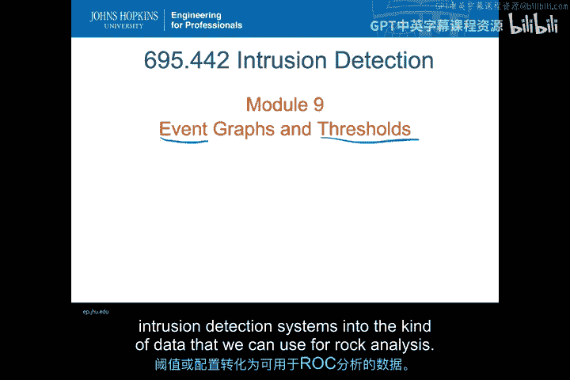

So the idea of measuring IDS systems really started with the idea of measuring anomaly detection systems because the use of scores within anomaly detection systems implied that we can have different thresholds of the scores that come back for measuring the。

The degree of anomaly that any indicator would possibly have so there became a natural way of saying well changing the threshold on anomaly detection system is a lot like changing the threshold or the squelch on some kind of a signal processing system so by using scores in the anomaly detection that implied that we can use these kinds of quantitative analysis systems this is as opposed to the signaturebased systems that really only give you either an alert or a lack of alert I mean there isn't a threshold that we can adjust or a score that we can see with how closely does one thing match to another thing but as we'll see you can still use rock analysis for signature detection systems。

But kind of getting back to the anomaly detection systems。

 the idea of the sensitivity of the anomaly detection system was sort of determined by changing these threshold values。

 So the higher the threshold was， the harder it was for an event to be anomalous。

 the lower the threshold， the easier it was for an event to be anomalous。

 And that was the way that we could adjust how sensitive these anomaly detection systems were to the degree of anomaly that we would find。

So as we increase the threshold， fewer patterns fall into anomalous behavior， as we decrease it。

 more will fall into it。 So this usually indicates fewer false positives or type 1 errors because the more that I make it more difficult for something to be anomalous。

 The more likely it is that normal behavior would be classified as anomalous。

 So lower thresholds in this case would drive the higher， the greater false positive values。

 So this relationship between the true events and the false positive is really what we're going after with regard to receiver operator characteristics。

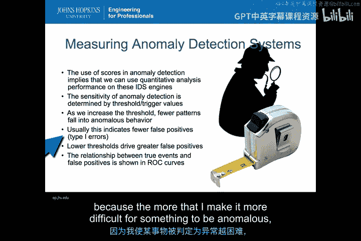

So within anomaly detection systems， all of this basically started with event graphs that came through。

 So this is really just a very simple graph of the event numbers on the X axis and the analysis score。

 the score that came back from the anomaly detection system on the Y axis。

 So this presumes that our classifier produces a score for each event that it finds for every packet or for every session for everything that I find I'm going to produce a score。

 So I can actually just put these scores up on a graph so that each event represents some observerservable that can either be normal or malicious。

 Now， here's the important thing。😊，In addition to my classifier putting up a score。

 I have to also know for each one of those events， what the true class of the event is。

 Was it really anomalous or an attack or was it really represented as moral behavior。In this case。

 a good classifier will then mark mostly malicious events with a higher score and mostly normal events with a low score。

 That's what we mean by saying we have a good classifier with regard to an intrusion detection system。

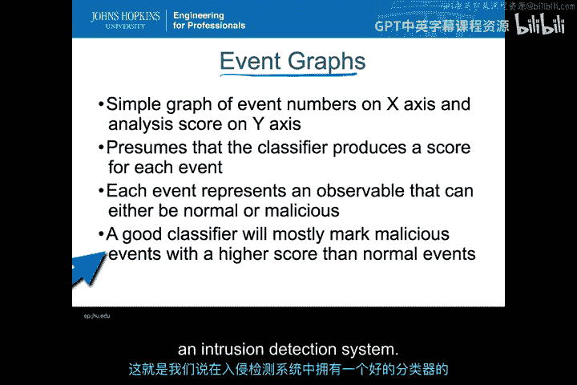

So here's a representation of a very simple event graph from some kind of an anomaly detection system。

 So anomaly detection usually produces a score somewhere between0 and1。

 So as you see our y axis is always going to be between0 and1。

 this is the event score for the IS system。 These numbers along the bottom are simply event numbers。

 usually they're linearly ordered in time， but they don't have to be we'll find that for rock analysis that this dimension turns out to be completely irrelevant。

 but it's a way for us to put up events on a single page and begin to get a view。

 an overview of the system of how we think the classifier is。

 So you can see that we have a cluster of events sort of up here。

 these seem to be clustered such that those would be more likely to be anomalous。

 and that we have a series of events down here。 and we can see that those are clustered and more likely to be normal if this is a wellbehaved classifier。

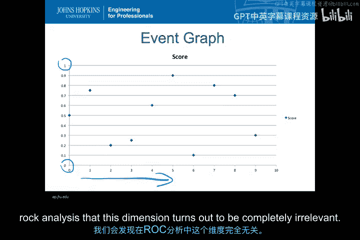

So the next thing that we need to do is we need to mark every one of those points from the event graph with its ground truth。

 So in this case， the blue dots or P's， These are going to be our anomalies in the system。

 This is these are marked to say that in the input data that I had coming into the classifier。

 Each one of these particular events was marked as anomalous。

 So that means that in a perfect classifier， each one of these blue dots would be all the way up here on。

The score of one。 So a perfect classifier would have put all of those up here。

 and all of the green dots， which were marked as normal， would all go down here on the zero axis。

 So a perfect classifier would have separated out all of those blue and green dots。

So as you can see by this， this is not a perfect classifier at all。

 I have some sort of interesting elements。 Like I've got this sort of green dot way up here。

 scored high， but the ground truth said that's really a normal event。

 And I've got things like this blue dot scored really down here low。

 But I know from my ground truth that that's actually an event。 So ideally。

 that green dot should have been on0。 and this blue dot should have all the been up here by one。

 But in fact， this classifier for whatever reason， place these events at the different areas that we have on the on this event graph。

So you can see even before we've done any kind of receiver operator characteristic analysis。

 just by visualizing and looking at the ground truth marked onto an event data。

 I can start to see at least visually in a qualitative way how good my classifier really is for so for some things I'm going to say the classifier is pretty good。

 but for other things I'm going to say the classifier is not so good。

AndBut now I want to try to put a more quantitative value to that。

View that I'm looking at right now that says， well， okay。

 so how good a classifier is this and how would I compare it with other classifiers？

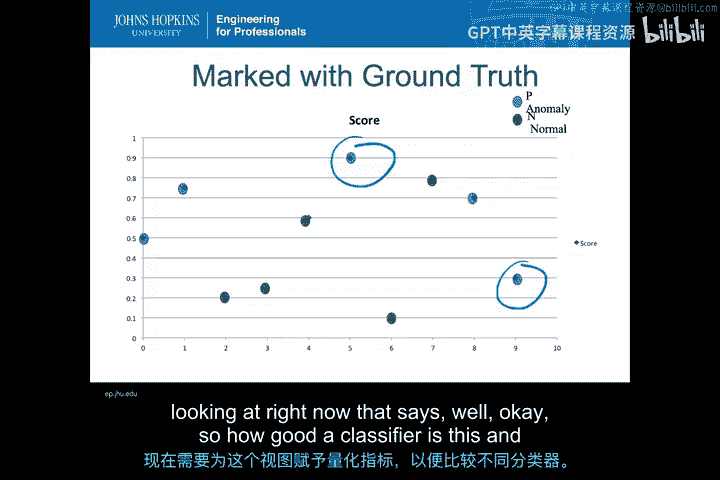

So in order to do that quantitative analysis， we can now create the confusion matrix。

 So these are where the anomalies that we are detecting。 These are the true。

 the true anomalies that are there and by the classifier。

 So anomalies are going to be P and normal is going to be false or N。 So because of this。

 there are four possible outcomes for any anomaly detection algorithm or classifier configured in a single way。

 we have the true class， which of course， is what we see within the ground truth。

 we have the detected class， which is what the IS system gave us。

 So from here we have the numbers of things that were indicated as an anomaly that really were anomaly。

 things that were normal that really were normal。 So this diagonal along the confusion matrix represents the correctly analyzed incidents or events。

That leaves us the two other areas， the things that over here were actually hypothesized as as a true positive as an anomaly。

 but in fact， was not。 So that's a false positive， where our anomaly detection system said it was an event。

 but in truth， it was not The other thing is something that our anomaly detection system missed that we know as an anomaly。

 but our system missed it。 So this diagonally line right here represents within our classifier。

 the errors， the type 1 and the type 2 errors that we can have within our classifier。

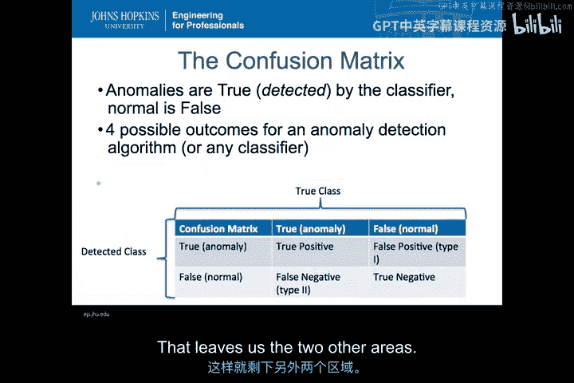

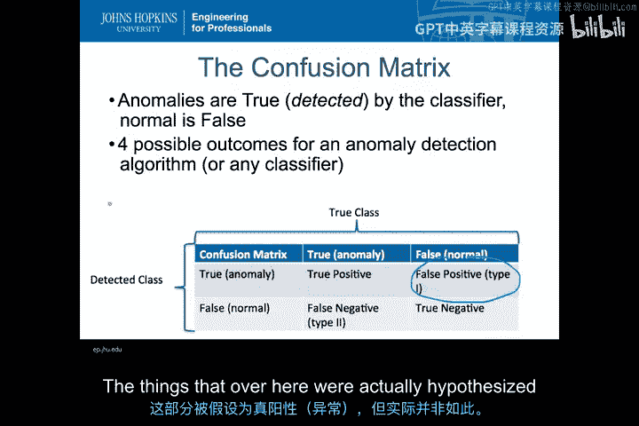

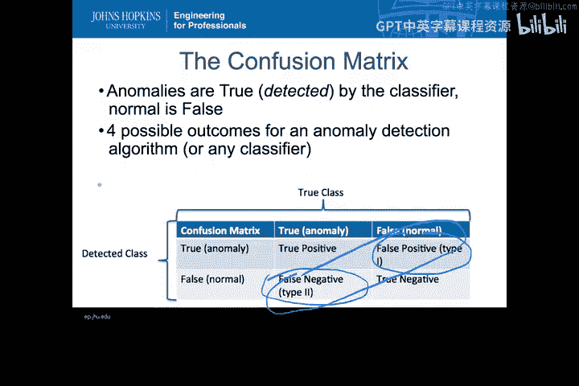

So let's go back to our data again and look at what sort of the event data might look like for the graph that we just put up。

 So here's our event numbers。 I've got basically 10 events sort of along the one side of my event numbers。

 each event has a score and for each event I have a true classification。

 So the score and the true classification represent what my detector thinks it is。

 the hypothesized class and the true class。 But you see here all I have is a score。

What I don't have here is I don't have a hypothesized class。

 So how do I get to a hypothesized class from the score so I can match it to my true classification。

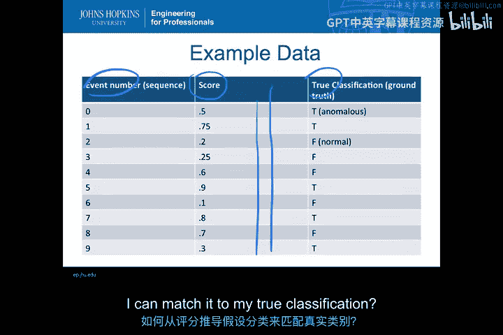

So here we are back at our event graph again and we can see from the event graph again we have the event sort of scatter。

 this is exactly the same data that we were just looking at a moment ago。

And here's the same data now marked with ground truth as we've seen before。

 But now we want to be able to turn this into a hypothesisthesized class。

 So remember when I looked before and we were just eyeballing this data。 And I said， oh， look。

 it looks like this set of events up here sort of looks like it might be anomalous。

 And this event down here kind of looks like it's normal。

 And then I' kind of get this event here in the middle that I could sort of choose to put in either place。

 Well， that begins to say， well， wait a minute， maybe there is a partition value。

 some way that I can draw a line on the score as a threshold value to begin to say。

 what is the hypothesized class for each one of these events。

So that's essentially what I have right here。 Now I've drawn like my， you know， in this case。

 I've drawn my threshold at about 0。42 in terms of doing that， which means everything below 0。

42 is hypothesized to be normal。 and everything above 0。42 is hypothesized to be anomalous。 Now。

 you see I'm going to have errorss on both sides。 certainly down below 0。4， I've got this one。

 which we know is a true event， but in fact was by this threshold hypothesized at normal。

 and I've got a couple of these green events up here。 which are hypothesized to be events。

 but in fact， we know are marked as normal。But now， by drawing that threshold。

 I can do all four of those counts that I need to for my confusion matrix。

 I know how many true positives I have。 I've got 1，2，3，4 true positives。

 How many true negatives do I have。 Those are the green ones that are actually done correctly。

 I have 1，2，3， that are actually done correctly in that in that sense。 So now。

 when I want to talk about my errors， Where are my type 1 errors。

 Those are the errors that are marked as green， but are falling above my threshold value。

 In this case， it's these two elements。 And then I have my type 2 error。

 Which one was actually missed， And that's this one down here， So now。

 just by drawing the threshold and creating the hypothesized classes。

 I can now create all four elements of my confusion matrix。

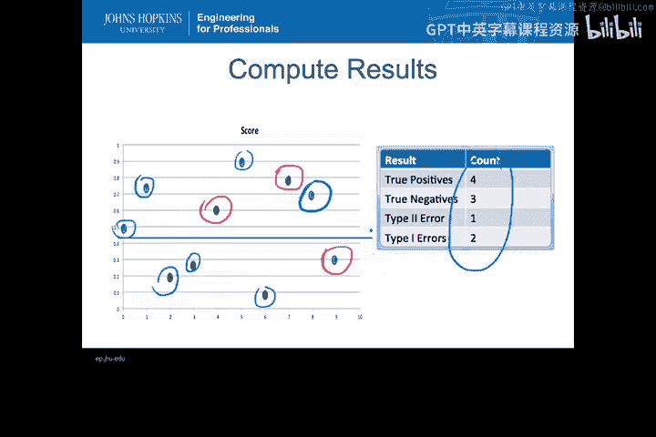

So that confusion matrix that we just created was done for a single threshold point。

 Every time I select a new threshold， I could potentially get a new confusion matrix。 Now。

 I won't always get a new confusion matrix， because if I move threshold only a very small incremental amount。

 and I don't cross any of the events that I actually have within my data that I won't change my confusion matrix。

 But every time I cross an event。 I cross a score that's there。

 I'm going to create a new confusion matrix。 So you can see that the maximum number of unique confusion matrices that I can have is determined by the total number of unique points In other words。

 unique scores that I have plus one。😊，When I have that I've got the total number of points that are possible with all the different thresholds that I can draw now the more data that I have and the more points that I have。

 theoretically at least the more different confusion matrices I can draw so by drawing more and more confusion matrices。

 I add resolution to my analysis， but I don't actually change the idea of the classifier。

 I've just moved the threshold around the data。

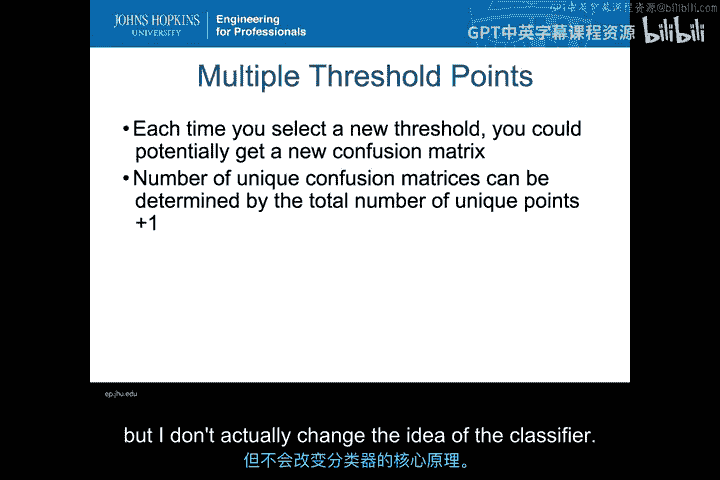

So to show how that works， here again is our sample data。

 the same ones that we used before with the true classification and the ground now we take that and we sort it。

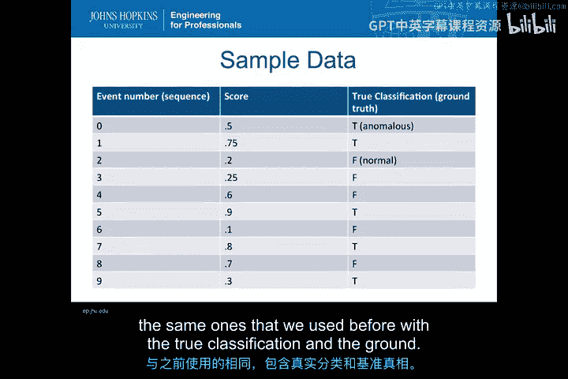

So this is remember when I said that the event number really doesn't matter。 So in this case。

 I'm not going to worry about the sort of the event number。 I'm going to sort by score。

 This is going to allow me to easily know how many thresholds。

 I can draw and where should I draw the threshold。 So I know the first one has to be drawn before。5。

 The next one between 0。5 and 。1。 The next one and so on and so forth all the way up until I get to my maximum score。

 Actually， this is， as you can tell， is an error。 This one should be sorted sort of down here within there。

 So the first one is before 。1 and so on all the way up to 09。The true classification， of course。

 is always associated directly with the score that I have here。

 So I have to make sure that I continue to match the true classification with the score that I have so I can do my counts effectively。

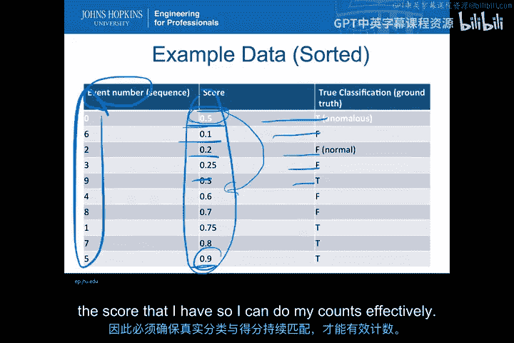

So within the data graph， it starts to look like this。 I start with very low threshold points。

 and I just start moving up the threshold points， getting as many of them as I possibly can。

 So in this case， I just created thresholds at a even number of values。

 you can see that by doing this， I will not have created the maximum number of confusion matrices that I could possibly create。

 But it's one way where I can just sort of step through in order to understand exactly how I can compute my false positive rate and my true positive rate。

 which， again， is simply created by the counts on my confusion matrix。 Now。

 you might ask in this particular case， Well， what happens if I。

Have I draw a threshold and it falls exactly upon a score。

 What if I had drawn one and it fell exactly sort of on any one of these particular areas here。

 what do I do， Well， it really doesn't matter as long as you're consistent when you fall directly on a score。

 you can count that as above or below the threshold。

And the only thing that matters is if you do it consistently every time your threshold hits a particular value。

 If you do that， you will always still produce a valid confusion matrix and a valid point within the rock space。

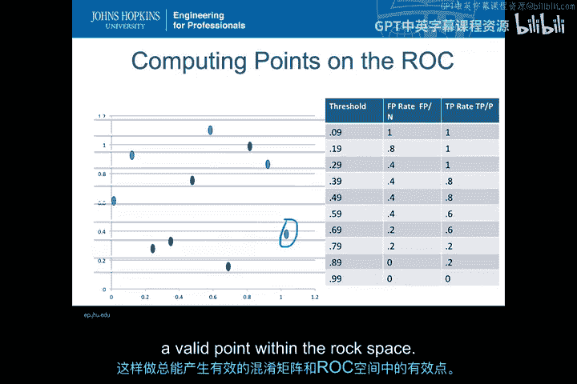

So from all these different thresholds that we draw。

 I can finally draw my very first receiver operator characteristic curve。 And in this case。

 it's this sort of weird step function that I have that goes through the data and shows between sort of the 0 to1 scale。

 how that particular classifier operates in the tradeoff between a true positive rate and a false positive rate。

 Now if you notice， I've still got my diagonal that I can draw。

 So I've got one point at least that's sitting directly here on the diagonal。

 That's this point right here at the threshold 。79。

 which at that threshold shows that I'm basically a random classifier。

 same thing on this 1 point up here。 this 0。9 point。

 So these reflect points within my classifier that the classifier's threshold is basically not doing any effective class。

 And that sort of easy to see if my threshold is too low。 my threshold is too high。

 I'm basically putting all of the points above or below that threshold。

And I'm not classifying them at all。 But for any time that I have points above and below。

 I'm going to start to create tradeoffs within my rock that I can start to say， well。

 where are my best points， I've got a pretty good point here and a pretty good point here。

 So depending on how I want to maximize my true positive or my false positive rate。

 I might choose to draw my threshold at one of those elements in order to maximize what it is I can do。

 So in that's one point down here at 。29， the other one is sort of down here at the 0。6。

4 in order to get sort of the maximum value with the minimum false positive rate that I can possibly do there。

 So we can start to see where some good threshold points might be in a particular classifier that we have。

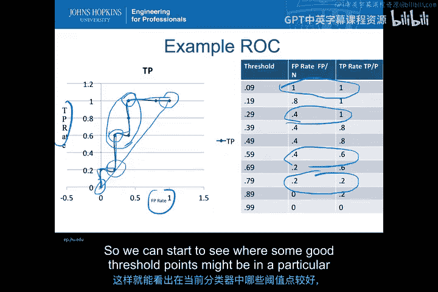

Now， in this case， we created a curve because we could have a threshold that we could create for multiple classifiers or sorry。

 multiple points within our rocks base on a single classifier。

 If you can't modify the threshold or if you're in something like a signature based Is where there is no concept of a threshold。

 you can still get single points by creating one particular confusion matrix based on whatever it is that you have for your intrusion detection system。

 So different fixed classifiers can be compared directly on the graph as well。

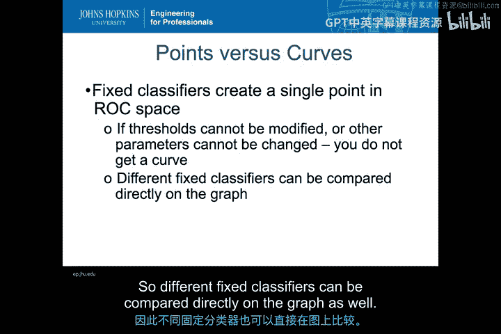

So for our example that we had， remember when I drew that line at approximately 0。42， well。

 in that particular case， I have a single false positive and true positive rate。

 which gives me one single point in my rock space。 This is a perfectly valid point within there to start to do comparisons between different sorts of Iss so that even within one particular data set。

 I can still do the analysis of a point within that data。

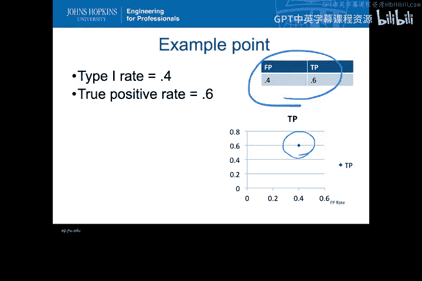