# 约翰霍普金斯大学《入侵检测｜Intrusion Detection》中英字幕 - P41：9_基于IDS配置的多重混淆矩阵.zh_en - GPT中英字幕课程资源 - BV1sGu1z5E2J

Okay， so now let's pick up where we left off in the last module and talk a little bit more about the comparison of confusion matrices based on multiple IDS configurations or multiple different IDSs。

 giving us different curves within the receiver operator characteristic space。

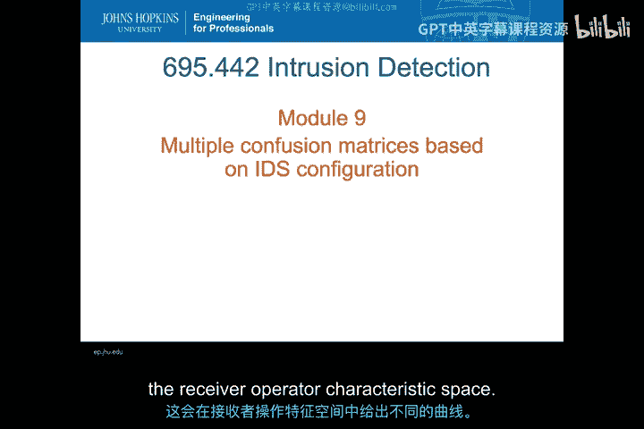

So now that we've talked a lot about the rock graphs in particular。

 we've talked about this sort of tradeoff between true positives and false positives。

 So within the Is world， think of this as really giving us a cost benefit tradeoff where the benefits to an Is are actually finding our true positives or' actually finding our events the costs are basically our false positives。

 So why should that actually be， Why should it be a cost benefit analysis in that way？ Well。

 if you think about what a benefit is， that's sort of an easy one right？

 So if you're going to have an Is at all， you want that Is to essentially make sure it can give you positive events that you can actually do。

 But what doesn't mean for a false positive to be a cost So a false positive when you get a false positive you're going to have to expend resources in order to determine whether or not that event was a real incident or not So if you have too many false positives。

 you could actually spend all of your resources or many of your resources。

I just tracking down the different kind of events that aren't really attacks at all。

 So this is why false positives are very dangerous to a Ccer team。

 You never have ground truth within real data coming in from an IS system。

 you don't know just because the classifier said that something was an event it doesn't mean that it really is an event。

 So within the benefit side。 I want to make sure that everything I see is， in fact， a true positive。

 and， in fact， part of my benefit is making sure that I see all of or as many as possible of the events that are really true positive events。

 and my costs again are those things that are mischaracterized in a way that causes me to expend more work。

 That's why within these receiver operator characteristics。

 we often talk about them as a cost benefit analysis within the IS sphere。

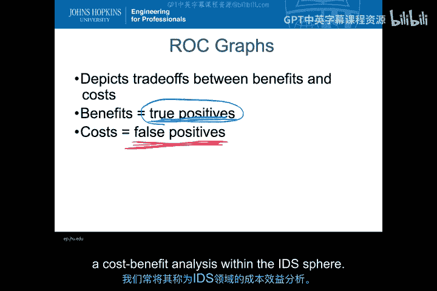

And so now， within that idea of the cost benefit analysis。

 we've talked a little bit about sort of points versus curves。

 So now we can sort of think about this as a way of evaluating points versus curves in a cost benefit kind of analysis。

 So if I have a fixed classifier creating a single point within my rock space。

 and my thresholds can't be modified or I only have a fixed classifier。

 So I don't have any way to move the point。 I might try different test data。

 and that might give me a different confusion matrix。

 but within the same test data that I'm using to compare one or more Iss。

 I'm only going to get a single point， which means I only have one trade off between my cost and benefits。

 So I'm going to look at this as saying if I have a point that has a lot of true positives and a fair number of false positives。

 I can say that's going to be my cost， theres going to be my benefit。

 And how am I now going to compare that to a different cost benefit trade off within a different classifier。

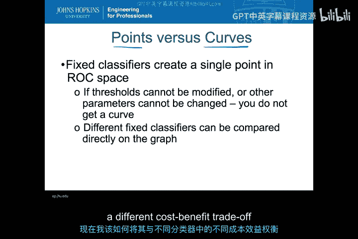

So if we go back to our example point again。 So now we've got these numbers and you know we just call them0。

 right， you know， this 0。4 versus 0。6。 What does this mean in terms of sort of a cost benefit。

 So in this case， if I look at our true positive rate of point6。

 that means about 60% of everything that I expect to see coming know that would actually come through here。

 my true positives I'm going to see about 60% of all of the events。

 So I'm going to miss about 40% that's going to be on the order of 40% of real incidence that I'm not going to see。

 So point6 is okay but it's not a really high value。

 I'm not going to expect to get a whole lot of points know within here。

 I'm going to expect to have quite a few type 2 errors where I'm going to be missing some real events。

 The same kind of thing now， let's look at our false positive rate。

40% of everything that I see is going to look like a true positive。 but in fact is。Not going to be。

 It's going to be a false positive。 So I'm going to be expecting to spend 40% of my time running down incidents that。

 in fact， turn out not to be real incidents。 So here's my trade off。

If I'm looking at something that has a 40% or a 60% in my rates here。

 and I compare that to a different classifier that maybe has a higher type 1， but also a higher。

 true positive rate。 So as this 0。6 gets up to say 0。8 or 0。9 or something or even 0。

95 now I'm going to say okay now I'm getting more and more of my real events as I get to 0。95。

 But if in order to get to my 0。5 true positive rate， I end up with at about a 0。8。

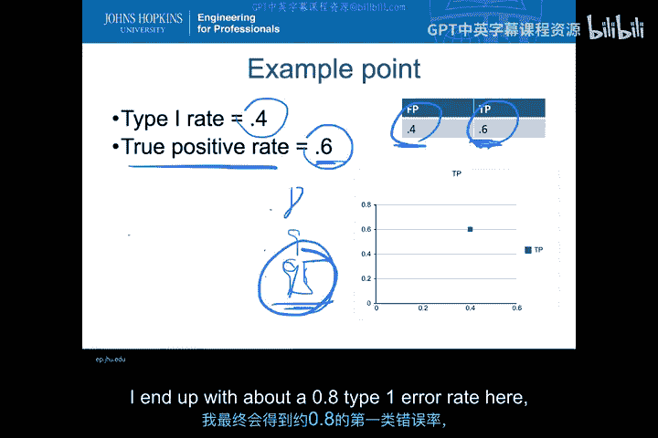

Type1 error rate here， that means 80% of what I see。

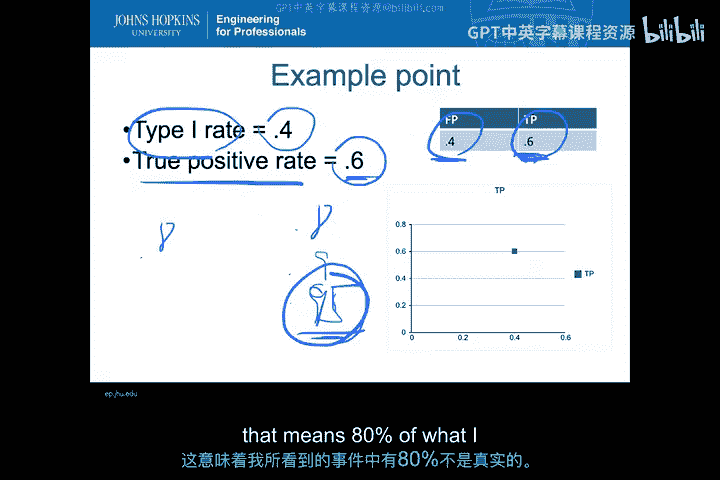

Is not going to be a true event。 So if 80% of what I see is going to be a false positive。

 And I get 95% of the real events are actually identified， But I have many。

 many more normal events than I do a tax。 That means this 80% could， in fact。

 create a much higher number of things for you to track down Then I actually get out of my 0。95。

 So when you think of your cost benefit analysis， that's the way to start to compare these various points between the type 1 rates and the true positive rates。

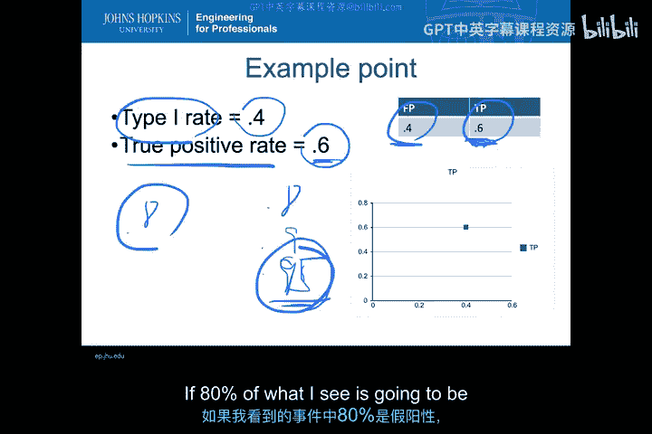

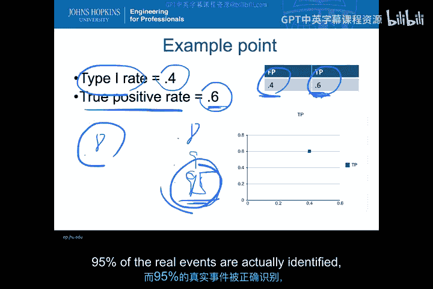

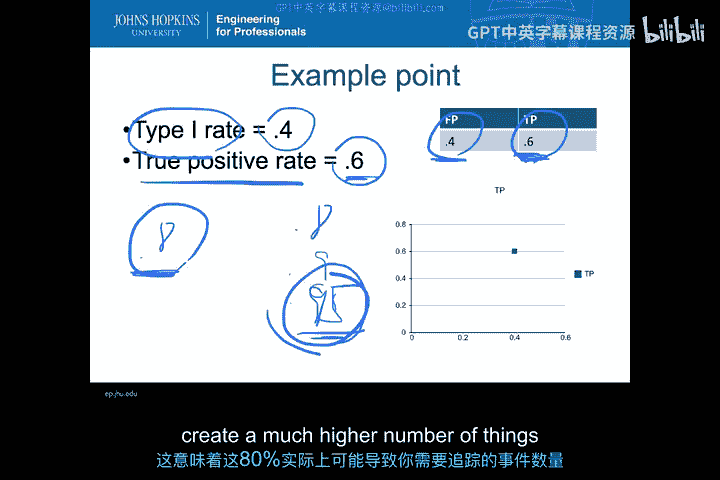

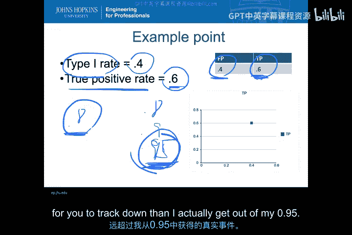

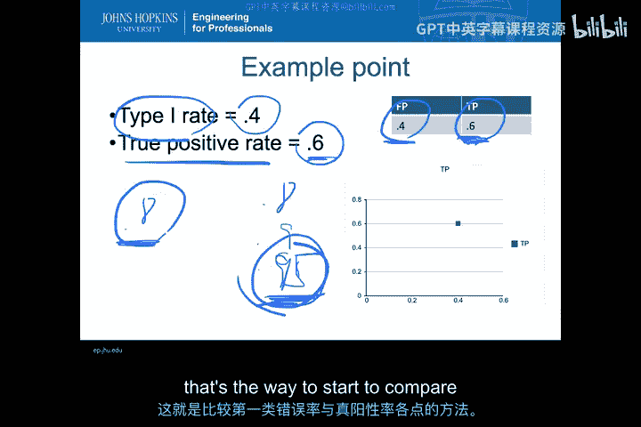

So now I can look at these raw comparison points that I had before and look at them in a slightly different way。

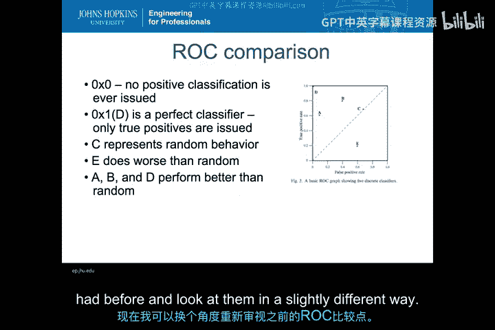

I can begin to see in these points that I'm never going to get a perfect classifier D。

 And if I ever get something that looks like C， I'm going to reject it out of hand because that doesn't really give me anything at all of much value in terms of what I'm really trying to do。

 So the real thing to look at here is comparing points A and point B。

 So what does that look like from a cost tradeoff or a cost benefit analysis。 if I look at point A。

 point A has a very low false positive rate。 which means that although I'm only going to get 60% of the real events identified。

 I won't spend very much of my time tracking down false positives。

 B only gives me a slight incremental ability over a to find different kinds of events。

 But the cost I have here is that 40% or more of all of the events identified or going to be false positives。

 that's getting really close to as many as half or a little less than half of these。

Things coming in are going to be stuff I track I have to track down and determine if they're true。

 So from a cost benefit standpoint， it's usually better to sort of minimize your false positive rate in real systems at unless you can really get a tremendous benefit here。

 Now， if this value of B instead was all the way up to the top。You're sort of way up here。

 so it actually is pretty clearly identifying everything。

 even at a relatively high false positive rate， there are some situations where that may be strongly preferred。

If I want to make sure that I catch all of my zero days， all of my original attacks。

 and I don't miss very many of those at all。 I may look for something that has more of that characteristic。

 even if it does generate false positives， if it's that important to me。

 But for most enterprise situations， I'm going to prefer more in this point A time frame。

 So sort of this more low， false positive rate， understanding this going to be a number of things that the Is is not going to detect using that particular kind of trade off。

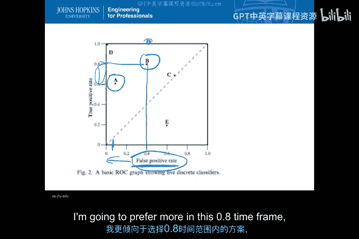

So if you have a variable parameter and you can adjust it。

 then that gives you a lot more flexibility in comparing different sort of receiver operative characteristics。

 if I can adjust the threshold or the rock， now I can look at any one of these points and determine do I want to be sort of here or do I want to be up here maximizing my true positive rate。

 so now I see that this particular curve can do a number of balancing points in between and I can do my cost tradeoff analysis within different points on the same classifier in the same way that I might compare two classifiers to completely different IDss that have do different single points within the rock space。

So if I look at sort of the way real rock curves end up looking。

 obviously I've sort of have this is my as my rock space。 you know， this is my zero to one line。

 this is the area in which I'm going to do all of my rock most rock curves within this space are going to look like some kind of a step function。

 some kind of a curve that's going to be in the direction that's slightly better than my zero to one diagonal。

 So the points that I'm going to have here。 Each one of those points is going to be better than a point off the diagonal。

 the farther I am off the diagonal， the better in some respects I am between a random classifier and the rock you know and the characteristic of that point within the rock space。

 So if I wanted to try to boil this down to a single tradeoff without doing a real cost benefit analysis。

 what I'd want to do is sort of maximize the distance between the point and the diagonal within here。

 the other way I can look at it is to try to get to the。of a perfect classifier。

 And would be really easy to see that minimizing this distance is equivalent to maximizing the distance away from the diagonal here within these within any one of these points。

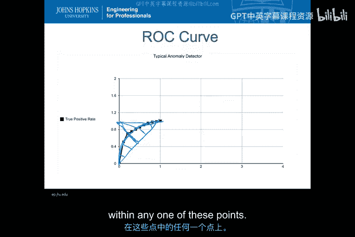

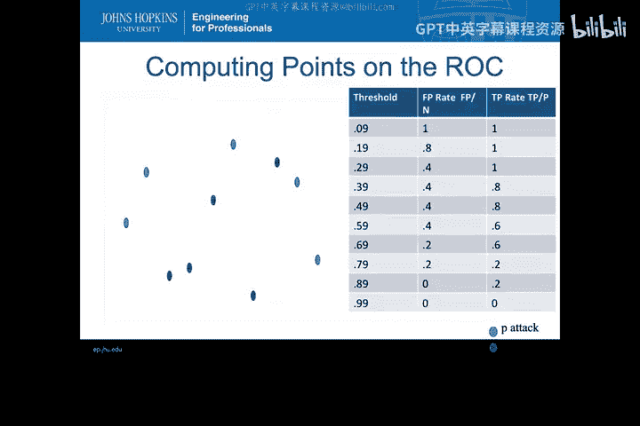

So if I look back at our sort of example data that we've already calculated a couple of different ways。

 I can see this looks in the same way as the other curves as well。

 I can see it has the same characteristic that I can use maximum distance to the diagonal minimum distance up here to the perfect classifying point and still identified the points here that I would have thought were my two best tradeoff points within my classifier that we've sort of identified before。

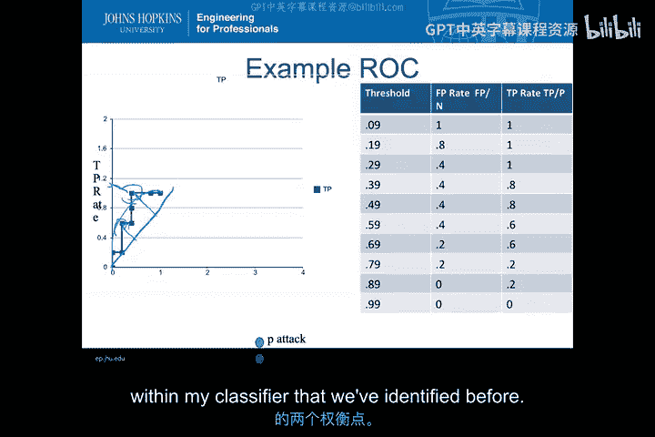

So now what happens if I take two different IDSs or three different IDSs。

 so I've got three detectors in this particular graph and they' are all going to have different kinds of rock curves。

 but now I don't want to just compare one point to another I want to look and say which of these IDS systems is the best classifier for my environment。

So there's a couple of things you can see pretty easily with regard to just even comparing these curves。

 you can see that detector1 is does better along sort of the high false positive rate。

 high true positive rate area and detector 2 seems to do a little better job between minimizing the false positive rate while keeping the true positive rate high so if I want to begin to look at these and say。

 well there are regions so that if I care about this region， I'm going to sort of favor detector1。

 if I care about this region， I'm going to care more about detector 2。But what about detector 3。

 So detector 3 is this single point classifier that sort of sits right down here between detector 1 and detector 2 for some element。

 So is there ever going to be a reason that I really want to select detector 3 within this picture area。

 And the answer is no， there probably isn't because detector 3 doesn't operate in this high region。

 It operates only in this low region。 So first of all， if I care about the low region。

 then I've got the three detectors to trade off 12 and 3。

 And it's clear that within this lower region， this detector。

 this sort of detector number2 is always going to do a better job at determining and maximizing my value。

 then either the single point detector3 or detector 1。

 which does a worse job even than detector 3 in the same area。

The other thing you can begin to say is that well what would happen if I can choose two or more classifiers。

 can I combine classifiers to actually do a better job， Well in fact you can。

 there's the sort of idea of having a convexhu that says if I have a number of rock curves。

I can draw a bounding curve around all my classifiers and say that the combined classification of all of these different classifiers can do no better than the convex hall around the classifiers themselves。

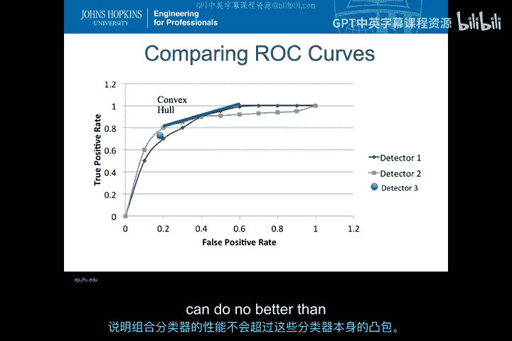

So here's a couple of charts talking about what the space looks like in a convex hall。

 If I have a lot of different classifiers。 So if I look down here at this sort of first area。

 I've got you know D， which I certainly don't ever want to use for any reason。

 but then I sort of have A B and C all of which kind of do a little bit better。

 but if I draw if I take a and take this sort of best point in A and the best point in C and draw a line I can combine classifiers A and C to do as good a job as B alone would do in this sort of center region So if by doing this I can choose classifiers B and C in this particular area and by choosing those classifiers I can get as good a classifiers B in this sort of center region and still have all the characteristics the threshold characteristics of A and C So if I were to select classifiers from this jumble of different rock curves than what I'm going to do is what。

I have over here in this other chart is I'm going to select just A and C and use the convex hall combining A and C to give a characteristic space that looks like this。

 So this space in here。Is the space that I get by combining A and C in terms of my classifier？Now。

 in reality， trying to combine classifiers from an intrusion detection standpoint can be very difficult because the technology for implementing these classifiers very frequently gets into the way。

 So it's not that I can always take two completely different IDss and just combine them by taking the two tools and running them in parallel。

 This maximal convexhu assumes that I can take the algorithms for the classifiers and combine the algorithms to create a better classifier that often is not possible in the intrusion detection world space。

 but where you can do it， especially in various things like Bro that would have modules that you can load in that would give you the best of the classifiers of different kinds of systems。

 you can achieve results that look a lot like these convexhu results。

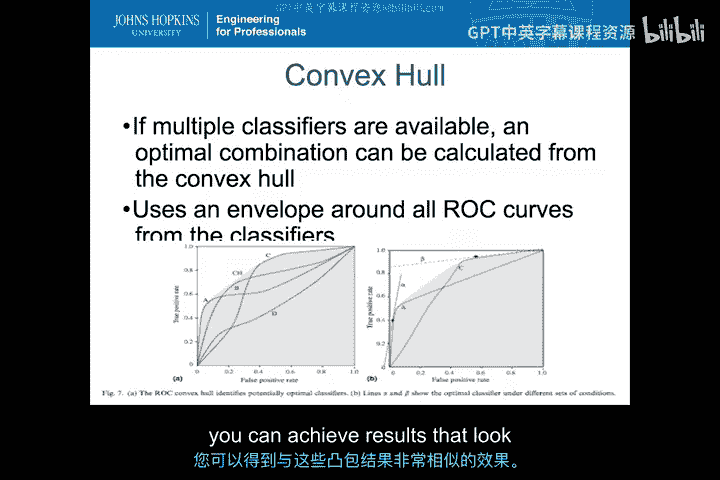

Another very quick mechanism you can use for comparing different kinds of values of multiple rock curves are just simply to calculate the area under the curve for each rock。

 this gives you very sort of a quick comparison about whether two different rock curves。

 one of them covers more space within the rock space than another。

 the more space that you cover within the rock， the better the classifier can be along the entire modification that I can make with regard to the configuration。

 the different configurations that I can use。 so in this particular case you notice that my A and my B。

 my B actually clearly covers more area in the space than a。

 So even though a operates a little bit better sort of up here in this space。

 the classifier in general， if I just use area under a curve。

 just integrate the rock curves between A and B， I would get a single measure that would say in this case that B is superior to A。

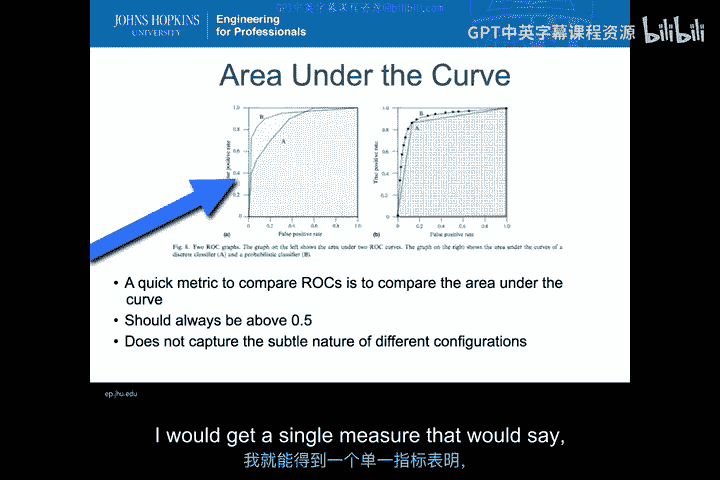

はい。So let's go back and talk about some of the more of the benefits with regard to these receiver rapid characteristics。

 now that we're beginning to do a cost benefits trade off。

 and we're starting to look at how we would do the comparisons between different kinds of Iss using rock analysis。

 Well， there's a couple of things because we're using rates。

 The rock analysis in general is insensitive to changes in the class distribution。 So in general。

 I can have the same sort of because I'm comparing rates。

 If I have a very few number of anomalies and a lot of normal traffic。

 I can still generate a rock trade off curve， which。

Doesn't basically says I can use test data that isn't completely balanced and still get the same sort of detection rates so I can do comparisons between true positives and false positives。

Even static classifiers like， again， signature based IDSs can generate rock curves。

It doesn't have to even produce a score。 if it does produce a score， I can actually generate a curve。

 If it doesn't produce a score， I can still create a point within rockspace。

 and that's a really important thing to keep in mind is that for a signature based system。

 I can create a single point。 Now， you can actually create more than one point for a signature based system。

 Remember， if what I'm doing is changing the configuration of a threshold in an anomaly detection system。

 essentially changing the specificity of what I'm going to do with regard to the identification of anomalies within a signature based system。

 that can be equivalent to changing my signature rule set。

 So if I want to look at and compare different rule sets for the same classifier。

 sayy I have a couple of different common rule sets for snort or a couple of different common rule sets for serocottta。

 I might replace those rule sets and use those as different configurations。

Of those particular classifiers， and then I can run the same data across those two different data sets and create two different points in rockspacease for the same classifier。

Now， you do presume within rock analysis that I've got some kind of an independence within the data。

 so essentially this assumes that you don't have things like attack chains and that's really because it was designed for natural classifiers that。

Had the idea of statistical independence within the source dataset that was there whenever you have dependence in the dataset。

 you begin to say that the rates are no longer really as meaningful because the rates of individual items that are identified as attacks versus non-attack could be classified differently。

 if in fact there was a sequence of events that gets you up to finally determining whether something is or is not an attack。

 so that's like saying that when I talked before we could reorder the events and it didn't matter within rock analysis if the ordering of the events does matter then you can't perform the rock analysis quite as meaning and have quite as much meaning in the rock analysis as you could without those kinds of sequences Now there are ways to get around that as well and we'll talk a little bit about that but this is one of the areas that was attacked in in the McC paper that you have on your reading list for this module。

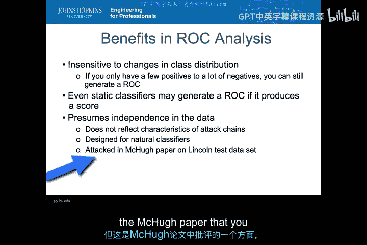

So speaking of the McC paper， there was a huge number of problems that were identified within using rock analysis for intrusion detection systems。

 First and foremost， understanding what it even means to have signal to noise ratio。

 What does it mean to detect an anomaly versus detect normal。

 That seems to be fundamentally different than trying to understand how you get a signal out of the noise。

 there really is a lack of tunable detection functions for most detectors。

 So you really only have a single point for most detectors unless you have different configuration set you can swap in。

The error per unit time versus per run versus per session。

There is this problem with a base rate fallacy。 Do we really want to mark the true positives with ground truth based on time like you would sort of in a signal processing arrangement or do you want to do it per packet or do you want to do it per session or do you want to do it in a collection of sessions。

 So there's a number of ways you can think about this， a single packet might be an attack。

 a single session might represent attack， but have many packets。

 And for things like distributed denial of service， it's helpful to think of that as a single attack。

 But there are many， many thousands of sessions that would contribute to the identification of that attack。

 So you can say that how would I generate now， my comparison between normal versus attack when many。

 many sessions contribute to an attack But I can't say that there are many。

 many sessions that give me a single normal value。 So this is where I get into the base rate fallacy and the idea of。

How do I begin to do a comparison within this class。

 we'll do our comparisons at the packet level because at least you can mark whether or not you have something that is at the packet level。

 an attack versus normal and I can count the number of packets that were related to the attack。

 whether it was multiple packets in a session or multiple sessions and I can count normal traffic better if I count it by packet as well。

 So we will use packets as our base rate， but understand that even though that is more beneficial than say using sessions or something else。

 there are still significant problems even using the packet as the base rate that we're trying to do with regard to the comparisons of these rates。

 a lot of it having to do with what is the attack makeup within the test data。

 is there are a lot of high numberered packets within the attack detection so that I get a uncharacteristically high true positive rate or。

It's something more in the line of we have a lot of small number of attacks that represent something very close to what we would see on our normal traffic。

So in all of this makes rock analysis a little bit difficult。

 So why do we still cover it Because rock analysis is still the best quantitative analysis that we know in order to really determine and compare quantitatively the characteristics of the classifier within true or more intrusion detection systems Now a little bit better than using true positive and false positive rates。

 it's more common now to use precision and recall but remember precision and recall still have their foundations in the confusion matrix which still have these same problems like in base rate fallacies。

 so just going to a PR graph instead of a rock graph doesn't really solve all of the problems that are discussed within the McC paper that you'll be reading for problems within this rock analysis。

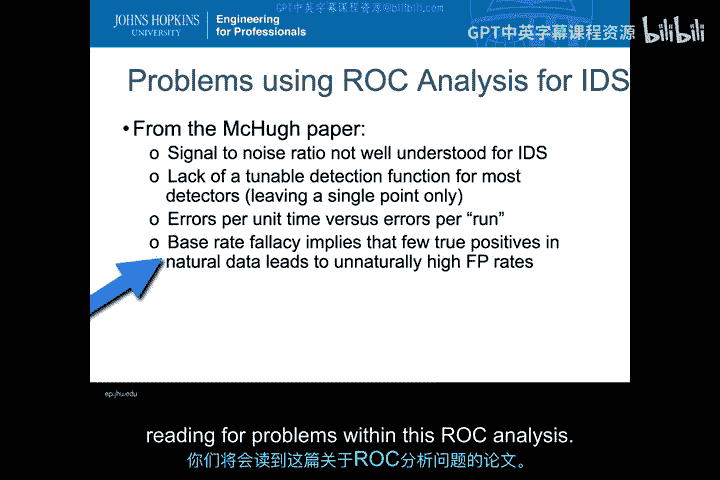