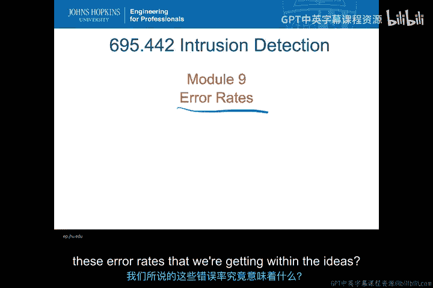
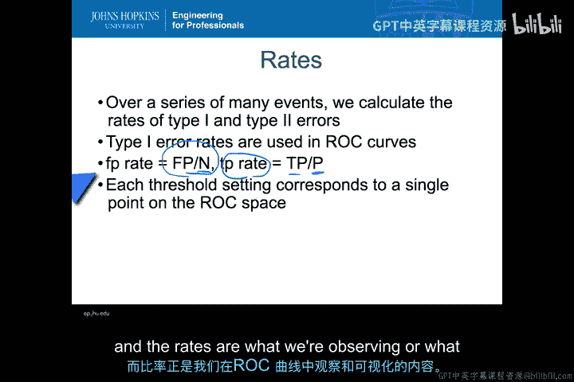
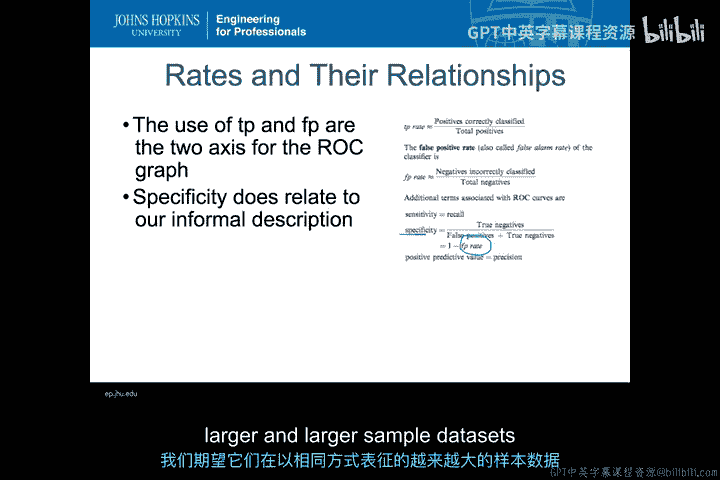
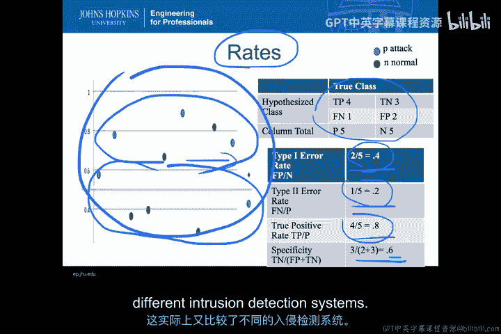

# 约翰霍普金斯大学《入侵检测｜Intrusion Detection》中英字幕 - P42：10_误报率与漏报率.zh_en - GPT中英字幕课程资源 - BV1sGu1z5E2J

So now let's take a slight diversion to talk a little bit about error rates within our classifiers。

 since this is really the basis of all of our rock analysis， all of our quantitative analysis。

 it makes some sense to go back and think a little bit more about what do we really mean by these error rates that we're getting within the IDS？

So the rates when we talk about getting a rate， we means that over a large series of many events。

 we can calculate what the type 1 and type2 errors are in relation to the total。

 so the idea is that we believe when we're doing this kind of quantitative analysis that no matter how big the data is and how many events we have the rate of type 1 and type 2 errors that we get are going to be consistent across all the data that we collect within like data。

 so that the more data we have the larger the data set that we use。

 the more refined or the more resolution we can get within these type1 or type 2 errors。

 but all of this rock analysis is based on the fact that these error rates are related directly to the configuration of the specific classifier that we're using with the same characteristic kind of data that we're running So we use the same data in order to compare different IDss because we want the same distribution of。

The same distribution of normal。 But within all of our sample data。

 we're assuming that this distribution is representative of the environment that we will finally use in the resulting system。

 So the type 1 error rates， of course， are what we use in the rock curve and these false positive rates and the true positive rates。

 as I say， are completely in relation to N in this case， or P in the other。

 which is the true number of normal events or the true number of anomalous events or attack events in this case。

 for the true positive rate so。If these numbers go up， then these counts should go up as well。

 and the rates should remain relatively consistent。

 So each threshold corresponds to a single point within the rock space。

 What we mean by that is to say that the data is used to calculate these rates and the rates are what we're observing or what we're visualizing within the rock curves themselves。

So when we talked previously about things like specificity and sort of other things。

 the rates that we calculate within their respective data sets and the classifiers。

 have a lot of additional types of information that can be gleaned once we know what these rates are and once we get the numbers within the confusion matrix。

 so we've talked about true positive rates we've talked about false positive rates。

 but you also have things like specificity， so specificity。

 true negatives over the false positives plus the true negatives or one minus the false positive rate。

 So this has a meaning that says how specific we get with regard to the identification of incidents is related in the same informal description that we talked about with a signature-based system to the idea of what we can have when we have this quantitative set of values within the confusion matrix。

So when we talk about a lot of the other sorts of calculations that we can get。

 you'll see that they're almost all in this sort of idea of creating rates of some type。

 even sort of specificity， and these other elements that we talk about are in relation to some sort of a total or beginning or some type of rate so that we can begin to think of all of these values。

 whether it's specificity， whether it's accuracy， whether it's precision， whether it's recall。

 any one of these particular areas， because they're associated with rates。

 we would expect them to be consistent over larger and larger sample data sets that are characterized in the same way。

So within the simple example that we've been working with。

 we can see that the error rates that we're creating these sort of 0。4。2 the specificity of 0。

6 these are meaningful not just with respect to the event graph that we have created over here but if we had continued this event graph and just continued to create events for longer and longer periods of time。

 these numbers up here in the confusion matrix would all go up but we would expect these numbers here including the specificity number to remain consistent and get more and more accurate with regard to the characteristic of the classifier over the data。

 so that's why it is so important to use rates to calculate all the various thing within these rock curves rather than using the event graphs directly。

 imagine looking at an event graph of hundreds of millions of different events where we could sort of visual。

Characerize the different classes of these events。 You would never be able to do that if you had millions of events that you were trying to organize。

 So getting quantitative about the rates helps us to be able to classify those events more carefully in the in the comparison of the different sorts of intrusion detection systems that we have。

 That's why even though there are problems with the rock analysis。

 the concept of trying to do an analysis that can be consistent and refined as we get more and more test data and more and more real data。

 is very valuable in trying to do a quantitative comparison of all of these different classifiers。

 which in turn really does a comparison of the indifferent intrusion detection systems。

