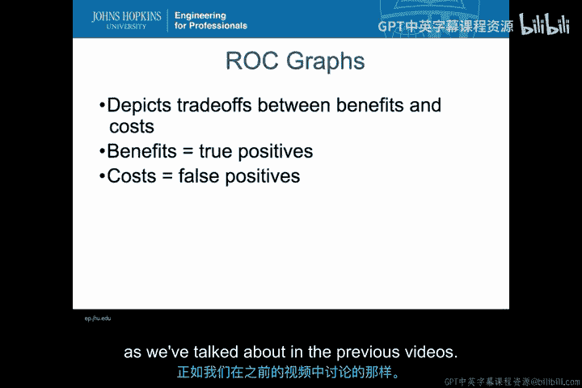
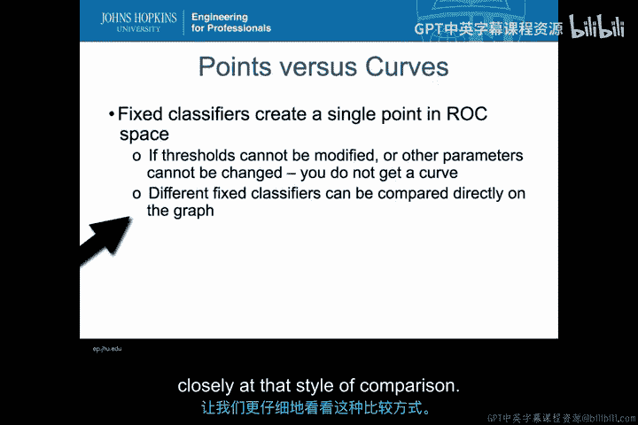
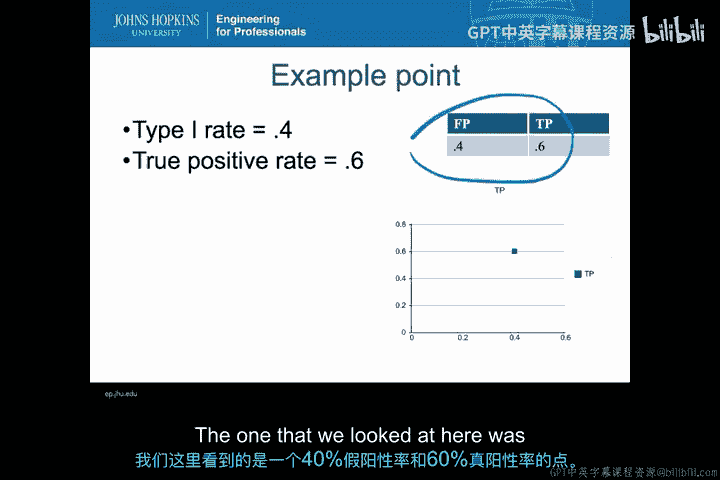
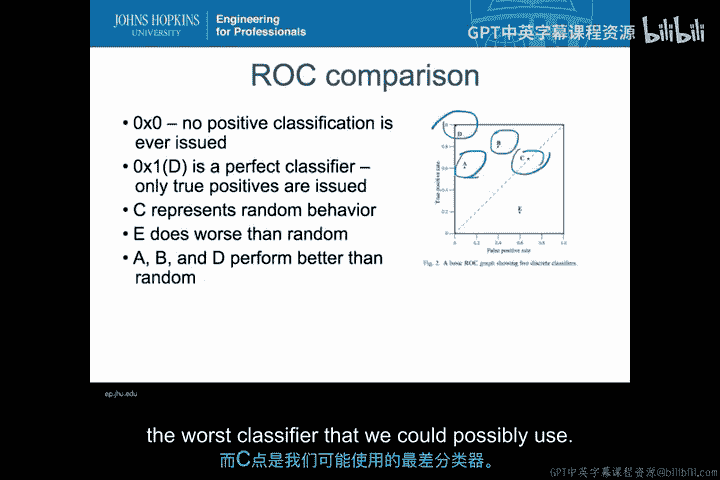
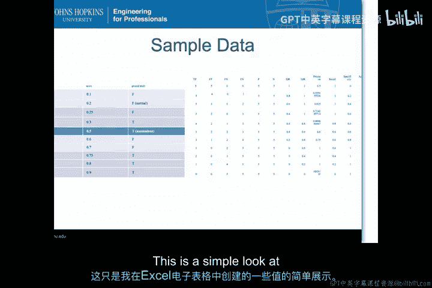
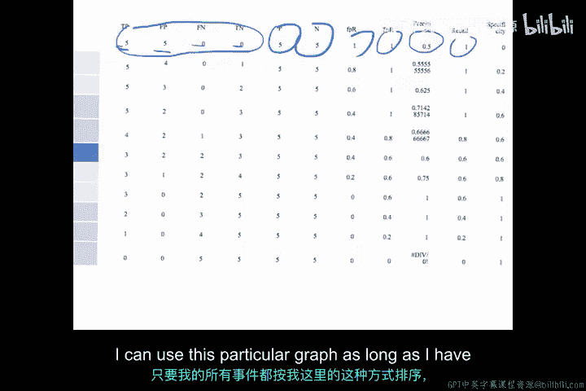
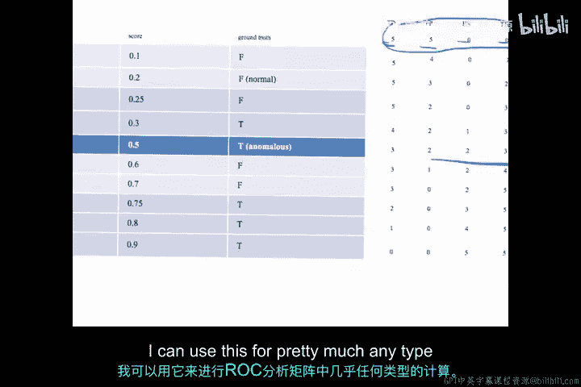
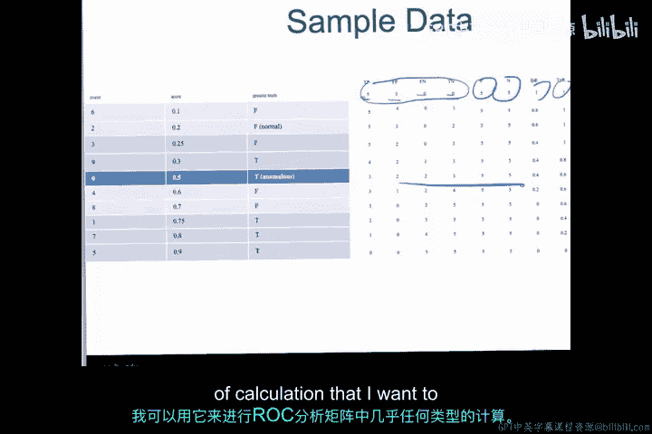
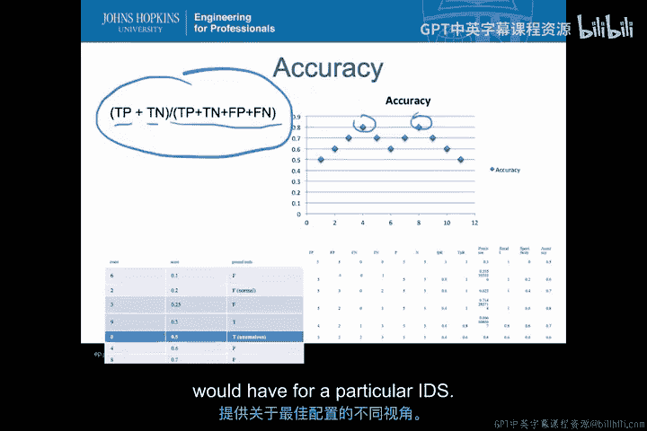

# 约翰霍普金斯大学《入侵检测｜Intrusion Detection》中英字幕 - P43：11_ROC曲线与P-R曲线.zh_en - GPT中英字幕课程资源 - BV1sGu1z5E2J

So now let's look a little bit about using those rates and the calculations to get a little more specific about the differences between receiver operator characteristics and precision recall graphs and how we would actually use those graphs to evaluate the IDS systems。

So remember that we're really using receiver operator characteristics as a way of doing a cost benefit analysis。

 as we've talked about in the previous videos。

So in this point， we've also looked at points versus curves and how fixed classifiers create a single point in rock space if you can't modify the threshold and the different fixed classifiers are compared directly on the graph。

 so let's look a little bit more closely at that style of comparison。

So just as a reminder， here's our example point that we've talked about before within sort of the cost benefit analysis and the one that we looked at here was a 40% false positive rate and a 60% true positive rate。

And we looked at the different ways where all of these different points where a was superior to B in terms of a cost benefit analysis D being an imaginary point that we could probably never reach and C being the worst classifier that we could possibly use so now let's look a little bit more quantitatively at the sample data that we've created so if you recall from before this is the ordered events that that we've had。

 so these are the events ordered by score correctly ordered this time you notice that I have the 0。

5 event actually put in the right place in this particular one we have all the ground truth associated with all the different scores so from just these elements I can now create in this sort of grid fashion。

 all of the different values that I would care about here。

So this is a simple look at some values that I've created within sort of an Excel spreadsheet so what I've done here is I've calculated for each threshold point。

 the true positive value， the false positive value。

 the false negative and the true negative so these four values represent my confusion matrix so in this case the P now coming in here represents the total of my know basically the things that were correctly characterized as my true positive and the things that were correctly characterized and my ends were essentially know the true negatives and the false positives added up so this gives me my total on the column levels from here I have my false positive rate。

 my true positive rate I can produce precision and recall and specificity as well so I've got all of these basically calculated now for each one of my threshold points and I can use this particular graph as long as I have all of my events ordered in this way。

I have here， I can use this for pretty much any type of calculation that I want to do within the matrix of my rock analysis。

So an easy graph that I can produce from here is my rock graph。

 So all I've done here is I've taken my column of true positive rates and my column of false positive rates。

 and I've simply produced the same graph now that you've seen before but now I've sort of computed it just given the points that I have automatically here within my graph so I can begin to look at well okay what are my best points And again I can look across all of the different points I have in my sample data and start to think where the best points are within the graph that I have with regard to the rock analysis。

So now I can do exactly the same thing with my calculation of precision and recall and you notice I have a different type of sort of plot distribution here。

 In this case， the perfect classifier is going to be right up here。

 sort of my maximum recall and my maximum precision that I look here Why I don't have a point up here where precision and recall are at the maximum So what points are going to be close。

 what are going to be my best points in terms of trading off precision and recall I can see I'm getting several points that are closer here and I can begin to look at these three individual points and start to say what are my tradeoffs from a precision recall standpoint looking as close as I can to this sort of upper right corner with a precision recall。

And we'll look more at exactly how to investigate each one of these given points in the precision recall sense。

 sort of as we get into the next video。The one other element that you probably should be at least familiar with is this idea of accuracy So accuracy is a way of using the confusion matrix to produce again。

 a single number that tries to reflect the tradeoff between true positives and true negatives so like you can see from the from the equation that I sort of have written for accuracy it's the true positives and the true negatives。

 these are the correctly classified events over all of the events。

 so the more correctly classified events I have the higher this particular is going to be with regard to accuracy Now within the sample data that we have we have two points that are equally high with regard to the accuracy level and if you look at kind of what those points are within here。

You can see that those points are actually going to be closely related to other points that looked like they were really good tradeoff points。

 either from the PRr curve or from the rock curve。 So looking at this kind of analysis I can compare accuracy with precision recall with rock。

 and from each one， I get a slightly different visualization of the comparisons within the different configurations of the Is that I have listed here。

 if I had had multiple ideasss， I could do exactly the same thing as I do with multiple rock curves。

 I could put multiple sets of these of this information up and again。

 do the analysis between accuracy and PR and the rock analysis。 So within the rates。

 once I've generated the rates， I can generate visualizations of all of these。

 whether they're accuracy， whether it's precision recall， whether it's specificity。

 any one of these can now produce a visualization for me to give me a different perspective on what the best configuration would be。

Depending on what the requirements that I would have for a particular IS。

