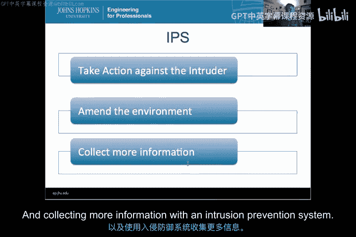

# 约翰霍普金斯大学《入侵检测｜Intrusion Detection》中英字幕 - P44：12_导论.zh_en - GPT中英字幕课程资源 - BV1sGu1z5E2J

So welcome to 695442 intrusion detection。 This is module 11。

 the module that we're going to begin to focus on the response portion of the IDS。

 remember we have the three main parts of an intrusion detection system we have the sensor portion we've got the analysis engine or the characterization engine or the classifier and we have the response portion and now we're going to really focus in on the different types of responses。

 the different policies that are involved in responses and sort of the different ways in which the response can be used by the end of this module we want to be able to differentiate between the variety of response mechanisms available to the IDS we want to associate response options specifically with security policy characterize the risk of using automated response that special kind of response that turn an IS into an IPS we want to demonstrate an ability to use rock and PR graphs。

Data and security onion， and we want to manipulate the alerts and investigate alerts using SquiL。

So the point of the module that we have here is that there are a variety of ways that an intrusion detection system can communicate with the response team。

 the alert type should support the users of the IDS and the response actions can range anywhere from sort of the passive to the active side。

So within the response requirements that we're sort of talking about in the first video that we have after this introduction。

 we're going to basically be mapping the user and user types to the purposes in order to understand how to set the requirements up for any particular IDS response engine。

 so we're going to go into this in more detail within this particular video。

 but we're going to be all about mapping and determining what the response requirements are。

In the next video after that we'll talk about the types of responses versus the passive and the active responses and focus primarily on what the passive response options are in the video after this。

 we're going to focus more directly on the IPS portion of that where we talk about taking direct action against the intruders amending the environment and collecting more information with an intrusion prevention system。

And finally we're going to talk about the risks and cautions for using intrusion prevention systems。

 they really are kind of a special case， but as a growing portion of the IDS landscape in commercial products and freeware products。

 it's important to know when and how we're going to use the active portions of the response mechanisms that we might take within an IPS。

So the whole point of this module is all about the response portion of the IDS from here you'll be able to take the functions of an IDS and incorporate them into an enterprise wide capability to effectively reduce risk through the use of incident response so best of luck on the module and let's go ahead and get started。

😡。