# 约翰霍普金斯大学《入侵检测｜Intrusion Detection》中英字幕 - P45：13_响应机制要求.zh_en - GPT中英字幕课程资源 - BV1sGu1z5E2J

Okay， so in this video， let's start to look at what some of the requirements might be for the response mechanism within our intrusion detection system。

We'll talk about alert types and we'll talk about the users of these different types of alerts from intrusion detection systems and a little bit about matching these to the purposes of why we would want to have alerts from an IDS in the first place。

So let's go back to the original definition of what is an IDS for this If you remember from back in module1 we talked about from Wikipedia。

 the whole idea about information security intrusion detection is the act of detecting actions with attention to compromise。

So if we talk about the act of detecting and sort of look right in here。

 we would say what does it mean to actually detect。

 we would have to have some notification of the detection or else it's really gone undetected。

 so the portion of the IDS that really gets into know how a user gets alerted and what information is contained within that alert really is part of this definition of what an IDS is。

So remember we talk about detecting as based on observable phenomena。

 so the ID essentially has to see it and partition the activity into alerts versus nonalerts。

 so this whole idea of an IDS as a classifier that's classifying the observable phenomenon into two or more categories。

 the detection itself then has to somehow present the category that represents the alerts to the appropriate user with the appropriate information in order for the user to actually take some kind of action based on what the alerts song。

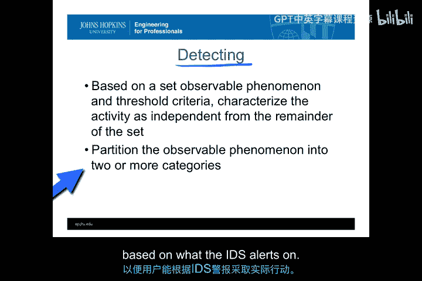

So within the Is， the sort of realm of IS systems that are out there。

 there are three general types of alerts that you get from IDS systems。

 real-time alerts interval or batch alerts or automated response。

 So if we talk about what a realtime alert is。 This is where you get immediate notification。

 Now you might think that you always want to have immediate notification to an alert。

 but that's not always the case。 occasionally， if you try to alert too quickly on an item。

 two things can happen too bad things can happen。 First。

 you end up presenting an alert before you have any context for what to do about the alert。

 So you're presenting some kind of a flashing red light。

 but really no indication of what you ought to do about it when you see the flashing red light。

 the other problem is that if you add context to the thing that's being detected from the Is。

 you may find that this actually isn't an alert after all。

 but really part of some normal kind of behavior。 So that leads us down to。

This interval of batch alerts where you create more complete forensic information across multiple different indicators and you pull those together to create the alert so where in the realtime alert。

 the base rate of a realtime alert tends to be something more on the packet level or the process the actual sort of execution of a process inside of a system an interval or batch alert tends to be more about sessions or more about processes and how they're running。

 they provide more complete information and context surrounding the incident and you can be more assured that altogether you have an incident going on。

And then of course， we've got this category of automated response where in addition to sort of real-time or intervals。

 the IDS can take a responsive action directly and automatically we call this an alert type because taking an action directly really does say I've detected some kind of incident and now I'm going to do something about it without manual intervention creating it and of course。

 automated responses are so different in advance， so much more advanced over traditional I that we actually even sort of change the name that's when we start calling things IPS instead of an I within the system。

 an intrusion prevention system So an intrusion prevention system can add automated responses to either of these sort of elements in the interval or the batch alerts that are kind of up in here。

 It can be either way。 I can do real-time alerts and automated response or interval and batch alerts。

automatedutated response。 In fact， I can even mix real time and interval alerts within the same system as well。

 saying that I have real time alerts， but I will also produce an interval or a bachelor once I get the rest of the information。

So the real advantage in this sort of doing realtime alerts is that it is the fastest way of getting alerts to a user and remember the whole benefit of an IDS is to increase the rate of response and reduce the response time required in order to restrict or reduce the damage that would happen from a particular incident so from that perspective。

 the real-time alerts give you the most immediate notification of everything else going on。

 on the other hand， the interval or batch alerts because they're providing more full and complete information not only can guide a responder on what to do but it can eliminate some of the type1 errors that I might get from real-time alerts。

 so again， it's really a tradeoff once again between how much real-time alerting do I want to have versus how much interval or batch alerts do I want。

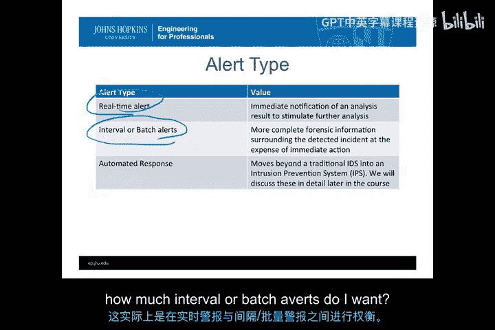

So who is it， What are the users that actually get this response information back from an IS。

 There are three types， general types of users that tend to ingest Is alerts and respond to them。

 the first category is sort of the network security specialists。

 These are your network security people usually working together with the I function that runs the networks。

 the firewalls， the network services。 They normally have very specific knowledge of the attacks。

 the threats， the vulnerabilities， they tend to be the most connected to the CEt team to the response team directly。

 However， notoriously these network security specialists and the I organizations don't often have a detailed knowledge of the business and asset values of all of the different elements within the organization that they're trying to protect。

 So depending on their level in the organization， this sort of business and asset value and the policy。

Regarding those things may just not be something that's part of the day to day operation of the network security specialist。

 So in this particular case， the alerts。Themselves should have some additional information。

 some additional information that would help。These network security specialists understand the relationship to the policy and the asset value。

 So this particular set of users tends to be very technically sophisticated。

 very related to how the organization is connected to its partners。

 the Internet and the outside world and with only a sparsely connected set of information to the business and the assets。

 And again， I'm using generalization here， there are certainly some network security teams that are very connected to the businesses of the organizations they support。

 But in general， you would find that as a category these network security specialists tend to be more disconnected than other other users within a business line。

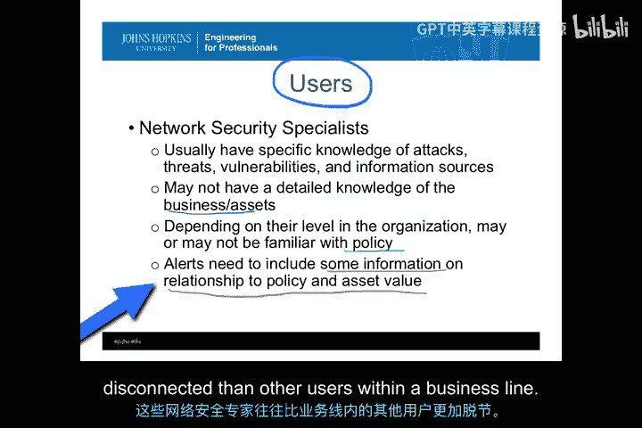

Another type of user that ingests IS alerts are these system administrators and the people who actually run the various servers and end user systems within an organization。

 Now， these users tend to be much more knowledgeable about the technical details and assets and the asset values contained in their systems。

 In fact， the system administrators are often aligned with the business units because their businesses tend to run on the proper functionality of the individual services and systems running those particular kinds of businesses。

 However， in this organization， there's usually a lack of knowledge about the attacks。

 the threats and the vulnerabilities that are associated with those systems that tend to be much more about uptime and making sure the services are available than making that they're secure。

 sort of the ultimate example of this is in the control systems world where the system administrators really maximize uptime for the engineers and don't want to take。

down to say security patch them or make them up here。

 the scope of control instead of the entire network of an organization is often local to a single business unit。

 which is why they're usually tied and more knowledgeable to the system details and the asset values contained within these systems and system administrators in this organization are all about expediting in order to do the kind of uptime and business functions that you would have to achieve their incentives are all about helping the business succeed。

 not necessarily in protecting from security threats and again this is a generalization。

 but this does classify a lot of what the sort of system administrators focused on the security side of a business of a business line or business unit might be inclined to do。

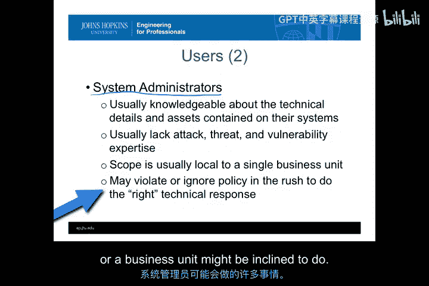

Finally， the third category of user that we have are the investigators These are the parts of the organization often associated with law enforcement。

 compliance， security， physical security these are the portions of the organization that are really out to understand who is in particular trying to damage the organization for insider threat they're looking for the individual internally for external threat they're often looking to see。

 is it a criminal organization， is it a nation state。

 is it an individual hacker or activist what kind of person or what individual person is actually causing the damage they normally have the responsibility to take action with regard to legal action or an HR action to resolve the incident by doing something that doesn't necessarily represent a technical response So usually these are the least technically sophisticated。

Of the inges of the IDS alerts。They tender rely very much on a first impression of the data without recognizing the limitations of what an I S provides。

 So if you remember from our tabletop exercise。You can realize it's very difficult to associate these IS alerts with objective so that an investigator may jump to conclusions based on what they consider to be the thing that the IS alert might signify with regard to a particular sort of attack objective。

 However， these particular users are usually the most familiar with policy procedure procedures of evidence。

 they tend to be the ones that know exactly how to turn technical data into legal or HR actionable items。

 So when they want to get an IS alert。 they really want to indicate the time and the person and the activity that they can then use to write up some kind of a legal or HR response to this kind of an incident。

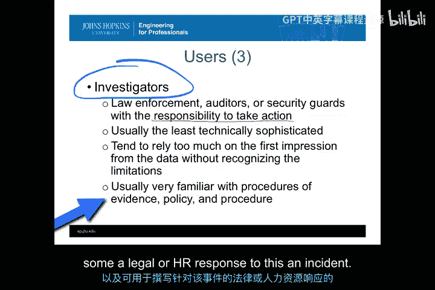

So in addition to the different user types， there's actually different reasons that you might want to use some of these Iss in general。

 there are different purposes to using the alerts， and we've talked about some of these in previous modules。

 but let's bring them back together in terms of the three different purposes that you might use for an Is So we've talked about using an Is for deterrence to demonstrate that you're watching to notify on suspected policy violations we've talked about quality control where you're using an Is to assure the security architecture and assure that it's properly configured and operational。

 and we've talked about using it from a CE perspective where you actually want to take a response to the actual intrusions that are there。

 So you want to understand the scope and scale you want to know the accountability or you might want to gather some evidence for legal action。

 Now， these three purposes of an Is could be applied to any of the users that we've just talked about that。

s the ability to sort of map users to purpose within the IS world。

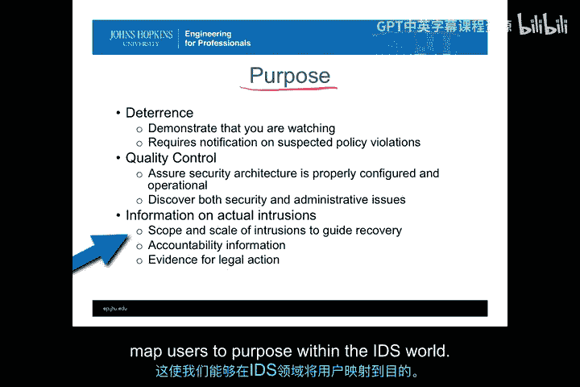

So when we start to map users to purposes now again。

 these are users of an IDS to the purpose of the IDS。

 you can see that what we have here is we've got the different user types along the top and we've got the different purposes of the IDSs sort of down here along the bottom。

So this will set up our little twodisal matrix here that'll apply for the different users and the different purposes what we might want to do。

 So if you're a network security admin and you want to start thinking about， well， okay。

 so I'm a network security admin， what am I going to do if I'm trying to do。Deterretnce， well。

 then as a network security admin， I'm going to want to use the I S alerts to produce bulletins with a large distribution in order to create my deterrent effect based on the network based Iss that I care about for quality control。

 I'm obviously going to verify my network security architecture。 Again。

 this is all about the network side for this particular side。 on information on intrusions。

 These are network related intrusions。 I'm going to communicate with my C Ct team and try to usually resolve an externally facing an externally facing kind of incident coming into my organization。

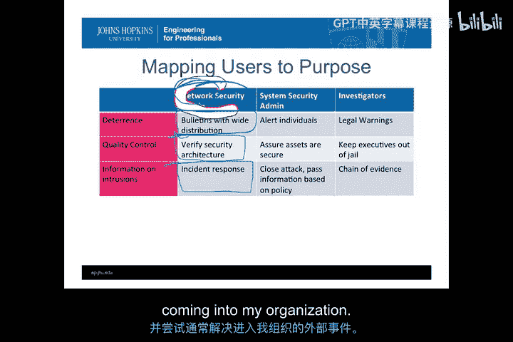

Now if the user is the。

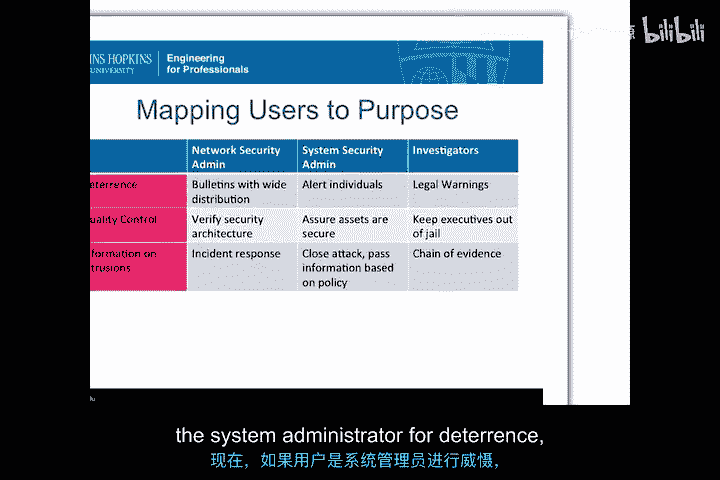

The yeah。The system administrator for deterrence， I'm looking to alert individuals within the business unit for quality control。

 I'm looking again， mostly at the host or at the asset level to make sure the individual assets are secure and for the sort of。

 you know looking at the information on intrusions。 I want to close the attack。

 I want to do my antivirus work， I want to clean up my systems。

 So my system administrators are primarily going to be working again。

 more at the host level in this particular case。 and more using these for those individual purposes。

For the investigator side。 So if I really want to start thinking about what are investigators going to do now。

 what does deterrence mean if you're an investigator。

 Usually you're talking about things like legal warnings。

 So how do I create a legal warning from an IS alert why I might use the IS alert to inform a user that they're actually doing something that might be illegal or might have some result that would create an HR issue like firing or fines or something in that kind of area。

For quality control， this one's a little bit of a different category。

So if I'm mapping my quality control with my investigator， essentially。

 since I'm talking about people， the closest thing I can sort of think about here is keeping executives out of jail。

 but there may be some other things that we can think about with regard to quality control from the investigator point of view using IDS alerts。

So when the investigators are really going to be talking about information on intrusions。

 theyre going to be working with the CSERT teams and with the IDS alerts to create a chain of evidence that would provide legal justification for some kind of an HR response or some kind of a legal response or criminal response based on what's happening within the organization。

So these aren't necessarily the only types of responses that I'm going to use for an IDS。

 but they're an example of what I might do with the different kinds of IDS alerts from the different purposes of the IDS given my different user base。

 there are a few other kinds of purposes that we would have to think about that are more across an organization and not specific to a user type。

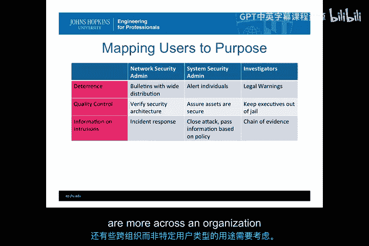

So one of these would be in the area of regulations。

 So what I'm going to say is that in some environments there is a regulatory requirement that an IS can use in order to really help perform some sort of regulated task that's required So one example in this is that within the Department of Def there is a requirement for all scans to be reported。

 Well a networkbased IDS is pretty good at finding scans。

 so you could use an IPS function within the IDS to essentially automatically report for the scans。

 thus meeting your regulatory requirement within the scanning environment for the Se you've got a requirement for reporting outages If your IDS is helping you to understand the outages again。

 you can use this to meet your regulatory requirement and of course there are many others that are possible within this kind of an area depending on exactly what your industry and your regulatory environment is。

Thinking about the use of IDS to meet these regulatory requirements is one of the positive values you can get from actually deploying an IDS within an organization。

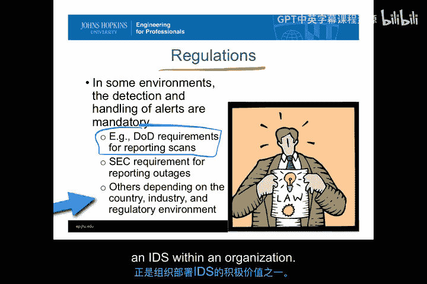

And in addition to regulations， there are other sorts of requirements that you might see。

 you might have requirement just to maintain situational awareness and use your Is to help you understand what the current situation is within a large environment。

 So if you're say a national response team or a Department of Def wide response team。

 You might use some kind of Iss in order to just understand what the attack situation is across a very large environment。

 You can use Iss directly for training。 so I can insert different kinds of attacks。

 create the incidents and train my response and run exercises。

 similar to the ones that we ran sort of in the previous module。

 We talked a little bit about creating legal actions in collecting evidence for legal actions。

 A lot of people use Iss specifically for research into the attack environment。

 Can we do research in classification。 Can we do research in the identification of different kinds of Iss。

Research organizations will use IS for that purposes for test and evaluation。

 If we have some kind of other defense that's not an intrusion detection system。

 I might use an IS within the framework the testing framework to understand how to do the test and evaluation and。

 of course I may use an Is if I have to open up a temporary vulnerability exposure just to see if that exposure is being attacked while I have to have。

 say some legacy or some known vulnerable service up and running within the system。

 So in this video we should have gone through some of the general ideas of how to use an Is and for what purpose and to what users in order to meet the kinds of requirements that you might have in terms of actually deploying an IS。

In the videos that are coming up， we'll continue to explore the use of response within the Is in order to。

Provide value to these organizations and limit risk。

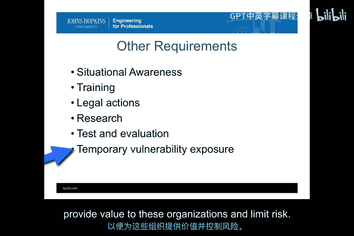