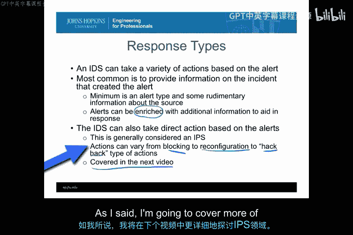
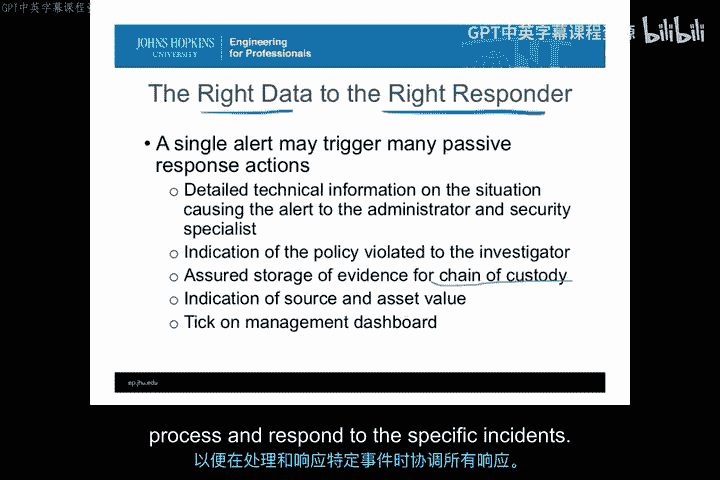
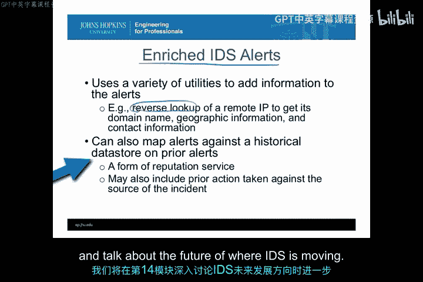
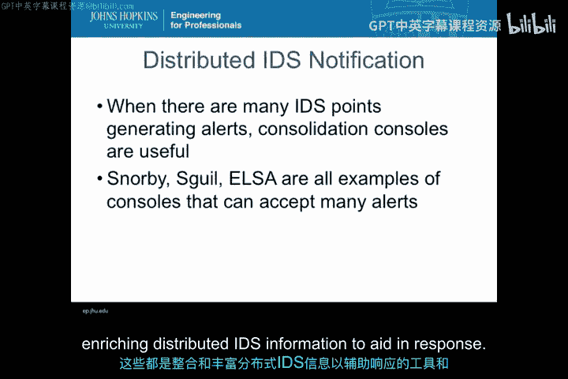
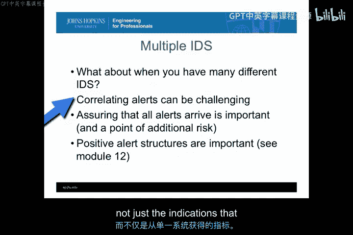
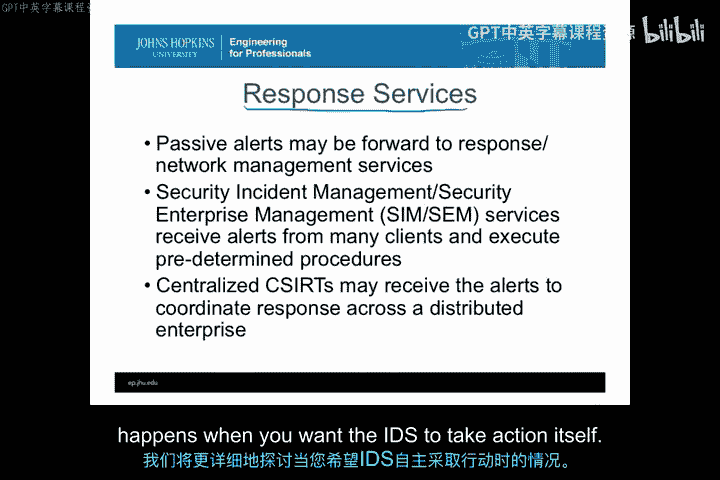

# 约翰霍普金斯大学《入侵检测｜Intrusion Detection》中英字幕 - P46：14_响应类型分类.zh_en - GPT中英字幕课程资源 - BV1sGu1z5E2J

In the previous video we talked about IDS purpose users and some of the requirements to get into installing an IDS in this module。

 what I want to do is get into a little bit more detail on the response types themselves。

These are going to get into the passive versus active options and start to talk a little bit more about what are the different types of passive responses and some of the issues in the passive responses for IPS and the active responses。

 I'm going to get into more detail on that in the next video。

So as we've seen an IDS can take a wide variety of actions based on an alert that comes out probably the most common and the type that we've dealt with most in this class so far is to provide information on the incident that actually created the alert so as you can tell there's a lot of different types of information that could actually be captured when we talk about what an IDS alert could consist of。

 sort of the minimum when you talk about what a minimum amount is is basically sort of an alert type and some rudimentary information about the source。

 usually if it's a network ID something about the I address if it's a hostbased IDS maybe be the process name or the user that was logged in。

 however， there's a lot of enrichment that can actually take place with additional information to add to these responses and allow the users of these responses to take actions more quickly than having to look up the information themselves。

Now it is true that if I'm actually taking some action to enrich the information once I get an IDS alert。

 the IDS is in fact executing some additional processes。

 taking some direct action in order to enrich the information in the alerts but we don't really consider this part of the direct action based on resorts that an IPS would take mostly because this additional information is part of the passive response。

 so it's not actually changing an environment or doing something that would allow the environment to change。

 the exception to that is if I'm enriching with additional information that actually causes me to reconfigure or collect additional information from the environment like turning up sensors or turning additional sensors on to gather information this would be like an IDS that works on netflow data to suddenly turn on the ability to do full packet capture once a suspicious incident has been discovered。

That's more in the IPS realm， if I'm enriching based on static tables or even doing external lookups to the outside world like in the Who is database。

 I consider that more in the passive response mode of enriching additional information。

 but not taking an action within my infrastructure that would actually cause some kind of a difference or mitigation of the event。

So with the IPS taking direct action based on the alerts。

 these can really vary as well all the way from sort of regular blocking and sort of turning off a connection to reconfiguration of the environment to going outside of your organization in order to hack back or do something externally that would impact the adversaries that are attacking you。

 and as I said， I'm going to cover more of the IPS world in the next video。

So in this video we're going to talk more about the passive response options so if you're going to take a passive response。

 the first thing to realize is that just because I've done some passive notification。

 this doesn't preclude taking some action as well the idea of passive monitoring and archiving should always be part of an active response mode as well so even if I'm going to be doing active response like we'll talk about more in the next video。

I should be doing some sort of record keeping and alerting that would be part of my passive response options。

So as I'm thinking about the passive response options。

 one of the first things I have to sort of think about is am I looking locally or remotely with regard to where does the notification have to happen and what I mean by that is local to the analysis engine so local to where the event is actually detected if it's on the same system or within the same area that the detection takes place。

 we consider that local if a detection takes place and then the notification to a user is on a different system or remote system we consider that remote response so local systems or things like printing to a paper or a screen these tend to have less exposure to denial of service and loss because they don't rely on a network infrastructure or any other external infrastructure to actually notify the user the system where the alert is actually generated is also the place where the notification or the response is actually happening This of course requires that the responder。

Be local to the system so it doesn't work well in large enterprises where I have a number of different Iss dispersed throughout the environment。

 and now I have to essentially have people local to each of those places and then they have to coordinate manually better to ship all the alerts to a more central location where my responders are。

 even though I may have more exposure to the denial service or loss and may even get into my idea of。

Creating type 2 errors by blocking my response from the Is directly。And so as I've indicated。

 if you're going to have a number of different IDSs and they're going to send to a single point。

 you're essentially going to have to have some kind of an aggregator or an aggregation function。

 they're going to take all of these responses from multiple IDS analysis engines and put them in the context so a response team or set of responseers can actually review all of these various alerts and try to do some correlation between them。

 Now this could be there should be support tools to do this and you've seen some of these inside of security onion as you're looking at that。

 but there's also other kinds of commercial tools that you can buy that would really begin to bring these alerts and try to put them on a single timeline these are tools like Arcite from IBM that take things from a number of sources and put them in place or even a tool like Splunk that will take in alerts from a whole lot of different areas and then run analytics across those alerts in order to create a higher order of correlation。

Of course， in all of this notification， it's extremely important to get the right data to the right responder。

 So what do we mean by that， That means that the data coming out of the IS analysis engine and going into the response has to include data that the particular user type is going to need in order to provide that response。

 So these single alerts。That you're going to do may trigger a whole lot of different kinds of passive response alerts or actions so I could actually send detailed technical information on the situation to the Ccer team or to the network administrator or the security specialist I could send a different set of information based on the same alert to an investigator to a user that would be an investigator type and that would begin to look at what the policy violation was。

 I can send an assured storage of evidence for a chain of custody so that in addition to my passive response options。

 I can store things in a way that would be legally appropriate for taking either an HR action or a legal action。

 I may want to have an indication of the source and asset value or a connection to policy or a connection to other kinds of loss or things that are happening right now。

 and finally， I may take the same alert and just translate that to a single stoplight chart or a tick on a management dashboard to a manager。

Who just wants to know situational awareness is there an incident that's currently being responded to so as you can see。

 a single alert doesn't necessarily have to only generate one set of information I can tailor the information from an alert to each individual user type that may actually have to take an action among the response now there's a warning。

Once you start sending the same alert to a whole lot of different users to try to do a number of different response actions。

 you may have a coordination problem among all of those different user types。

 remember that occasionally the different users of IDS information are going to have conflicting goals and conflicting purposes。

 so， for example， somebody who has a goal of deterretnce and wants to produce information that might alert the perpetrator that they're being watched could go against the investigator this trying to gather evidence for some kind of prosecution。

So if you're going to be doing the right data to multiple responders。

 you do have to make sure that there is some sort of standard operating practice that would allow all of those things to be coordinated。

 the responses to be coordinated as you begin to process and respond to the specific incidents。

Probably one of the most important areas in IDS commercial tools and research today is this whole idea of enriched IDS alerts。

 the idea that you can take information from the IDS alert and use it to not only gather external information but run analytics that would cause additional correlation and additional information fusion to happen across a wider variety of information triggered by the alert so when we talk about a wide variety of utilities that add information。

 these can be as simple as a reverse lookup for where the I address is to much more advanced things like using a splunk analytic to combine the alert with historical information to know everything that's been done prior to that so I can map all of these various kinds of alerts against a data store I can create a form of reputation service I can include a whole lot of many more complex items that can now enrich the IDS alert itself。

is what you really can start to look for in IDS products beginning today。

 these interactions between other kinds of big data analytics and other sorts of cloud based analytics that you might see are another direction that we're seeing a lot with enhanced and enriched IDS alerts We'll talk more about that when we finally get into moduleule 14 and talk about sort of the future of where IDS is moving。

So when we talk about distributed IDS notification and as I say。

 when there are many different IDS points generating alerts and consolidation becomes perhaps not only just useful but even required and necessary。

 you can see that even what we've talked about within security onion， snory， Squeal。

 ELSA are examples of consoles that can accept many different types of alerts and begin to combine them together into ways that you can investigate the underlying packet structure and the things that are more appropriate to responding to the essential alerts that are there。

 so part of the value that you're getting out of the labs。

 in terms of investigating all of these specific tools within security onion is the idea of when I have a distributed or multiple IDSs reporting into a console。

 how would I use that information to go a level deeper in my analysis and begin to understand the underlying causes of the specific incident？

Those are all tools and examples of ways of combining and enriching distributed IDS information to aid in response。

Now， in a lot of what we're talking about with distributed IDS。

 we're sort of assuming the same kind of alerts are being generated。

 But what happens when you've got a whole lot of different types of Is hostbased network based signatures versus anomalies systems and you've got lots of different base rates。

 you do some that are networkflowbased and session based others that are packet based others that are based on memory or tripwire or other things that are happening within a system Well when you get down to there Correlating these kinds of alerts can be very challenging Assuring that all the alerts arrive as important and additional risk and we'll talk about positive alert structures but this whole idea of using multiple different kinds of Is and then trying to say how do I know that a networkbased alert that I got over here corresponds to hostbased activity that they found in another location is not something that is automated today。

 this is not something that you can just buy a product to say attach all of my。

IDS is together and give me a full picture of everything that's been happening in the incident That's part of research。

 it's part of what's happening in the research community。

 but it is not something that you see very much in commercial products yet there are places that are moving into the direction of consolidated alerts and a lot of the big data analytics really has at its fundamental underpinnings the idea of taking all of these different types of data and looking for associations between those data in order to。

Better respond to the total incident， not just the indications that I get from one particular system。

Finally， there is the whole idea of taking the responses that you have and forwarding them external to your organization to some other kind of response or network management service。

 there are a number of organizations that will essentially take all of your IDS alerts。

 ingest them externally to your organization and provide information back on what the response actions should be taken。

The value in using a response service instead of trying to do all of this yourself is the response service can often evaluate alerts to determine which ones are type 1 errors。

 so all of that additional work that we talked about before in reducing type1 or false positive errors can be basically contracted outside of the organization So they can also compare a lot of the alerts that you get on the outside from other clients and execute predetermined procedures themselves that would help to protect your organization This might happen in terms of a Ddos in order to throttle the bandwidth during a DdoOS attack if it's something you know you want to do you can externally contract an organization to do that。

Finally， instead of resolving incidents， you may just for informational purposes。

 decide you want to send your alerts to a centralized CSEt and coordinate response across a distributed enterprise this is common in government organizations where you have Cers that have a broad overview or broad look across a number of departments and agencies。

 something like a US CerRT at the at US。DHS would essentially be the kind of centralized organization that where they don't take direct action。

 they ingest alerts and provide advice and response actions back out to the individual departments and agencies。

 so using response services as a way to take to the next level of aggregation。

The alerts that would come from multiple organizations in order to find out what's going on。

 Another example of this is to look at something like the network security telescope。

 that would be an organization that takes voluntary firewall and Is records from a whole lot of different organizations and provides a view or a situational awareness of the sorts of attacks that are happening Internet wide that can be valuable as you're trying to determine whether an attack against your organization is targeted to you or just simply your' one of many victims that are being hit at that particular moment and don't appear to be singled out。

 So these are different ways in which the response services can use IDss in order to consolidate information across a number of different organizations。

So as we've seen in this video， you can use passive alerting in a number of different ways。

 creating information that are tailored to different user types， different response options。

 you can aggregate these over different types or distributed IDSs and you can send them external to your organization in order to do some kind of situational awareness and consolidation across multiple organizations in the next video we'll get into that more specific detail of what happens when you want the IDS to take action itself。

