# 约翰霍普金斯大学《入侵检测｜Intrusion Detection》中英字幕 - P47：15_入侵防御系统(IPS).zh_en - GPT中英字幕课程资源 - BV1sGu1z5E2J

In this video， we're going to look at more of the active response options that are currently available within intrusion detection systems。

 so called intrusion prevention systems， and their intrusion prevention systems because they actually not only detect attacks and passively tell you about them。

 but actually take some sort of active mitigation or preventing the actual incident from occurring。

So in this video we'll talk a little bit about the different types of automated actions or automated mitigations that some of these IDS systems can do。

 and then in the next video we'll talk a little bit more about the cautions and some of the difficulties in using some of these direct response options。

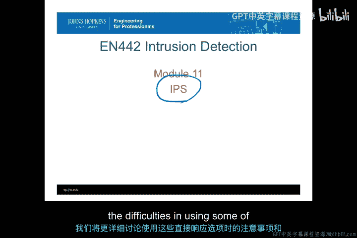

So in general， we have three different types of active responses that are taken from most kinds of IDS or IPSSs that are out there。

 and from most aggressive to least aggressive， we can talk about taking action against the intruder。

 amending the environment or changing the environment based on the detection of these attacks and just。

Changing the environment to collect more information。 So I say more aggressive to less aggressive。

 because if I'm taking action against the intruder directly， I'm operating outside of my boundaries。

 outside of my administrative control。 If I'm amending my environment， I'm taking direct action。

 but inside my my boundaries are inside my direct reach of control inside。

 collecting more information in some respects is a subset to amending the environment。

 I am changing the environment， but the purpose of changing it isn't really as visible to the intruder is changing an environment to block something or to actually do something that would be visible to the intruder。

 So the difference between collecting more information and amending the environment。

 is that when I talk about amending the environment， the intruder can see what's happening here。

 and the intruder cannot see what's happening sort of down in this area。

 So if I talk about amending the environment that's visible to the intruder。

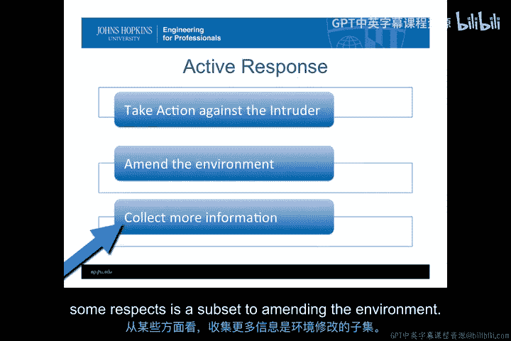

We invisible to the intruder。 That's what I differentiate between these two different options。

 Of course， taking action against the intruder is always going to be visible to the intruder because I'm operating now outside of my boundaries。

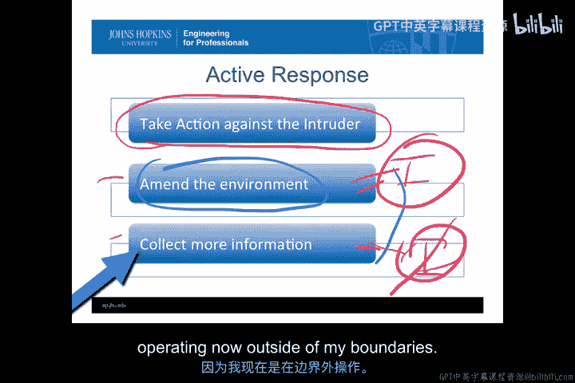

So let's talk about the most most aggressive type of response first。

 taking direct action against the intruder。 This is a very tempting option for many organizations because。

It basically has this sort of retribution aspect to it。 I've just been hit by an intruder。

 It kind of makes sense to a lot of people to say， well， if they're going to come and attack me。

 the best thing for me to do is attack back。 But， in fact。

 this is often just providing additional options for the intruder。 So， for example。

 an intruder may be attacking you not from their own enterprise。

 but from some other enterprise they broken into。 In that case。

 taking action against the intruder may actually be taking action against another victim。

 So it could be that the whole reason that the intruder was attacking you was in order for you to attack some other victim that the intruder didn't want to attack directly。

 So because of that， this may sort of increase or decrease risk within your organization。

 It's very risky to take these kinds of actions against the intruder。

 The intruder may use your automated response to damage others。 And you have a possibility of some。

Deial of service or legal liability。 so you could increase the frequency and the severity of your own risk within the organization in order to to do this sort of direct action。

 but you know you can do this manually as well as automated。

 sometimes it's not an I taking direct action。 it's manual direct action。

 which has many of the same drawbacks。 So if your organization was going to take a manual action against the intruder and they would do that each and every time using this as an I option is very attractive it can happen more rapidly。

 it can happen while the intruder is perhaps still accessible to the I as opposed to later when you try to manually attack and the intruder is actually gone。

 So there are。Good reasons for doing direct attack back。

 If it was something you were going to do manually。

 If it's not something you're going to do manually。

 then you certainly don't want to automate a process that you wouldn't ever do manually。

 in terms of trying to take direct action against the intruder。 But as I say。

 this is not something that's usually offered as a turnkey option within an I systems that you can buy。

 but almost every I system that you can buy has a link to an external program shell script some way that you can stimulate some other kind of program outside of the I。

 That program can do anything， including taking direct action against the intruder。

 So even if the I does not include an option that looks like it would take direct action against the intruder。

 you can often take that action by looking at an external function that can be called from the I once something is actually detected。

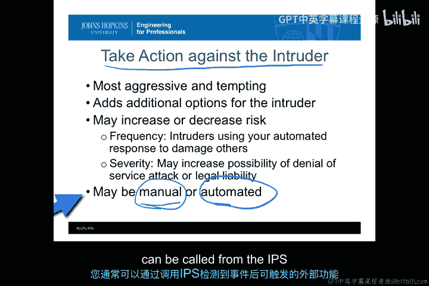

Frequently， when you're talking about an I S， the I S itself may not take the direct action。

 but it may provide some kind of automated user driven action。

 What that basically means is that instead of taking direct action to damage the intruder。

The Is could create the programs that would do the attack back and present the option to a user to essentially launch that attack in one click。

 So you can do things like taking action to terminate a connection。

 this often because it could be a risky process， requires some sort of a human being on your side to take responsibility for the action。

 by taking that kind of responsibility。 The Ips is doing all of the effort to prepare the automated response。

 but requiring the user to actually take responsibility for launching the response。 Now。

 as soon as you remove that option of the user taking responsibility。

 then this becomes a traditional Ips automated response at that point as well。

 So you can do all of these sorts of things。 But when you're trying to take direct action and the user is initiating it。

 more of the risky actions like leveraging the infrastructure to damage the intruder or stop the attack。

These are the kinds of things that you do want to have somebody take responsibility for。

 so having it user driven often makes sense in an IPS context。 and of course。

 part of the idea of an IPS or setting things up is trying to understand where the leverage points are against the intruder。

We've had cases in the past， real cases where。Relentless hacks and attacking back didn't seem to cause any lightning or any sort of reduction in the activity of the intruder。

 So there was at least one case where the part of the automated script came back and essentially sent email to the family members of the intruder essentially alerting the family members of the intruder that this attack was going on。

 And that was actually effective at stopping the attack。 That's sort of a special case。

 but it gives you an idea of the breath that you might have in some of these direct actions that are taken outside of your enterprise to attempt to leverage and stop an intrusion from actually continuing。

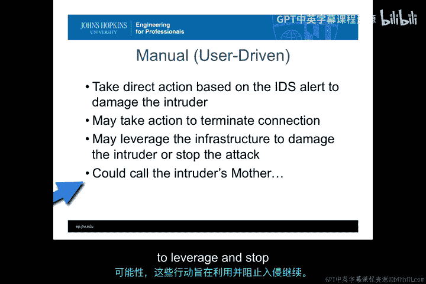

So whenever you're going to begin to operate outside of your boundary and look at the automated response to do that。

 there's a couple of things to keep in mind as to why you would want to ever do these kinds of actions that are outside of your administrative control。

 First of all， the sheer speed of the attack may lead you to believe that if I want to do an automated response。

 or if I want to somehow externally respond to this attack that's happening。

 it may have to be automated simply because of the sheer speed of the attack。

 This is especially appropriate when you're going to take this action。

 every single time the condition happens without exception。

 If there's any evaluation or analysis as to whether or not an action should take place。

 it's probably not amenable to an automated hackback or an automated response。

 you might only want to do this when high value assets are at risk。

 So instead of doing it for any kind of attack， you might hold it out for just a couple of the extremely high value assets where its。

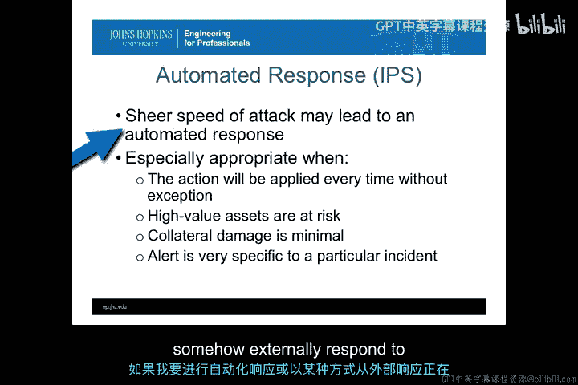

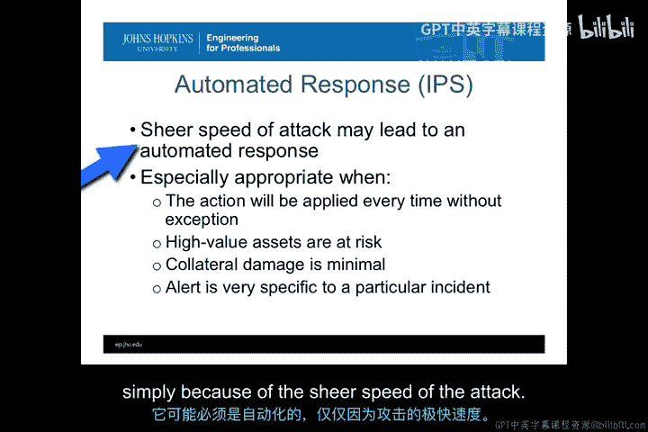

So important to maintain the integrity or availability of those assets that an attack back outside of your infrastructure is appropriate。

 Those kinds of things should have minimal， possible collateral damage。

 meaning that you don't want to launch a random denial of service attack or something that's going to impact innocent victims or customers。

 So if you can create some kind of an external automated response that minimizes collateral damage that would be another way that it could be appropriate to do these sort of automated responses。

So this means that the alert is very specific， so it's not a more general type of alert。

 It's a very specific action under very specific conditions。

 If you have all of these sorts of elements that are part of what's happening in your system。

 it might be appropriate to do one of these really high impact externally facing kinds of automated responses。

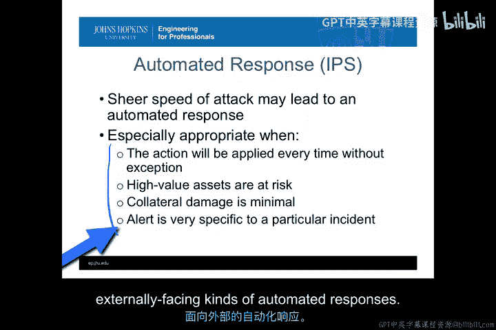

Now， the idea of hacking back is not the only kind of automated situation you can do for an IPS。

 One of the most very one of a very common type of Ips action is simply to collect more information from your infrastructure。

 This is where you choose to crank up the information sources based on some Is alert。

 I've already mentioned one example of this， where if you have your Is based around netflow data。

 An alert based on netflow might turn on packet capture。

 you wouldn't want the packet capture on all the time because the data volume would be too high。

 but you may want for specific kinds of incidents when you want to collect more information。

 So this can be very useful， especially where you can't collect all the details of all the information all the time。

One example here as well is if I use a network based I to actually turn on host based information collection。

 you can collect a lot of information from system call traces and detailed logs from individual systems that you probably wouldn't want to do all the time。

 But if I have a network indicator of suspicion for a particular host I may want to turn on the kind of Is functions on that host that would collect information directly in response to that network traffic in order to create some kind of evidence that I might take against the user of that particular system。

 So this additional information。Can usually indicate the source or the target of an intrusion。

 part of the reason you would do this。Is to gather information to make your response more effective。

 However， as a caution， this actually could increase the risk of additional exposure。

To the intruder by turning on more and more of these systems。

 you are opening up various kinds of attack surfaces and the ability for the intruder to potentially over overuse the resources available in the system and cause things caused denial service attacks。

 so collecting more information should always also be cautionary。

 It's not as risky as directly attacking back， but that doesn't mean it is without risk in order to do this kind of automated function with an Is。

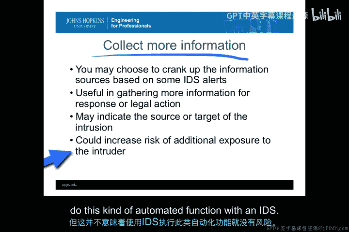

Another very common function that's coming with a lot of commercial systems today is trying to take an attack you've identified and divert it away from the specific resources that are being targeted by the attack。

 This is one way to collect more information。 So you look at an attack that started against a critical asset。

 you identify that attack is happening， and you divert the attack without the intruder's knowledge to some kind of benign host designed to capture more of the attack。

 something more like a honeypot that's out there looking for any activity and investigating any activity that's what it's looking at。

 Now， when we're talking about a honey net or a honeypot。

 that's usually out there as a primary way of attracting intruders。

 So when we divert it to something that isn't there primarily to attract intruders。

 we sometimes will call that a fishbowl。 instead of a honeypot。

 The advantage of a fishbowl over honeypot is that。

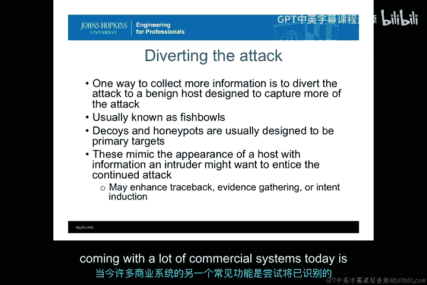

You haven't really attracted the users externally。 You're not making yourself a more attractive target。

 You're simply diverting into some place to gather information once you have already been targeted。

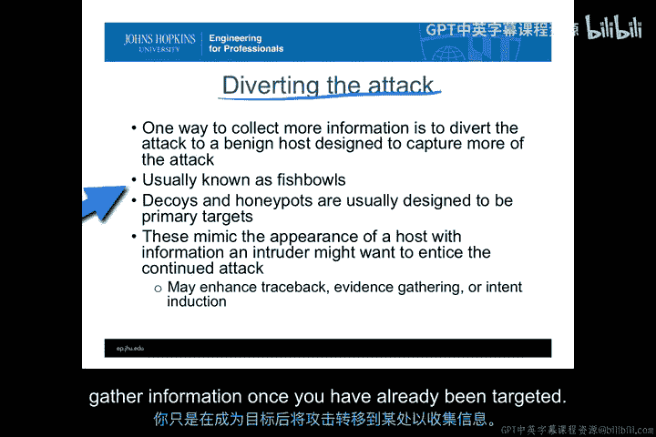

So decoys and honeypots， they're usually designed to be primary targets。

 whereas fishbowls are designed to be places you can divert to。

 but they do the same kind of function。 They mimic the appearance of a host with the information the intruder might want to have in order to entice a continuation of the attack。

Now this could of course， enhance the idea of tracing back to the intruder。

 gathering evidence against the intruder， trying to figure out the intent or sort of using an induction in order to understand what the next target might be from all of this attacking behavior it's part of why diverting the attack is becoming a very common aspect within sort of large scale IDS deployments。

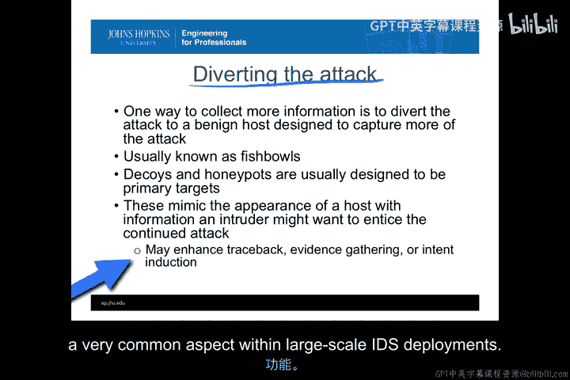

We've already mentioned several times that an IPS can amend the environment can use the alerts essentially that are generated to automatically close detected vulnerabilities。

 This is especially useful when I know I'm going to have to have some exposed vulnerabilities based on legacy solutions or based on other situations where I can't keep a vulnerability closed all the time。

 But if I see an indication of an attack。 I can temporarily close a service or block。

 amend the environment to turn a service off or amend the environment to close a detected vulnerability that's being done。

 Now， this requires that our analysis engine can identify the exposed vulnerability causing the incident so we know what to close rather than identifying the source of the attack。

 I'm really looking at what is it about the target of the attack。

 that I can take a direct action about in order to mitigate the current attack that's going on。

The idea here is that you might take an immediate action to shut something down or to close a vulnerability and have that confirmed by some kind of administrator later in order to make it permanent。

 So it's designed to be a temporarily block or a temporary mitigation that mitigates the immediate effect of an attack and allows the administrator or the response team additional time to decide whether or not that should be a permanent change or whether it should be undone。

Use of this kind of amending the environment can lead to kind of an out of control configuration of your system。

 Imagine an intruder that knows that you're going to be spending a lot of time amending the environment。

The intruder might use that fact to begin to create chaos within the system as automatically things are closed or blocked。

Leading to essentially a denial of service attack against your organization using your own I S。

 So there is some caution there as well， but amending the environment can provide time to the c Ct or to the administrator in order to understand what they should do longer term with regard to this kind of attack。

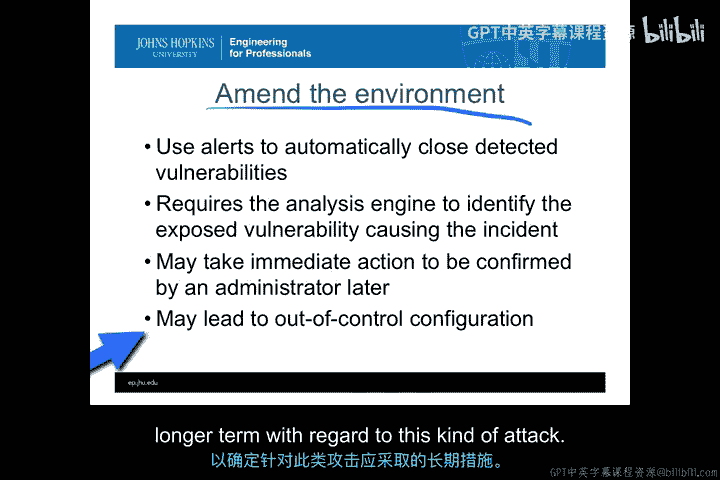

Sort of a special case in amending the environment is what we're calling adaptive response。

 This is where the part of the environment that you're actually amending is the IPS system itself。

 So the IPS is using information gathering on alerts in order to change its own configuration。

 So this is where the system sort of learns from your use of alerts and response to provide automatically。

Doing the response that you've done before within an IPS or automatically changing the IPS to make certain kinds of detections more sensitive or canning the responses。

 recording and canning and replaying responses that have been done when it was in an I mode as opposed to an IPS mode。

So this kind of environment changing the IPS itself。

It could be updated based on alert activity or additional information。

 But the whole idea here is to speed the response by changing the I in a way that provides additional response options to the response teams in an automated fashion。

 In fact， it can go as far as adapting the Ips S to make something that used to be a manual response become automated。

 If it's the same response every time。 and it's a common element。

 the user could work with the I to amend the configuration of the Ips to turn something that was manual into an automated response that would happen in the future。

This is， like I said， it's a way of changing your infrastructure to reduce risk by speeding up the response as opposed to changing anything else in your environment that would create a direct mitigation by changing the target or changing the configuration of the vulnerabilities to the target。

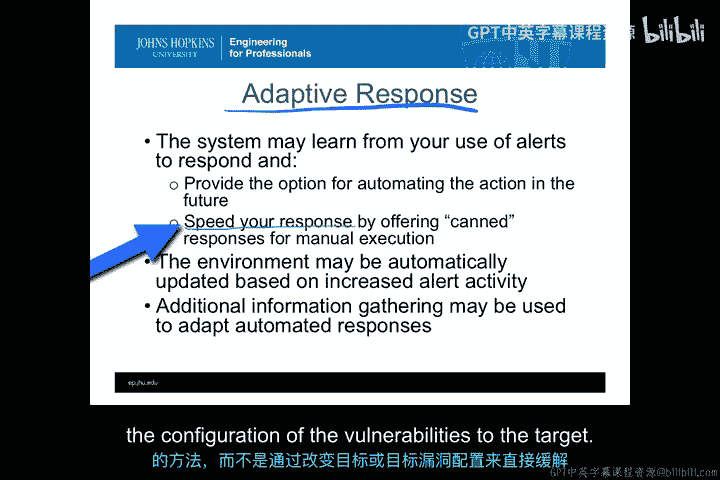

So this is actually a form of a feedback loop if I'm changing the IPS itself。

 I'm using the IPS information and the use of the IPS to increase the effectiveness of the IPS over time。

 so I can change not only the automated scripts or the way I do automation。

 I might actually change the entire configuration of the analysis engine itself。

So imagine I have a situation where I've discovered more a more refined technique of changing my tradeoffs between type 1 and type 2 errors。

 and I automatically have a feedback loop based on what the responders do that update the analysis engine to be more effective in the future and identifying incidents。

 This is exactly how some of the anomaly detection systems based on machine learning work。

 So they attempt to learn from historical activity and from the historical categorization of events as to whether their real events or type 1 events to change the configuration of the classifier。

 So this does allow some tuning to the current environment。 But remember。

 this tuning of the current environment if it's too automated may put too much power in the intruder's hands in terms of changing the I in a way that the intruder would like to change。

So within this video， we've talked a little bit about the different options that an IPS can have。

 but the thing to keep in mind is this is an overview of the different types of things an IPS can do。

 In reality， an IPS can fire off almost any kind of process or program or initiate almost any kind of behavior in the system that you can imagine doing So anything you can do manually。

 you can almost always automate and have the IPS system do it in an automated fashion against the intruder against the environment。

 against the IPS itself in terms of what's actually changing within the system in the next video we're going to talk about the cautions and risks that might be involved as you have this power of the IPS system。

Essentially able to do any kind of action on its own based on detected incidents。

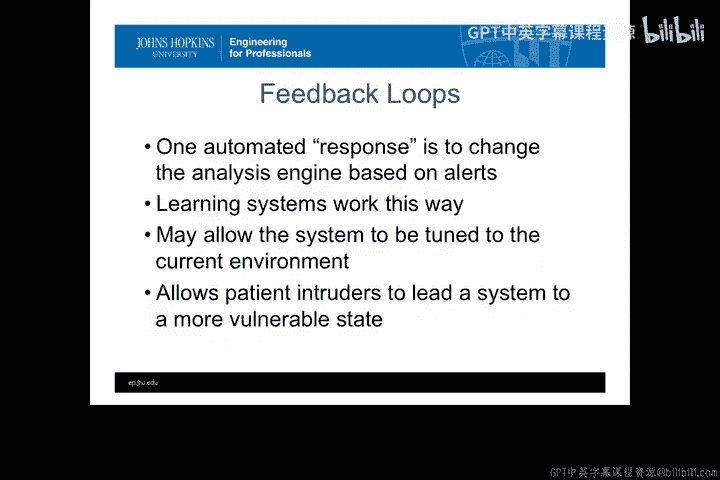