# 约翰霍普金斯大学《入侵检测｜Intrusion Detection》中英字幕 - P48：16_IPS实施风险与注意事项.zh_en - GPT中英字幕课程资源 - BV1sGu1z5E2J

Okay so in the last video we talked about the intrusion prevention systems and the kind of active responses you could take with intrusion prevention systems。

 remember that an intrusion prevention system can take basically any action that it can call out to from an arbitrary program so almost anything can be manually done can be something that you can do from an IPS。

 but you may not want to do everything you possibly can do with an IPS。

 so in this video we're going to talk a little bit about some of the risks and cautions when considering how to configure and actually run an IPS。

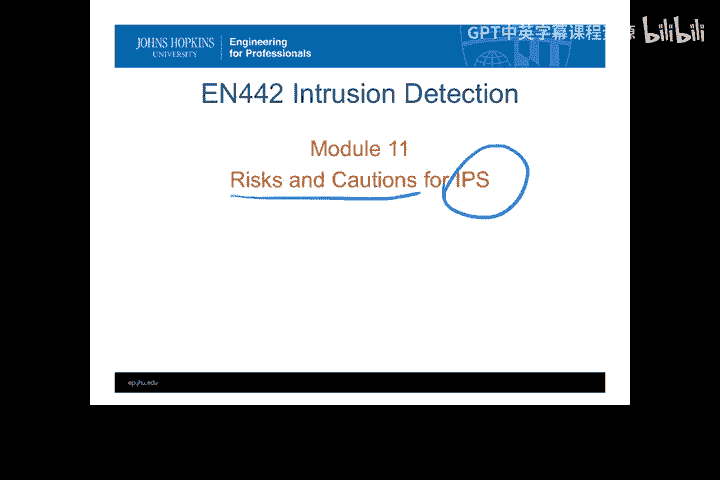

So the main thing to keep in mind with regard to IPS is that whenever you take any kind of automated action。

 then you have to at least some degree handed it over control of that IPS to the adversary Now how do I mean by that。

If you're going to take automated response， that means the trigger of that automated response is going to come from an adversary action。

 that adversary action。Kicks off the automated response。

 which means that the adversary is actually in control of when that automated response actually happens。

 So when the adversary learns of the nature of the I P S。

 as soon as the adversary knows what the I P S will do based on the adversary's actions。

The adversary can use those actions to essentially drive desired response taken by the I P S。

 It's like having an internal opportunity to take some limited action based on what an adversary might do externally。

 So from this， you really want to understand that the more invasive the response options。

 The more arbitrary the response options can be in an I P S。

 The more dangerous this could be in the hands of an adversary。

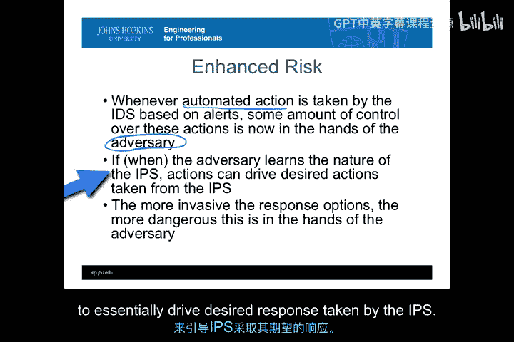

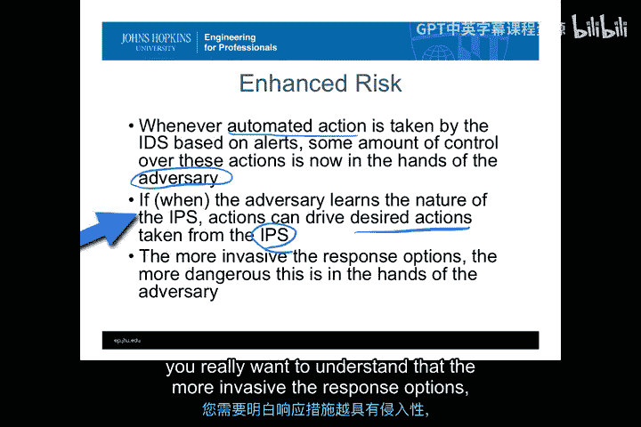

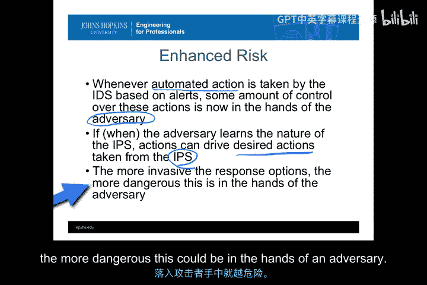

So now let's talk about the specific risks that we might get for each individual type of automated response that we could have from an I。

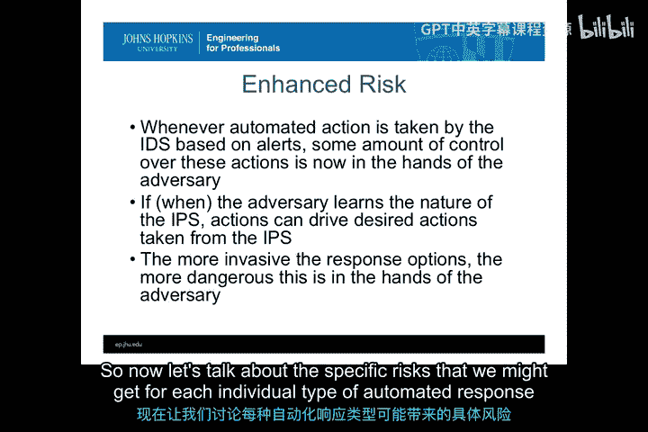

So let's talk first about attack back。 This was the most aggressive kind of automated response that we had talked about in the previous video。

 and we had talked a little bit already that the system designated as the source of the attack probably does not belong to the attacker。

 it probably an intermediate node so that if we attack back one hop back into the structure without thinking further about where the attack might actually be coming from。

 we are probably attacking an innocent victim or an attempted victim from the attacker。Of course。

 you once in a while， or sometimes the alerts that we're going to get from the IDS that will drive the IPS behavior could actually be the result of some kind of IP spoofing or the intruder lying about where the source of the attack is coming from。

If the intruder is lying about the source of the attack。

 then the I P S might take action against whatever sight belongs to that sofed I P address。

 So that's another way of the intruder。Getting a victim to attack another victim down the way。

 So this could even provoke additional attacks。 So if I attack an innocent victim that also has some kind of automated attack back as part of its structure。

 we could actually create this idea of attacking two different victim sites while the intruder just basically sits back and watch as it happen after the initial stimulated attack。

 this actually really did happen in an attack back in the early days of the internet where there was a bug in finger in the finger protocol where the intruder could use the finger protocol to essentially create a listing of all of the processes that were currently being run in the system and providing a lot of information about who was logged in and where。

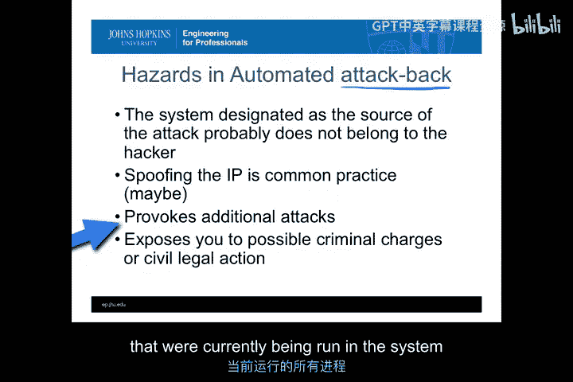

As a result， there was an automated hackback that was actually produced for this what was called the finger bug。

 which said that whenever that would happen， as a result。

 you would automatically try to gather the same information from the attacker machine so。

Once there were a number of these installed automated attack backs。

 the intruder merely had topoof the source IP address to another victim that had an automatic attack back on the finger bug。

 And essentially， this would create a cascade and almost to a service attack between two notes that would continually run the finger command against each other's infrastructures because they were perceiving an active attack going on between two innocent victims。

 So it's an extreme case， but it does show that this kind of attack back can actually provoke additional kinds of attacks。

 Finally， you could actually be exposed to some kind of criminal charges or civil legal action based on an automated attack back if the place you were attacking。

 turns out not to have been the intruder， or even if the intruder was part of an organization and you attack back to that organization and the intruder was a rogue insider or somebody that did not speak on behalf of the organization。

You could be held liable in a way that the offended organization could come after you for some sort of legal restitution。

 so these are just some of the hazards in automated attack back that。

Could be used by the adversary to actually expand upon the damage that might be created if you have this utility installed within your infrastructure。

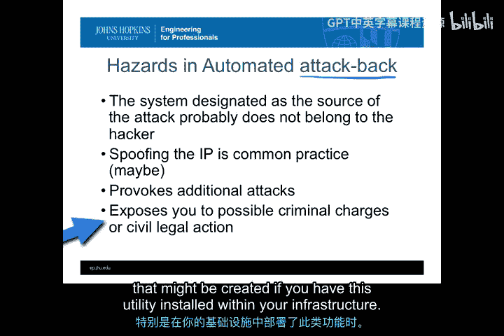

Even something as simple as sort of just using your IPS to collect more information can essentially be a hazard and increase risk within the individual organization。

 The adversary could be manipulating the various alerts in order to flood the resources collecting information。

 Imagine that you had an I or an IPS that was collecting flow-based attacks。

 and every time a flow-based attack was detected， the target of that attack was turned on for detailed packet capture to be stored for later analysis and the adversary simply used the same attack over and over again across every system in the entire infrastructure。

 This would effectively turned on total packet capture for every source for every destination within the organization definitely flooding the resources of that organization and creating a situation where the intruder has essentially turned off the collection ability and。

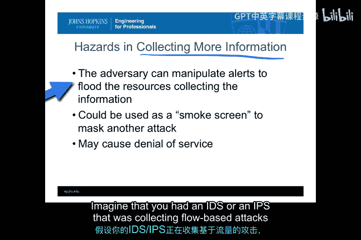

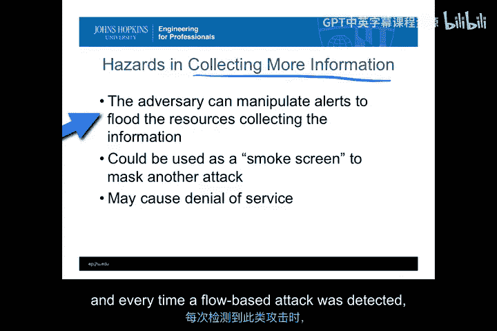

Now operate essentially invisibly within the organization。

 knowing that the IPS has now effectively turned itself off。

The other thing that we can see from this is that the IPS can be used as a smokescreen to mask some other attack。

 we've had cases in the banking community where IPS systems that collect more information once they see a web based attack。

Essentially flooded the analyst with detailed information from a wide variety of sites while a small under the radar attack was being used to transfer money out of the system。

 that might have been seen if there wasn't all of this other attack activity going on。

 but the I P S itself essentially created the smokescreen。To hide the activity and of course。

 all of this really leads to a denial of service， both on the I and potentially even within the offered services within an organization。

 So as you can see， there are additional hazards， even in taking what seems to be a relatively innocuous automated technique。

 which is just collecting more information。

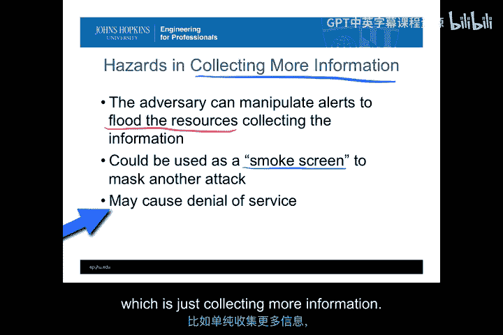

The next point that we can talk about is what happens if you're going to use the IPS to divert an attack。

 So this is the situation where the IPS is recognized an attack against a critical asset and rather than stop the attack。

 it has diverted the attack to some sort of a fishbowl that would look at the actions of the attack or to try to understand better what's going on。

 Well the very first thing that could happen is that that could actually be a legitimate customer and it could have been a false positive within the detection of the attack。

 so now I've diverted a legitimate customer away for my critical asset or my regular system and potentially have created some sort of an error or at least an unintended service to that particular legitimate activity。

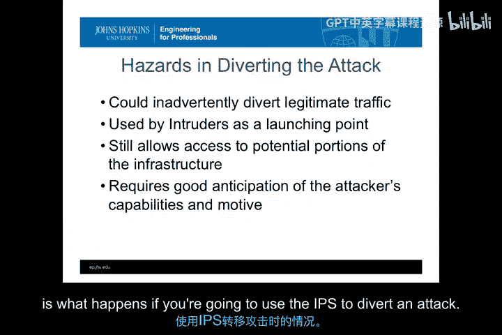

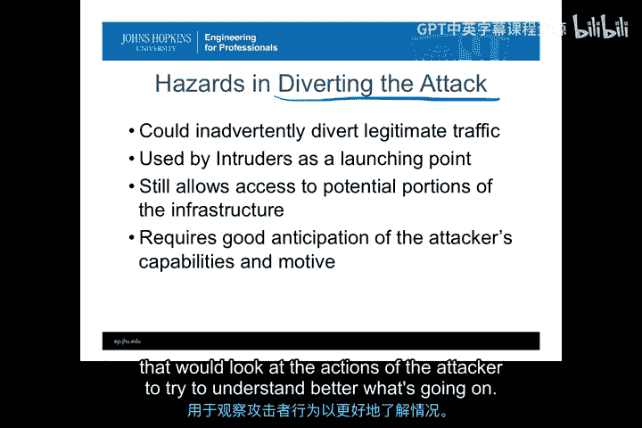

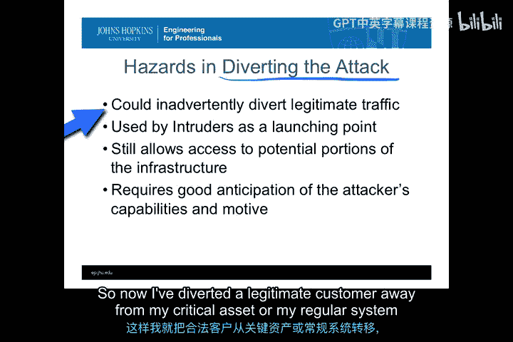

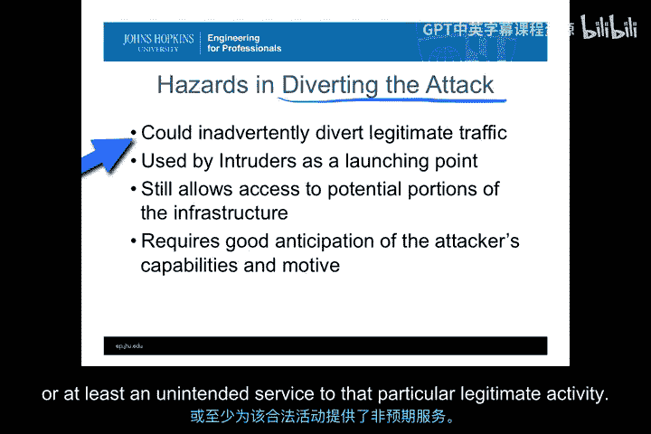

If the intruders know that these kinds of diversions are taking place。

 the intruders could use the system that they're being diverted to as a launching point to create additional attacks within the organization。

 potentially this fishbowl is farther inside the organization than the intruders would normally get。

 So by going into the launching point and using an attack that's very rapid and faster than the manual ability to turn off the attack。

 The intruders could use it as a launching point to attack other points inside the infrastructure of the organization。

And remember that no matter what you're doing with diverting the attack。

 whether you're going to a fishbowl or some other way， you're allowing the attack to continue。

 You're not stopping it。 So you still are allowing access potentially to portions of your infrastructure to the attacker while you're trying to record the elements of the attack。

 This inherently as greater risk because you are allowing the intruder some freedom of action within assets that you own inside of your infrastructure。

 So in order to do this successfully， you really have to have very good anticipation of the attackers's capabilities。

 their motives how they're going to use the situation so that when you divert attack to a fishbowl。

 you know that you're going to have captured and limited the exposure of your critical assets to the intruder while you are in the middle of investigating what it is the intruder will technically do inside of your infrastructure。

 So if you think you have a very good handle on the way a particular intruder as operating。

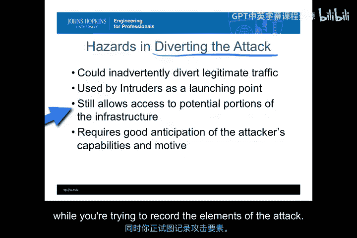

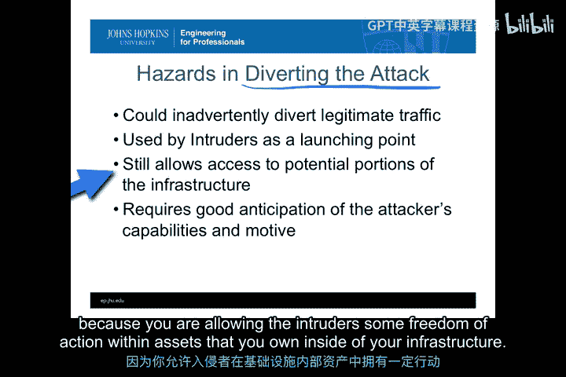

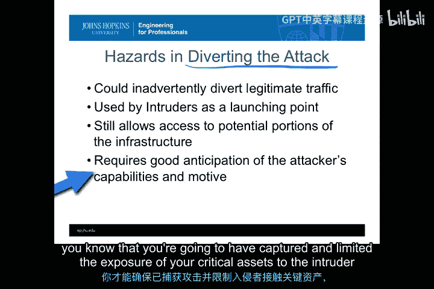

Putting them in a fishbowl can give you more information。

 but if it really is open to any intruder and you don't know what the capabilities or motives might be。

 this can be a very risky endeavor in giving the intruder an unknown intruder with unknown capabilities access to another system inside of your infrastructure。

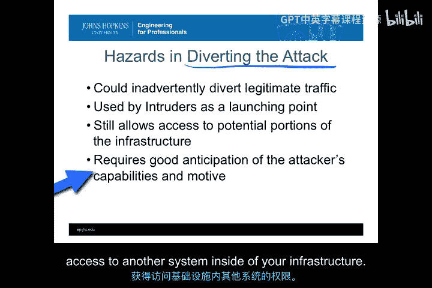

So what if I'm not going to divert the intruder， I'm simply going to block and do automated blocking。

 I get an intrusion。 I've recognized it。 All I'm going to do is turn that particular connection off or block it。

 I can do this by changing the firewall。 I can do this by going to the service and essentially resetting that connection。

 There's any number of ways that I might automatically block a detected attack from coming into my to my infrastructure。

 Well， the intruder can certainly use this feature to block a true victim。

 So if the intruder knows that there is some organization with legitimate access。

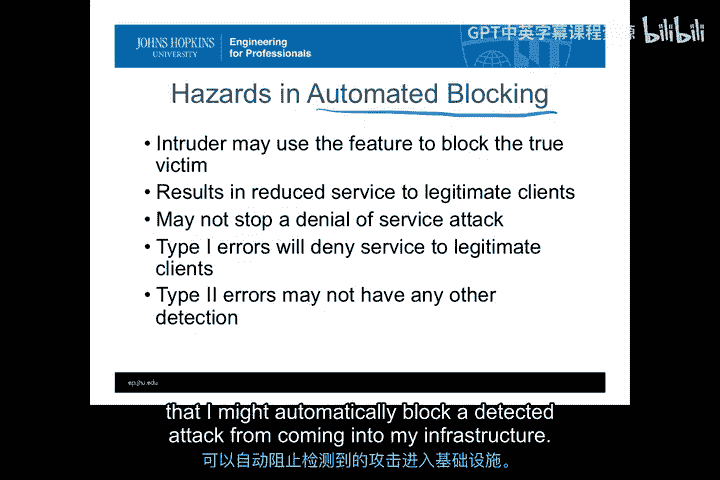

By simply manipulating the and spoing the I address of coming into that organization。

 the intruder could cause the IPS to block a legitimate user。

 So that's the first thing that you might get is a reduced service to legitimate clients to legitimate accesses in areas where the intruder is coming from。

This is certainly not likely to stop a denial of service attack。

 If I'm blocking my attacks at the firewall， that may not matter if I'm basically exhausting the resources of my firewall that could create the denial of service of the rest of my infrastructure directly there。

 So automated blocking may not essentially give me the ability to prevent the downstream impact of that particular attack。

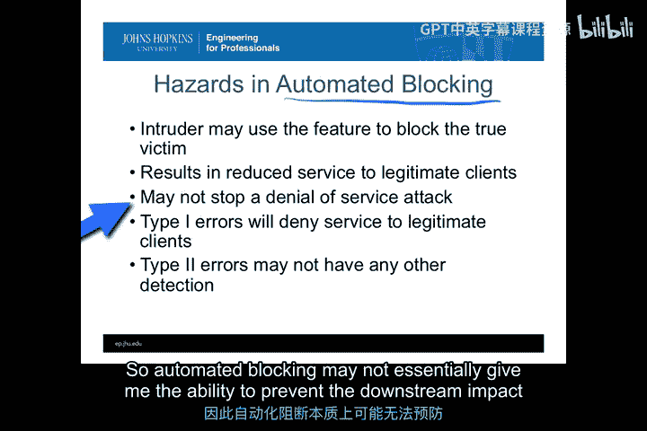

Certainly I'm going to if I have a typey1 error that's going to be problematic with automated blocking。

 If I take any kind of IDS system that has a reasonable typey1 error rate。

 then every time I get a typey1 error， I'm going to deny service to some legitimate or ordinary connection that I'm there。

😡，But in this particular case， if I miss the attack altogether and I'm counting on automated blocking rather than investigating incidents than if I miss an attack。

 and I'm relying too heavily on an I S， I may never actually figure out that I've got a different kind of attack going on。

 So both type 1 and type 2 errors could be problematic in the area of automated blocking。

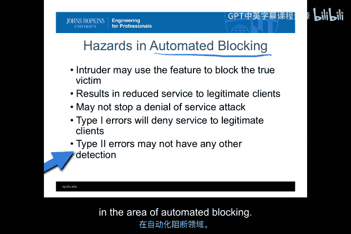

So what about trying to reconfigure my infrastructure when I get an attack as opposed to blocking or diverting what happens if I'm simply going to reconfigure the security parameters of my infrastructure to help to avoid the impact of the attack。

 Well， this certainly puts the reconfiguration under adversary control。

 So although usually alerts would cause a tightening of security。

 an adversary can actually use automated reconfiguration that tightened security to know that manually I'm likely to reverse this when I see that it's gone too far。

 So an adversary can use sort of the human behavior of undoing more of an automated reconfiguration to open up additional vulnerabilities within an infrastructure。

 if nothing else， doing an adversary continuously causing a reconfiguration and a blocking of an infrastructure may cause the defender to completely remove that automated reconfiguration allowing an。

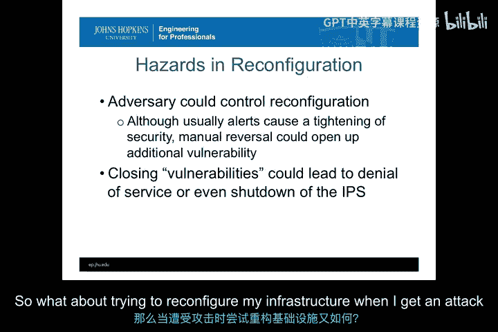

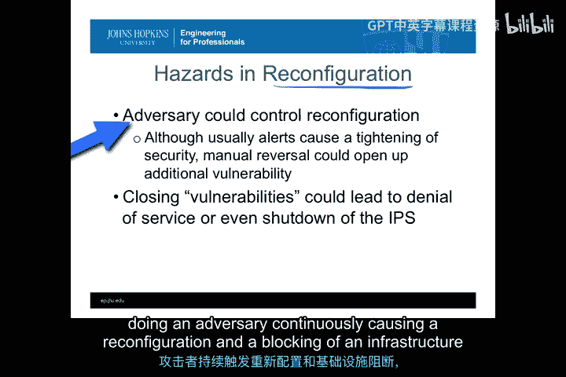

Additional vulnerability for the intruder to use。And， of course。

 closing vulnerabilities could just lead to another denial of service or even shut down of the I itself。

 So if I'm using this reconfiguration to provide information to the Ips。

 and the reconfiguration prevents the observables from making it to the I P S。

 The intruder has effectively caused the Ips S itself to become ineffective。

 These are all potential hazards in the reconfiguration of an infrastructure。

 along with many more that you can imagine if you put automated reconfiguration under adversary control。

 without some very specific parameters and how this would actually take place。

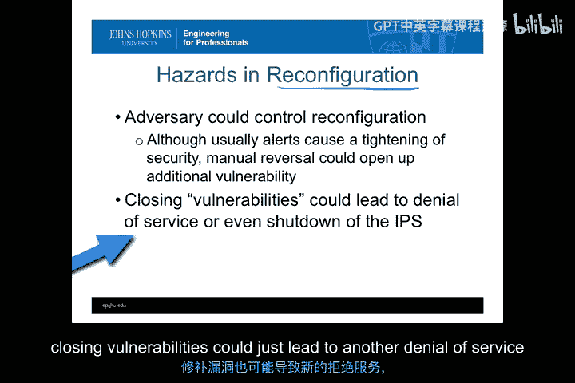

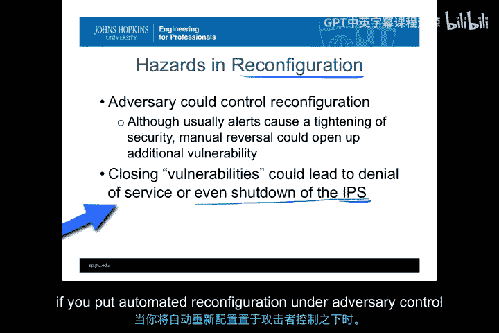

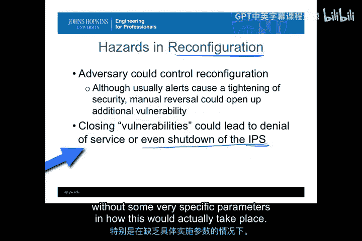

So in the area of adaptive feedback or response， remember this is the type where the IPS is actually going to use the results of handling incidents to change the configuration of the response in the way of adaptive feedback or change the notion of the detection engine itself with regard to the feedback loop。

 so this essentially provides the intruder with direct access to the IPS configuration this allows the intruder to say。

 okay I'm going to be providing a variety of automated responses or responses that will first be manually done eventually turn into an automated response through the adaptive response mechanism that essentially will lead the intruder to know what the actions will be and how they will be taken in future kinds of attacks that would happen。

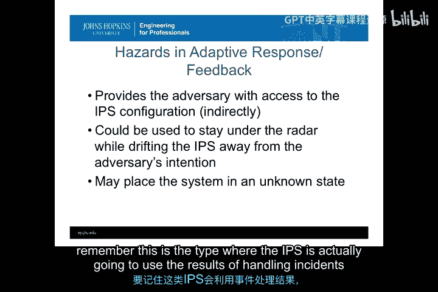

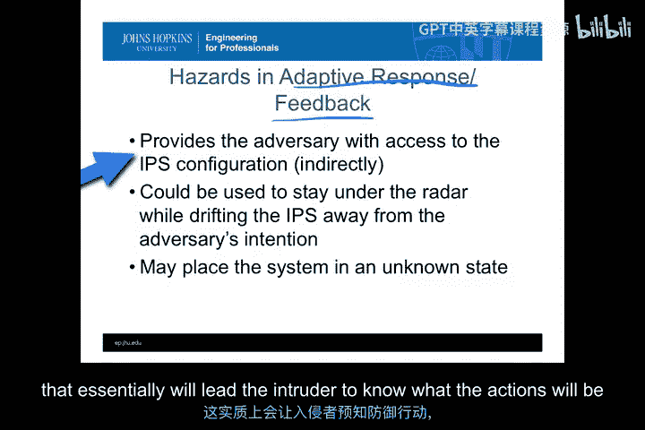

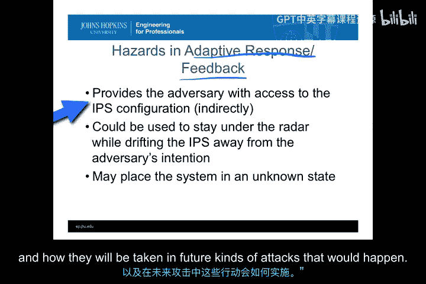

For feedback loops， it can be even more insidious， I can have a very slow intruder that will drift the configuration through the learning algorithms in order to stay under the radar when I actually want to launch a more serious attack later on。

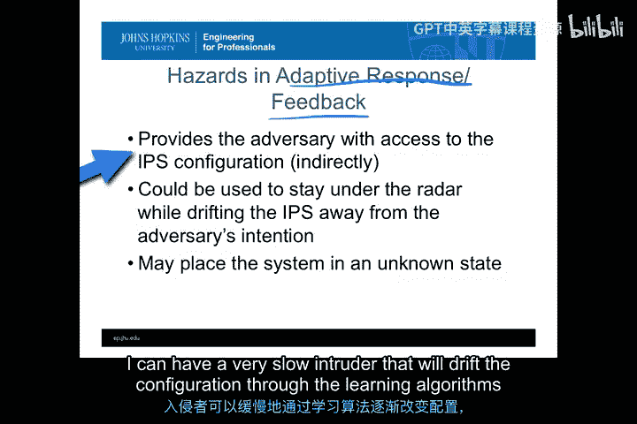

Finally， all of this adaptive feedback and adaptive response and things that are changing the configuration of the IPS may place the system in sort of an unknown state with all of these automated reconfigurations。

 it's going to be hard to say exactly what is it that the I or IPS is configured to do at any particular point in time。

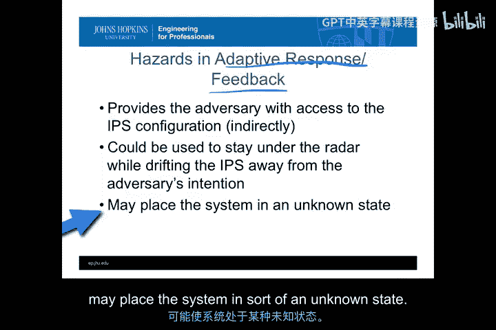

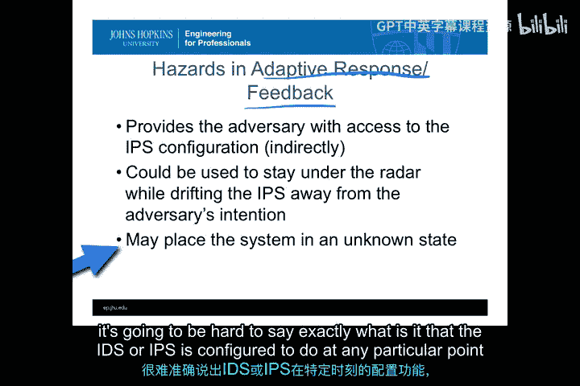

So to limit the risk of all of this automated kind of behavior。

 what you really want to do is make sure that any IPS action that you have is tightly constrained。

 it should only do what human responders would do each and every time that a condition would be detected under the IPS。

 there can be really no conditions under which a humans wouldn't take a particular action in order to make it amenable to the IPS。

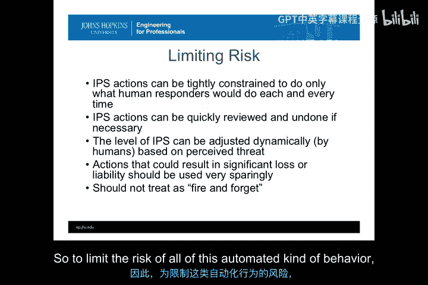

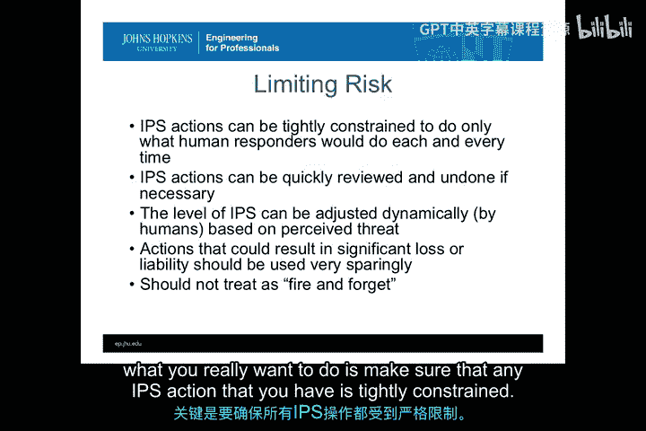

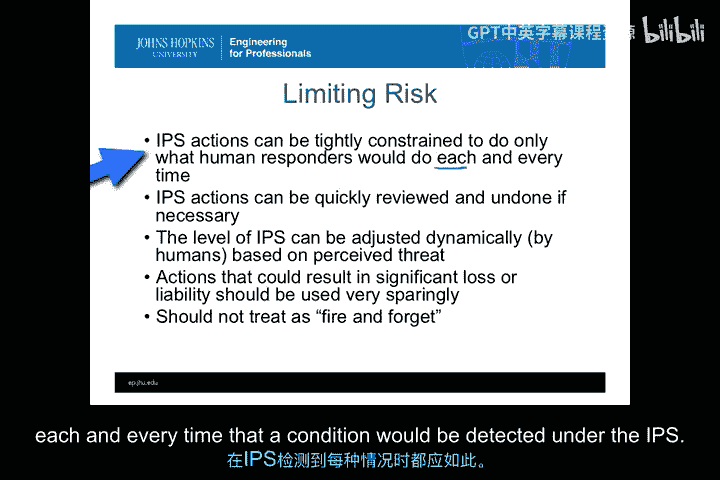

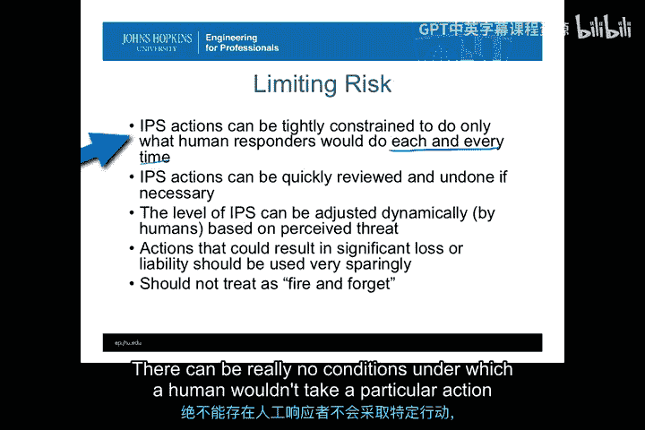

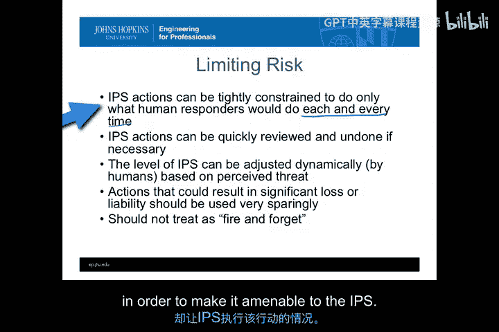

If the IPS actions can be quickly reviewed and undone as necessary。

 that can limit the risk that you might have with an IPS taking any kind of these automated actions that are there。

 So it doesn't really reduce the necessity of a Cert team， looking at the alerts。

 it increases the necessity of the CesEt team looking at the IPS alerts to make sure that more damage isn't being done by an IPS than would have been done without it。

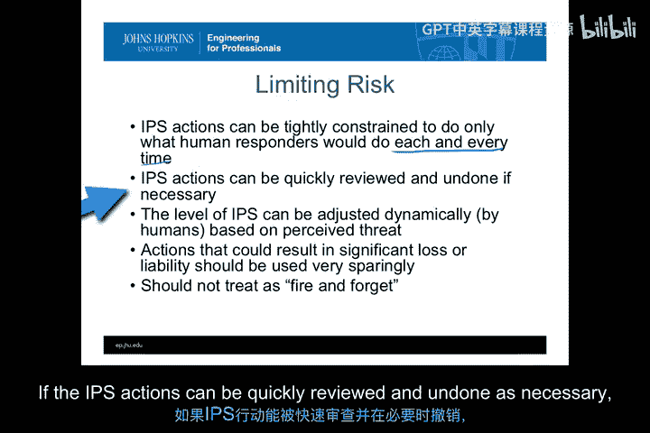

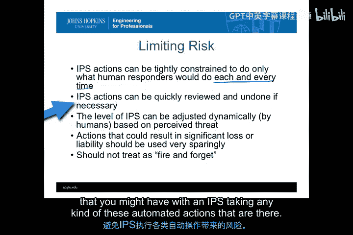

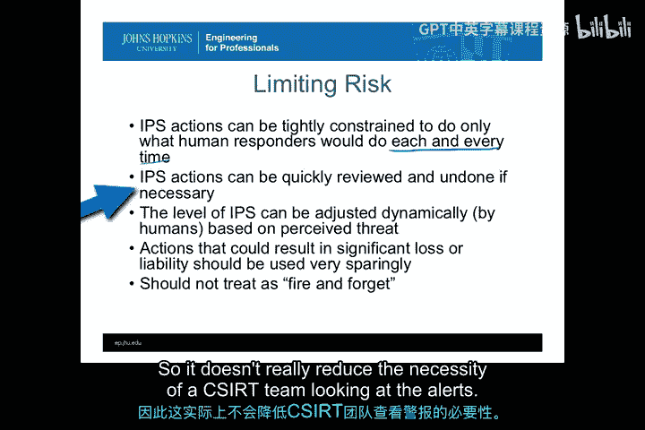

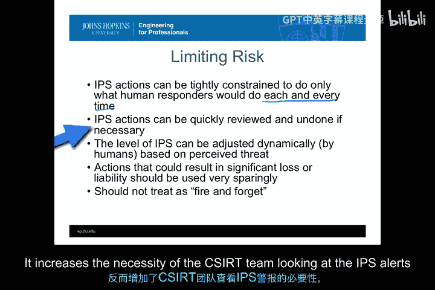

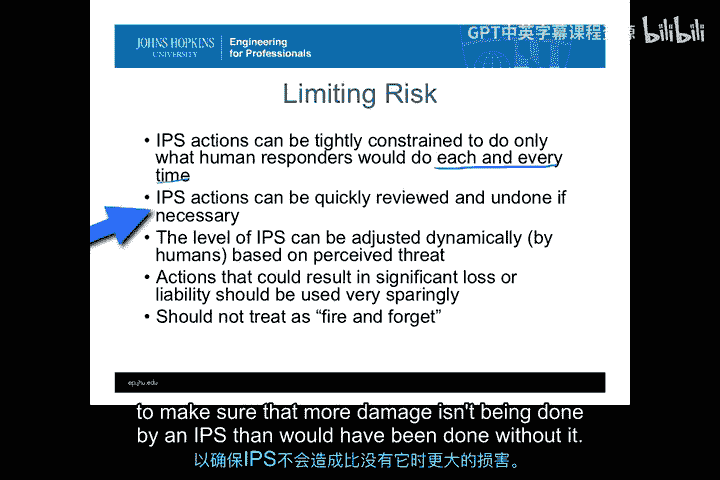

The level of the IPS， the aggressiveness of response should be adjustable within an IPS。

 There may be times in which a really aggressive type of Ips response is warranted。

 but maybe most of the time you wouldn't want to have it that way。 So based on perceived threat。

 you can use IPS functionality as a way to adjust dynamically based on changing conditions how fast you want an IS to automatically take actions。

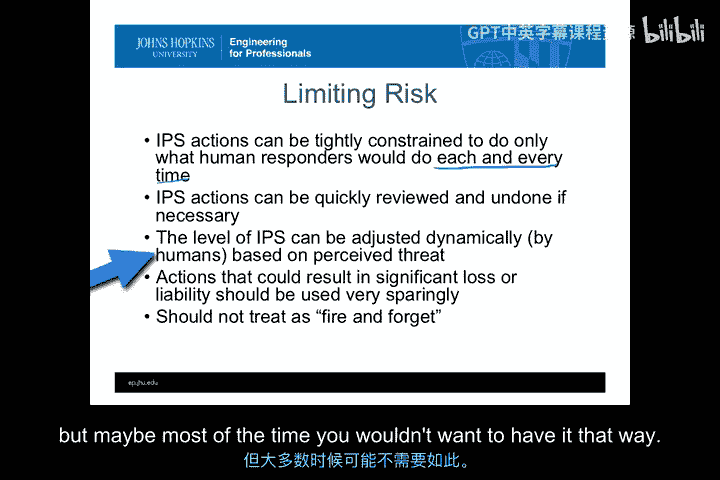

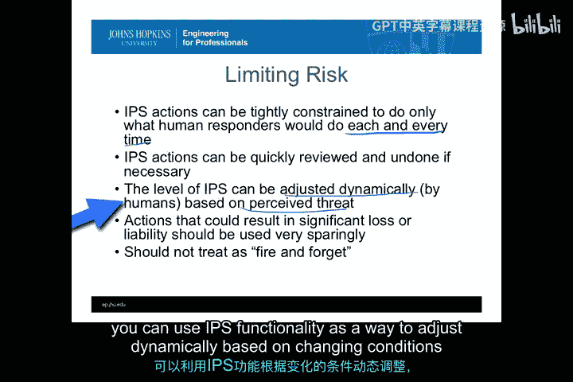

Now， actions that could result in a significant loss or a liability should really be used very sparingly。

 And I would say that if you can anticipate a significant loss or liability。

 you should really be very cautious about using any sort of automated action at all。 Now。

 the IPS could create the scripts to do the automated action and allowed the humans to do that more rapidly by having the actions ready to go。

 But in the case of an Ips automatically taken action where significant loss or liability is concerned。

 This should be very， very cautiously done。 Certainly， in no case。

 should an Ips ever be treated as sort of a set and forget， I've set up my Ips S。

 I never have to look at it again。 and my C Ct team can go off and do something else。

 The bottom line with the use of an IPS S in limiting risk。

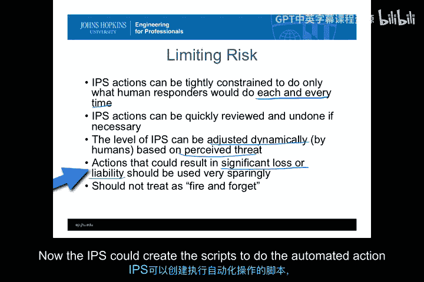

Is continuously evaluating the effectiveness of the IPS and the ability of the IPS to remain under defender's control and not under the adversary's control。

 And that's really the bottom line and using any of these IPS kinds of responses。

 keep it under the defenders's control as much as you possibly can。

 and remember that whenever you automatically trigger action。

 especially action that can result in significant loss。

 you are placing a tool in the hands of the adversary。

 And even though there are benefits to doing that very， very rapidly。

 it should be carefully evaluated as the benefits versus the risks of incorporating these kinds of automated actions into your systems。

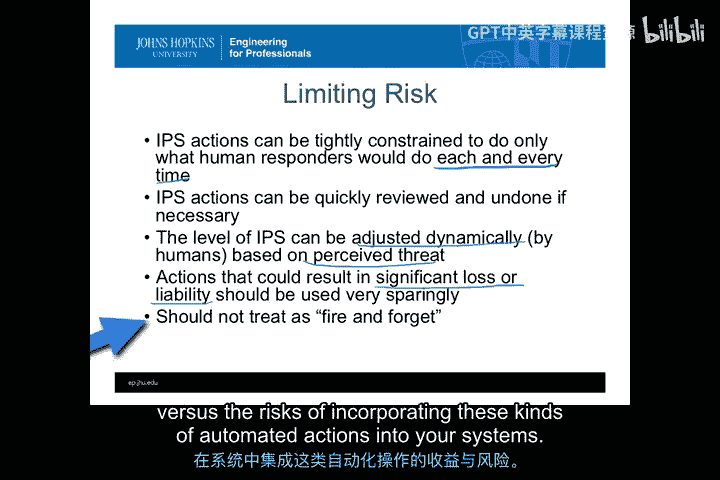