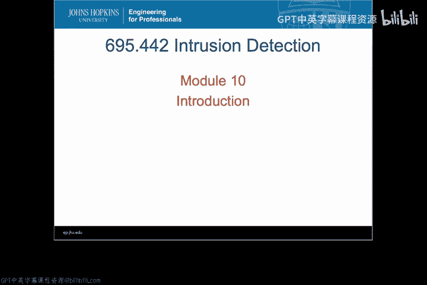
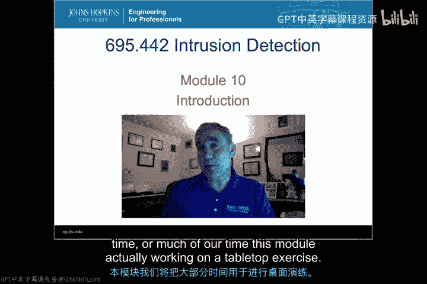
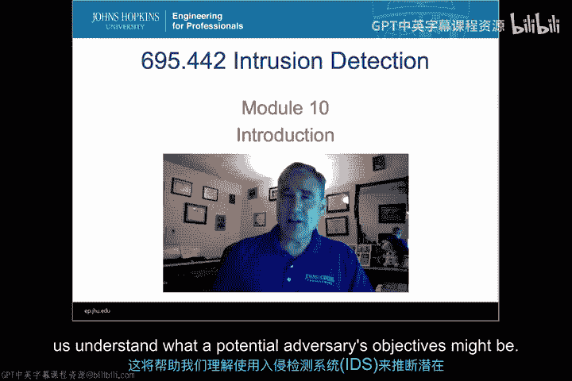
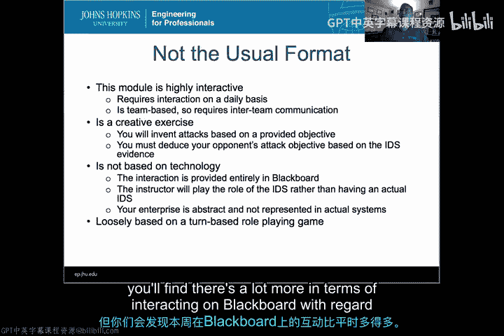
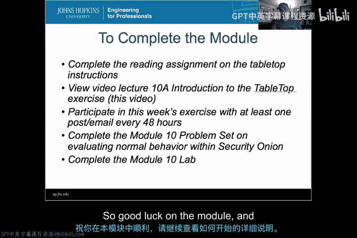

# 约翰霍普金斯大学《入侵检测｜Intrusion Detection》中英字幕 - P49：17_导论.zh_en - GPT中英字幕课程资源 - BV1sGu1z5E2J

Okay， welcome to module 10 for 695442 intrusion detection this is going to be the module in which we're going to spend almost all of our time or much of our time this module actually working on a tabletop exercise to help us understand how difficult it really is。

To use IDS or to use an intrusion detection system to help us understand what a potential adversary's objectives might be。

😡。

So this is not in the usual format This is actually going to be quite different than the other modules that we've had up to now and different than the modules that will be coming after this this module is highly interactive。

 it really requires daily access in order to successfully achieve all of your objectives with regard to what we're trying to do in the exercise This one is also teambased so this week you're going to be in your teams working together to attempt to work with IDS alerts work with attacks in order to try to get the objectives of the exercise complete。

This is a creative exercise。 There are many， many different ways to achieve objectives。

 I've never seen the same team do it the same way twice。

So I truly expect you to really come up with some interesting and creative ways to both attack and defend during this exercise that was there。

 part of the point of this is really bringing in that human perspective that creativity perspective that you're going to see in the real world with regard to attacks and the use of IDS alerts。

This exercise is not based on technology。 You won't be using security onion in this exercise。

 You won't actually be configuring a real Is or looking at real IS alerts。

 We're going to abstract away the detailed syntactic parts of actually manipulating。The IDS。

 so we can get the point of actually using an IDS。Losely。

 this is based on sort of a turn based role playing game。

 but you'll find there's a lot more in terms of interacting on Blackboard with regard to this week that we normally see。

So while I do hope this is going to be a fun and interesting exercise this week。

 there are some true learning objectives behind this week that we want to make sure that we cover so by the end of this module I want you to be able to see how you select between IDS alternatives and what the result of selecting between the alternatives in a constrained exercise might be you're going to configure an abstract IDS at very high level principles to get an idea of what you might expect when you start to work with real intrusion detection systems out in your own environment。

You're going to be creating an attack plan to achieve a specific objective The point of this course is not to learn how to attack systems。

 but understanding a little bit of how to attack and avoid IDS detection is an important part of understanding how IDSs work we're going to evaluate sort of abstract IDS alerts to select appropriate responses and hypothesize on an attacker objective which is part of the real point of this exercise is assessing the difficulty in determining the objective just from using IDS as your primary trigger。

😡，So to complete the module， they're reading assignments on the tabletop instructions。

 so be able to see exactly how the tabletop works and watch the instructional video that comes on after this on the details of the logistics for this tabletop exercise。

😡，Participate， participateicipate in this week's exercise。

 You must post at least once every 48 hours， but it's really better to do things every day in this module if you possibly can。

 there is still a problem set module 10 problem set on evaluating normal behavior within security onion so while you're waiting between various things that are happening during the exercise。

 there is some work to do in security onion， there's a lab and a problem set to do to begin to calculate normal behavior so that in the next module we can start to turn that into a rock and a PR graph so we're going to try to create some of the data this week in order to next week begin to do the quantitative assessment of the IDss that we've been driving toward so。

This module is going to be different。 It's going to be very intense and very time consuming this week。

 Try to balance your time between participating in the exercise and doing the work that you need to do within security Onion。

 There's no additional reading this week。 There's no additional discussion outside of that。

 So that's why this is a very different kind of module。 You have fewer things to juggle。

 but each of them may be a little bit more intense than what you're used to。

 So good luck on the module and please move on to look at the detailed instructions on how to get started。

