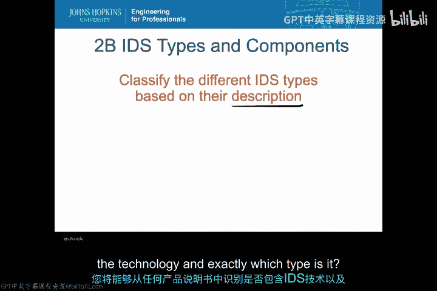
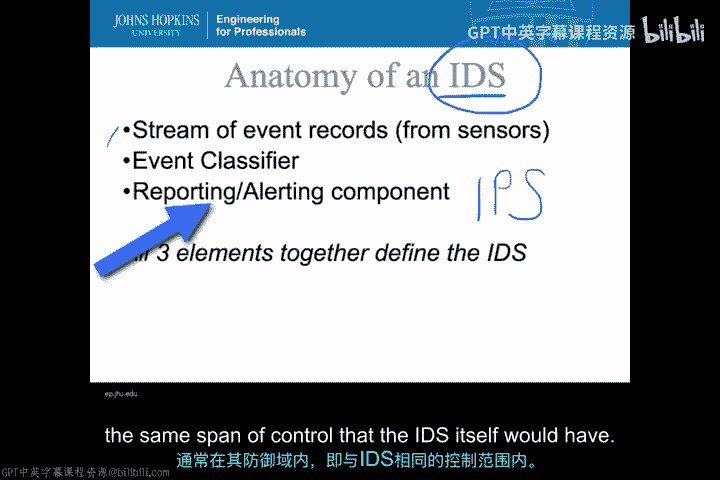
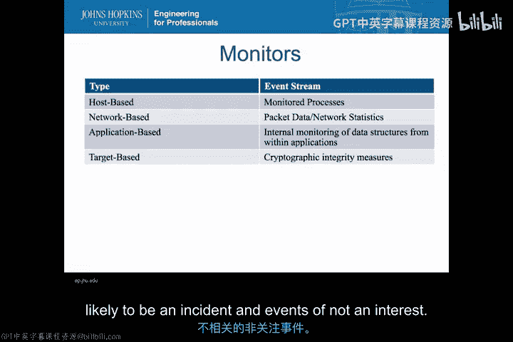
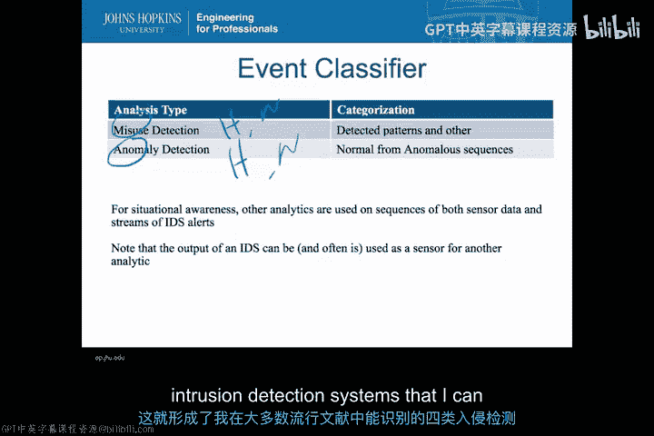
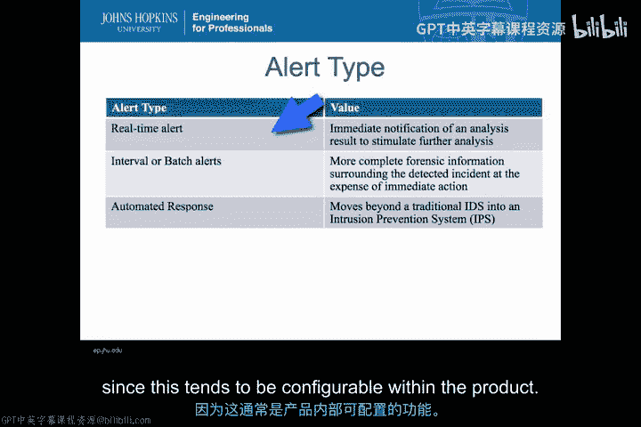
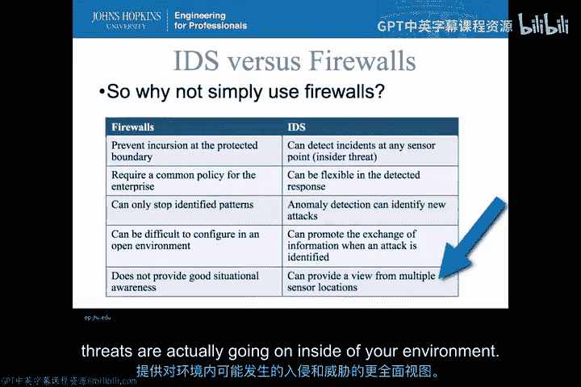
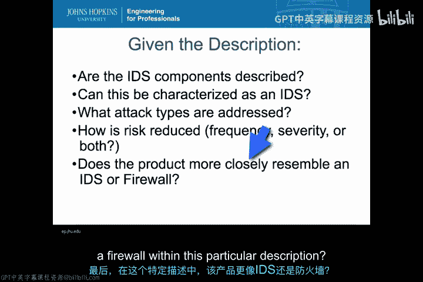
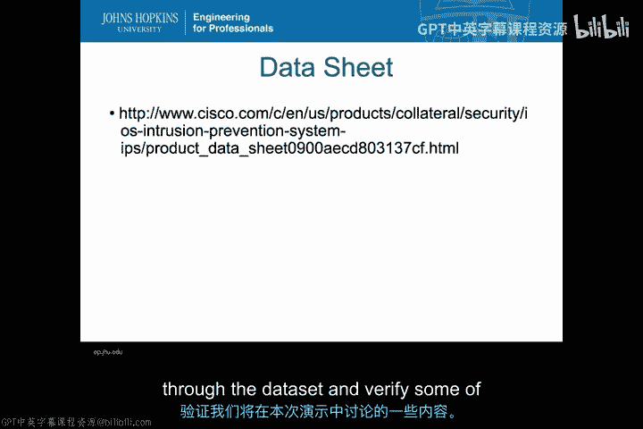

# 约翰霍普金斯大学《入侵检测｜Intrusion Detection》中英字幕 - P4：3_IDS分类与核心组件.zh_en - GPT中英字幕课程资源 - BV1sGu1z5E2J

Okay so in this video we're going to take the opportunity to dive a little bit deeper into the various types and components that actually make up an intrusion detection system。

 so we're essentially going to classify the different IDS types mainly based on their description so when we talk about you know and read about an IS or a nonidS product in the press or on a data sheet。

 you'll be able to match that up against the types and components that we're going to talk about here。

 in fact you'll be able to by the time we're done， identify from any data sheet or product sheet out there whether an IDS is included in the technology and exactly which type is it。

So let's first go into exactly what is the anatomy of an intrusion detection system So every single intrusion detection system。

 all of them consists of exactly three elements， there may be other things involved in the technology。

 but these are the three elements that are absolutely required in order to actually have an I a real I system that's there。

 So when you're looking within the product sheets， you want to try to find whether there is a stream of events。

 an event classifier and some sort of reporting or alerting component that's there these are the three areas that always have to be there in order to identify that this is an I no more and no fewer are the IS components Now I will say also that when you talk about the reporting and alerting component that third component。

 I also include in this component the possibility of an auto。

That would change us from essentially talking about an IDS to an IPS an IPS is an intrusion prevention system。

 and that basically is exactly the same as the three elements that we're talking about here。

 the stream， the event classifier and the reporting or alert learning component。

 but instead of simply reporting back to the user there's going to be some kind of an automated response usually within the defensive domain within the same span of control that the IDS itself would have。

So the very first part of an IDS is basically how does it collect that stream of events that direct stream into the IDS itself。

 and there are different types of intrusion detection systems that are basically all distinguished by what kind of data set is fed into that particular IDS。

So there are usually four recognized types of inputs that will go into these various kinds of Is。

 The first is really this sort of hostbased。 The idea that I'm going to monitor processes on a host and the event stream is going to consist of a series of information elements that are going going to come from the monitored processes。

 usually from something like audit logs or some other kind of event stream from the operating system or down in the kernel or out in the application area。

 we'll talk in more detail when we get into hostbased Is exactly what is monitored in terms of these different types of Is for the network we're really talking about a stream of data packets or network statistics things that are coming from the network So when the first one when we talk about host based。

 we're talking about data at rest and in network based we're talking about data in motion。

 So those are kind of distinct。In between those two particular areas。

The fourth recognized type is often considered a subtype of the host base and that's our application based monitoring these are monitoring the internal data structures from inside of application。

 they tend to be very sort of application based today many IDSs will separate application based monitoring from host based monitoring because the stream of events dealing with an application could come from the network or they could come from the host。

In other words， if I am looking at applications that are running in terms of their processes。

 the things that are actually being processed， it's going to look like a host based monitor。

 if I'm looking at an application through deeppack inspection from network traffic。

 then it's going to look more network based， but in both cases I'm really looking at the application level from within that side。

The fourth type is a little bit different than the other three again， the target based。

Is really looking at an integrity measure' specifically looking at the integrity of important files or elements that should never change。

 You could have a targetbased monitor on either a hostbased system。

 a file that should never change or a network based system。

 a series of traffic that should never vary from its host or destination。 In both cases。

 I'm looking at some kind of an integrity measure where integrity is the really important part。

 if I can calculate integrity such that it can't be spoofed by an intruder and I can recognize that as an observable that I'm talking about a targetbased system。

 The most common targetbased system that's out there is one that's actually known as tripwire。

 tripwire is a hostbased targetbased monitoring system that looks specifically at the integrity of files within the operating system。

 You'll learn a lot more about tripwire as you。Begin to get into some of the projects that you're working on。

The important thing to recognize about all of these monitors is that they involve a stream of data into some kind of an analysis engine or some kind of a classifier。

 This is different than which you might see with a forensicbased tool where you have saved data from the host or the network or applications and you're actually running something to discover incidents well after the fact The important thing about a monitor for an IDs is you have near realtime detection of the various kinds of events coming through a streaming classifier in order to identify when you have a possible incident。

So now let's move on from the internal， from the stream of events coming into an intrusion detection system to the actual classifier that's going to separate those events into events of interest that are likely to be an incident and events of not an interest。

So the event classifier， this is really the heart of any intrusion detection system that you have out there every single intrusion detection intrusion prevention system at its heart contains some kind of event classifier that's taking that stream of input events and separating them。

 classifying them。With regard to whether they're not of interest。

 they're not part of an incident or whether they indicate some kind of an incident。

 The classifier may indicate what type of incident it might not just be a binary classifier。

 but it's always going to be a classifier that gives you some indication that I have an incident here。

 Now， remember， the incident is not the same thing as recognizing an attack。

 What I've done is I've classified my event stream into events that indicate that there might be an attack and events that don't indicate that there might be an attack。

 In either cases， the classifier could be wrong。 And there are different types of classifiers that have different characteristics with regard to how often theyre correct or incorrect with regard to their classification。

Basically， the different types of IDss break into two general categories。

 we've got the first which is misuse detection。 This is also often called signaturebased detection。

 although that's really a little bit too specific of an indication of what kind of IDS it is。

 but in a misuse detection system， what I'm detecting is I have some kind of a representative string or a set of events that if I were to see them in the classifier indicate some kind of an incident。

 this detects a pattern that's going to come in from my input stream that when I recognize that pattern。

 I'm essentially going to recognize that that is the indication of an incident。

Now this is different than the other type， which is basically the anomaly detection system so when I talk about an anomaly detection system。

 I mean that what I mostly am going to measure and match against is my event stream to what I would consider to be normal traffic as long as I can match the event stream coming in to what I think is normal and not part of an incident I won't alert but whenever I see an event stream that I can't match to that sort of normal behavior I'm going to call that anomalous element an incident so anomaly detection has the advantage that I don't have to have that signature in advance the way I would with misuse detection it has the disadvantage that any unusual behavior with regard to anomalies that I'm seeing are automatically now indicated as some kind of an event and that's not always necessary the case so in misuse detection I'm much more likely to recognize those。

Exactly and find incidents that match known attacks。

But I'll never find anything I haven't seen before。

 I won't see the so-called zero day attacks in anomaly detection。

 I'm not really looking for any specific attacks that I might already know。

 but since I'm going to call everything unusual an attack。

 I might have a very high false positive rate。 I may classify some things as a that in fact are simply unusual situations or variations from my normal behavior that I don't recognize as normal。

Two other points of interest when we're talking about these kinds of event classifiers。

 the first is that for situational awareness， often what we have are a series of analytics that are used on both the sensor data and streams of IDS alerts so just because a classifier ingests the different types of events does not necessarily mean that those events are lost。

 they're often staved and can be used for other purposes。

 like situational awareness like forensics tools like the various other kinds of things。

 Also note that IDSs can be chained together so that the output of an IDS can be and often is used as a sensor。

For another analytic， so the series of incidents that come out of the event classifier can be used as an input stream for yet another classifier。

 this kind of chaining of IDS is becoming quite common。

 especially across multiple organizations or multiple elements within an organization。

 in order to be able to understand whether events are isolated or whether I'm seeing a more general trend。

So between those two types between the misuse detection and the anomaly detection that I've just talked about。

 I now have the different types of IDSs that I can do。

 I can use misuse detection on the host I can use misuse detection on the network or I can do anomaly detection on the host or on the network so in either case I can have ause host-based misuse detection IDS。

 a network-based misuse detection system， a networkbased anomaly detection system or a host-based anomaly detection system that gives me the four general classes of intrusion detection systems that I can actually recognize in most of the popular literature。

The last important part in trying to categorize a different IDS is the way that it actually alerts the user。

 the three different types that we really have to deal with here are realtime alerts。

 interval or batch alerts， and automated response。So when we talk about realtime alerts。

 what we really mean is immediate notification， in other words。

 that we're talking about some kind of a system that as soon as I recognize a signature or something within the stream of events。

 I immediately notify a user or take some kind of a response this is different from my interval or batch alerts where I might when I get an indication wait and collect a more detailed forensics indication before I actually provide the incident to like my intrusion detection team。

In the second case， what I'm really trying to do is to say it's not that important to provide real time access。

 It's more important to put that in context with other information that I can gather。 Sometimes。

 of course， you may get both。 You may get first， some kind of a real time alert followed by an interval or a batch alert。

The third type is this idea of automated response。 This is where instead of a traditional intrusion detection system where all I'm doing is notifying a user。

 I'm actually taking action against these users against the incident It basically can do things like reprogram your firewall。

 reset connections， add additional protections， increase monitoring to certain areas。

 there's a number of different types of automated responses that we'll talk about as we explore the specific products and types that we have within the class as we move forward。

So these alert types are actually almost always evident within most modern intrusion detection tool systems today。

 Most systems will do a variety of each of these different types of alerts inside of a single IDS product so historically or within research products you might only have one of these in most real products like if you're using snort or bro or tripwire or any number of others of these IDSs。

 they'll often have one or more of these different alert types that you can actually configure within the IDS itself。

 so unlike the four different alert IDS types that I talked about in the previous chart。

The alert type doesn't usually distinguish the IDS product。

 since this tends to be configurable within the product。

So as you can tell from my description， the whole idea of an intrusion detection system is really closely related to the concept of some kind of a firewall or protection system After all a firewall will also do some kind of a match within an incident and then block or not block traffic if it's a network firewall or block or not block access if you're inside of a host based on those detected incidents so why not simply use firewalls why bother alerting users why not simply do the protection ahead of time。

Well， Iss and firewalls really have different kinds of purposes。

 and they're sort of represented by some of the things in the chart that I have here。

 So firewalls can prevent incursion at some kind of protection boundary so I can look at either an access control boundary or a network boundary and do an automated protection based on predefined rules。

 An Is can detect incidents pretty much any place I can get streaming sensors。

 So it's not restricted necessarily to simply be used at protection boundary， So for insider threat。

 I might have a more complex set of elements that I'm actually trying to detect based on sensor logs without a clearly defined boundary or some kind of a boundary that I'm actually using for protection。

 With firewalls， I have to have a common policy across everybody going across the boundary。 in an Is。

 I can be a little more flexible since I'm really talking about alerting rather than trying to。

Were trying to do some side of enforcement。Fiwalls by and large can only stop identified patterns。

 usually firewalls will not include any kind of anomaly detection because there's too many false positive。

 too many things would be blocked that would actually have to be normal IDS since we can actually just alert users rather than take direct action can essentially employ anomaly detection to identify these new attacks in close to real time。

Firewalls can be difficult to configure because you've got to make sure the configuration is relatively liberal in terms of what it allows through since every other action is going to be some kind of a blocking action。

 whereas IDs can really support the exchange of alerts so attacks can be identified attacking information be shifted around more easily it lends itself better to a federated approach Finally。

 firewalls don't really allow much in the way of situational awareness they block traffic。

 but they don't give you insight into actually what's going on sort of inside and outside of your system but IDss since they're based on sensor logs from potentially multiple locations can be fed into an area to provide a much more comprehensive view of what the possible intrusions and threats are actually going on inside of your environment。

So let's take a look at a real product and see if we can't break it down and understand a little bit better how to identify the different elements of an intrusion detection system。

 the example that I'm going to use here is basically the Cisco I intrusion prevention system now although this has intrusion prevention system in the title we want to break down and say exactly what kind of I is this。

 how am I going to categorize this particular IDS and I'm going to do this by looking at the data sheet for the Cisco I IPS and walk through the important elements of this in order to be able to understand what kind of IPS I'm talking about。

So right from the very first diagram I can already see that the location of the。

IDS is going to be right in line with my network traffic。

 This is essentially going to tell me immediately that what I'm really looking at here is something that's going to be more of a network based Is than a hostbased Is。

 Now I do look and I see loss of hosts that are being described in the description here and in the description over here。

 but I don't see anything running， and I don't see a sensor stream coming in necessarily from these particular locations。

 What I am seeing is I'm seeing most of this happening。

 Most of the excitement is kind of happening right here at the router Ips。

 So my first indication at the very beginning of the data sheet is going to be that this is probably a network based Is。

 Then if I sort of look down a little bit further。 And I look at the kinds of protections。

 protect branch ps from internet worms。 So if I'm looking for worm protection I'm probably looking for something that has already been identified as a worm。

 that's going to lean me toward thinking that this is more of a signature based system than an。

B system。 So let's continue to move on。 So I'm going to apply IPS traffic to stop worms and attacks。

 Well， this is now reinforcing the idea， since I'm going to take automated action through an I that I'm probably not looking at something with a very high false positive rate。

 I'm probably looking at something with a very low， false positive rate。 That's again。

 going to lean me more toward the signaturebased misuse detection based system than it would anomaly base system。

 Finally， this other protect branch office servers applying the I in the firewall to protect local servers from attack。

 Again， this protect this I functionality and protecting。

Branch office servers that are connected to the network tells me that this is probably a network based misuse based intrusion detection system。

 But let's go on to a little bit more detail within the data sheet。

So what I'm going to look for inside the data sheet is a couple of specific questions I'm basically going to say are the different IDS components described。

 remember I'm going to be looking for the three， I'm going to be looking for the monitoring stream。

 I'm going to be looking for the classifier and I'm going to be looking for the reporting or automated response part then I'll take those three and say can I characterize this as an IDS。

What types of attacks are addressed， Is it0 day types or types that I already understand。

 How is the risk reduced， Am I trying to reduce the frequency， severityity or both， And finally。

 does the product more closely resemble something like an I S or something like a firewall within this particular description。

So this in particular is going to be the data sheet that I'm going to use to try to identify all of this information I'm going to pull some of the specific categories directly from this data sheet。

 I encourage you to go ahead and go to this link yourself and look through the data sheet and verify some of the things that we're going to be talking about in this presentation。

So here's the data sheet that I'm going to be looking at you can see that I have the address here sort of within the browser。

 you can see this is exactly where I pulled that sort of initial major use case and key benefits。

And then sort of down here within the page， I'm going to take a close look at this table one that's sort of in here this gives me the features and the advantages and benefits This is probably the place i'm going to best find how I'm going to do the categorization of my particular。

Questions whether or not this is IS。 Okay， so first of all， if you look here， the very first feature。

 I see IPS signature packages。 there's a dead giveaway。

 I'm gonna have that this is a signature based Is in terms of coming in here。

 So I also have that sort of down in in the next bullet。

 you'll see that I have other category signatures， including some lightweight signatures updated by Cisco。

 So again， signature based system that I'm having coming in here。

 All of these first three are basically talking about that kind of an area。

And the next element I'm going to take a look in here is look up here。

 More comprehensive and effective attack coverage by default。

 quicker inclusion of most relevant threat signatures。 Look down slightly from this。

 I'm going to have traffic scanning for attack signatures。

 traffic scanning this sort of next bullet tells me specifically what I'm dealing with here is network based traffic。

So now I know I've pretty much guaranteed that what I have here is something that's going to be identified as a networkbased IDS。

 it's going to be signaturebased or misusebased， it's going to be based on network traffic and it's going to require it's going to have an automated response capability in IPS capability here which I can easily see in any number one of any number of these items within table one to talk about exactly what kind of automated rules can apply It also looks like I'm going to have various kinds of automated reporting that can kind of come back out of here so that I can integrate this with other kinds of support that I might have in the organizations this is going to be very useful when I try to integrate this with some kind of network oriented SIimM system。

So at the end of what we have here， what we see is that we are able to determine pretty clearly that what we have in this particular Cisco I I is a signaturebased misuse IPS that does automatic signature automatic signature updating and automatic protection at the network appliance level now we completely categorize what kind of Is we're talking about based on the data sheet that's involved here。

 So at this point， you should be able to see pretty clearly that what we can do within categorizing the different kinds of IS is to look through a product data sheet。

 identify specific elements thatll tell me what kind of an I is we're talking about and that'll tell me what sort of capabilities I can expect to get from this product and what kind of threats can I deal with and again from that how can I actually reduce my。

I risk within the system。