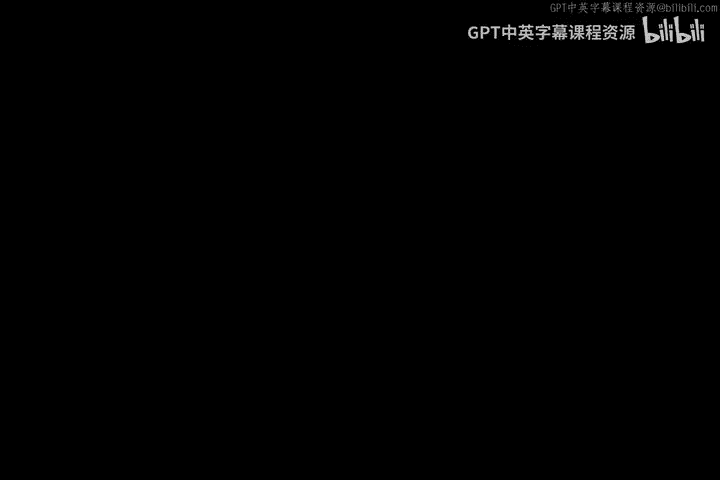

# 约翰霍普金斯大学《入侵检测｜Intrusion Detection》中英字幕 - P50：0_专项课程介绍视频：入侵检测3.zh_en - GPT中英字幕课程资源 - BV1sGu1z5E2J

You there Bay， I like to introduce myself， my name is Jason Carlson。

 and I'm a senior cybersecurity Engine professional at the John Hopkins University P Phsics Lab。

I teach at the JTUY School of Engineering under the Sub program and a Mil officer。However。

 28 years the military commission has well experienced， information assurance， mission system， cyber。

 security engineering， other king， emission analysis and attru detection。

I developed a Ju detection course。Which is broken down in consider at specialization areas。

Each specialization area has seven modules， which presents the topics of choosing detection through lectures。

 readings， videos， quizzes and assignments。You can take all specializations or you can pick those areas within trutrusion detection you would like to learn more about。

True Juion Casserra courseurse explores use of network and host based intrusion detection and prevention systems as part of our organization's overall cybersecurity posture。

And threaten form decision strategy， a variety of approaches， models， analysis， technologies。

 framework and algorithms。be studied to understand the practical concerns of deploying IDS IPS。

In an enterprise legacy IT， as well as OT， a British technology cloud。

 and as a service hetero and homogene and environment。

Within the inrus detection casseerra specializations， youll learn about post positives。

 pho negatives。Porecision recall graphs miss trade off。Miss detection trade offs。Architectures。

 configurations and reporting of IDS IPS。By needs。And data。

Tuning baselinelining to understand and differentiate anomalies or beign activity will also be discussed observable collection points of interest。

No for situation awareness。Understands of neutrality。Net flow characterizations。

You your route anizations will be discussed to you pack inspections。

On types of attacks and threats to host h staff activity and network dynamic activity。

And their countermeasure。Course topics。Will include but not limited to。Products， architectures。

 configurations of components of ID IPS， host and network base， IDS and IPS， network analysis。

Ideius technologies。Ideas on context， machine learning， Linux， firewally tables。

 uncomplicated firewalls。Cens a response tactics。Nwork pack analysis， graph theories。Daniel router。

onymization services， receiver operating curves and characteristics。

And network compact analysis studies。My goal。But then the true of course in Cassera。

 is there students to make learning fun？To have learned and be a fun， enjoyable experience。

 be yet to it be interesting。Translating difficult concepts into manageable learning modules that can be easily understood。

My hope is that students will be able to take the threat ideas provided。

And translate that into professional careers。I thank you for everybody's interest in the session course in Conra。

And hope everybody enjoys and learns a lot from the course within intrusion detection on Cara platform。

