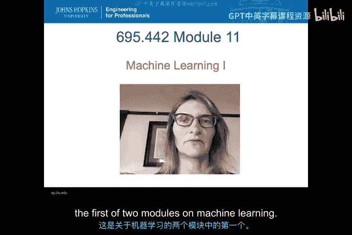
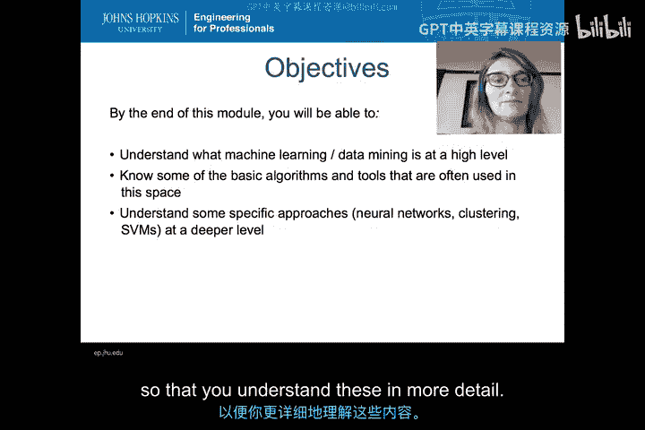
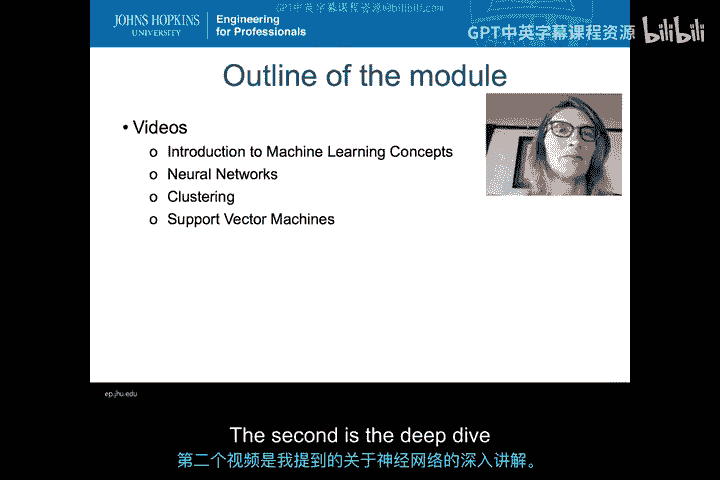

# 约翰霍普金斯大学《入侵检测｜Intrusion Detection》中英字幕 - P51：1_导论3.zh_en - GPT中英字幕课程资源 - BV1sGu1z5E2J

Hi and welcome to Module 11， the first of two modules on machine learning。

This module is intended as an introduction to machine learning， and I hope that by the end of it。

 you come away understanding what machine learning is and what data mining is and some of the key concepts in this space so that if you talk to someone else in this space。

 you'll understand a little bit about what it is that they mean when they use certain terms。

You should also come away understanding some of the basic algorithms that are available to you in this space and there are a large number of them and I won't be covering all of them in any amount of detail。

 but you'll get some sets for what some of the key algorithms are and also some of the tools that tend to be used in this space as well there are a number of tools now available so that you don't need to program from scratch and understand all of the underlying mathematics in order to do so you can actually just use a tool and say I want to build a decision tree and let the tool do it for you。

And by the end， too， we will do a deep dive into a couple of the algorithms so that you understand them in more detail。

In particular， we're going to look a little bit at neural networks， at support vector machines。

 and at clustering so that you understand these in more detail。

So given this， there are four main videos in this module for you to review。

 The first provides an introduction to machine learning concepts at a very high level。

 The second is the deep dive that I mentioned on your network。

