# 约翰霍普金斯大学《入侵检测｜Intrusion Detection》中英字幕 - P52：2_机器学习基础概念精讲.zh_en - GPT中英字幕课程资源 - BV1sGu1z5E2J

Welcome to Moule 11A in this module， we're going to do a very brief high levell introduction to machine learning。

 what machine learning is and some of the basic concepts behind it and some of the basic concepts behind the mathematics used in machine learning。

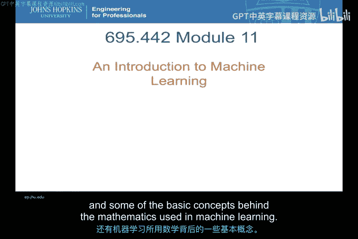

But first， let's start with a definition， what is machine learning？

Machine learning was first defined in 1959 by Arthur Samuel as a field of study that gives computers the ability to learn without being explicitly programmed。

 and in fact he not only made this definition， but he also went and further and create a machine learning algorithm in particular what he did was develop a program that played checkers and the way it learned how to play checkers was by playing against itself until it learned what were the best approaches or moves so that you could win in the end。

 and in fact that particular program went on to beat the state champion at checkers for the state of Connecticut。

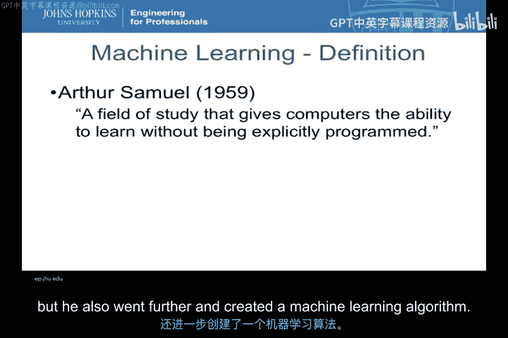

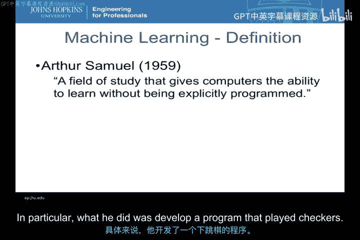

Since then， there have been a number of different machine learning algorithms that have been developed and in this module we'll cover a couple of those in a bit more detail。

And what we've also noticed is that there are a number of different terms that have been used。

 I've been using machine learning， data mining is also a very commonly used one。

 artificial intelligence used to be used a lot， but it has somewhat fallen out of favor for the more explicit machine learning and data mining terms and then another one that you'll often see particularly less so in academic circles but much more in industry is the phrase analytics or data analytics。

 and all of these terms I am going to use essentially interchangeably for this module。

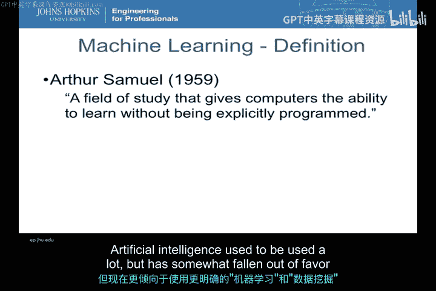

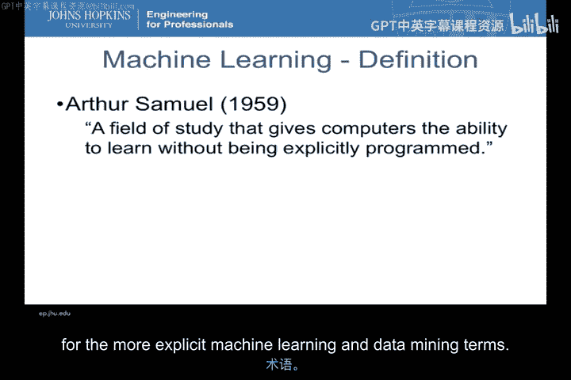

So what are some of the basic concepts that we have in machine learning I'm really going to focus on essentially two key concepts The first is your learning algorithms。

 so really are you doing supervised learning or onsupervised learning and the key here is what you have for data and that will impact what algorithms you can use and therefore what kind of approach you take to your learning algorithm and I'll go into that in a moment and then the second key concept is really gradient descent and that is related to these terms。

Loal minimumma or and global minimum and that is a very key concept in how the mathematics behind learning work and i'll go into that into more detail explaining again at a high level what these terms mean without going into detail in the mathematics behind it。

 but understand that this。Concept actually underpins pretty much all of the learning approaches that you're going to see。

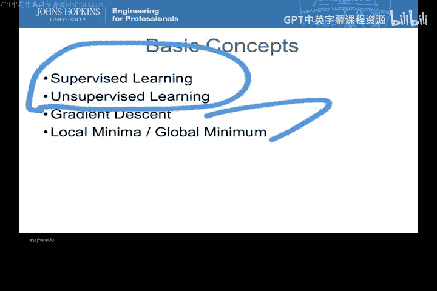

What is it then that I mean by a learning algorithmEssential your learning algorithms。

 whatever approach you use to learning can be categorized in two ways one is supervised learning。

 one is unsupervised learning in supervised learning you have a model or find a model that explains your labeled data so if you have taking for example the data that we've seen from Lincoln labs all of that data we know the ground truth we know of the data is normal or if it's attack and therefore we have labeled data labeled normal or attack and we can use a supervised learning approach because what we can do is so one learns。

 we can say yes， you're correct or know that is not correct and the algorithm can use that to then learn more and become better at making these predictions。

By contrast， onsupervised learning does not have labeled data and what its approach is is to find patterns in that data。

 is there something that it can detect some similarities or clusters or something like this to say this data is all self-similar and this other data is self-similar based on some other category or feature within the data space。

And then that we can use that for then learning more about our underlying data set there is actually a third approach which combines the two which is semiupervised in this case you're using unsupervised learning but you have some labeled data and you're able to use that labeled data to help the unsupervised learning algorithm learner help tweak or send it in the correct general direction。

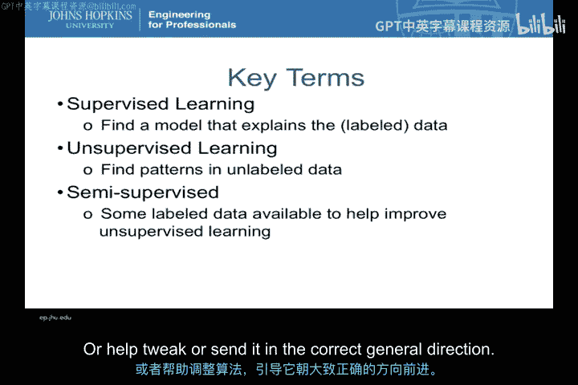

That's the learning algorithms。 What does the key term gradient descent mean This is focused on how the learning algorithms learn from a very conceptual basis。

 Imagine you're dealing with a two dimensional space， so we'll call that。Data， not。And theta1。

And what you can do is map out this space and you want to you have some values coming in and depending on the values of theta n and theta 1。

 you have some result and that result is either close to what you're expecting or not。

 and so that's considered your loss function and your error function so should be this axes here so say J that's a function of your theta n and theta1。

What you want to do is minimize your error or your loss。

 so the ultimate point you want to learn is theta0 and theta 1 at this point here。

 which is the lowest point， the lowest point is also known as your global minimum。

 and that's really your optimal solution。It's optimal because it has the least error possible。

The way an algorithm actually works then using gradientnt descent is that you start at some point。

 so you randomly select some starting point， so some starting values for theta not in theta1 and some starting sample from your data set。

 so say that sample started here。From there， as the algorithm learns what it's really doing is called gradient descent。

 it's stepping down the mountain is trying to find that point where you have the least error。

 So if you do imagine it as a mountain and you're on the mountain and you want to go down at to some point deep in the valley but you can't really see it because there might be trees in the way or just the contours what approach might you take well。

 that approach might be that your next step will be the direction that has the steepest descent because you know you're going down to the deepest part of the valley。

And so from here， you might step over to here。And that might be your next step down。

And then you repeat that process， now you're further down what is the next step that you take and you want to keep going in you want to keep descending down through。

 you never go back upwards because that's making your error greater and therefore you're going further away from the ultimate solution for your problem space。

And so maybe your next step is over to here and then ultimately down into here。

That's for a global minimum。 One of the problems is that you have a large space。

 And what might happen is that you'll get trapped someplace that's actually not the global minimum。

 but you're not able to get back out because of this gradient descent approach。

 And so that is known as a local mini。 So， for example， the space over here。It's not optimal。

 but it is down very low into the space and from there。

 any direction you go means going back up and since all you can do is descend， your trap。

 you can't get out of that minimum。So for example， if your starting point had happened to have been over here。

 there's a good chance that you might have done steps like this。

And then ended up trapped in a global minimum rather than finding the ultimate answer。

 so that's some of the the concerns that one has when using machine learning techniques that you want to make sure that the variables that you're picking。

The different parameters that you're tuning are all set in such a way that you try to find this global minimum and not get trapped in a local minimum。

So what are some of the things that affect your gradient descent method and might give you different results based on different runs of your particular learning algorithm？

Well one of them is the type of gradient descent that you're using are you using batch。

 stochastic mini batch， so what that means is， for example。

 with batch you're taking a large number of inputs at the same time。

 a large number of samples doing all of those and then batching your result back for deciding what step you should take and so you've looked at all your all your possible inputs and based on the combination you decide what your descent will be。

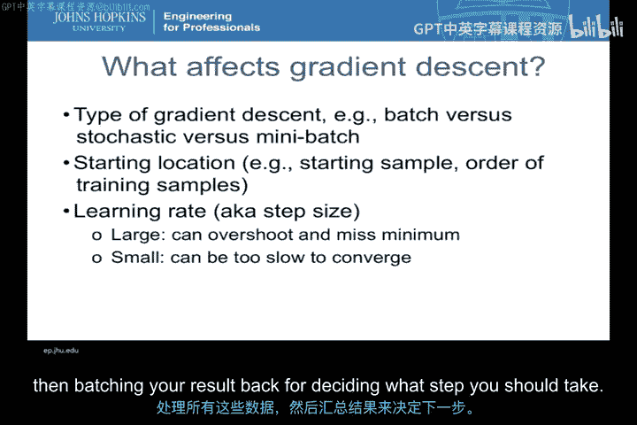

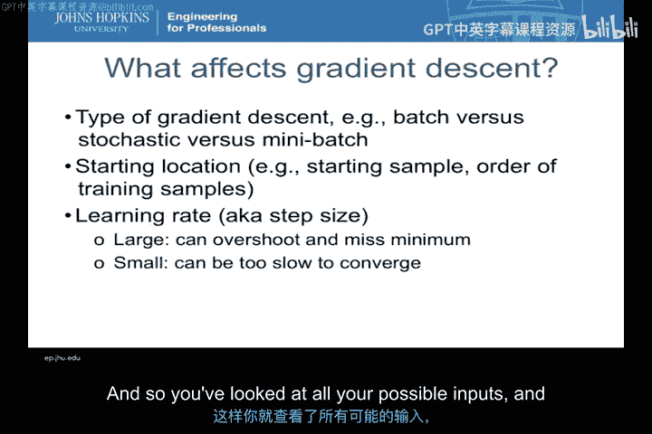

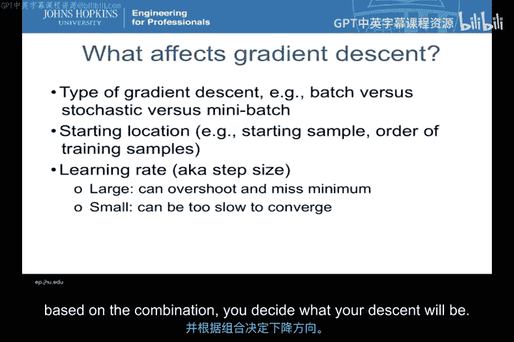

Versus stochastic where you do each example one at a time versus mini batch where instead of taking all of your samples。

 you're using some small subset each time， so maybe 10 examples each time。

Another thing that will affect gradient descent is your starting location and that's going to be that could be based on the random variables for theta not in theta 1。

 for example those random those are usually randomly set at the beginning so what are those variables another thing will be your starting sample。

 is your initial starting sample will tell you what spot you start in in the overall mapping of your space and therefore what where you might end up in terms of trying to find a solution and so again on the previous slide we'd started in the two different locations and one showed that you would get caught in a local minimum versus the global minimum。

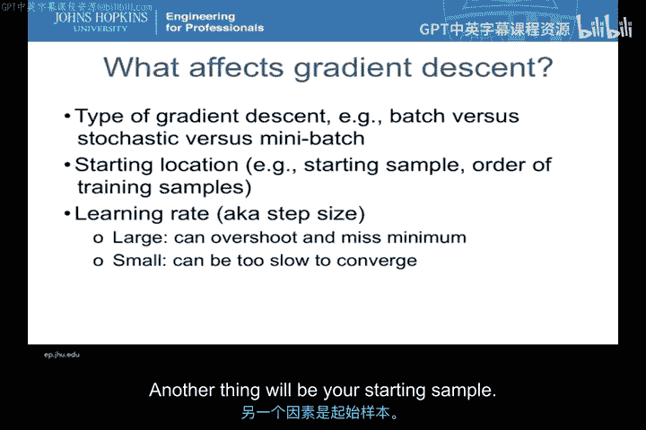

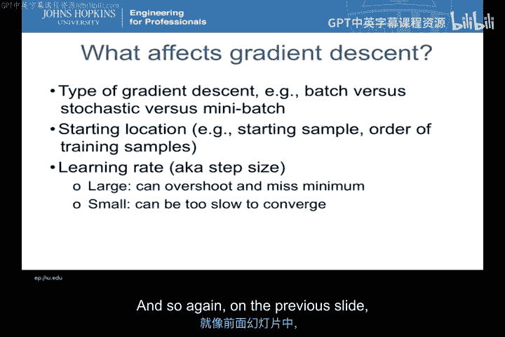

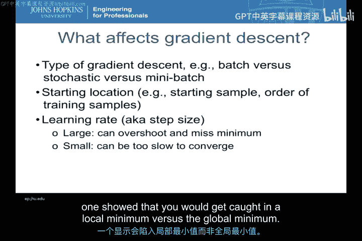

Another example might be， for example， if you're using stochastic learning。

 the order of your training samples will define where you're taking your steps and where you might end up being trapped in the end or if you found the optimal solution。

A third thing that affects it is what's called your learning rate。

 you can think of that as being your step size， are you taking a large step down the mountain or are you taking a small step？

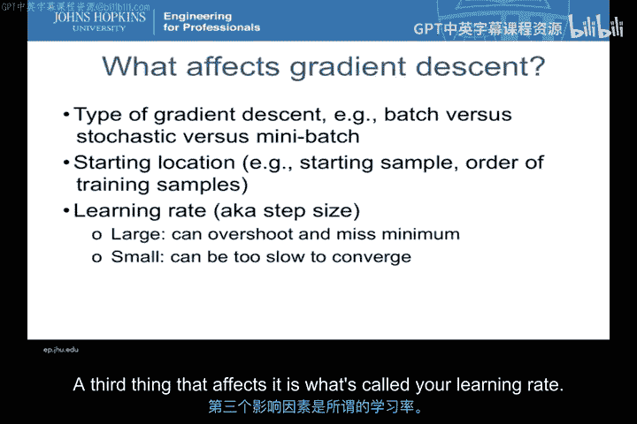

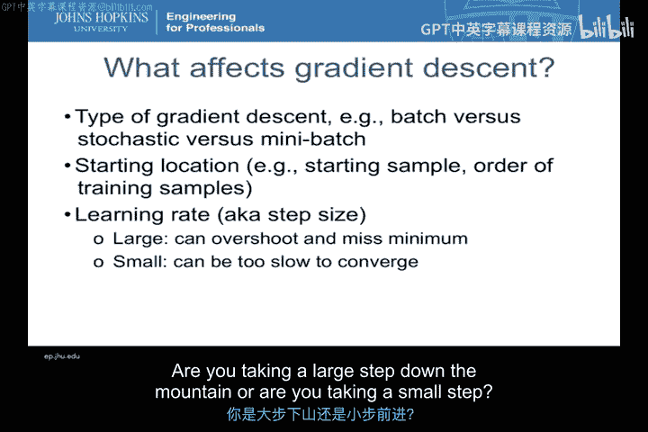

If you're taking a large step in the it might be the case that you overshoot and you miss your minimum and so you keep almost like you're bouncing around where you want to be。

 or if you have very convoluted space， you might even step over some part that goes up and then into another minimum on the other side。

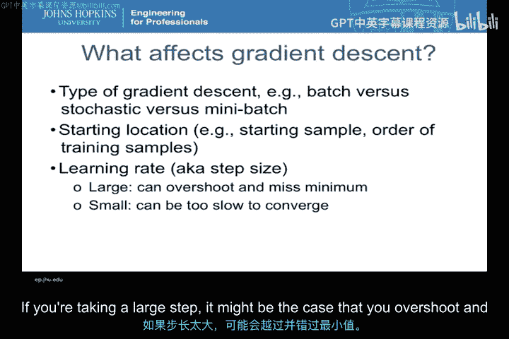

If by contrast though if your learning rate is too small。

 your steps are too small is going to take a very long time to converge to a solution。

 think about it the same again as if you're going down a mountain if you have very small steps。

 it's going to take you a long time to get down to the bottom of the valley and so these are the things that need to be considered when you're doing gradient descent and these are the different tradeoffs that you have to think about。

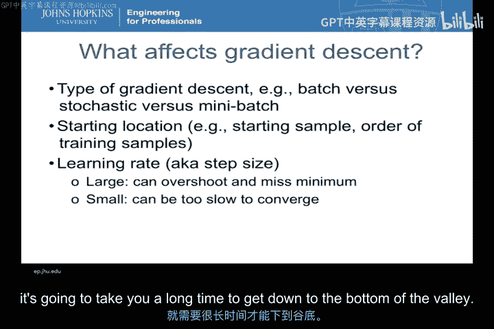

There are a large number of algorithms in the machine learning space and here I just cover some of them that have been used specifically for intrusion detection neural networks is a very interesting one and one of the actually the next module that we'll look at will be a deep dive looking specifically at neural networks and within neural networks there are a number of different types of neural networks as well。

Cluing is another key algorithm that is used often。

 and again I'll have another module that goes into more detail on clustering and particularly I'm going to focus on K means clustering。

 I'll do a light touch on DB scan and then I'll focus on K nearest neighbor。

I call out DB scan here a little bit because that's been shown to be one of the better algorithms in terms of results for clustering when you consider a number of different parameters such as performance。

 speed of execution， a number of different things。Support vector machines。

 which I will also lightly touch on in a future module are another approach to doing machine learning and in particular is something so support vector machines are a binary。

Way of looking at things it essentially provides a plane through hyperspace that will separate your data into two categories there is something called a one class SVM one class support vector machine and what this can do is create a support vector machine from having only one class of data instead of two classes of data and again I call that when O is being particularly useful for doing anomaly detection within the intrusion detection domain。

Some of the other algorithms that I'm not going to go into detail on and this module。

 naive Bayase is a very commonly used one， it essentially is looking at probabilities and what is the probability that given the features。

 the values of the features that you're looking at right now so for example。

 with our data that might be your IP address， source IP desktop IP sourceport， De port。

 given those values， what is the probability that this input belongs to a particular class so for example。

 what is the probability at this input is a particular type of attack or that it's normal traffic and this is based on the prior probabilitybabilities that have been observed from previous data。

One of the catches with Naive Bays is that it assumes that all of your variables are independent and that is often not the case。

Another way of approaching machine learning is through evolutionary computation and this consists again of a large number of different subsets of algorithms。

 genetic algorithms， genetic programming， artificial immune systems， swarm behavior。

 a number of different algorithms this one's kind of interesting particularly genetic algorithms。

 for example， because what it's doing is trying to。

Eulate how genes work and so you have algorithms where you will have essentially a gene and so it might consist of binary ones and zeros and what you want to do is。

Take that gene and essentially you'll add it to another gene and you'll do this through crossover。

 it can have mutations， all the different things that you see that actually happen for in people or in the world really for doing genetic。

For evolution and how you evolve through genetic material and so it's reproduced this in a computer sense。

 genetic programming took that exact same approach。

 but applies it actually to programs rather than looking at data and models。

 so that's very interesting。Moving on， decision trees are another common approach to doing machine learning。

 for decision trees， essentially what you're doing is creating a tree that says， okay。

 if I see this particular variable and it this value go down this branch。

 otherwise it has this other value go down this other branch and keeps going down from that。嗯。

What's interesting about that is going on to the next one assemble learning and random forest is that decision tree is a very popular approach that seems to be working well are random forest。

 and what a random forest does is it consists of multiple decision trees。

 each decision tree was created by choosing likely at random some subset of your feature space and so if you had n different features then maybe you take the first four of them or some random six of them or something like this and then try to learn based on that and create a decision tree based on that。

Then what happens with a random forest is it takes the results of all of these different decision trees。

 combines them to come up with some ultimate answer。

Ensemble learning does essentially the exact same thing， except not specifically with decision trees。

 but it could be with any set of algorithms， and what it will do is take the results， for example。

 you might have two or three different types of neural networks and take the results of these different neural networks and combine them together in some method that might be a voting method or it might be some other form of combination。

Such that you then say， all right， based on the results I'm getting from all my subcompents。

 this is what I think is the ultimate answer。Logistic regression is a standard statistical technique and what it does is it models a large amount of binary data such that one might be normal and zero might be attack and therefore as you go through a model all of this based on all your features that the assign weights each of the features so that when you see an unknown example。

 it will provide a result between zero and1 that's actually the probability that that traffic that you just observed as normal。

Association rule mining in this concept， what you're trying to do is mine rules that explain what you're looking at。

 so for example， if you see x then y。Baesian networks is another very common approach。

For Bayesian networks， what we do is look at the features that we have and find relationships between those features and then combine those with probability models and then finally what you can't quite see on this slide unfortunately our Markov models Markov processes and in this case what you're doing is that you have a state and based on the input you have some probability that you're going to change to another state so at a very high level。

So that summarizes some of the algorithms that you will observe as you look at the machine learning field and in particular how it applies to intrusion detection。

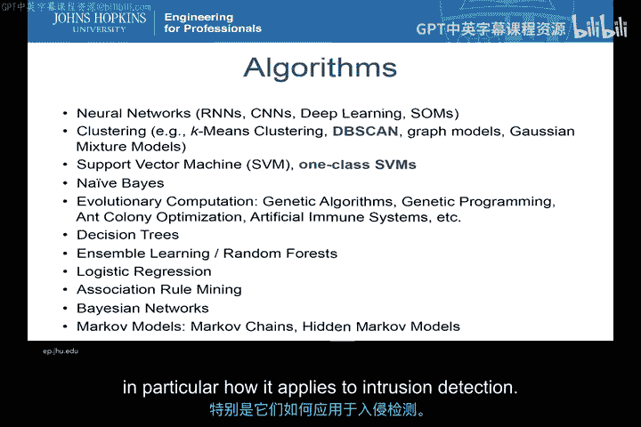

Now let's look at some of the tools that are available to you to do machine learning and there are a number of different tools out there。

 most of which are actually free R is a very common one that's actually a statistical package that has been in use for decades has been constantly built on by staatisticians and has a number of features built in so that it's easy for you to do logistic regression for example。

 or any of the data mining algorithms。

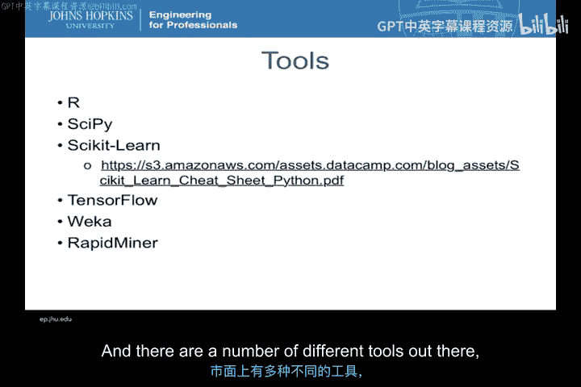

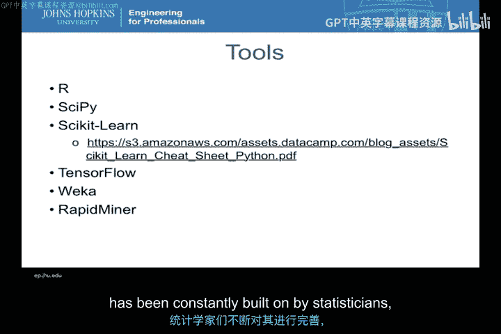

Essentially R is its own programming language， very similar to Python and speaking of Python that's what the next three are about SiPI P SKt Learnn and TensorFlow。

 these are all related to Python and provide libraries essentially so that as a Python programmer you can access these libraries to do machine learning SKit learnn I have a link here to a very nice cheat sheet so that you can use SKit to be able to do some of the machine learning approaches。

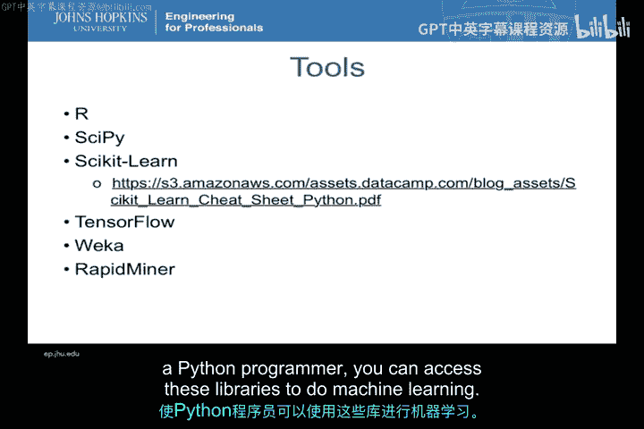

WeACA is very different from the others in that it has a graphical front end and is intended specifically for taking in data and doing different types of machine learning algorithms on that data。

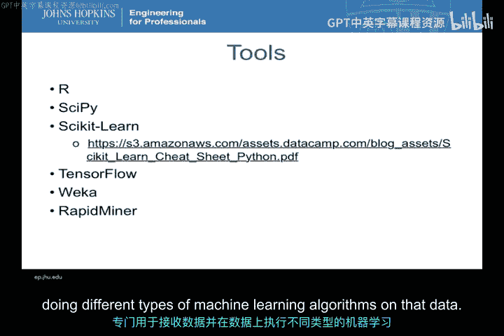

It a free wear program， you can go and download it。

 there is a free book that goes along with it to help you learn how to use it。

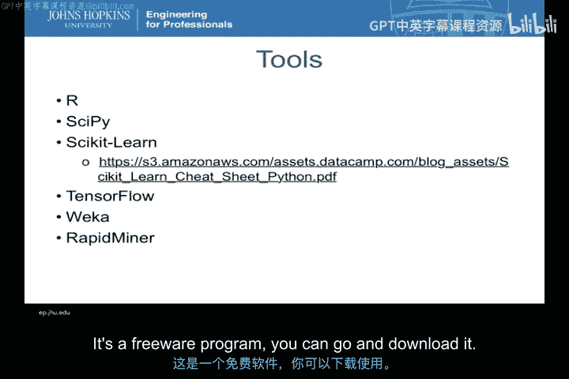

And then rapid Minr is available for free for small examples。

 and I believe it was less than if you had less than 10，000 rows， so imagine again taking our。

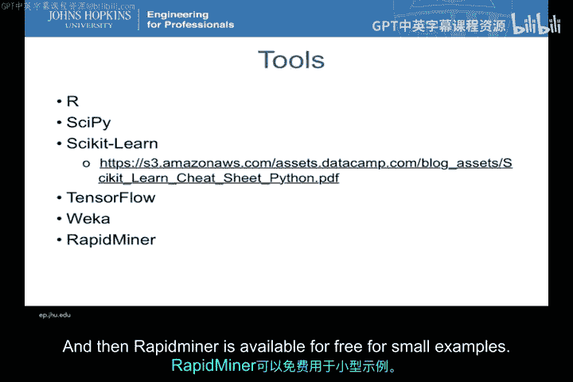

Our Lincoln Las data set and trying to use Rait Minr with it。

If you look at it from all the different packet headers or even summarized up looking at it from flow level。

 you have well more than 10，000 rows， and so you wouldn't be able to use rapid Minr to analyze that particular data set。

 but if you had a smaller data set， you can use rapid Minr for free and then it costs money on a per user and per amount of data that you want to process going from there。

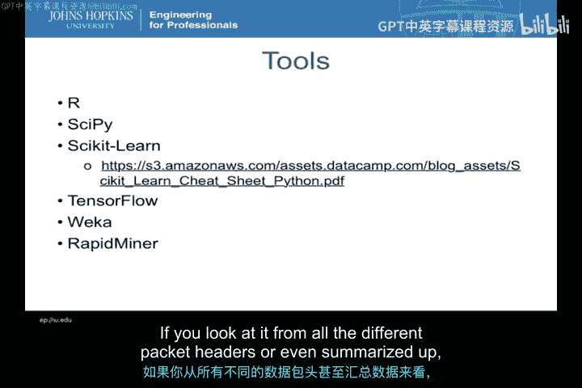

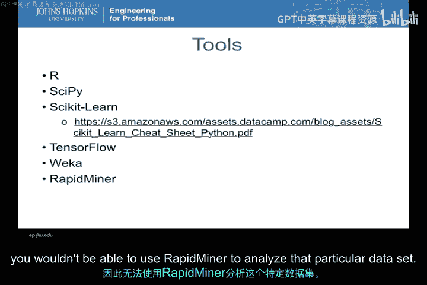

I actually encourage you to go and take a look at the Ra Minr site。

 it has a really nice video on the front page that gives you in one minute a demonstration of how easy it is to use rapid Minr and do some data mining in particular what they demonstrate as a decision tree。

 they take data from an Excel spreadsheet about passengers on the Titanic and they either survived or did not survive and then they took a look at what were the similarities between passengers who survived or who didn't survive and would you meet the if you were a passenger on the Titanic。

 would you have likely met the criteria that were used for putting someone into a lifeboat and so I do encourage you to take a look at that video。

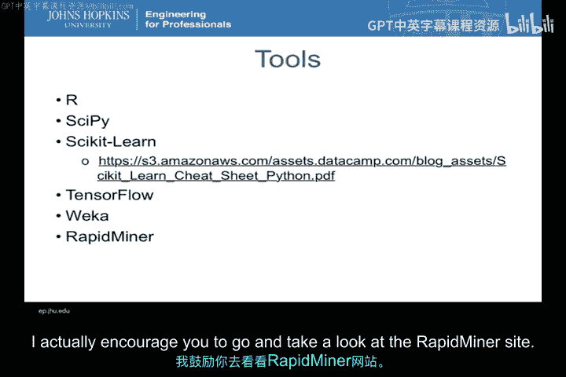

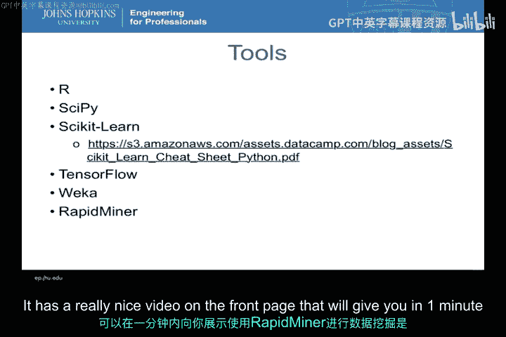

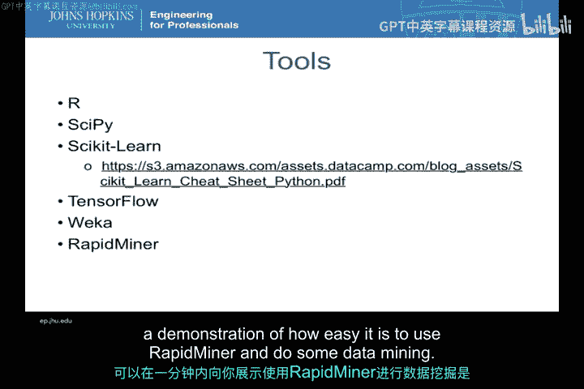

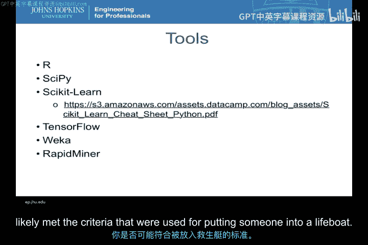