# 约翰霍普金斯大学《入侵检测｜Intrusion Detection》中英字幕 - P53：3_神经网络原理与应用.zh_en - GPT中英字幕课程资源 - BV1sGu1z5E2J

Welcome to this section of the module where we will be talking about neural networks。

 describing what they are， the history for them， and how they are calculated and used。

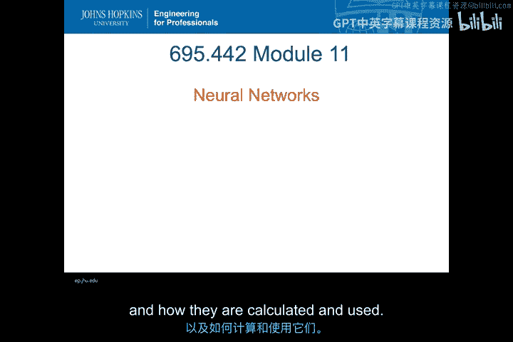

There are several different types of neural networks。

 the ones we will focus on in this lecture are called artificial neural networks are also sometimes called multilayer perceptrons。

 although usually you don't hear that term so much anymore。

 there are a number of other types of neural networks but have they come from this as a basis so recurrent neural networks which provide methods for having feedback。

 convolutional neural networks which have other types of inputs built into the networks such as filters for vision。

 self-organ maps， which is an unsupervised learning approach that takes input and essentially remaps itself to try to cluster the inputs that it's seeing into some sort of organizational structure and then deep learning I will mention deep learning a little bit at the very end。

 this is an approach that has become very popular as of late especially about the last five or six years it's really taken off is become a very wellestablished approach in computer vision。

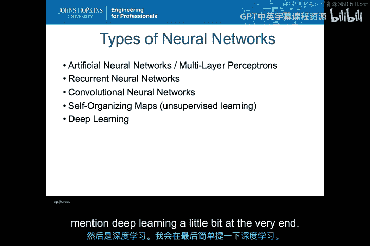

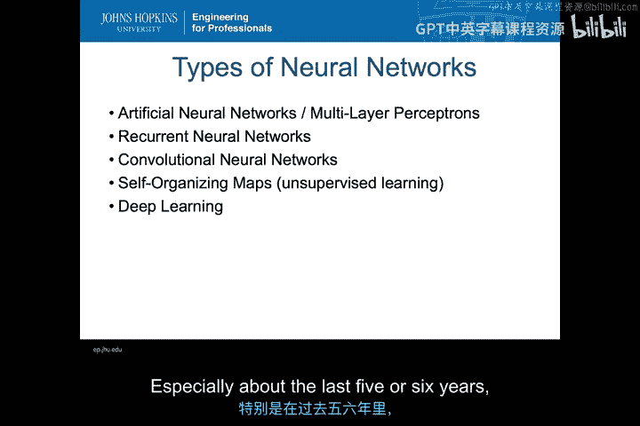

We're starting to see it being used now in computer， in intrusion detection type problems。

 not with a tremendous amount of success yet， but I think that that will be coming in the future。

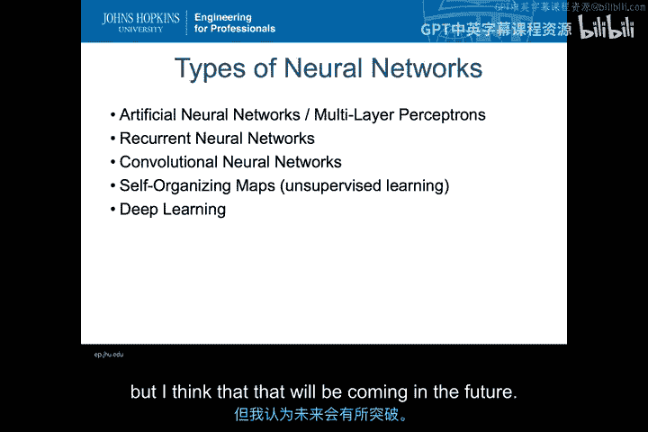

So neural networks are actually based the whole concept is based off how the brain works。

 so what you're seeing here is what's called a goldgi stain of neurons from a brain tissue sample from a primate and you can really see the neurons here so for example right here you can see one here is another obvious one here over here and each of these neurons the dark spots are the body and then you can also see they have these long tendrils that come out。

And that they form connections to other cells， another very long one here。

 and this is how everyone's brain is composed， they have all of these different neurons and neural networks are really trying to model how the brain works to obtain its functionality。

So before I go into talking about neural networks and how those are composed。

 I'm going to talk a little bit about how neurons themselves work so that you understand why neural networks are to structure it the way they are。

So what we have here is， excuse me， an illustration of a neuron and when you can see you have the cell body here。

 part coming off of that you have what are called dendrites， all this little forest of pieces。

 and the dendrites receive signals from other cells。

 that's really the part that communicates receives communications from other cells。

And what happens is that。Something from another cell will release。Neurotransmitter of some sort。

 and these neurotransmitters will build up in the gap in the fluid gap that exists between neurons。

 and they'll land on the dendrites and there will be different receptors on the dendrites that will accept those neurotransmitters。

Once there have been enough of these neurotransmitters that have landed on the dendrites。

 what happens is that the cell is excited。Meaning that there is an electrical current that goes through it and that electrical current essentially passes all the way along the axon to the deter terminal branches here。

So that's called that excitation is's called a neural impulse， and so that goes through here。

 it excites here and what ends up happening on these terminal branches is that these pieces here release neurotransmitters that then go and connect to other neurons and in this method what you have is an electrical signal that passes through the brain and this is how thoughts are conceived as just a series of electrical signals。

Going between neurons， it's how we view the world and interpret what we view。

 it's how we have language， everything operates in this exact same way。

 and we use this basic neuro sorry biological understanding to now model on a computer how neurons work in the theory that if we can do that and build it up。

 and we can create something that thinks in the same way that people do。

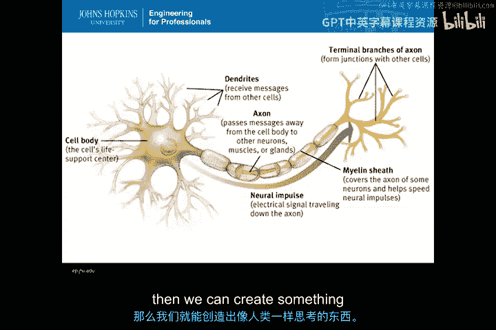

So how is it that we model a neuron in them， this was done by myColican pits and the original one was called the perceptron。

 which is really a single， almost essentially a single neuron， operates in a very similar manner。

 What you see is that you have a number of different inputs。系ello。You have an input here。

 an input here， input here， and all of these different inputs all go get added into a weight。

Some sort of weight function W。And then arrive at a single perceptron where all of those inputs multiply by their weights are summed together。

After that summation， you pass that through a function called the activation function。

 which determines what the output should be， a typical very basic activation function would be TAN H。

And from there， after going through this function， you have an output。

 and then that output can connect to other perceptrons to continue on in a chain。

 but that provides you with your basic output from the perceptron。

And so if you look at it mathematically， essentially what you have is a function G。

 which is your activation function。And that takes as input。

 the sum of all of the input weights multiplied by the actual inputs themselves。

And there's also something here called a bias weight W， which is minus1， and then this bias weight。

 and that allows for。Adjustments mathematicalally it makes things work better。

 it allows for adjustments in what's happening mathematically and so you always have this bias weight as well。

 which helps to adjust all of the different inputs based on and the activation function so that's basically how a perceptron works it takes all of these different inputs and process it through a function generates an output。

😊，Given that this is how a single perceptorron works。

 how is it that we can now put them together and get something meaningful？

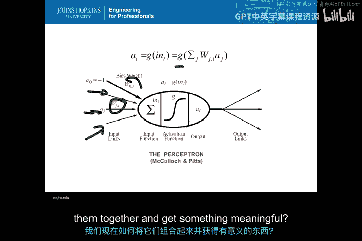

By combining multiple perceptrons we can generate essentially a neural network in this case like a perceptron you have your input。

 so here we have a whole input layer。In your hidden layer， each of these one， two。

 three are all individual perceptrons and then they go out in this case they go to an output layer and so you have essentially another perceptron here。

 another perceptron here， and those are generating your output。If I get rid of these marks。

What is actually in your input layer Well your input layer consists of all of the features of your input dataset set so for example。

 using the Lincoln Las dataset it might be the case that your input layer consists of one feature would be your destination IP address。

 another might be your source IP address， another might be your destination port。

 another your source port and so for each record that you have from your data set you have all of these different features and so you will take a single record。

 break it down into its features and the input layer will be each of those features。

Those all then get forwarded on to every single perceptron in the hidden layer。

 a calculation is performed using the activation function。

 and then that output feeds into the output layer， essentially the output then becomes the input for the next layer or the next set of perceptrons。

Again， a function is performed by adding up all of those inputs and then using some sort of activation function to generate your output。

In its simplest case， you typically will have only one neuron in your output layer。

 so you want perhaps just a binary， yes， no， is something normal or malicious， for example。

Or is something true or false in a more complex case， as you' shown here。

 you can have multiple different outputs。In the same way that you have neurons or sorry forceptrons and your output layer。

 you can actually have multiple hidden layers， you don't have to have just one so you could have another hidden layer in here。

That takes the output from the first hidden layer。Performance of activation functions on that generates output。

 and then all of that goes to your output layer， and you can have in practice any number of hidden layers and you can have any number of perceptrons in the hidden layer。

In this case， it goes up to capital end to the one。Hidden neurons in the hidden layer。

The next hidden layer might only have two， the next hidden layer might have 20。

They do not have to be the same number of neurons in each hidden layer。

So to watch some input coming in， you might have input coming in here to x1。

 that's going to go through to each of these。Different hidden neurons。

This hidden neuron is going to take the input from x1， also from x2 all the way up to XN。

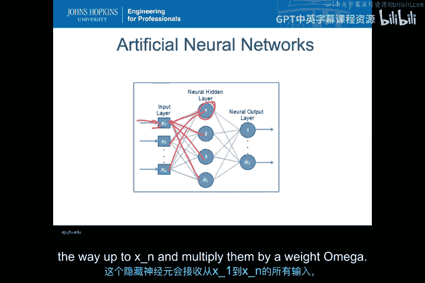

And multiply them by a weight omega。

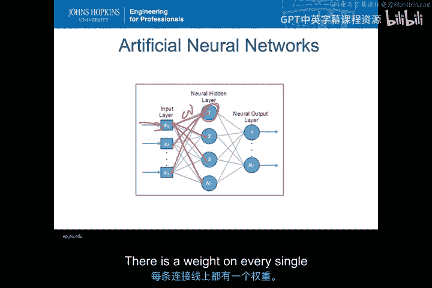

There is a weight on every single one of these connection lines， all of them have weights on them。

So that weight is multiplied by the value of the input that all of that is summed together and then an activation function is used on those weights and an output is generated and in this case the output then goes to the different neurons in the output layer again at this point the neurons in the output layer will take all of the different inputs multiplied by the weights on each of these connections。

Some of them。Put them through an activation function and generate some kind of output。

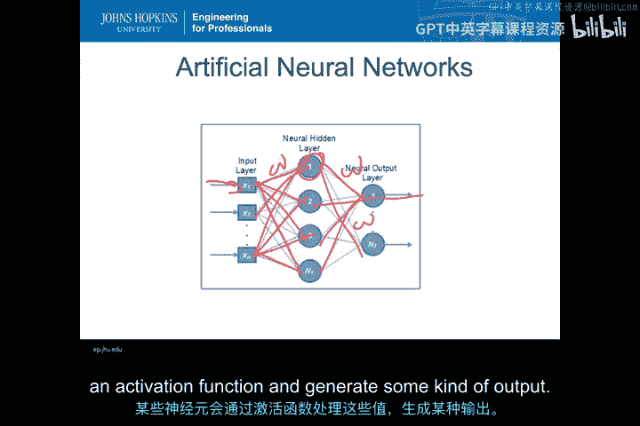

That tells you how a neural network works， what it hasn't shown you is how you train a neural network to begin with。

Originally you're going to have all these different input。

 the weights are likely going to be randomly assigned and so your output is not actually going to be necessarily the output that you want in fact it's not going to be the output that you want and so how do you train it。

Well， neural networks require labeled data。Again， taking as an example our LincolnIn labs data。

 we do have labeled data， we know what flows， for example。

 contain a tax and which ones contain a normal behavior。

 so we might take all of the different features in a flow as our input。

 we send it into the neural network it goes through the entire process and then let's assume that we only have one output and that output is going to be either a zero saying that this was a malicious or a one saying that this was normal。

So normal we'll get a1 and malicious， we'll get a zero。So you get some output。

That output is going to be some value between 0 and 1， for example。

 depending on the activation function it might be between minus1 and 1， whatever in this case。

 assume assume between0 and 1。And what you want to do then。

Is now train your neural network to give you the correct result。

 so you'll get some output and say it's 0。7。And what you want to do is say get the answer of one。

So you have an error here of 0。3。 So you're going to take that error and actually you're going to do a mean squared of the error。

 but you're going to take your error to function。And you're going to map it back。

 so you're going to go backwards and say， all right， given that error。

 I'm going to adjust all the weights on each of these different connections。

All of these based on what that error is， I'll adjust that weight and then I keep going backwards so then I still have an error。

 and so I'll propagate that backwards and adjust the weights here as well。

This is why this is called a back propagation as the algorithm that's actually used for doing the calculation of the weights because you're propagating backwards all of your errors and adjusting the weights。

 you then take your next sample and send that through your neural network。

 you get another error based on that error， you do the same thing and back propagate weight your errors to adjust the weights。

You end up stopping this process when you get to a point where the error that you're receiving based on the inputs that you have your training set is small enough that you consider it to be an acceptable deviation。

 so it might be that everything that's normal is showing up as at least a 08 or a 0。9。

 everything that's malicious is showing up is at least as low as at least between 0 and 0。

1 for example， whatever that case may be whatever that acceptable error rate is at that point you can stop training the neural network and then test to see how well that network now performs given on scene data。

So how is it that we know how much to adjust the weight sp to try to actually train this network this goes back to gradient descent so what actually happens is that you're adjusting based on partial me partial derivatives of what you've seen for previous errors。

And you use that with again， a step function to determine how much you should adjust the weight。

 so this is where the gradient descent that we had seen in the previous module comes into play。

 we're using a gradient descent approach to adjusting the weights to taking a step towards a minimum and hopefully a global minimum to determine that the optimal values for all of our weights and therefore the optimal neural network for representing the sample of inputs that we have。

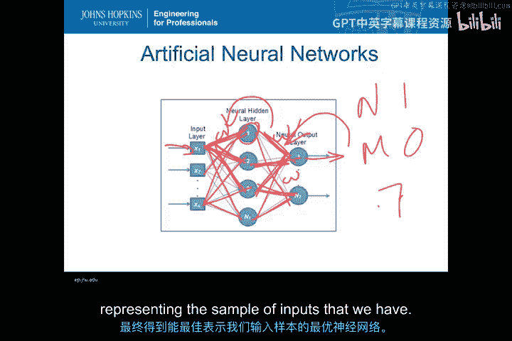

So how do neural networks work in practice Well this here is actually an example of deep learning。

 you'll see that it has a large number of inputs， it has multiple hidden layers。

 and each hidden layer can have multiple or different numbers of neurons inside。

 it's not always the same number of neurons going into some final output。

In the case of deep learning， it burn particularly well in terms of vision。

 and so you can find that each node actually ends up being able to calculate or represent something very specific。

 so you might have a node that's very geared towards recognizing faces。

 another node that's geared towards recognizing cats， another for diagonal lines。

 and at each stage you're narrowing down and saying， all right。

 I can recognize these things with this network。嗯。There's actually going to be in the next module in module 12。

A video by Jeremy Howard， who is from。I know I best from Kagel actually。

 which is a machine learning competition site。Who is very gives a very good talk for NGma 2018 on deep learning and so he has a beautiful example actually showing how you can visualize what's happening at the nodes in a neural network again or sorry in a deep deep learning network again。

 deep learning is particularly well suited for visual processing and and we're still working on how we can apply that to intrusion detection and starting to have some limited success but as I've mentioned before I think you'll see that we'll start to have more and more success with this as we go forward so here's an open research question if anyone's very interested in machine learning and intrusion detection deep learning might be one thing to take a look at。

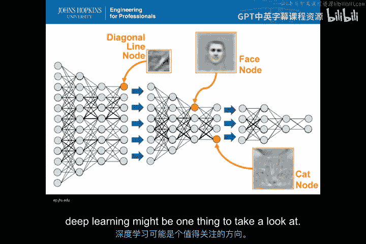