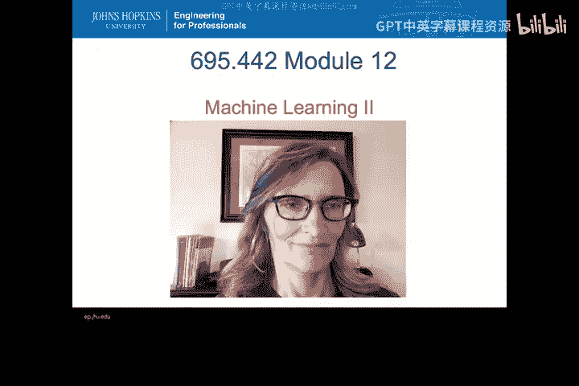
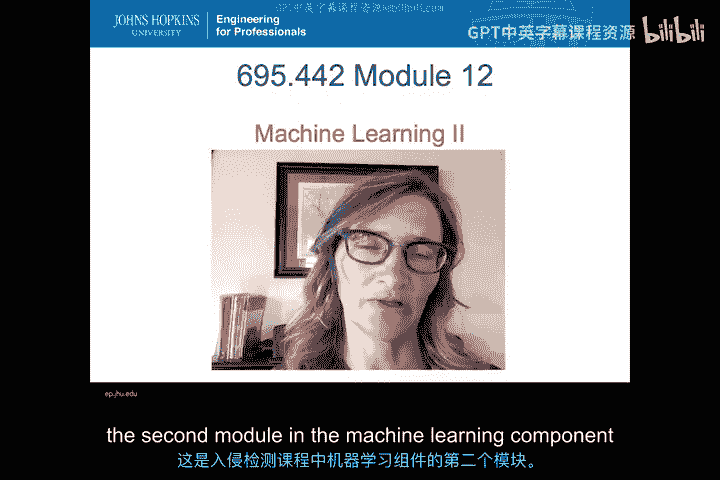
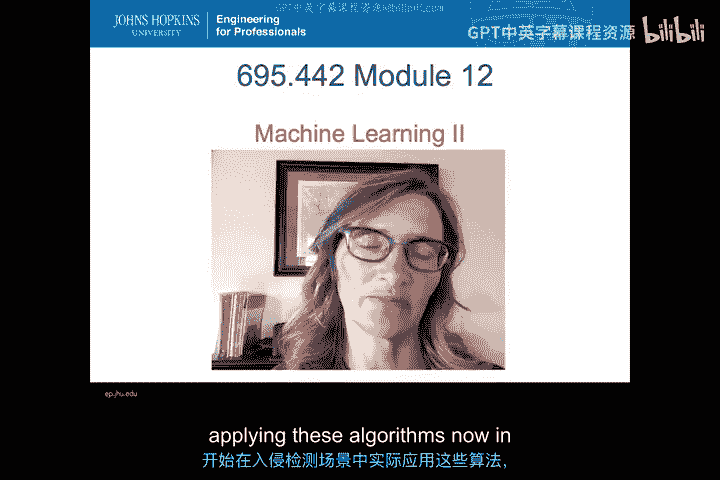
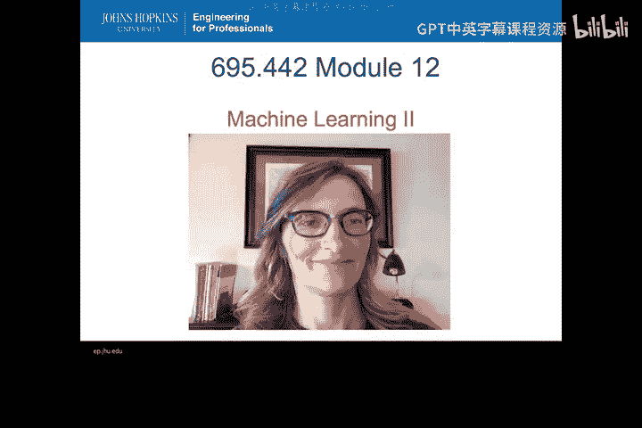
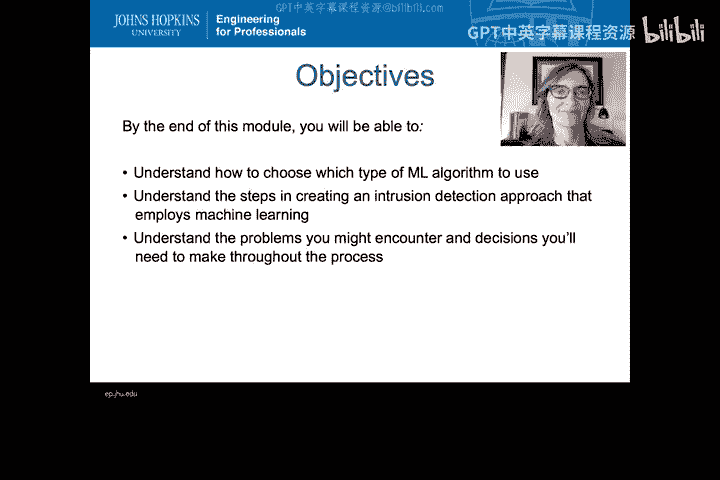
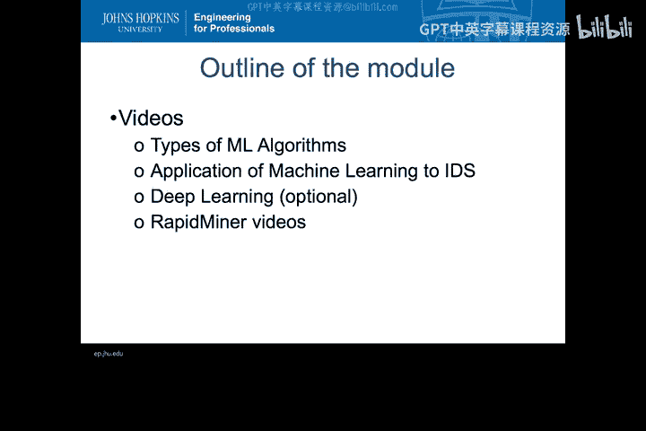

# 约翰霍普金斯大学《入侵检测｜Intrusion Detection》中英字幕 - P56：6_导论3.zh_en - GPT中英字幕课程资源 - BV1sGu1z5E2J

Hi and welcome to Module 12， the second module in the machine learning component of the Intrusion detection class。

In this module， what we're going to do is build on what we learned in the last module for algorithms and start actually applying these algorithms now in the intrusion detection context and take a look at what's required to do that。

 So with that， let's take a quick overview of what's coming up。

The objectives in this module are threefold By the end of the module。

 I want you to understand how to choose which machine learning algorithm you should use。

 There are four different broad types， and each of them answer different types of questions。

 and so the goal is to understand which of these four you should use if you want to use machine learning for an intrusion detection problem。

I also want you to understand the steps involved in creating an inrusion detection approach that employs machine learning algorithms。

 what is it that you need to consider， and as part of that。

 what are the problems that you might encounter when using machine learning algorithms and what are the decisions you'll need to make throughout that process and how can you make those decisions。

 what are the tradeoffs。So those are the high level objectives for what you'll be encountering in this module。

So in this module we have several videos this time。

 the first one on the types of different machine learning algorithms available to you is a standard lecture format。

 as is the second one on the application of machine learning to intrusion detection problems and what you're going to encounter what the steps are and what some of the problems you will need to consider are。

The third one is an optional video that I've included on deep learning。

 and this is actually a link to Jeremy Howard's Enigma talk from this past January。

 where he gets a very nice overview of deep learning and how deep learning works and actually applies that to a computer security problem in a very interesting and unusual way and encourages people to really think about their problems in new ways so that you can apply new algorithms。

And finally， we'll be looking at a series of different rapid minor videos Rait Minr is a machine learning tool set。

 and we're going to use that in both our assignment and in the lab to apply some machine learning techniques to an intrusion detection problem to get a feel for how this works and some of the things that we have to really consider and without needing to actually develop any of the algorithms ourselves we can use what's been already provided and is available freely for us so with that let's get started。

