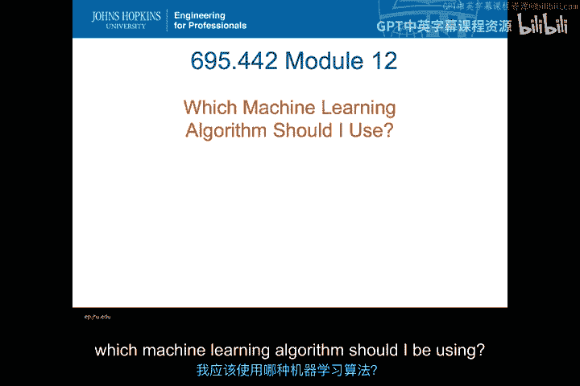
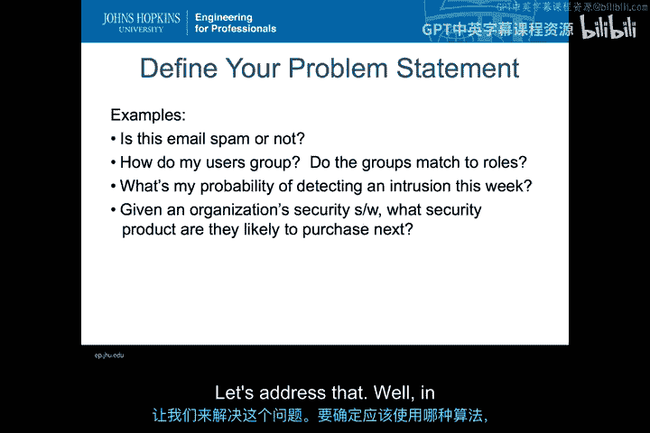
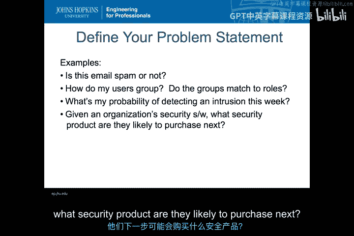
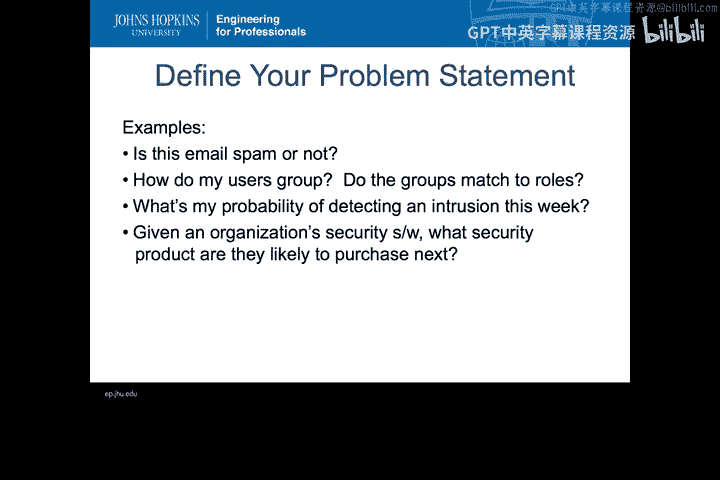
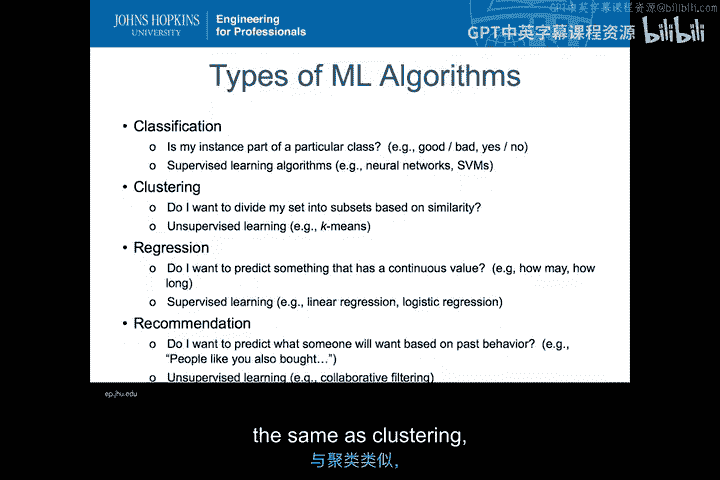
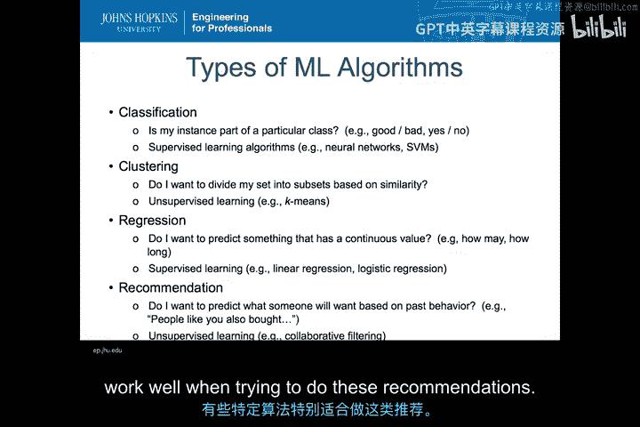
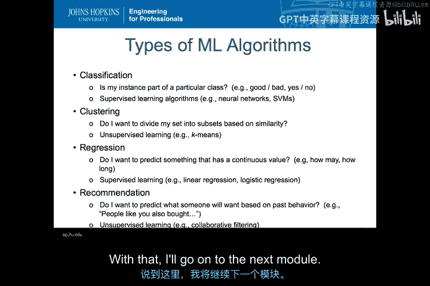

# 约翰霍普金斯大学《入侵检测｜Intrusion Detection》中英字幕 - P57：7_机器学习算法选型策略.zh_en - GPT中英字幕课程资源 - BV1sGu1z5E2J

The first question we really need to ask when we're thinking about applying machine learning to the problem of intrusion detection is which machine learning algorithm should I be using。

 So let's address that。

Well， in order to determine which algorithm you should use。

 you really need to determine what is your problem， what is it that you're trying to solve。

 and so your very first step is going to be defining your problem statement and so here are some examples of problem statements。

Is this email spam or not？How do my users group and do the groups match to roles？

What's my probability of detecting an intrusion this week？

And given an organization's security software， what security product are they likely to purchase next？

These are all very different problem statements， and they all take different approaches to solving them and therefore different machine learning algorithms。

So what possibilities can we apply to these different problems？

At a high level， you can think that there are four different types of machine learning algorithms。

 classification， clustering， regression， and recommendation。

Each of these operates differently and solves different problems so for example。

 classification the question really being asked is is my instance part of a particular class。

 for example， is what I'm looking at is it good is it bad。

 is it a yes or no answer are you trying to classify something。

 are they Democrat or Republican or libertarian or independent。

 how can you actually determine what class something belongs to？And to answer these questions。

 you need supervised learning algorithms so remember a supervised learning algorithm meant that you had training data that was labeled so you knew the actual output and you could learn here's what the different outputs look like and tried to determine what the features are that determine those particular outputs so neural networks where one example that we looked at in the previous module support vector machines were another。

 there are different supervised learning algorithms。

 but if you're trying to do classification in general。

 these are the types of learning algorithms you want to use。

Another example of a type of machine learning algorithm is clustering。And that question really is。

 do I want to divide my set into subsets based on similarity？

In this case what you're looking at is saying I have a large group and I want to determine what are the subsets within there and then what are the characteristics of those subsets。

 and this is an unsupervised learning approach and again we looked at that in the last module and we looked at the K means algorithm where we were able to take a set and then divide it into different subsets。

Another type of machine learning algorithm is regression。

 This one we didn't really look at in the last module。 but the basic question here is。

I want to predict something that has a continuous value。 So， for example。

 how many of something or how long it will something take or some continuous value Can I determine what that value is。

 It's similar to a classification。 As the classification is discrete。 And in regression。

 we're looking at continuous values。 So like classification， it's also supervised learning。

 But in this case， the algorithm you're using will be things like linear regression models or logistic regression models。

Or any other type of regression。And then the fourth type of machine learning algorithm。

 which I didn't touch on at all， actually in the previous module。

 which some people may or may not consider a type of machine learning depending on your purity of viewpoint。

Is recommendation systems。Do I want to predict what someone will do based on their past behavior？ So。

 for example， you've seen in Amazon， people like you have also bought。

That kind of thing is a recommendation system， and it also is an unsupervised learning algorithm。

 the same as clustering， and there are particular types of algorithms that really work well when trying to do these kinds of recommendations。

 Collaborative filtering is one example。

The only example I could think of within the intrusion detection context is something along the lines of if my security organization has a particular set of software。

 what is likely to be the next thing that I purchase？

Not something we're really going to look at in this class。

 we're really probably going to focus on classification， we want to know if we see some behavior。

 is it malicious or not， is it an intrusion or not？And with that， I'll go on to the next module。

