# 约翰霍普金斯大学《入侵检测｜Intrusion Detection》中英字幕 - P58：8_机器学习在入侵检测中的应用.zh_en - GPT中英字幕课程资源 - BV1sGu1z5E2J

Now that we've selected what we're going to use for a machine learning algorithm to apply to intrusion detection。

 are we done？And the answer is no， there is a lot of process behind actually generating the correct model and testing and everything to make sure that you have a working intrusion detection system。

 and in this module we're going to address at a very high level some of the steps that need to be done in order to make your machine learning algorithm in reality able to detect intrusions。

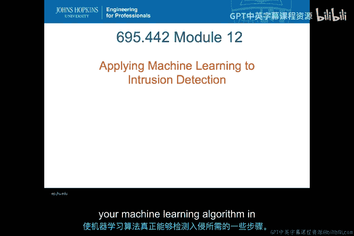

At a high level， there are really two stages training and testing。 but within that。

 there are a lot of different steps that need to be done。 As mentioned in the previous model。

 the very first thing you need to do is define your problem statement unless you know what problem you're trying to solve。

 you can't do anything you can't choose your algorithm you can't choose your data。

 you really need to define your problem statement first。 Once you've defined your problem statement。

 then you can go and identify available data sets。There's a bit of a link here between available data sets in your problem statement。

For example， maybe your problem statement is that you want to identify malicious software on a host machine。

If the only available data sets you have then are network is network traffic。

 then you're not going to be able to actually use that to identify malicious software on a host。

 and so there is a bit of a balance between the two it might be the case that the problem you want to solve。

 you can't solve because there is no available data conversely you might find that you have some available data sets that could be used to solve other problems that might be very。

 very interesting。So once you've identified your problem statement and the available dataset sets you have for solving that problem。

 what you need to do is drill down on those data sets in particular， with that data。

 you need to determine a couple of things， the first is your class attributes or your features。

 what is it that you can use as input to your model or to be able to determine if something is within the class that you want to recognize。

 meaning that the second thing you need to be able to identify is the class everything within your training dataset。

Is this， if you were looking for， for example， is there an attack within a set of network traces or where are the attacks or what flows that represent attacks。

 then you need to have that trace labeled as being either normal traffic or attack traffic。

So those would be your two classes normal in attack。And then within that， if you had， for example。

 net flow data， you'd be looking at the attributes across that net flow data。

Once you've identified your attributes， then it becomes a question of。

 do you need all of those attributes， So is it possible to use a subset of those attributes in order to do your classification and still get good results。

 This is also known as dimensionality reduction。And the real reason behind this， a couple of things。

 one is that if you have too many attributes， it's possible that you're learning things that are actually extraneous to the classes that you're trying to learn。

 and the second one and the more important in some ways is that it can slow down your algorithm。

 oftentimes you want your algorithm to be very， very fast because you're running in real time on real data。

 and so if you have fewer features or attributes that are part of your model。

 your model can generate results more quickly。You also need to clean your data。

 so before you can actually do any training， you need to make sure that your data is very。

 very clean so that you are using correct data for creating your model and I'll discuss that in a minute。

From there， you can choose what algorithm you want to use and then learn that model using your training data。

After that， you want to evaluate your model on previously on scene data。

 this is considered the testing phase。And then once you have a trained model。

You're going to use it to now classify that unknown data。

That is what you're going to do is once you've evaluated your model on this onseen data and tested it。

 you're now going to actually take that model and use it for real in the wild and see how well it works and hopefully it works well and that you make lots of money because you produce this product that is very。

 very good at detecting attacks。

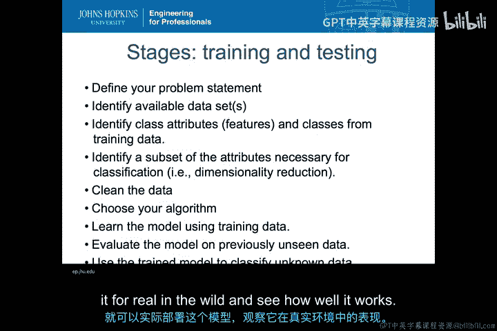

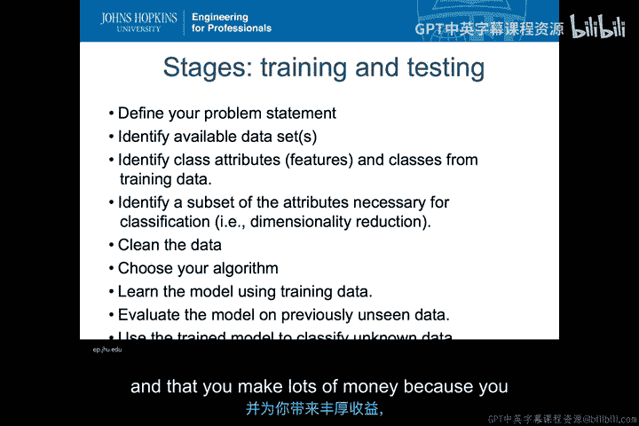

So I want to drill down on some of the different steps that I mentioned in that previous slide。

 and the first thing I want to drill down on a little bit is identifying available data sets。

 There are a lot of problems with this。 You would think that this should be something that's easy and in fact。

 it's actually extremely difficult。Within intrusion detection。

 there really are no useful public data sets。Imagine， even think about malware， for example。

 if you wanted to write a program that would run on a host machine to detect a software as malware or not。

 What you need for this。 Well you need clean data data that。Does not contain any malware。

 And you need malicious traffic， malicious data。 Sorry， And where do you find that， Well。

 you have a couple of options。 One， you can put a machine out on the Internet and start collecting all kinds of malicious traffic。

 The problem being that that software。Might in turn use your machine to start infecting other machines and so you would need to set that up very carefully and the other problem then is that you're only going to start detecting what's available right now in the wild。

 and you might want a system that is able to detect things that don't happen to be hitting your system right now。

 so maybe there is some malicious software that for some reason isn't propagating very quickly right now but every once in a while does。

 or maybe it comes through in using a particular medium that your test setup isn't collecting。

And so you really need to be able to find data。This is why within this course。

 we've been using the Lincoln Las dataset。 It has a lot of known problems。

 and the data is almost two decades old。 It is not representative of the traffic on the Internet anymore。

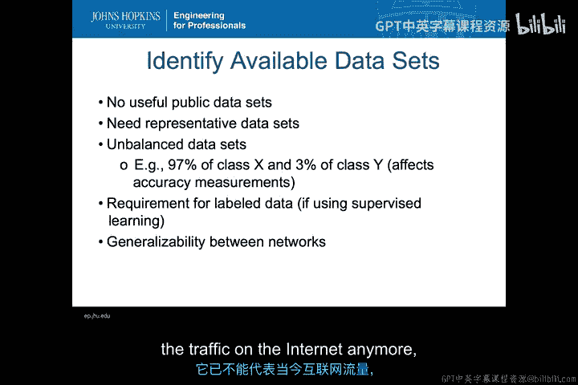

But it's labeled data and it's publicly available。 And that is very， very difficult to come by。

Another problem is that you need representative data sets。 What do I mean by that？ Well。

 if I have a data and I use that for training a model and I then take that model and use it on a different network。

 for example。Are the characteristics of that different network similar enough that the model I've trained on one network actually works on a second network？

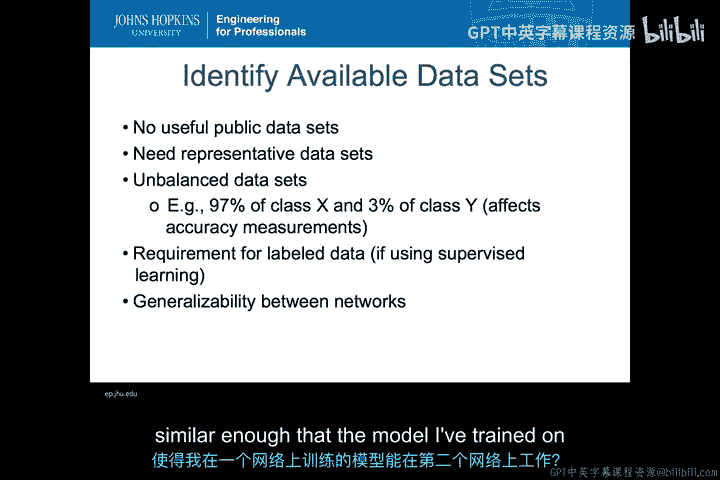

So is the data I've used representative of where my model will be deployed？

Another problem is on balance data sets for example， if you had 97% of one class。

 say normal and 3% of another class， say attack traffic。

 that's actually going to affect your accuracy measurements because in this case you have a very。

 very small amount of attack traffic to measure against to see how well your program works when you're trying to determine true and false positives and negatives。

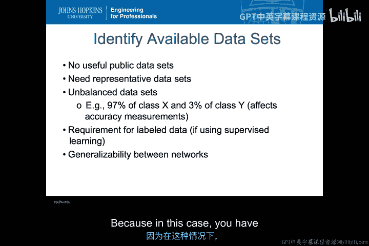

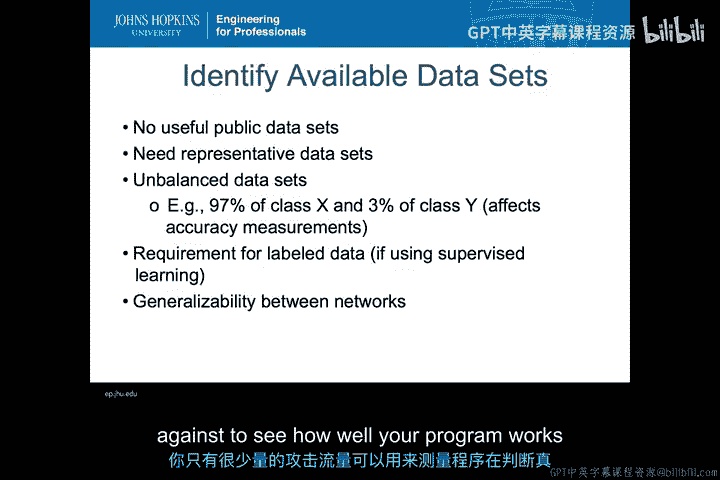

There's also this requirement for label data if you're using on sorry supervised learning approaches。

 which is particularly common when you're doing an intrusion detection system。

 you want to classify something is normal， is it an attack。

And so labeled data is very difficult to come by， it might be the case that you're able to collect traffic。

 for example， from the network that you plan on deploying your intrusion detection system on。

Wonderful， now you have all of this real network traffic。

 How do you now go through that and say what if that traffic is attacked traffic？

 And so it's very difficult to get labeled data。And then the last point here is the generalizability between networks。

 and so I touched on this before with representative data sets。

 whatever you've developed doesn't necessarily generalize out beyond where you've developed it。

 and so there are a number of different problems when you're trying to identify appropriate and available data sets。

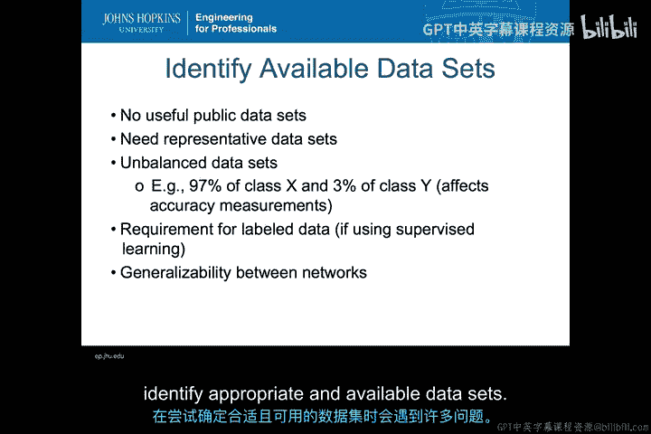

Once we've identified our data set， the next question becomes。

 what are the features within the data that we want to use for our model。

 what is most likely to determine if something was an attack or benign。

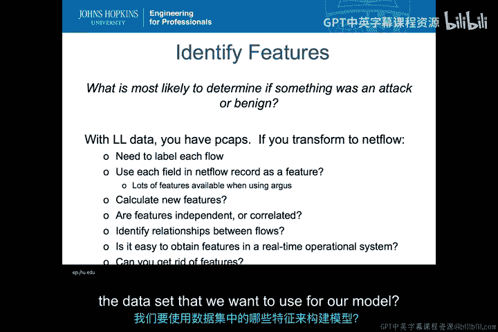

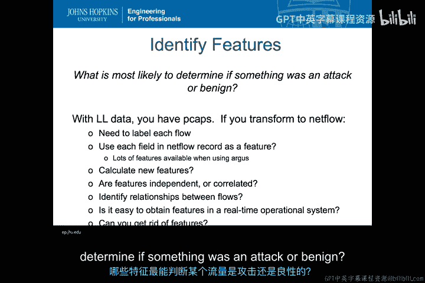

So let's think about the Lincoln labs data for a second here。We have PAP files。

 let's say we take that and transform it to net flow files。 Well， now we need to label each flow。

 I it an attacker or is it normal。And then do we want to use each field in the netF record as a feature。

 there are a lot of features available and that's just looking at standard netflow version 5 or something。

 if you take a look at ArguIS and the attributes that it's able to generate。

 it provides a lot of additional information beyond what a standard for netflow and so you can get a lot of different features。

 what are those features are appropriate for determining is something benign or an attack。

Should you be using the data you have to calculate new features？Are the features independent。

 are they correlated， that's going to actually have an impact on how well your algorithm performs and what kind of relationships it learns。

嗯。Can the algorithm you're using identify relationships between flows and should it be able to identify relationships between flows。

 or should everything be thought of as completely independent？

Is it easy to obtain features in a real time operational system？For example。

 if you're calculating a net flow record well。It might be less data in terms of your machine learning algorithm。

 but it takes a while for the network flow record to be generated because you have to wait until the entire flow has started and stopped and so you have what is potentially a long time period before you're actually able to do the analysis that you want to do。

And then the other question becomes， if you're trying to calculate new features， for example。

 how quickly can you do those calculations？And finally。

 can you get rid of features so this was the dimensionality reduction I had mentioned before。

Chances are you don't want to use all of the features that you have。

 so are there features that you don't need and there are different statistical techniques to determine if there are features that once you have a model that are not actually contributing to that model and so you can remove those features and then retrain。

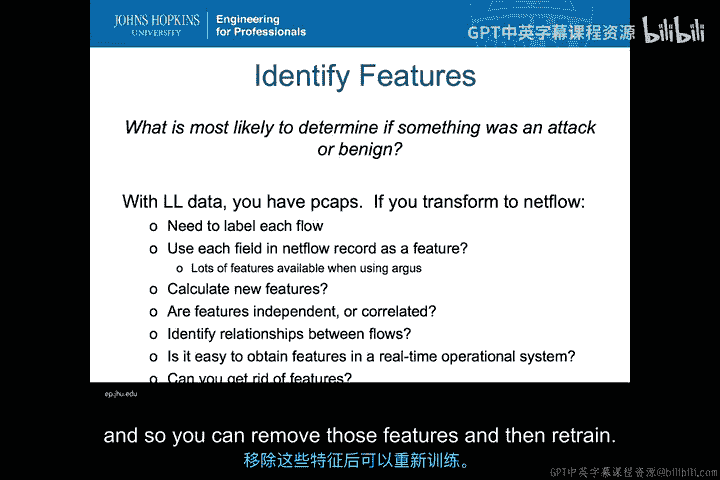

I had also mentioned before that you need to clean the data。 Well， what does that mean。

Data isn't always necessarily pretty。 Oftentimes it has problems。

 There might be duplicates within the data。 Sometimes maybe there was a hiccup in the system and it produced two of the same thing there might be missing data So for example。

 you might have an entire net flow record， but for some reason the source port was missing How do you deal with that missing data there might be data was correctly incorrectly entered it where you if you were using not generated data like netflow but something that was being input by a person。

 So for example， someone puts in M instead of saying male。

 So if you expect to see male or female in every line and you see M instead。

 how does the algorithm deal with that and what you should do rather making the algorithm deal with it is clean your data ahead of time。

 make sure that everything is actually consistent that you've dealt with missing data and that you've removed any duplicates。

 Ra minor which will be using in our assignment。Has a very nice training video available on data preparation。

 so if you go to their training videos website， look for a video on data preparation and it talks quite a bit about what you need to do for cleaning data and some of the features it has for doing that。

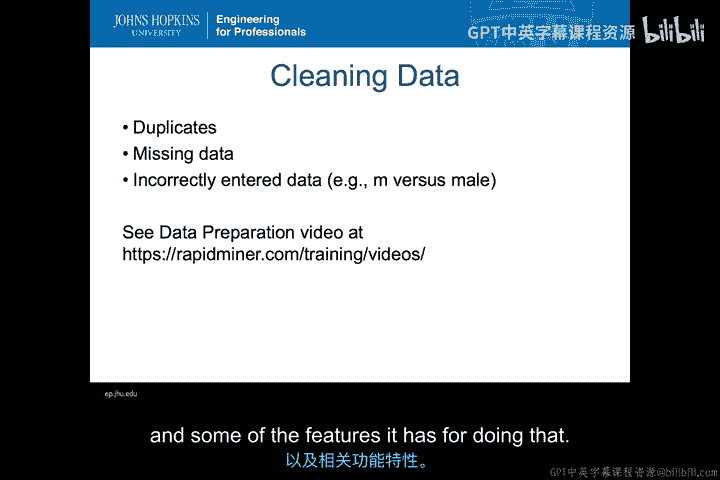

Now， choosing your algorithm， and I bet you thought we had already done this in the previous lecture。

 Well， no， not quite。So the first question really is are you trying to do a classification versus a clustering versus a regression problem。

 and I've essentially said you're likely to be doing a classification problem if you're trying to do intrusion detection。

But beyond that， what do you need to know to choose what algorithm to use？

The performance of your algorithm is going to be。Application and implementation dependent。

You want to have an algorithm that performs really well， not just in terms of accuracy。

 which I also mentioned on this slide， but also in terms of speed。For example。

 you've probably noticed that SNorRT doesn't always get the same results when you've run it two different times on the same network traffic。

 well it might be because the sNort is actually dropping packets because it can't keep up with the processing that it needs to do。

So can you find an algorithm that is simple and quick to run and doesn't have a lot of overhead？

Related to that algorithm complexity， so essentially can you have something that runs in O ofM？

In linear time， for example， rather than O of N squared or something。

 what is the quickest algorithm that you can have。Do you want your algorithm to be streaming versus offline particularly for the training phase。

 it might be the case that initially you went an offline algorithm in order to do the training and then you take the model and make sure that the model can be used in the streaming approach。

 meaning it's reading the data as it's flowing by and giving out results as the data goes by。

Incrronemental update capability。And this is not actually updating the algorithm from a。Well， it is。

 but not doing it from a performance perspective， but actually saying my data has changed and I need to change with it。

 so you might start seeing something that you hadn't seen before or slightly different features that represent an attack that your algorithm your model isn't actually modeling correctly。

 is there a way to update your model and can essentially keep training over time as well as actually presiding results？

So as you have drift over time， your model is able to accommodate that。

hybrid you could also be doing a hybrid approach， are you going to use not just one algorithm。

 but actually a combination of algorithms to be able to get better results。

What is the explanatory power of your algorithms？In some senses， for example。

 if you're using a neural network， you're just going to say something is an attack or it's normal。

 Well， why， why is something labeled as an attack or normal。

 Is there some way that you can set up your algorithms to actually explain back to a user。

 I think this is an attack。 And here's why I think it's an attack。 And then finally， of course。

 accuracy。 You want your algorithm to have。Very high accuracy in terms of detecting what are attacks and also having a low false positive rate so that you don't overload your system administrators with going after false positives。

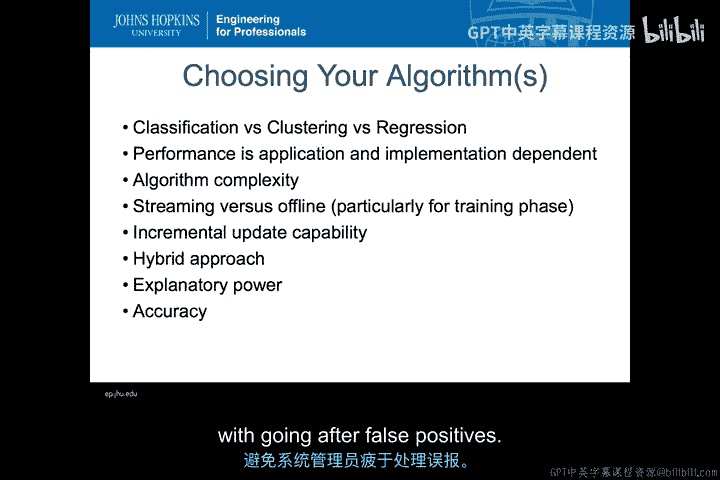

Now that we've trained our model， we have to test our model。

So what we need to have is a test set that's separate from the training set is not sufficient to have。

Training set， generate the model， and the model can give you accuracy readings in terms of how well it performs on that training set。

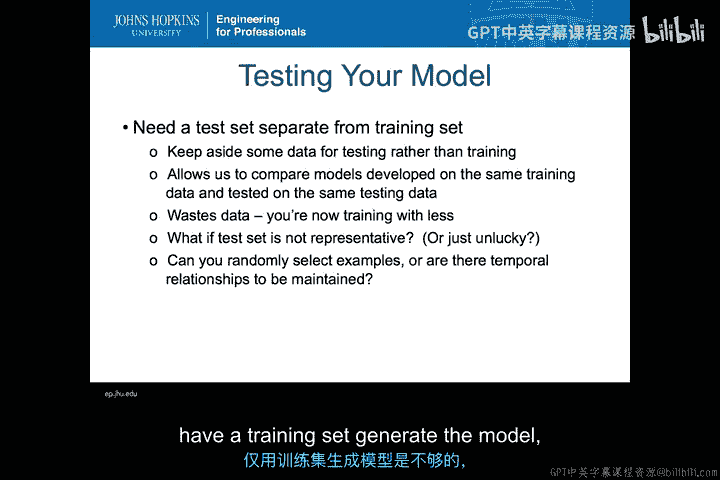

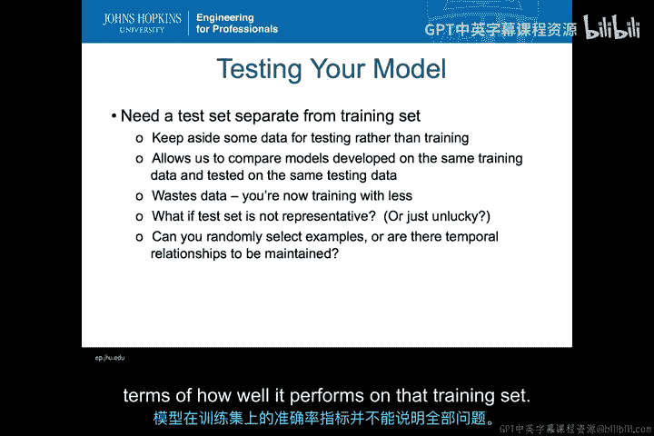

But then the question is how well does it actually work when it sees data it hasn't seen before。

 so for example， how your model over general law sorry。

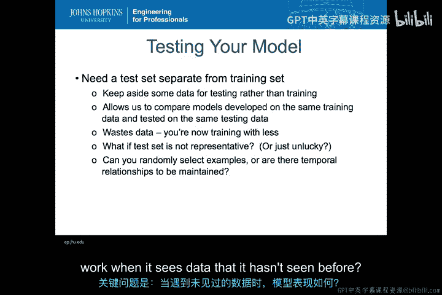

But it is the generalizability of your model， has it overfitted to the data that it has。

 or is it generalizable？

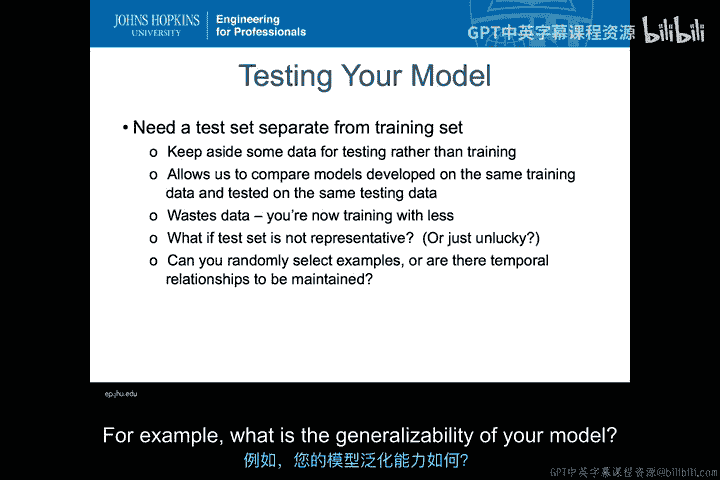

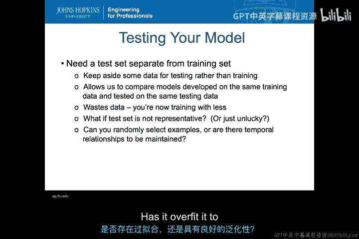

So what you want to do is make sure that you keep aside some data for testing rather than just use all of your data for training。

What you also want to do say you' you're trying to compare a couple of different models than what you want to do as well is make sure that when you're comparing those models。

 you're using the same training and testing data in both cases or in end cases if you have N models to make sure that you're comparing apples to apples with each you want to make sure that both models are developed on the same training data and that both models are tested on the same testing data。

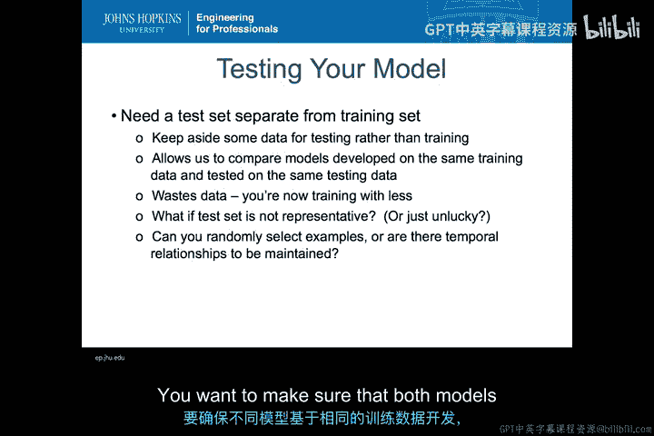

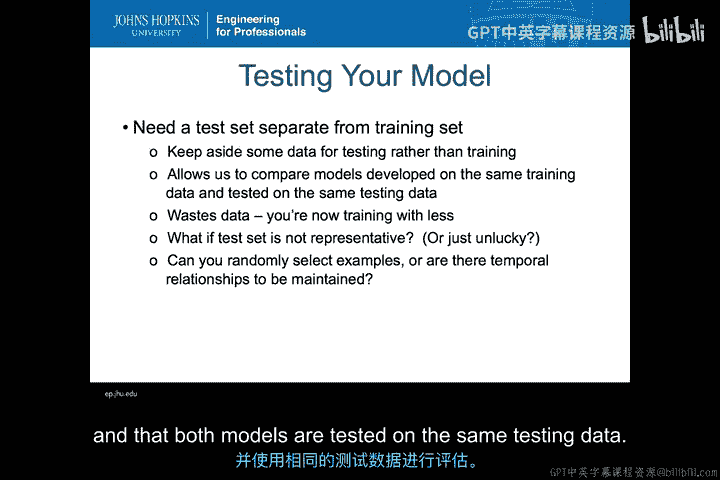

The catch， however， is that in some sense this waste data what I mean by that it means you're now training with less if I had 100 samples that I could train with and I need to keep set aside for testing。

 then maybe I'm training with 80 of those samples and using 20 for testing and so you've wasted those 20 because you're using it for testing when it could be improving your model by using more training and so you have this balance as well。

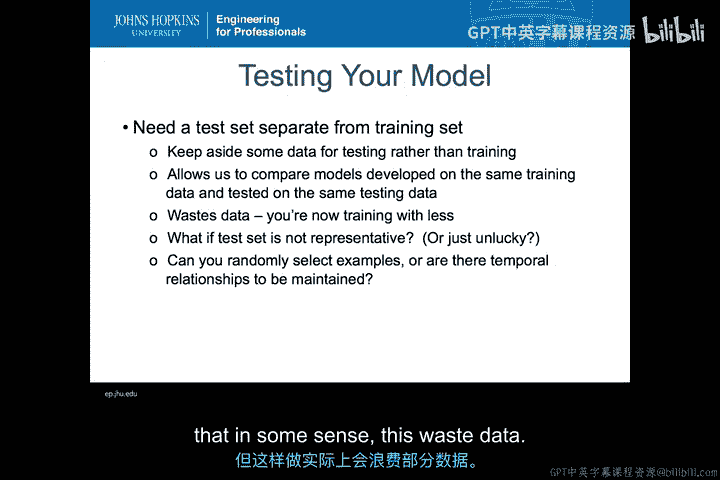

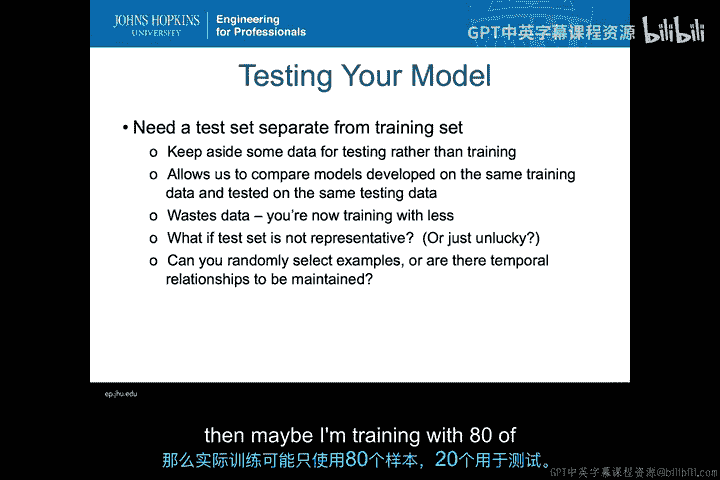

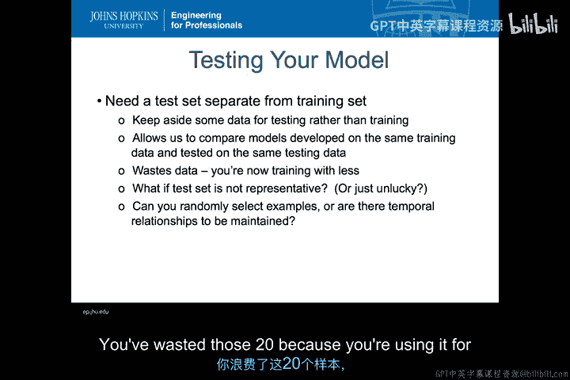

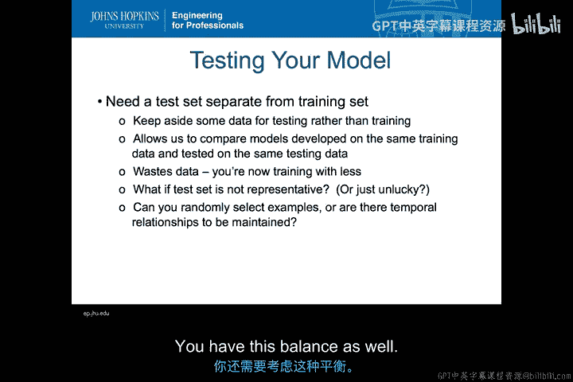

Then becomes the question of what if your test set is not representative。

 say you randomly choose your test set from within， you know。

 you want a test set of size 20 from within those 10 examples and you randomly choose those 20 examples。

 what happens if you happen to have generated a test set that's actually not broadly representative and you happen to essentially you were just unlucky。

 you chose a test set that either shows that your algorithm works particularly well or shows that your algorithm works particularly poorly。

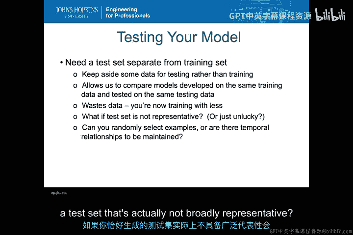

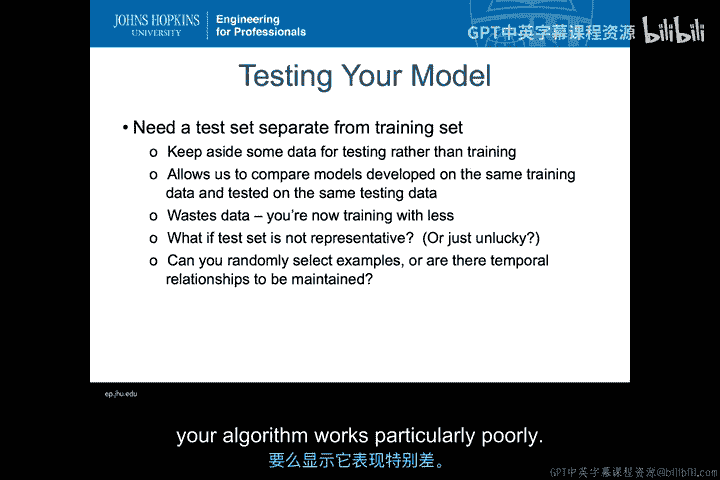

And then another question becomes， can you randomly select examples like I just mentioned。

 or are there temporal relationships that need to be maintained。

 how is it that you can actually select your test set from your training set？

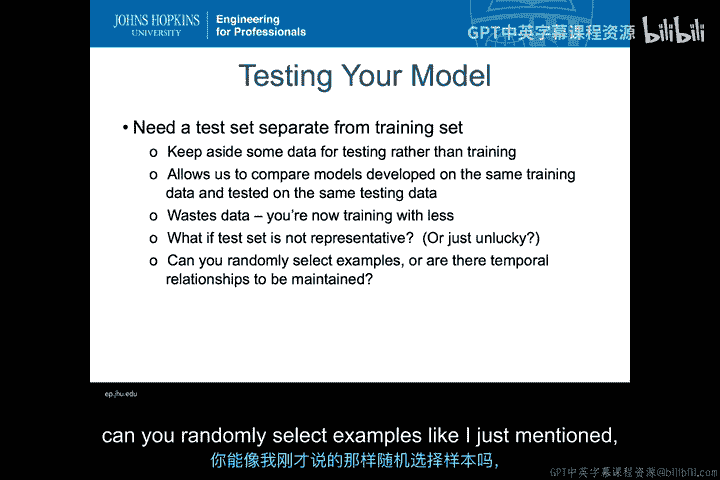

So one approach used in testing that tries to address some of these issues is something called cross validation。

Say you have a data set of 100 examples。 What you're going to do is take one set that's going to contain。

Say 80 examples and then take 20 for your test set。

And then you're going to have what's called a second fold， which is another taking your training set。

 but using a separate set of 20 from it for your test set， similarly for fold  three，4， and five。

 so that every example you have ends up being in your test set once and only once。

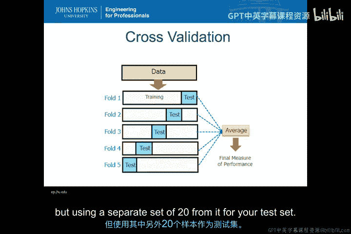

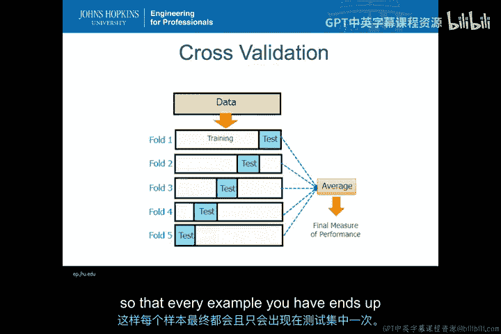

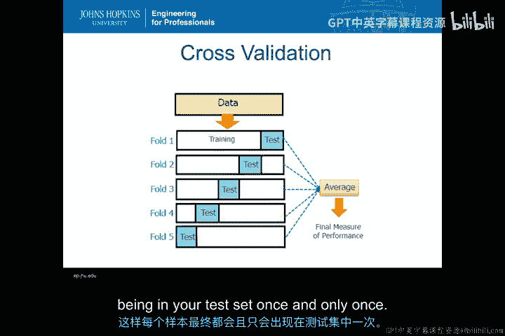

What this means in this case would be called fivefold cross validation is that you're training your model five different times。

 the first time you're going to train it for fold one on the training set available and then test it。

 then you're going to retrain your model using F twos training data and then test similar for three。

4 and5， and then you average all of those for your final performance measure。

And what we find is that generally this is a very good way of determining how well it does your model work at actually detecting in our case。

 normal traffic versus attack traffic。Most commonly。

 what you're going to see is something called tenfold cross validation。

 people tend to create tenfolds and then run 10 examples， set 10 training steps of their model。

 and then1 testing sets and average thoseO。There's another commonly used one called Leave one out crossvalidation。

 which is pretty much exactly the way it sounds you train on everything except for one example and test on that one。

 then you train on everything except for a different example and test on that for all of your different examples the catch with doing that is of course it takes an awful long time to do。

 which is why people tend to do much fewer folds such as1 tenfolds in the cross validation。

So this is a commonly used approach when you're trying to determine how well a model works。

 particularly a machine learning model， whether that happens to be in an intrusion detection context or some other context。

And so essentially that ends this particular module and now you've seen all of the different steps that are involved in trying to use machine learning within intrusion detection。

And what we will do in the assignment now is actually apply some of this in the assignment to really get a feel for what all of this means and how it all works together and some of the pitfalls really of trying to do this。

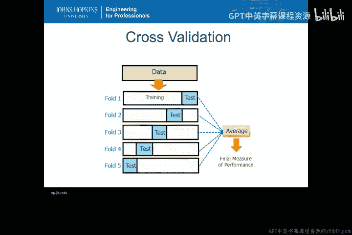