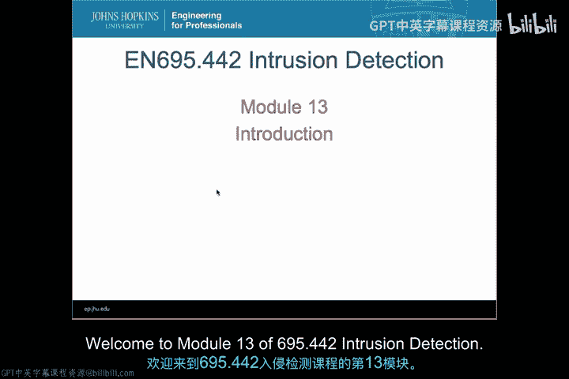
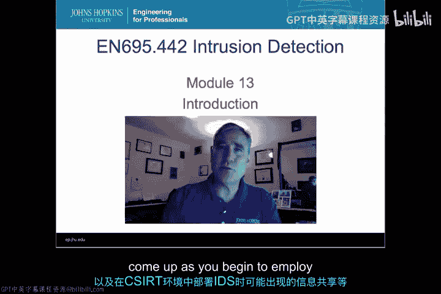
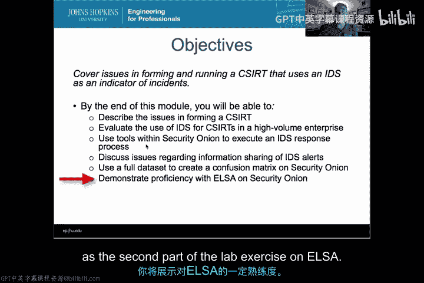
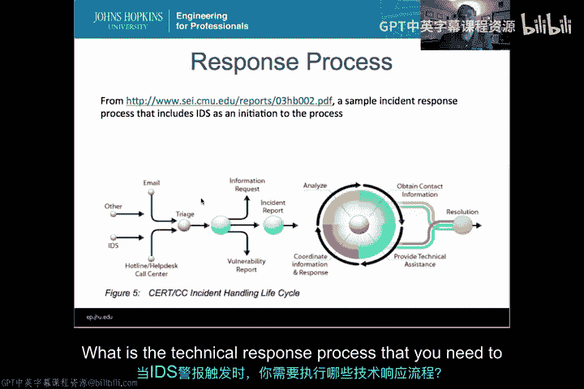

# 约翰霍普金斯大学《入侵检测｜Intrusion Detection》中英字幕 - P59：9_导论.zh_en - GPT中英字幕课程资源 - BV1sGu1z5E2J

Welcome to module 13 of 695442 intrusion detection， this module is going to be all about CSEts。

 the computer security incidentdent response teams。

 not from the notion that we did last module in terms of what are the technical difficulties in terms of using an IDS with a CSEt。

 but in this module we're actually going to talk about the CSEt itself。

 how we're going to be forming the CSEt what they should do。

 what authorities they should have so that you can have a pretty good nature of where a good idea of where the IDS would fit in the context of forming the CSCt in detail and also get into some issues with regard to information sharing and some of the other items that come up as you begin to employ an IDS within a CSERT context。

So let's talk first about the objectives for this module。

 we're going to cover issues in forming and running a CSEt。

 especially a C3 that uses an intrusion detection system as an indicator of incidence。

 so by the end of this module， you should be able to describe the issues that arise when forming a CSEt。

 especially those issues that arise around the idea of a CSERTt process that uses an IDS。

 you should evaluate the use of an IDS for CSEt in a high volumee environment。

 this is partially within your reading and somewhat within the questions and other things that we're going to cover in this particular module。

You're going to use your tools from security Onion to execute an IDS response process You're going to be able to do that through looking at the detailed technical process you would have following up an incident locally and see how the tools you've been working with in security Onion fit into that process you're going to be able to discuss the issues regarding information sharing of IDS alerts we're going to go with the full data set that you used last time to create the confusion matrix on security Onion this should create all of the information you're going to need to produce a comparative report by the end of this class comparing the different IDSs and security Onion that you've been working on and finally you're going to demonstrate some proficiency with ELSA as the second part of the lab exercise on ELSA。

So the next video after this one is going to be specifically on forming a CSERT team。

 some of the issues that go beyond the issues we talked about last time with regard to forming the CSERT and getting into more details in terms of the authorities and the types of CSER organizations that you might want to form some different options that you have。

Then we're going to talk about technical response process now remember in the last module we talked about a response process in the way that it was a human process。

 now we're going to talk about it from a technical standpoint。

 what is the technical response process that you need to do when it's triggered by an IDS alert。😡。

And then we're going to have a video on information sharing。

 the issues of sharing the data collected by an IDS and other incident reports locally globally within sectors。

 the different options that you have out there and some of the way information sharing is developing worldwide right now as we create more and more of this kind of information and see more and more value and sharing this globally so within this module you're going to get back onto the technical side of responding to incidents and using your IDS to specifically respond to these incidents。

 so with no further ado let's go ahead and get started with module 13。

