# 约翰霍普金斯大学《入侵检测｜Intrusion Detection》中英字幕 - P5：4_第一部分：威胁指标与检测类型映射分析.zh_en - GPT中英字幕课程资源 - BV1sGu1z5E2J

Okay， so in this video， what we're going to do is take everything that we've put together from the last couple of segments and map these into a pair of case studies so that we can actually。

 rather than just classify IDS， select an appropriate IDS type for specific attacks given a more complicated kind of scenario。

So this is a reasonably long video module， so I do recommend you take frequent breaks。

 definitely take a break between the two case studies。

 try to sort of incorporate the thoughts that are coming in through these to what you've already learned about various kinds of IDS types。

 threats， risk and attacks so that at the end of it。

 you can really see how the IDS types really do map to these specific kinds of scenarios。

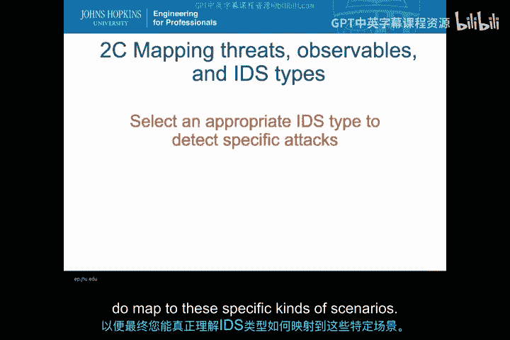

So when you think about selecting an I S， given a specific detailed case study。

 what we're really focused on are looking at specific kinds of threats within the scenarios and trying to understand what kind of threats are the most important to detect。

 And in these cases， we're definitely going to be focused on high severity incidents。

 So these are incidents where the stakes are not just very small。

 They're not simply stealing an identity or just trying to do a small amount of data theft。

 These are high severity incidents， as you， as you'll sort of see。

We're going to basically explore this with two case studies using information within these case studies to help us understand what type of IDS might be most applicable within these case studies。

So for each case study， what we really want to do is focus on who or what is the threat。

 where are the exposed vulnerabilities and where are the observables for the incident in particular。

 So as we've sort of noticed before and almost a nauseum， the idea of observables is really。

 really important in thinking through the scenario because that's the whole basis that the ID will have to use to classify whether or not there's an incident that is detected。

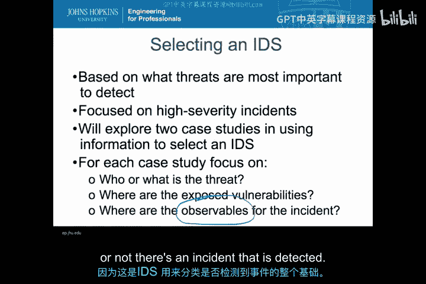

So let's get straight on into our first case study。

 we're going to really start talking about insider threat and how insider threat creates observables that we might detect using an IDS。

We're going to study some basic facts about insider threat。

 we're going to look at the various characteristics that insiders might exhibit。

 and then we're going to try to apply those to the selection of an IDS。

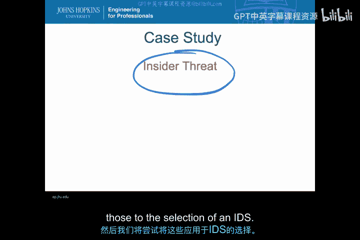

So the insider threat problem does have some very interesting and rather unique characteristics。

 One of the reasons I picked this particular example is because the whole idea of insider threat is very hot。

 of course， in the press in the media， we've seen lots of examples of successful insiders。

 but we don't see a lot of products， a lot of Is products that used through their advertising。

 a focus on insider threat very realistically or directly against the type of problems that insiders usually present。

 So with insiders， we basically have a trust model that we're dealing with。

 and the whole idea of trust。Is critical to when we're talking about insiders。

 Insiders start with a higher level of trust than external threats。

 and they use that trust to penetrate any kind of internal information security policy that would prevent them from misusing information。

So within the IS， if you remember the purposes of an IS。

 there are several that we can apply directly to insider threat。 We can talk about prevention。

 We can develop means of attributing actions to individual users to reduce the frequency or the potential frequency of incidents。

 We can use the direct detection capabilities， especially to provide traceability。

 And this way we can get to attribution。 That's the key。

 We really want to be able an insider threat to focus on the idea of attributing the incident to an individual。

 because we have trust， And trust is remember the focus of what we're talking about with insiders。

 We can within this， provide some traceability and accountability。

The other interesting aspect of sort of the insider threat problem we can consider is the idea of automated response。

 How would we incorporate an IPS for an insider， This is especially tricky in terms of trying to do some sort of automated response that won't just give the insider another ability to be able to guide the system and force the system to react in the nature of the insiders choosing。

 So we're going to talk a little bit about autonomic system responses and maybe consider some of the use of deception as a response within IDS that might be one of the ways that we consider in the selection of the IS to in order to account for insider threat。

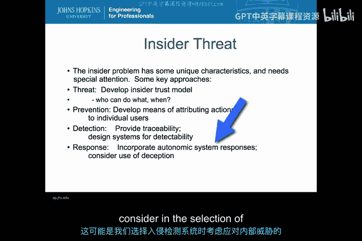

We are going to base our facts as we study insider threat on a United States Secret Service Insider threat study that's been done over the past decade that analyzes the physical and online behavior of malicious insiders prior and during network compromises。

This study and other investigated cases of malicious inside behavior discovers trends and indicators that can help us understand what the IDS would actually have to do in the case of insider threat。

 these facts can help us really understand what to produce in terms of the right level of a focus with regard to our incident detection Finally。

 you know the insider threat study did produce and deliver a sense of audience specific materials that supported training and prevention programs these training and prevention programs are useful as well in helping us to understand how to select an IDS since the purpose of an IS is to support the response to detected insider threats。

 so this is the study that we're going to use as a focus for the insider threat problem。

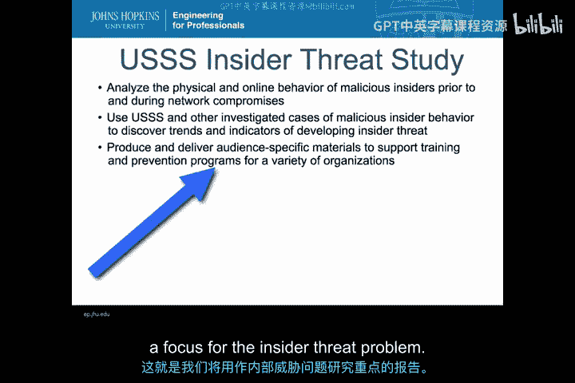

When the study was conducted， it was kind of a unique approach。

 combining the expertise of looking at you know things that would happen within the National Thrreat Assessment Center at the United States Secret Service。

 and the CerRT program out of Carnegie Meln， which dealt primarily with incident response。

 This built on an earlier study that Cert had actually done with case studies in DoD。

 looking in the Perre Orization， which is really focused on the personnel records of the enlisted。

 and these records often contained evidence of insider threat。

 and there was a study that Cert had done prior to the United States Secret Service studyud on this。

From the study， an insider threat advisory board was actually formed with membership from industry。

 government and academia to vet the findings that we actually saw within the insider threat study So this research is all based on real cases from real and investigations。

 none of it is speculation， none of it was know made up or simulated kinds of studies。

 we separated this analysis out on a sector by sector basis。

 with the idea or the hypothesis that different sectors might exhibit different types of insider threat。

 so banking and finance was the first sector studied information technology and telecommunications second。

 the facts that are actually discovered between these two sectors were similar。

 so the hypothesis that they would be very different turned out not to be true。

 but it was a good way to actually still structure the survey。

 There was supplemental information provided with an online survey。

And this was integrated into a methodology that was eventually taught to United States Secret Service agents。

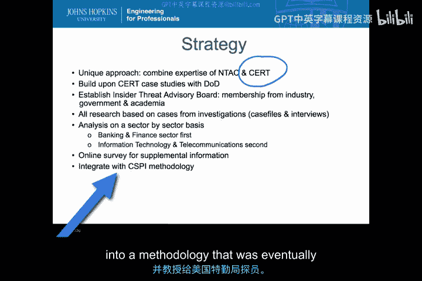

Now the only difficulty with this particular study is you'll notice that the amount of data。

 the number of cases turned out to be relatively small， 2739，25， these are not very large cases。

 The reason for that was that in the studies the cases that were discovered are all ones that were actually prosecuted in a court of law and the victim or the person was found guilty of actually perpetrating the insider threat。

 there actually aren't that many cases of insiders that have been prosecuted all the way through and related and had enough information to relate to the behavior that was exhibited during the time that the insider continued to to prepare and then to execute the insider threat so I wish there were more cases I wish this were a larger longitudinal study but this is the best that we have today in terms of the kinds of insider studies。

So we'll take this information for what we have， but always remember that this information comes from a relatively small sample size。

So let's get it right into some of the findings of the study。

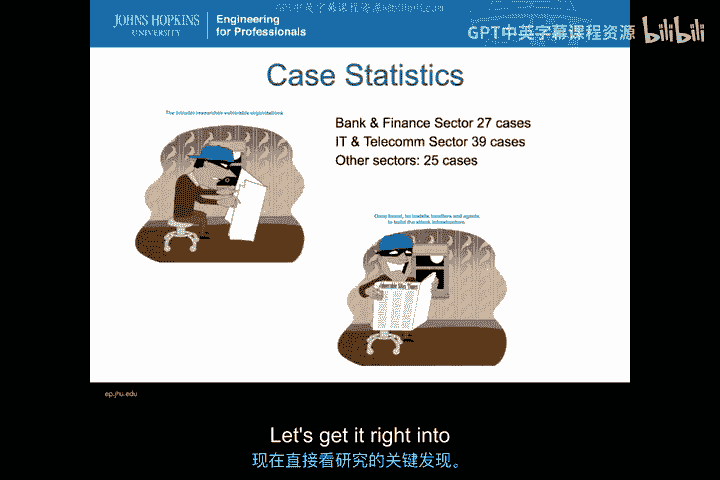

The first part， the first finding from the study really talked about the attacker's relationship to the victim on the insiders。

 So this was the idea that said， okay， if we're talking about insider threat。

 the insider obviously was defined as somebody that had some level of trust。

 So what was the trusted relationship between the insider and the victim。

 The interesting thing of this is that no connection meant that there was a trusted relationship with the organization。

 but there was no contractual or employee based relationship。

 So these were either external contractors， other people that had some kind of trusted relation。

 often maintenance folks that would come in and work within the organization as a trusted member inside。

 but not in fact， be what we would expect， which are current or former employees。 This other one。

 this non-emp connection， these were connections to an employee。 They were not employees themselves。

 but in 7% of the case。There were people， spouses， children。

 close relatives to employees and former employees that actually leveraged the trust of their relationship with this other person in order to get directly to the organization this 7% could have been lumped in to the sort of no connection set。

 but in this case it is more valuable to sort of keep them separate so we know that this is the 7% and we have 57% that did not include this special case of an outside relationship。

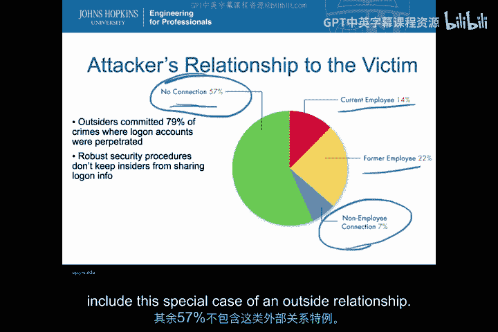

The second interesting finding was this kind of myth that insiders are all geniuses that， you know。

 somehow by having an insider attack your organization。

 they must have been really the best that your organization had to offer。

 What was found that most of the attacks were not technically sophisticated。 In fact。

 many of the attacks simply exploited inadequate or nonexistent policies， practices and procedures。

 Most of them used only very simple kinds of commands。

 the sort of thing that anybody using a computer might be able to do。61%。

 a much smaller amount exploited specific vulnerabilities。

 but even these vulnerabilities were very straightforward weak passwords or some kind of a known vulnerability that package like melo we able to compromise。

 about a quarter of the cases simply were walking over to another employee's computer while they were logged in and taking advantage of that。

 So this whole。The idea that insiders are some kind of genius。

 and you should really worry about the smartest people in your organization。

 the facts just simply didn't bear that out。

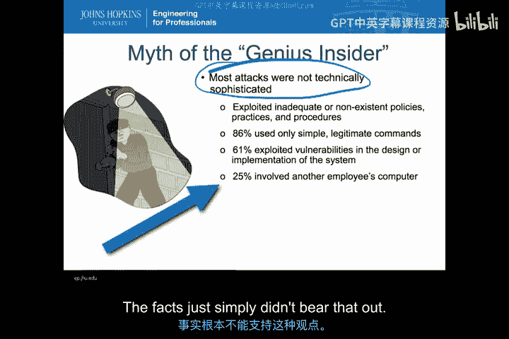

The other hypothesis that a lot of people have going into is that these are always about problem employees。

 They are always the people that are problems or problems in your organization that create lots of HR records。

 So this was studied by actually looking at the HR records and saying， okay。

 so of all of the insider threats that were in the study， how many had a case。

 a history of abuses and violations， how many were difficult to manage。

 how many were involved in external hack organizations or were administrators or had already some kind of disciplinary action prior to the attack。

 And you can see the numbers were talking relatively small numbers，9%。 history of electronic abuses。

 about a third were said after the fact that they were difficult to manage。 But remember。

 this is after they'd already been prosecuted。 So once they're prosecuted。

 It's kind of easy to look back and say， oh， yeah， yeah， yeah， Joe， I remember Joe。

 he was really difficult to manage。 So this 33% has sort of a smack of maybe not being。

Quite so legitimate No， absolutely none of the employees used some sort of external hacker tool or was involved in a hacker organization prior to the attack that happened Very few of them were system administrators and very few of them had had some sort of a previous access disabled because they had misbehaved so as you can kind of see from this the idea that problem employees are what you're going to worry about really aren't the problem here so in terms of an ideas you can't assume that what you can focus on might come out of problem records in HR。

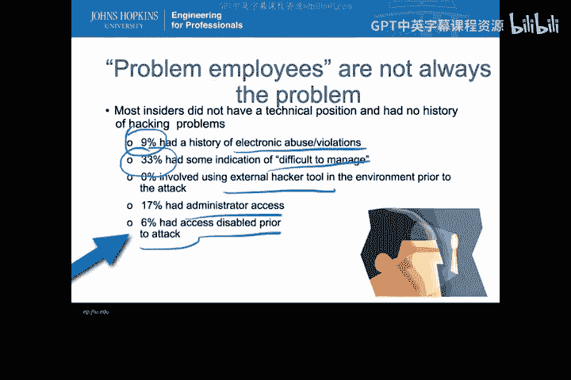

This finding was particularly interesting with regard to the study that insiders were most frequently caught outside of the security organization。

 There wasn't any real consistency with how the insiders were caught。

 And this actually makes it a little problematic for an I D S。

 So we got about 48% were detected in some way by security personnel。 That's less than half。

 That means that using forensics tools using the various kinds of evidence that would be that would come out of an insider attack Only about 48% were actually detected by the the security personnel themselves。

 Here's a scary one。35% were reported by external customers， this。

Is especially problematic when we try to think about how are we going to tune an Is if many of the cases seem to be observed outside our organization first。

About 30% of the insiders were identified strictly through the use of forensics。

 These were part of the 48% that were detected by security personnel and then investigated and in about 30% of the cases。

 the use of technical forensics was able to identify the insider。 Now this is not bad news。

 because that means there are technical indicators and observables for a large percentage of the cases。

 if not a majority， that could be identified through observables in real time。

 using streaming for using basically streaming intrusion detection systems， about a quarter。

 a little more than a quarter were directly identified through system failures or regularities not through the use of forensics。

 So what does this mean this basically says that when the system failed there was only one person who could possibly have been the source of that failure and therefore that person was identified。

So again， this is not bad news for an intrusion detection system。

 It means that we can find some observables that would allow us to individually pinpoint somebody who caused a system failure or some kind of regularity Now we should be careful that's only 26% of the cases what happened in the other 74%。

 could they not be identified this way or did we simply not have the sensors and the tools in place for that。

 Well， this is what the facts of the study showed， and it gives us some indication of what we might do with regard to an IDS tool。

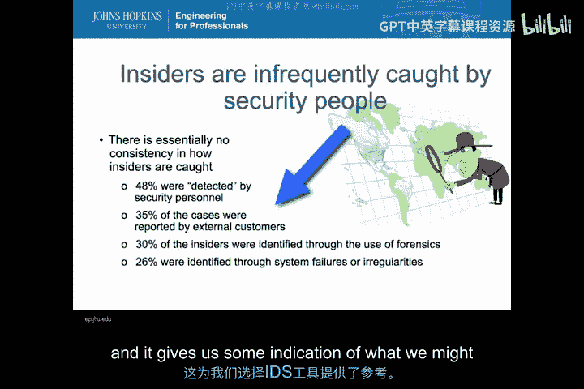

So here's a finding that's not too surprising。 The impact of insider attacks are usually focused around data。

 Data is really become some of the most important assets when you're talking about technical insider threat behavior。

 So it's not too surprising that insiders would go after data as well。 data is easy to steal。

 It's easy to modify， it's easy to attack。 So it's not too hard to understand why that would be the primary target for an insider。

 That's something that we can actually take and use as we think about insider threats。

So when we talk about 78% of the cases focusing on modification or deletion of company information。

 that's a high number。 That's a big number of insider cases that are focused around that。

 about 30% corrupting data，22% modifying without corrupting account information about 13% modifying programs。

 this actually says that we have a potential of grabbing observables around the integrity of information。

 This is a very useful finding。 all of the cases involve some kind of information systems and networks。

 not too surprising since that's how the cases were actually selected。 only about 30% of the cases。

 however， were what we would call retribution cases。

 cases where the insider wanted to do damage or harm to the system or network once it was inside and very few targeted things that are outside。

 targeted the customers of the organization are targeted something out。

9% is a relatively small number， but a serious number when you think about how severe。

Targeting from the inside to an external customer might be with regard to reputation。

 So this again gives us a good insight into how we might select the appropriate Is type。

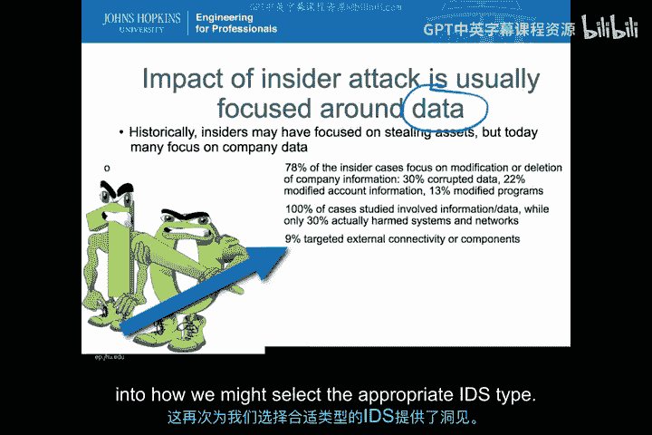

Here's another interesting finding with regard to selecting an Is tool。 There's a lot of。

Common understanding that's just flat wrong that most attacks happen outside of business hours。

 How many times have we all heard about the lone wolf who attacks from home in the middle of the night in order to steal the data and get away。

 But， you know， when we talk about， you know a large percentage。

70% of the attacks of the attacks happening during business hours。

83% happening within the physical operational plant of what's going on。

 and even though 30% of the attacks occurred from home，75% used both home and work locations。

 this says that we actually have quite a good opportunity to collect observables around ordinary business hours when the attacks might actually happen。

 It also says， however， that there should be no reason why we should necessarily focus all of the attention of an Is outside of business hours。

30% is still a reasonable amount of attacks happening outside of business hours。

But given the total number of attacks is going to be happening more during business hours。

 the difficulty is that we can't simply say because activity is less at night。

We can focus our observables then and find all of the insider threats。 It just won't happen。

 What we're going to see instead is we're going to see only a few of them happening during that time when most of them are going to happen inside of business hours。

 This tells us a lot about how we have to be able to take an intrusion detection system and worry that we can't simply train it on a small amount of activity that might be happening out of ours。

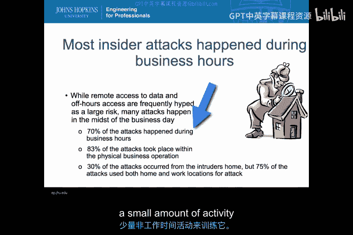

So shouldn't also come as any surprise that the who in terms of who is the insider。

 there is no common profile that's actually going to give us a leg up on this。

 You can't really think that an insider is usually a young male。

 You can't really think that an insider is usually a specific ethnic group。

 What we found is the distribution of males， females， executive technical support， full time。

 part time contractor， all of these followed exactly the percentage of that group of person。

 inside of the organization， it was exactly proportional。 So， yes。

 there were fewer females that were actually involved in insider threat cases。

 But if you look at the percentages， the same percentage as the number of females in the organization were involved。

 The same thing with executives， technicals and support personnel。 If you look at them。

 in that proportion， That's how they were involved in insider。basicallysically。

 it says anybody can become a criminal in the organization。

 there's no single profile that's going to help us tune an ideas to focus in one specific area of the organization。

 The indication of an attack and the attacker themselves can come from anywhere and from anyone so we need to be able to focus broadly in order to deal with the inside or threat question。

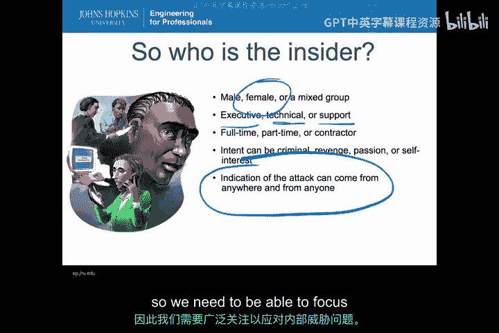

So those are the basic facts that we can use in order to determine what are we going to do with regard to an IDS so what have we really learned and what can we use There's a broad set of motivations and goals no single strategy looks like it's going to be totally effective。

There are lots of vulnerabilities focused around data access controls internally all because of trust。

The risk is significant for insiders because the severity basically can take over any amount of information internally and remember the integrity attacks。

 integrityity attacks can destroy not only reputation。

 but the actual fundamental nature of a business internally。

Normal behavior is difficult to determine， we saw very broad things inside and outside of work hours。

Not a lot of way for us to say， hey， there's a really good opportunity for a very simple anomaly detecting system。

 And we do need a deterrent to try to reduce the frequency。

 And it looks like a deterrent could be effective because we're not talking about super geniusious insiders。

 We're talking about people who don't want to get caught。

 who don't necessarily have the skills to be able to work around any I D S that we would want to put in place。

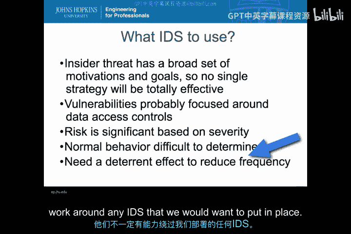

So what are the possibilities， What kind of IS should we choose So we want to use a system that alerts when access controls are violated。

 This is certainly going to be a host based IS that's going to be running inside of our servers or our clouds that are looking for access control violations and losing those particular alerts as indicators within our intrusion detection system。

We're probably going to have a number of false positives with normal us accidents and changing conditions。

 So although anomaly detection is a very common way to address insider threats。

 we have to be prepared that if we use anomaly detection。

 werere going to have to deal with a lot of false positives because of normal user accidents in changing additions。

 The good news is the users know when it was an accident and when it wasn't an accident。

 So automated alerts may actually serve as a deterrent。

 This is an Ips system that instead of actually shutting something down would automatically alert the user that an incident was detected and attributed to the actions of that user。

 if it was just an accident that the user was doing that， they would know it was an accident。

 know that something had gone wrong and take the appropriate action。

 if they were actually an insider and attempting to threaten the organization。

 they would also understand pretty quickly that that is something that's going to。😊，Be seen by IDS。

 And if they're not a genius insider， it's going to be very difficult for those insiders to proceed and will likely they will be deterred。

For the data access and all the things we're talking about data。

 the host based system near the critical data is probably a good place to start。However。

 we might want to think about a network based I S that focuses on outbound identification of I P in order to understand leakage of insiders。

 This has the positive side benefit that if I have malware internally。

 which operates essentially as an automated insider， I might also look at I P leakage by that。

So I can select a networkbased IS， focus it on my outbound traffic and focus on characteristics of I leading my organization。

 large amounts of files or large amounts of data coming from an unusual I address。

 Those are the sorts of things I can focus around a network based Is so I can use a product that is a hostbased IS system。

 something near the critical data， I can use something like tripwire for critical individual files that don't change。

 I can use access control system data feeding into an Is that would identify the users that are exceeding their authority for access control。

 and those are probably good places given the facts and the data that we have for Is that we would actually want to start when thinking about what type of IS do we want to select。

Okay， at this point we're going to be moving along to the second case study which is going to be the 2003 Northeast corner blackout I suggest at this point take a break。

 think a little bit go back if you need to within the first part of this video think a little bit about how the insiders are actually getting at the data as you're putting together your virtual machines。

 versions of tripwi are going on the machines， think about how that particular IDS would be able to address some of the details of the insider threat as presented in the first part of this video now we're about to move on to the second case study。

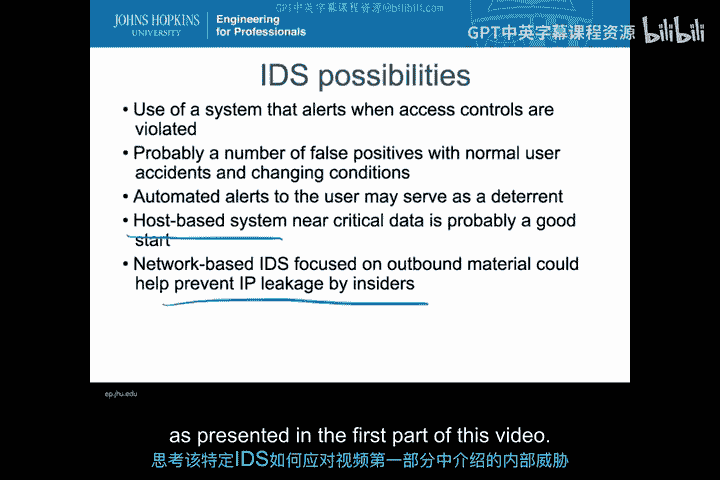