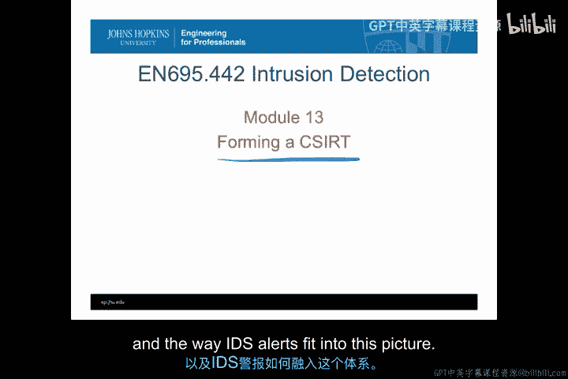
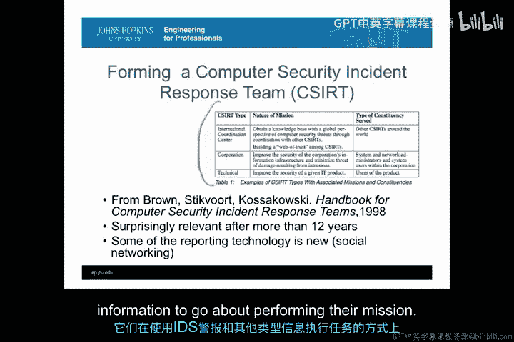
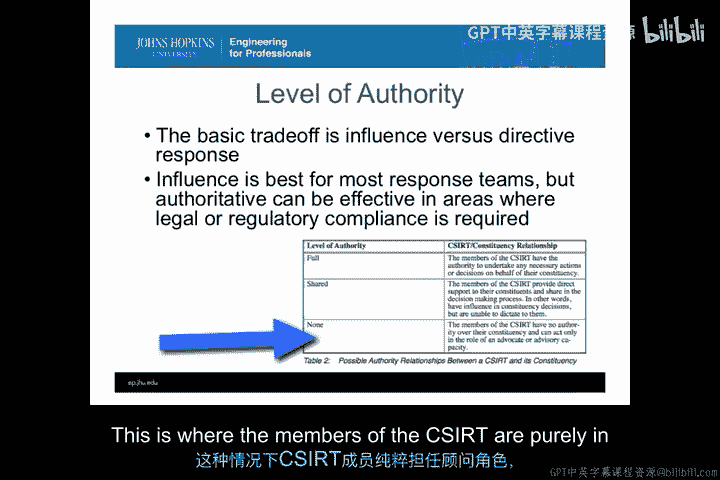
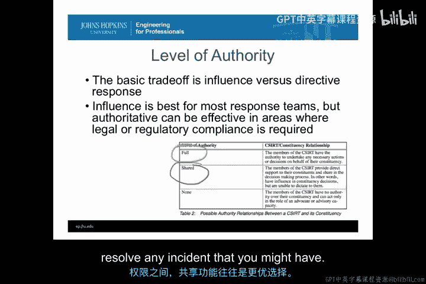
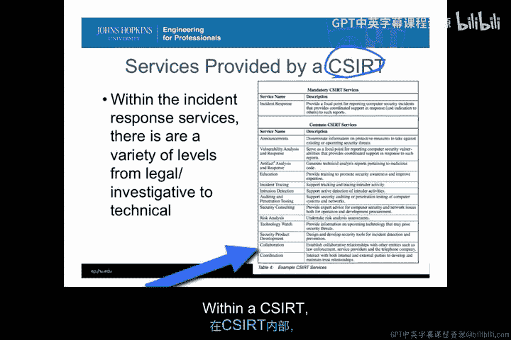
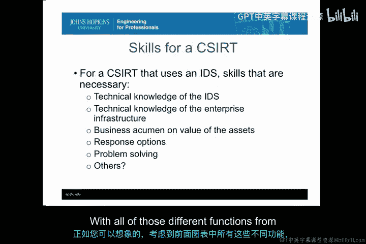
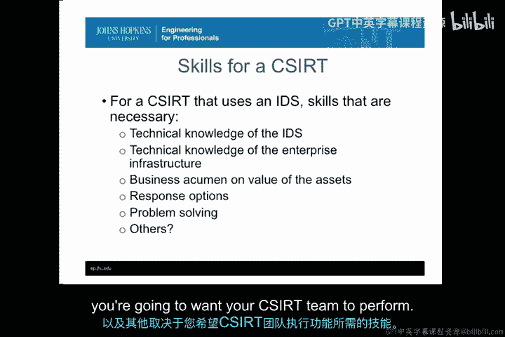
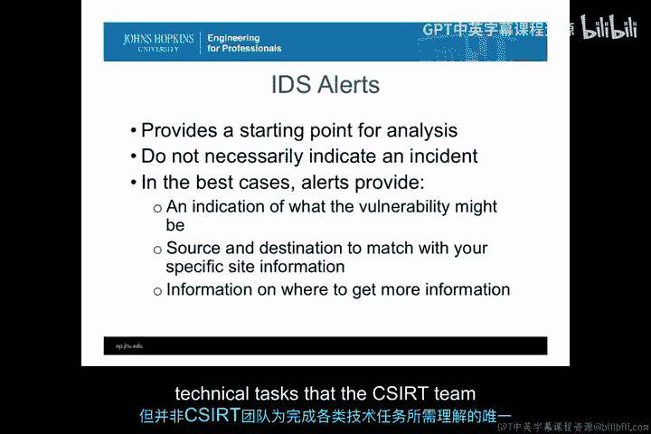

# 约翰霍普金斯大学《入侵检测｜Intrusion Detection》中英字幕 - P60：10_计算机安全应急响应组(CSIRT)组建.zh_en - GPT中英字幕课程资源 - BV1sGu1z5E2J

Okay， in this video， we're going to talk more about the technical details behind forming a CSEt。

 some of the options that you have， some of the different ways in which CSEts have informed formed in the past。

 and other areas that you can perform within the functionality of a CSEt within a large organization。

We're going to go into the level of authority， the functions of a CSERT。

 we're going to talk some about the services provided， some of the skills that you're going to need。

 the dynamic nature of the way CSAts operate， and sort of the way IDS alerts fit into this picture。

So we're taking a lot of our information for this part of the module from this original reference written by Moyra Brown Stfor and Kowski。

 it was actually written in 1998， but still surprisingly relevant even after all this time the types of CSEt are really about the same as the types that were formed at that point in time the directions and the authorities and the issues that were identified are still the main issues that we have today。

 even though the technology on the IDSs have changed the technology in the defensive infrastructure has changed somewhat the general nature of forming the team hasn't changed a lot within those three so when we want to talk about different CSEt types that can actually be formed。

 they still fall into three basic types， you have sort of an international coordination center。

 these are the global CSEts around the world that。Coordinate either on a national or an international level。

 so US CerRT would be in this category， CerRTCC is in this category。

 some of the like the Netherlands Cert are kind of in this category as well。

 they're not they don't have a specific organization or a specific constituency。

 they instead have a broad number of organizations that can report information in a trusted way to form this type of CSERT。

The main thing， and I said that just a moment ago， the main thing with these international coordination centers are trust without building up this kind of web of trust in here。

 this trust between the organizations these international coordination centers really can't function。

 They have to be able to hold the information that is provided to them without releasing it to any unauthorized parties。

 they've got to be able to use the information to give early warning to anybody within their constituency and they have to share amongst other international CEt teams in a way that doesn't expose their constituency in a way that they wouldn't want。

 So that's sort of the ideas behind this sort of international coordination center。

Beyond the International coordination Center you've got ones that are associated directly with corporations or with enterprises or other sorts of individual entities that have the authority to operate within their networks and systems so the idea is the nature of their mission is to improve the security of the corporate information infrastructure and reduce risk so we talk a lot in this course about the reducing risk within these organizations。

 and that's primarily what this type of CSERT does。

 this is by far the most common type of CSERT that exists out there。

 and the one that you're most likely to be associated with。

 they tend to support system and network administrators within the corporation within the organization that they're there。

 they can provide advice or direct support they can either do it with authority or without authority but the use of this information and the passing of information from the lowleve portion。

Of the organization up into the board level is another function of sort of this area of the Crt。

The third type of CSERT team that we see is this technical CSERT team These are usually associated directly with some specific given product。

 an open source product， a commercial product， it's the users of the products that are being served so you can imagine the Microsoft response team is a version of this kind of technical team Their job isn't to protect Microsoft the corporation's IT network。

 their function is to respond to the various kinds of problems within a specific IT product within Windows within word within something of that nature Almost every major technical IT product has a response team of this nature。

 a technical response team that deals with reported vulnerabilities。

 reported bugs and other sorts of elements that would improve the security of the product over time。

So these three different types of CSEts really represent the full gambit of the different organizational types of CSEts you might see for the computer security incident response teams that are there。

 there are examples of every one of these that you'll probably run into and they do differentiate in the way they actually use IDS alerts and other types of information to go about performing their mission。

The next fundamental tradeoff to talk about with regard to the development of CERT teams is this whole idea of level of authority。

 What level of authority will the CSEt team have。 The basic tradeoff here is influence versus directive response。

 So influence essentially means that the C Ct team is providing advice guidance。

 even specific technical steps that can be done。 and this is versus directive response。

 This is like policy is changing so that you must within a time period do what the CEt team is saying。

 Now， there are some elements of between influence and directive response。

 Theres some in between portions where you can have influence over other organizations that actually have directive directive authority。

 So you might have influence over the next version of policy that's written。

 So the Cert team itself doesn't write the policy。 So there's a couple of different ways that。

This tradeoff can be managed， but it that always is a tradeoff in the CSERT team between the sort of influence versus directive response that you have now in terms of what's usually best for response teams the history shows that what's usually best is influence because that tends to garner more trust and trust is one of those ultimate areas of requirements that you must have in order to successfully have a response team that gets reports outside of the IDS but with direct reports from the constituency that's there so the basic kinds of level of authorities that are represented in this chart there's full where the members of the CEt have the full authority to take any necessary actions on behalf of their constituency This does happen in the case of network CSERT teams where the network CEt can essentially change any configuration or change any nature of the network。

That's where you see the full network authority usually seen。

More commonly you have shared authority where the members of the CSERT can provide direct support and have influence but usually have to work through an intermediary or through a policy representative in order to be directive in order to compel change within the system and we call that sort of shared authority because it's the CSERT team defining what the actions will be。

 but not actually embodying the authority to require that they be carried out and then of course there's none the sort of no level of authority。

 this is where the members of the CSEt are purely in an advisory role。

 this is often the case in collective Cers you know like the CerRT CC or other sorts of global certs where they put out suggestions and some types of information but they can't really compel anybody to to do or make those changes that there's sort of in place so between these three。

You see that there's a trade off between the amount of trust versus the amount of。

Rapid protection that you can get based on what the CSE team learns with regard to an incident。Now。

 it should be noted that part of this tradeoff has to do with the fact that the CSERT team reduces risk by accelerating the response to any incident。

 So in some respects， if you think about the full authority section here。

 that's the maximum amount of acceleration that you could get with regard to resolving an incident。

 But in order to resolve the incident， you need the cooperation of other administrators of the different areas。

 which is why the sort of shared function tends to be the better option in terms of trying to make a rapid change happen in the trade off between the trust that you engender in making systems better。

 versus the authority in actually trying to rapidly resolve any incident that you might have。

Now， of course， depending on the type of CSEt that you set up。

 there is a wide variety of services that a CSERTt can provide Basically there's only one sort of mandatory service。

 which is the heart of the incident response team， which is this providing a focal point for reporting computer security incidents providing coordinated support in the response and indications to others for all of those such reports on the incident response。

 so this is what makes an incident response team an incident response team and you can get the initiation of this from your constituency from external entities or from your IDS system。

 but the response is the nature of what the service has to be provided for this to be a CEt team at all。

 however， you might have a whole lot of other services that help you meet the independent mission of what actually about going on a common one is announcements or publications that。

Go out to your constituency disseminating information on protective measures。

 these are the advice pieces that you're hoping that your constituency will follow in order to assist them in recovering from or preventing or dealing with any kind of an incident that's sort of going on at that particular moment。

Some teams include the vulnerability analysis and response directly。

 so this way when you get an indicator that there might be an incident going on。

 you can actually do an analysis to understand what the vulnerability from that that that implement exploited and then use that to feed into some kind of mitigation to improve the computer security of the organization itself。

 this is an augmentation to most of the basic incident response processes that we've looked at before。

 and it involves a separate technical team inside the CSEt that looks specifically at reverse engineering malware and understanding some of what's going on with regard to the vulnerabilities。

And speaking of malware， this sort of artifact analysis and response specifically deals with how do you reverse engineer any malware that might come in？

That expertise is very hard to come by， but if you have it。

 a good place to organizationally place this is within your CSEt so that you can have the sort of tight binding between the indicators of an incident。

 the reverse engineering of the malware and the recovery processes that are kicked off by the CSEt team。

Many CSEts find that education is an important aspect of what they're trying to do within the CSEt。

 mostly because it's through training and education that you gather the trust of your constituency。

 you help them to be good stakeholders when an incident actually occurs and it does improve the expertise across the organization so that you more or less speak the same language during an incident when it's actually being responded to。

Incident tracing， this is the idea of trying to trace the intruder activity to a source。

 trying to find out who's done it， this is a CSEt in cooperation with an investigator to attempt to understand where the root cause of the incident was and perhaps bringing whatever person is that that root cause to justice in some kind。

Intrusion detection， this is the support of the IDS system itself。

 it's not a requirement that the I support of the IDS be inside the CSEt。

 but it's valuable for the CSERT team to have a very strong participatory hand in the deployment and the configuration of any intrusion detection or intrusion prevention software that's deployed at the site。

 mainly because the indicators that come out of this intrusion detection system are going to be the indicators that kick off the CSERT process。

 so early involvement in the deployment of the intrusion detection systems and the intrusion prevention systems is very valuable to the CSER team。

 but again， as I say， not required， you could put intrusion detection in hands of the network administrators and simply get the requirements from the CSEt as to what do they need for a detection of an intrusion。

the whole idea of auditing and penetration testing。

This is attempting to look ahead of an incident to see where an incident might happen。

 looking for the vulnerabilities and using pen testing in order to determine what the weak spots in the infrastructure are。

 this can aid both in strengthening the infrastructure。

 but also preparing the CSEt for knowing where the weak spots are in the organization when an incident does occur。

There's security consulting since the CSERT team do become probably your best security experts in the organization。

 having those individuals provide some kind of expert advice on security network issues is a good use of their talents。

 same thing with risk analysis， doing risk analysis within the CSERRT team is a good way of maximizing the experience that you have within the CSERT organizations。

TheTology Watch usually trying to keep the CSERT team up to date。

 understanding the upcoming technology， understanding how that changes the security threats， again。

 this assists the CSER team in their own incident response。

 but it also assists the organization in risk mitigation when new technologies are being deployed。

Security product development， this is in particular valuable when the operations personnel from the CSERT team and the IT development personnel for security tools and incident detection work together the DevOps philosophy within IT would call this as a requirement in order to involve the operations people and the development people in a rapid change and adaptation of the security products to the changing incident environment that the CSERT is experiencing。

Collaboration and coordination across other response teams internally and externally to the organization is although it's said here as a common CSERT service that isn't required。

 it's very likely that the collaboration and coordination is necessary within a CSERT whenever you have an organization that has to work with other organizations in the resolution of an incident。

So with all of those different functions from the previous chart， as you can imagine。

 it's tough to actually find personnel with the right skills to do everything that's required there。

 You need a number of things that are very difficult to find certainly in an individual person。

 but even difficult to hire as a team， so you often have to grow these skills internally in the CSEt team through training and education and on the job learning as the CSEt team develops。

 You certainly have to have the technical knowledge of the IDS to understand the alerts and understand how to perform the incident response processes that are kicked off with an IS or an IPS alert。

Certainly， you need some kind of technical knowledge of the enterprise infrastructure to be able to scope and properlyably evaluate whether the incident is or is not something that is important to respond to in that same vein having some business acumen to know the value of the assets and understand the context in which these incidents and indicators are running within the CSEt so that you can again prioritize and take appropriate responses。

And there are usually multiple response options that you can have for any given incident。

 so it's useful to have team members who are familiar with multiple different ways that you might respond to a given incident。

 whether it's to block or to turn off various kinds of services。

 whether it is to adjust services or divert attacks or set up honeypots or any of these other kinds of options that you might do all of these require a good set of problem solving skills。

 which is not too surprising is that's a general job category skill that you need almost everywhere。

 And depending on the specific elements that you want your CSEt team to do from the previous chart。

 you can imagine there are other specialties， reverse engineering skills， assembly language skills。

 a number of malware and analysis skills， large data skills， other things that are required。

 depending on。The functions that you're going to want your CE team to perform。

And the CSERT teams are never static， understand that CSEts like many other things that we've talked about within this class。

 are not elements that you can just say create one time and then you can just sort of let it go there are a number of factors to consider when trying to determine how to handle surge situations。

Growth and shrinkage within the various kinds of frequencies and severities that are happening。

 There's also， of course， organizational change in growth。

 there's all these elements that really affect the nature of the certs。

 a few of them were just listed here from table 8 on that document that I mentioned the rate of incidents of course。

 which cannot be easily predicted so the cEt is often going to experience periods of time where they have sufficient resources too many resources or too few resources to handle the current incident load。

 this is especially relevant when you're trying to think about how do you deal with false positives and the reduction of type1 errors that you might have within the system。

Then you've got sort of intruders are constantly dividing new methods。

 The technology of attacking is always getting better and better。

 So obviously the type and complexity of incidents reported to the CSEt is going to change over time。

 The skills that you had when you form the CEt are not going to be sufficient to handle this new methodologies。

 all of the new attacks and various techniques that are going to be coming over time。

Advances in the technology themselves， not just the intruder technology are other things that are going to change the nature of the CSEert。

 For example， you've got to have the technical expertise to keep up with lots of。

 you know the active X and the Java and whatever else comes along as the next killer app within the web today。

 you'd have to say that Cert teams have to deal with mobile computing much more than they ever did in the past。

 Certainly， they've got to deal with cloud computing environments。

 They've got to deal more and more with the Internet of things。

 And as the technology changes so will the dynamic nature of the Cert。Now， in some countries。

 there are a number of laws that are being developed and changing that definitely affect what the Cs can and cannot do。

 Some of these have to do with privacy laws or what can be collected on the network。

 what can't be collected on the network， Of course。

 there's a huge amount of conversation within the US concerning things like metadata concerning other sorts of collections by corporations on。

Personal data that is shared publicly like in Facebook or out in other places。

 can those data sets be used for incident response。

 can CSERT teams use those data in a way that would help them resolve these incidents。

 these are questions that have to be resolved by the CSERT team and through the legal methods of what's happening in this space。

And of course， there's a lot of other demands that are often made on CSEts。

 situations frequently arise where the resources are there within the CSERT team。

 but they're dedicated to some other business requirement that needed that expertise at the time。

 so having to balance between applying the CSSEt expertise to other business requirements and using the CSSEts expertise when you need it for incident response are always going to affect the dynamic nature of what's happening within the CSERT team。

So in all of these cases， remember that the IDS alerts always just provide a starting point for analysis。

 they never complete the analysis， they're just a starting point。

 it's the skills of the CSEts and their authority and their organization that actually begins to resolve the incidents that are there。

 so as the IDS alerts provide the starting point remember that they also don't necessarily indicate an incident。

Sometimes because it's a type1 error， sometimes because it just doesn't matter to the organization。

 but in the best case， alerts are always going to provide an indication of the vulnerability。

 the source and destination of the attacks so I can match that in order to scope the appropriate response and information on where to get more information understanding parts of what's coming in with my IDS alert that will point me to the right business unit。

 or point me to the right reverse lookup or other areas that I can actually use to link that to the skills and the organizations that I have in my CSEts in order to manage the functions that I've actually created。

So those are some of the technical issues in forming a CSERT team。

 some of the skills and abilities and technical requirements that you're going to have to apply within this area。

 as you can see， knowledge of the IDS and knowledge of the IDS systems are important。

 but it's not the only thing that a CSERT team needs to be able to understand in order to accomplish the wide variety of technical tasks that the CSERT team is likely to want to accomplish。

