# 约翰霍普金斯大学《入侵检测｜Intrusion Detection》中英字幕 - P61：11_IDS响应流程标准化.zh_en - GPT中英字幕课程资源 - BV1sGu1z5E2J

Okay so in this video we're going to talk about a technical IDS response process So the idea here is going to be if you are a local responder within an organization。

 what is it that you can and should do inside the organization to begin to investigate based on an IDS alert that you might receive so we're going to cover what to do with the alerts when you have them。

 how to really determine whether the vulnerability exists looking for supporting information and then we're going to go through an example should just walk through how you might resolve one type of alert just to give you an idea of the way that this might come together at the end and then we'll talk a little bit about correlation and consoles and some of the tools both inside of security unionion and outside of security unionion that you might use in a case like this。

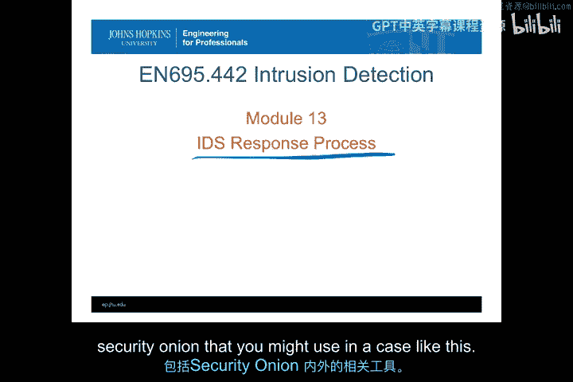

So just to place this in context， remember that what we're doing is starting with an IDS alert that's coming into some kind of a triage process and it's going into an analysis process that we're going to go around in order to resolve what it is that's going on in order to provide either some kind of technical assistance。

 or obtaining some sort of contact information to resolve the incident。

 so we're going to be walking through a more technical way of doing the triage function。

 of looking at information， looking at vulnerabilities， going through the analysis。

 and going finally to a resolution。

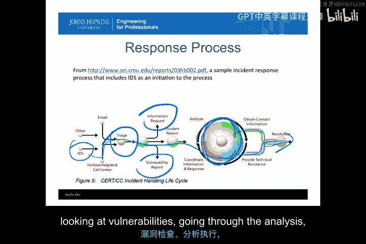

So as we've said before， an IS alert provides the starting point。

 So one of the first things we're really going to have to figure out from the IS alert is is this a T1 error or is this a regular alert that we would have to do something about Now。

 we probably want to err on the side of doing something and not assuming that it's a type 1 error if we assume a type1 error too early in the triage process。

 we might miss some specific evidence that we would want to follow in order to determine technically how to resolve the incident that we're talking about。

 So in the best case， when the alert provides information。

 this is all information that we're going to begin to process to understand how this alert fits into the technical analysis that we're doing within the organization in order to figure out where and what we ought to be doing in response。

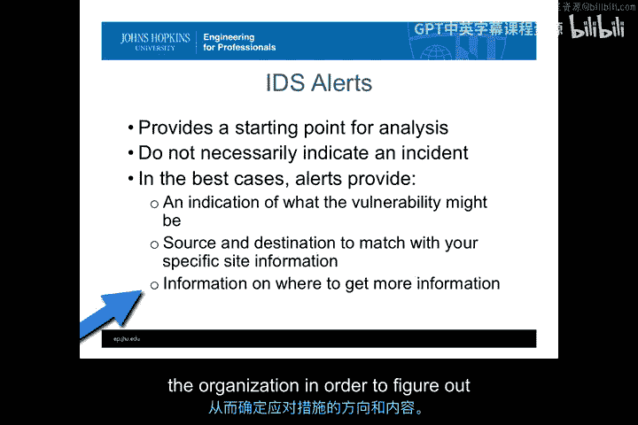

So again， looking at the same kind of response process that we have seen before。

 we're going to first determine if the vulnerability exists。

 We're going to look for supporting information and look for modification or other evidence that we actually have something serious that's happening within our system。

 So this is a general case of technical response where if we see that the vulnerability does exist。

 and then we can find supporting information and application log。

 and then we actually see some damage that we're looking at。

 we're going to know that we're on the right track for going from the IS alert to an identification of the damage that we actually have to respond to。

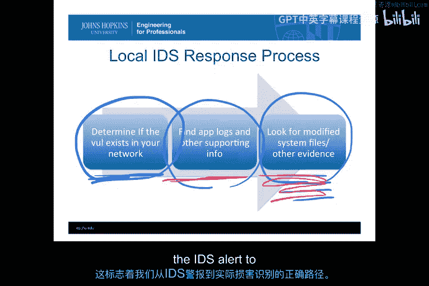

So in general， to determine whether a vulnerability exists or not within our system。

 basically we're going to have to start by tuning the SNort rule set or the IDS rule set。

 so I'm using SNort as kind of a generalization of a signaturebased IDS so we're going to try to remove all of the alerts for any operating system that we just don't run at all。

 so if you're a shop that only does Windows and Linux and you're seeing alerts for Mac。

 this may not mean anything at all within your system。Usually。

 what's happening is we have a windows based system， and we're seeing Uniix style alerts。

 And those are the ones that we probably want to tune down。

 unless we are sure that it actually has something to do with systems that were running。

 If you are unsure about it， you should leave it in。

 But after you have done a number of these kinds of events and determined they were not incidents。

 you should probably try to remove this from the rule set。 if you possibly can。

How can you verify whether the vulnerability exists。

 you can use something similar to a NeESA scan in order to scan all of the systems in your IP space to understand where your vulnerabilities are and where the systems and the attack surface is that are being alerted based on the rule set that's coming in。

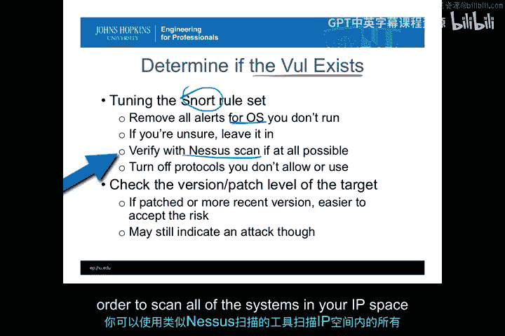

Of course， along with this， you're certainly going to want to turn protocols off that you don't allow or use。

 so if you don't think you have a system that supports。

 say port 25 inside of your organization because you already have a mail gateway。

 then you shouldn't have port 25 coming into your network the same with the kinds of software that you're running within end user servers。

 especially not so much on the end user systems。Because we know that users are relatively unpredictable and run all kinds of different software。

 but servers normally have very specific software that they run。

 Is there any reason to leave a compiler or leave on various kinds of editing tools or other things on servers when you're not doing any development on those servers and you're only running services there。

 No， you should turn those services off and remove them as much as you possibly can。

 This is very similar to tuning the snort roll set。

 This is starting out to make sure that you don't get spurious alerts and various things from your Is that are going to alert on elements that shouldn't even be running in the first place。

The next thing you're going to want to check is you're going to want to check this patch and the version number of the target of the alert that's actually coming in place。

 because it may be that what you're seeing is some kind of a rule set or some kind of an alert on a system that doesn't exist with regard to the patch level that you actually have so check that version in that patch number。

 If the version of the patch level of the target is such that the alert is targeting a vulnerability that doesn't exist within that patch level of the target。

 it's easy to say， okay， that's probably probably a type1 error and that you can actually sort of take it out of your system。

Now， I'm not saying that just because you don't have the version number doesn't mean that it's not a real attack。

 It could very well be a real attack。 This may still indicate there's an attack coming through your firewall coming into your infrastructure or being launched by an insider。

 but if it's being launched against a version or patch level of the target that doesn't actually express that vulnerability。

 then you can still triage this out as anything that's necessarily important to your system。 Again。

 be very conservative unless you really know what the versions and patch levels of the target are for sure。

 and know that that could not have reflected a real vulnerability then you should probably still try to investigate it。

😡。

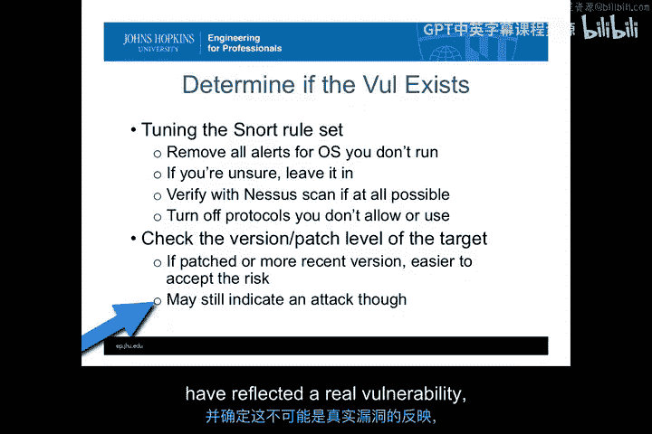

So once you've determined that your target is vulnerable to that attack and you've determined that that incident that's coming in place is on a supported operating system。

 now you have to start to understand what the scope and scale of the attack is Usually this means performing some kind of forensics on the target going to other tools and other log files in order to look for supporting information beyond the IS alert itself。

 so that you can begin to understand better what specifically was targeted on the system。

 you won't usually get that level of information from the IS alert。

 although you'll get some indications based on perhaps the process I of the process that was doing the host-based Is or the network port for the network based Is about what might be affected and where to start with the forensics on the target You're going to want to check your app logs associated with the vulnerability to say。

 was there anything involved in this。Particular IDS alert on the vulnerable system that I can maybe have logged within the app files on the system itself the app files associated with the vulnerability on the host that was attacked are more likely to give you the detailed scoping information of exactly what was affected whether it was an integrity attack or some kind of a confidentiality attack you should be able to find out through the app logs better than through the IDS alert itself on what exactly was going on in that situation Now。

 occasionally you're just going to have to look for activity from the modified system and say。

 okay this system was attacked， I have no idea what it did。

 So I want to watch and see if there's any suspicious behavior coming out of that host。

 So for example， if I see an end user host that historically does not have port 25 activity coming out of the host or if it does it's almost never coming out encrypted and now suddenly I see a highvol encrypted stream coming out of that host。

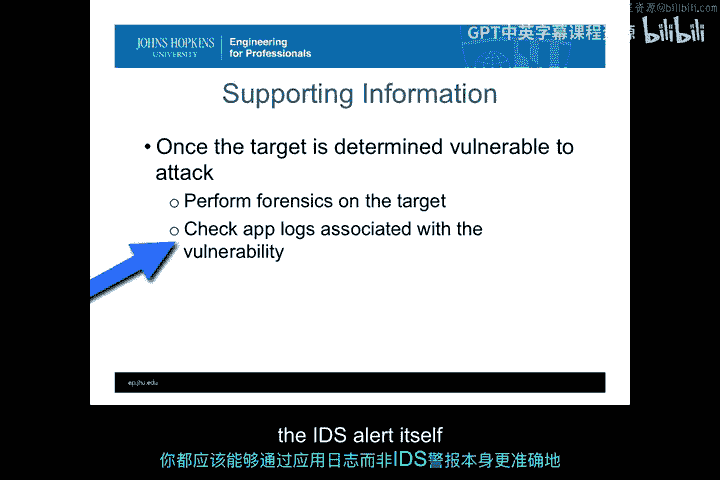

I can pretty much guess that one of the things that happened on this system was to gather up system and send it out in an encrypted form that I can't read。

Now， I'll be able to go to the host and look specifically at those processes that are encrypting the information to find the files that are actually being expfiled potentially from that machine。

 So that's looking for behavior on a targeted system where you don't have app logs to tell me exactly what was going on in the same nature。

 you can watch for activity from this host to other trusted hosts。

If you see activity from a attack host to other hosting your infrastructure that begins to give you a scope of how many systems might have been touched by this attack。

 This is especially true in selfproagating malware or you might have one system that was the initial vector of the malware。

 but it immediately starts spanning out and touching other systems inside of your infrastructure。

 If you're doing netflow collection internally on your network system to system。

 that's probably a very useful data set for you to use at this point。

 to know what systems have actually been touched by the attack system in order to say which other systems are likely to be places that I will have to recover。

 Now， once I've identified those systems， I'm going to have to verify a lot of elements on each system that was touched。

 the OSs integrity， the boot sequence is， the background activity。

 All kinds of things with regard to that operating system that might have been changed by a possible attack。

Now。I can make this much easier on myself if I actually capture the malware or reverse engineer exactly what the attack is。

 I may know exactly from the attacking software， what was affected on the target machine。

 So if I have intercepted， say a spearfishing attack was able to dump the payload and reflect that payload in some known piece of malware。

 So I know what was affected on the host system that could really rapidly increase my ability to directly respond to that piece of malware in my system。

 Otherwise， I have to assume the worst。 I have to assume that any part of the Os or boot sequence or background activity or process could have been affected by this malware。

 because I just don't know all of the things that this particular attack might have done on my system。

The more activity I can capture of what came into the host。

 and the more I can understand the details of that activity， the more I can bound。

The response on the modified systems that are actually being affected。

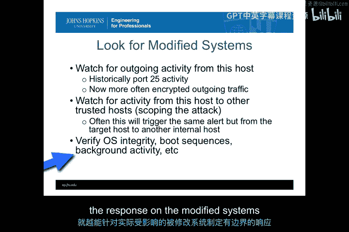

So I'm going to go through a very quick example through the steps that I've just talked about with regard to an incident。

 so in this case I'm going to use sNort as my IDS and as I come in and I'm looking through I get a sNort alert and the target is going to be specifically port Mapper on a Soeris host Yes I know that's not as modern as some of the systems that you may be using but it's just a historical example of one that we can talk about in a little bit more detail。

So port Maper on a cieris host immediately raises the question。

 could this be a possible NS mount attack external to our site？ Now， what does that mean。

 That means that I have an external intruder somewhere that's attempting to attempting to reach into my internal infrastructure to mount a drive using the network file system in order to either directly access files。

 Excel information or modify data。 It could be writing to the system。 It could be doing anything。

So if I assume the worst on what's happening with this as a possible NFS mount attack to my system。

 how dangerous could it be， well it could be very dangerous because all kinds of system and data files could be accessed and modified。

 not just stealing user based information， but modifying system boot files。

 modifying the way the system actually behaves。If the NFS mount was successful and if data was written。

 that's a serious integrity based attack on this particular server。

 So here's the snort alert in question that we're talking about。 As you can see。

 it's an R PCC port map request， NFS UDP that actually is coming through。

 It's the decode of an R PCC query。 That's the classification of the alert。

 Snort thinks that's a priority too， These are the informations on the source and destination nodes。

 So the source is outside of my organization。 The destination is inside of my organization。

 And this is some other information that I get in terms of just the I data that was coming in within unP。

 Now， from this particular data。 I can't tell immediately。 if this is a serious attack on my NSF。

 if the mount was actually successful or not。 Snort is telling me that it was an attempt。

 but it's not telling me whether that attempt was successful or failed with regard to this particular。

So I'm going to have to take the next step。 I'm going to have to go to the host and determine a little bit more about what's going on in this particular situation。

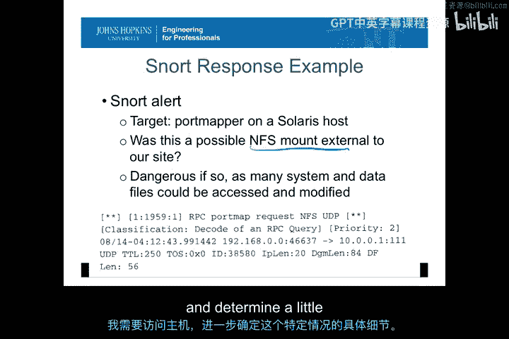

So first of all， I'm going to say， well， okay， this looks like it came through my firewall。

 Did it really come through my firewall to that host。 Okay， well， first。

 I'm going to search my firewall logs for the target host over that UDP。

 That's one of the information points that I got from the snort alert。 Remember。

 Snort told me it was a UDP attack directly through my firewall。

 So that means I can search my firewall log and see whether that was actually going on or not going on。

 So when I look down here at the firewall log that I pick up as I look through here， I'm saying， oh。

 wait a minute， I'm seeing exactly the same host the same destination， the same protocols。

 the same source and destination points on my firewall log。 I have now verified for sure。

 that this attack at that time came through my firewall。

 So this was an external attack to an internal machine that was coming through。

 I now have a further indication that this was at least。

attemptedtempted attack and might have been a successful attack。

 So now I'm going to have to go to the host itself。

 contact the host administrator and hope that that host administrator was running some kind of host monitoring tool or host based Is that'll help me take the next step within the kind of forensic。

analysis that i have to do for this particular kind of event。

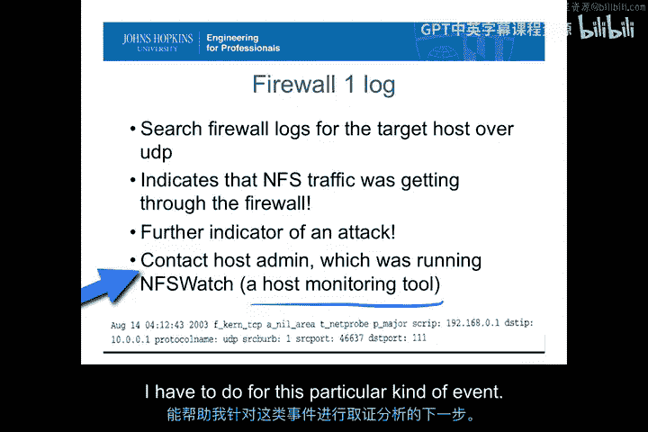

Now， in this case， we were fortunate。 we have a system administrator who is running a tool called NSF watch。

 So this NSF watch is basically an additional log file。

 looking for all NSF activity on the particular server and logging this activity so that we can find out what's going on with it。

 So in here it's going to indicate what's going on with regard to RC So the command that we use to get that is essentially looking for everything that the NSF watch would have seen from the host coming in and the output that we have is basically looking like this。

 What is this output going to mean for us on this particular hosts So we're looking at everything all the intervals total packets and it's going to give us details in how many read and write packets we have overall throughout the entire history of this particular NSF server。

 So now we have to say， did we have a successful NSF。😊，From this external data Okay。

 so what do we have that looks suspicious， first of all， we've got NSF read packets。

 We have 172 packets total， so this one doesn't look so good。 We have one right attempt packet here。

 but we have zero NSF NSF mounts。 So basically what this indicates is that we did get some RC authorization packets that went back and forth。

 but no right packets actually detected in the way that we have to worry about here。

So in this particular case， we were successfully able to determine that what we have is likely a probe。

 an attack that could have been a lot more serious but wasn't so what we've seen is we have time now to go and turn off this NSF server or at least lock it down further so that this RPC authorization probe that we had in here can't be turned into an attack downstream at some future time period。

So this， basically， because we were able to do the logging on the host that we have。

 we were able to turn this particular information into。

The idea of what kind of attack it was that it was a limited attack。

 We scoped it so that we don't have to worry about what was changed on the host through NSF。

 We know the system files were not touched。 We don't have the package that were changed on the system。

 So we know what to watch for because we have the alert and we know from the alert where the source of the attack was We know the destination。

 So we know to watch here in particular。 and we know that we probably have to modify some firewall rules as part of our feedback loop in order to prevent this kind of probe for impacting other systems that we might have within our infrastructure。

So that's just one example of how I go from an IS alert through a variety of log files to scope out the kind of attack that I actually have going on within my particular infrastructure。

 Now， you can tell from the details that you come into here that if I get very many of these attacks。

 this can be a very time consuming operation。 So if I get a lot of these attacks every day。

 I'm going to want to be able to lock down my system such that I'm not tracking down the same kind of attack like this every day。

 which is why I'm going to want to update my firewall。

 I'm going to want to change the configuration on this host。

 I'm going to do things that make sure that that snort alert doesn't fire again。

 What I won't want to do is remove that snort alert because this was not a type1 error。 Yes。

 it was not a successful attack in that it didn't change data but it was an external probe and it did launch an investigation that turned into very useful information。

 So this was not a type 1 error。An actual event that I care about from Snort。

 So that's a rule that I'm not going to want to touch。

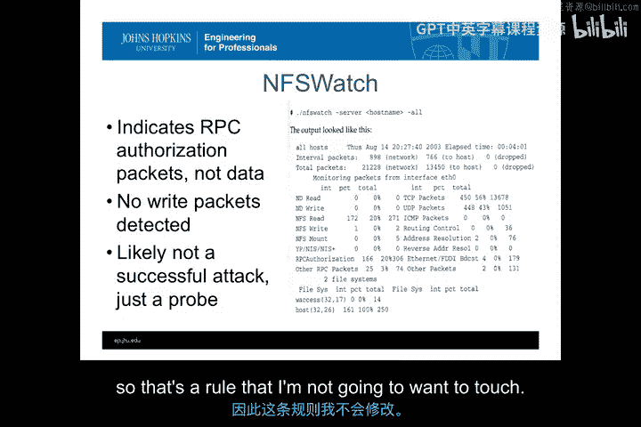

So as this kind of evaluation scales up。You immediately run into serious problems of correlation。

 trying to understand how to correlate a number of events in order to really get the right scope and scale across your entire organization。

 imagine having that NSF probe style alert happening across hundreds of machines。

 I would then want to correlate those alerts into a single incident so that I could understand the success that was happening across all of these different probe areas within NSF on my。

on my file systems。So luckily， tools do exist。To automate the collection analysis of multiple data sets。

 you've seen some of them within security onion， you've seen some of the ability to be able to run analytics on these kinds of alerts that come in place。

 You know that we can write tools to process alerts and to process ground truth like we're doing in order to access our ground truth data within security onion So we can use this for all kinds of data correlation that can link the Is alerts to firewall logs。

 application logs， cis log data， etc cetera。 tools like Spunk will do this and you can run analytics across all of these data sets in order to automatically do a lot of the work that we just did manually with regard to running through that NSF snortleler。

This works by importing the data from a variety of different log files and then using the alert data as a slicing function across the log files。

 This is where I basically have a huge data store。 I'm going to put all of my evidence or make it all accessible to me in some kind of Hadoop style data store that I can get to and now I can use the alerts as automated slicing tools to find out all of the information that might be related to an alert across all of the different log files。

 doinging this is one of the more recent and more valuable advances that we've had in IS alert resolution in the past few years。

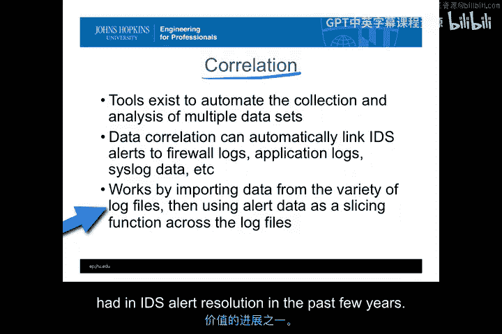

Now， eventually， you're going to have to associate all of these indicators that we're getting in all of these Is alerts and turn them into the broader incident through this correlation process。

 So in theory， the way you want to do this is you essentially want to think of all of the Is alerts as alerting on these various events。

 This is the same taxonomy that we've seen before earlier in the course and it's useful in terms of thinking about how we're building from the individual Is alerts into incidents。

 So I'm going to see a whole bunch of actions on targets。

 these are port numbers and source and destination nodes。

 they're going to indicate whether I'm getting reads and whether it's to network or a computer problem or something against data。

 So I'm going to get an entire series of all of these events that are coming in place。

 I want to take the collection of these events。 and begin to associate them into consolidated attacks。

 So I want to start to look across what。A the possible unauthorized results and what malware style tools are being used against a set of vulnerabilities that would lead to all of this event data that I'm seeing within my system。

So if the event data is being supplied by the IDS， then the attack data is coming by the collection of all of the various IS alerts。

 So how do I move from this set of IS alerts that's designated an attack based on some script or program or piece of malware that I'm talking about how do I build from that into an incident where I can hypothesize who the attacker is and what the ultimate objective might be within that particular area So I can use the attacks as indicators of well。

 what are going to be the unauthorized results of the attacks if I have a series of unauthorized results。

 I can start to hypothesize on what kind of objective do I have these unauthorized results might lead to。

Once I know the objective， I could essentially come back here and say， well， wait a minute。

 What are the type of attackers that would really in my organization be going after these particular objectives so I can do my incident information through inference。

Once I get all of my attack data， I can start to hypothese who the attacker might be and what the ultimate objective might be。

 This should sound very familiar because this is essentially what we did in the module 10 exercise。

 It's exactly what we did。 We looked at events that came from the I D S alerts。 we。

Put those together into a series of attacks where we could start to look at the unauthorized results through forensics to try to build into a record that would say。

 who is the attacker and what is the attack objective。

 So that's precisely what we were trying to get at with the exercise that we did a couple of modules ago。

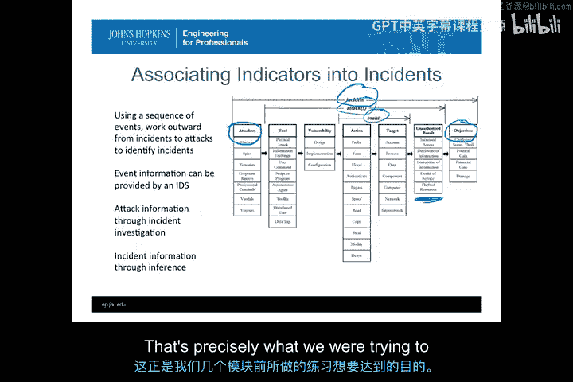

And of course you've already seen tools that are valuable in pulling this information together in order to try to abstract into the attacks and into eventually the attackers and the objectives。

 consoles like Snorbie and OSSIM are easing the extraction of the alert information and associating that with the kind of detailed packet information that you need to reverse engineer what was happening during the attack Today。

 many of these are webbase they're easy to use and they add analytics sort of what you're seeing with Squeal in order to understand exactly how to get at the consolidation of all the activity that's happening within within my system If you want to see some good examples of this process being run all the way across the entire set check out these two particular links that I have down here one for Snorbie and one for OSSIM。

These essentially show how Snoory and O S S IM are used to resolve the kinds of incidents that we're talking about within this video。

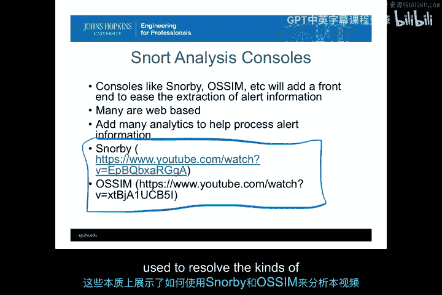

Finally， especially in the area of network based IS。

 a network based IS is really has to be paired to some kind of a packet capture and packet analysis program as we've seen within some of the consoles that you've been using。

 you can go straight from incidents to the direct packet capture associated with those incidents。

 and then there are many tools out there。 One example is net witness。

 but there are other ones as well， that allow you to replay。

Those TCP packets in order to understand what the user activity looked like within the applications that were running。

 so you can do things like trace back and see exactly what kinds of things were happening inside of a web page。

What videos were actually playing and which ones were they。

 What kind of information was being extracted from the various areas。

 It's useful to go from an Is alert into the pack and capture world to help you really scope what the attack was and then hypothesize and infer what the objective of the attack might be。

 So that's going to bring this video to a close as we begin to think about how we technically go from the alert that we would get in a standard Is through the investigation to be able to completely resolve what it is that's going on。

 potentially who it is that's doing it to us and what the objective of the attack might be。

 Just remember that from our exercise and from your knowledge of what's happening with regard to Is。

 This is never a trivial process。 and it's extremely different， difficult to automate completely。

 So it's unlikely in the near future。 we're going to get a situation where an Is is hooked directly into some kind of an AI。

Ba system that is going to pull all the information together and simply tell us who the attacker was and what the objective of the attack is。

For the foreseeable future， this is still going to be a human intense and a creative process to try to infer from the activity we can actually see to the objectives that are actually being performed by all of the various attackers that might be internal and external to our organization coming after our valuable assets。

😊。

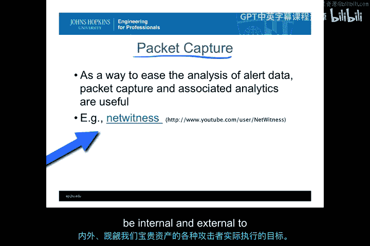