# 约翰霍普金斯大学《入侵检测｜Intrusion Detection》中英字幕 - P62：12_安全情报共享机制.zh_en - GPT中英字幕课程资源 - BV1sGu1z5E2J

One additional area to talk about within this particular module is the concept of information sharing as it applies to IS alerts。

 So you have all this data that you're collecting through a deployed inrus detection system or IPS you're gathering tremendous amounts of intelligence from everything that's happening within your organization。

 Should you share this to others， What are the benefits， What are the drawbacks， How do you actually。

 when and where you should be sharing some of this additional information to outside entities and to what value both globally and locally would you expect to gain by participating in an information sharing element like that。

 This video is all about the issues with regard to sharing detailed technical information outside of your organization。

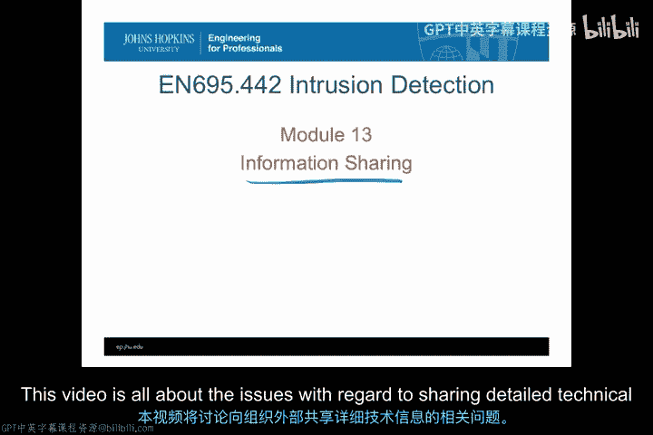

So let's start with some specific considerations whenever you're going to be thinking about sharing Is alerts or any other detailed information that you would get back from the resolution of the incidents that were sparked by these Is alerts。

 The very first thing， of course， that you really have to think about is the whole confidentiality。

 secrecy， Sen of the information that's in your organization and available as you're talking about these different kinds of incidents。

 So this information that you're collecting as part of your intrusion response capability is certainly going to be valuable to other parties and the confidentiality almost certainly has to be maintained。

 So how can you do that kind of confidentiality or secrecy。 Well。

 you con try to anonymize or to cleanse the data in such a way that you couldn't really tell what the confidential information was。

 The danger of。I that as soon as you send the information externally for use。

 you can combine that anonymized information with other external information that might point out exactly what the detailed targets actually were that were anonymized within the data so if I take。

 for example an attack that came into my organization and I don't want to expose the target IP address。

So I anonymize the Ip address。 I give it some other kind of generic number。

 and I release the information， but I keep the times stamp the same on the outside world。

 you could use the times stamp with other information that was collected from other parties to perhaps pull records that would indicate who the actual target inside my organization was maybe even what the payload or information was that was available。

 So anonymizing alone can't necessarily protect you from the confidentiality and secrecy side。

The the mere reaction of a team member might be enough to reveal at least some part of the information。

 Having the information exposed doesn't necessarily mean that I haven't exposed all of it。

 even exposing a little might be enough to reveal some part of the information for， for example。

 let's say that you don't exposed anything at all about an incident。

 but you simply share the existence of a new bug or security hole。

 One of the things that might be hypothesized about your organization， is that you have the system。

 which would have had the security hole and perhaps not all of your systems your patched。

 or even if they were， if we know what the details of the systems with the new bug or security hole were。

 Perhaps there's another security vulnerability。 In addition， that would target the same system。

 and now you've actually exposed some level of vulnerability to the outside world。

The next issue to really consider beyond confidentiality and secrecy is sort of appropriate use while the information is available to only one team。

 it's clear that if other teams access that information。

 they must adhere to any restrictions that the team places on the use of the information for appropriate use。

 So for example， if I have information that indicates that there are some particular systems that have a vulnerability。

 but I don't want to admit that that vulnerability exists within my systems。

 appropriate use of that information can't be to expose that particular vulnerability。

 even if it's good to do so from another team's perspective。

 So this is equivalent to sort of looking at the terms of a non-disclosure agreement necessary to obtain access to the kind of data。

 which specifically talks about the rights and duties and what appropriate use means within all of the detailed information。

 this is especially important。When you're not sharing publicly but sharing in a trusted relationship with some other partner。

 it's important that all parties to an agreement like that understand what it means to get that information and what it means to use that information to their advantage。

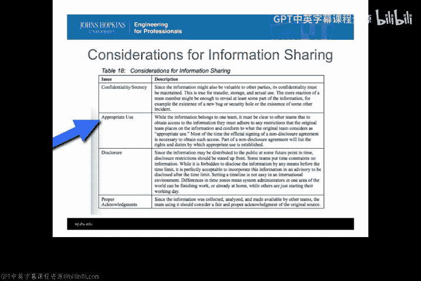

A corollary to appropriate use is the whole disclosure policy。

 since information may be distributed to the public at some point in time。

 the disclosure restrictions should be stated right up front。

 just because something is exposed to the public doesn't mean that all the details of a particular incident response record or IDS alert ought to be exposed when that becomes public。

 it could， as we talked about above in the confidentiality and secrecy area。

Add information to the public in areas that would make your site more vulnerable。

That than it already is。 So these disclosure policies， how many days， how much time whose's。

 who actually gets to say when something is released publicly is an important kind of ground rule to set up front。

 This is especially important in vulnerability disclosure。

 A lot of organizations have different policies with how long you hold vulnerability information before it's reported to the vendor or to the public or to some public vulnerability list。

 So if you are going to share vulnerability reports with other Cert or with other。

Other kind of organizations that are out there， you have to make sure that the disclosure policies are synchronized in a way that information doesn't get released outside of your control。

Finally， there's a whole idea of what does it mean to acknowledge the source of the information There are many cases where the source of the information really would rather remain anonymous and it's really not a fair thing to take credit because another organization wanted to remain anonymous。

 so you have to believe that the idea of proper acknowledgeknowledgments whether there want attribution or non-attribution。

 it should not simply be transferred so another organization takes credit for particular kind of information that's been released。

SoGiven these kinds of issues， let's take a look and see what these issues mean for different kinds of response teams that we've talked about before。

So let's start with sharing between the idea of the national CSEts。

 these are the USSerts of the world， the teams that represent nation states that are out there。

 so exchanging information between these nation states is something that is very valuable with regard to trying to acknowledge and respond to a worldwide cybersecurity threat so their Cert。

org in particular has been promoting information sharing between national seaEts for a long time and in fact they run forums and activities that actually bring national seaEts together specifically for information sharing and to try to share these categories of information the kind of watch and warning services。

 current activities， incident analysis， alerting research， automated data sharing capabilities。

 all of these are elements that。At Certcc at Pittsburgh。

Try to encourage within sort of the national Cert domain。

 So if you are a national Crt or represent a national Cert， one of the things to think about is。

 should you participate in these technical exchanges where you gain。Technical consulting， training。

 skill building， you get all kinds of tool development support， additional vulnerability analysis。

 artifact analysis and network monitoring analysis。

 but in exchange you are releasing some of your data external to your team in a way that you would expect this trusted group of organizations to deal well with it。

So all of this kinds of information sharing is promoted between national CSEts。

 it's probably one of the areas in which we have the most amount of information sharing between technical teams。

 but again， in an international community， occasionally politics are going to get in the way。

 you're certainly going to get differences in how the different teams think they ought to behave or treat information and all of this has to run up against the previous slide that we had on any concerns we have for sharing information between national CSEts。

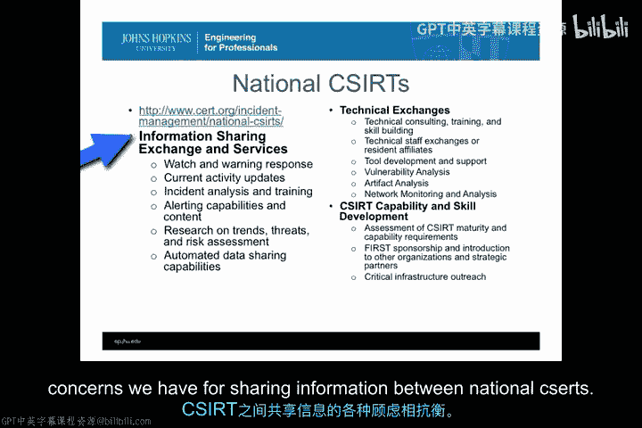

A little closer to home in the United States， we have these organizations called information sharing and Analysis centers or ISAC。

 the ISACs of the US basically exist to support information sharing by sector what do we mean by sector these are things like the power sector。

 financial aviation， oil and gas， these are the places where organizations are drawn together。

 CSEts and response teams are drawn together because of their common function。

This is usually a very non competitive space， all but for example， in the financial sector。

 so let's just take that as an example。Banks may compete against each other for customers。

 they competed against each other for financial gain。

 but the cybersecurity risk exists for all elements in the financial infrastructure。

 and it makes sense that there be a trusted venue for some cybersecurity data sharing in order to protect the entire financial infrastructure from widespread attack from criminal elements or other kinds of elements attempting to take down the financial infrastructure the same is true if we're talking about the electric area aviation。

 oil and gas and on and on and on there are many different ones you can see at this particular website that I've got listed down here at the bottom this shows the membership。

Of the ISAACs that are out there， gives you an idea of who they are， who participates。

 and the information sharing by and large in these organizations is highly trusted between the members。

 and so very detailed technical threats and technical resolutions can be shared across these organizations。

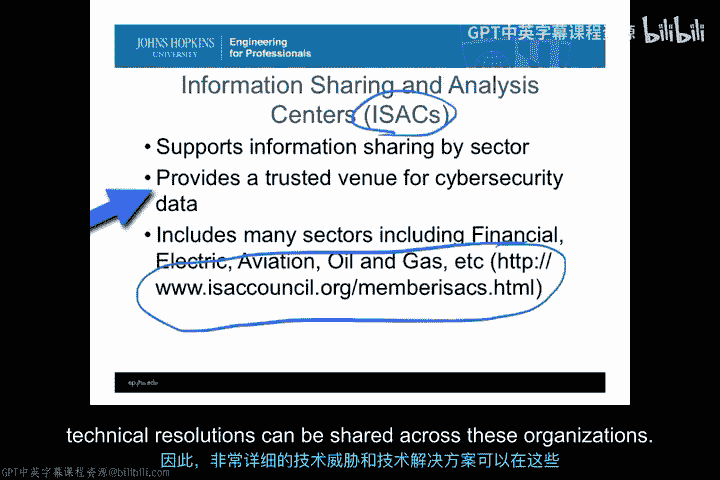

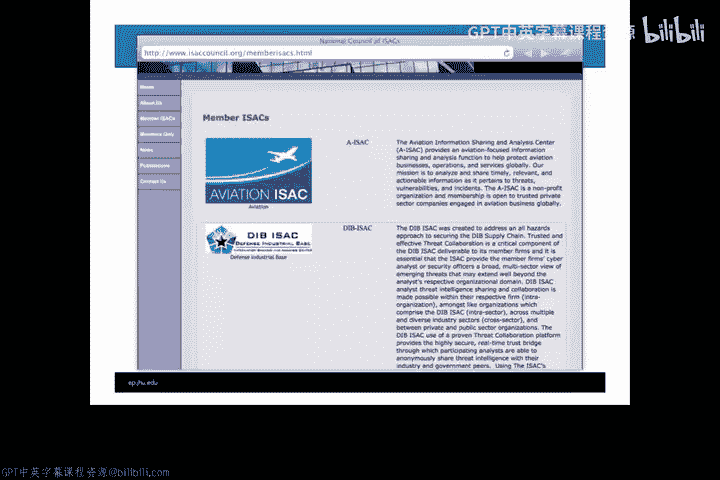

So here you can see the member ISACs and they go from aviation， defenseense industrial base。

 emergency services， E sector， financial services， the IT IAC， maritime security， Multistate。

 the communicationations ISAC， National Health ISAC， the Nucle ISAC， Oil and gas， Public Transit。

 Real E estate。

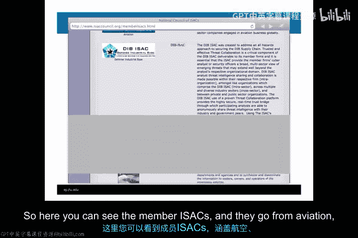

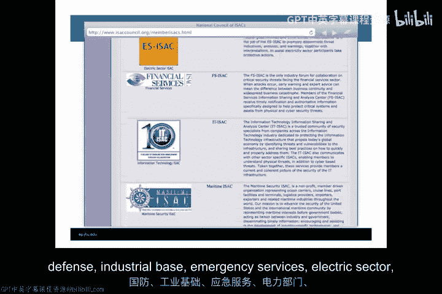

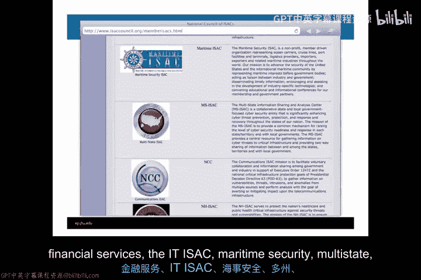

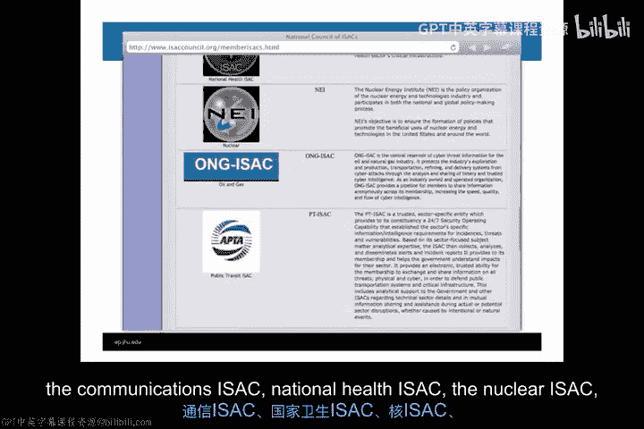

Research and education， supply chain， surface transportation and water。

 so there's a lot of different sectors that have all of this specific kind of sharing between these organizations that are very valuable with regard to cybersecurity threats。

 probably one of the most advanced in all of these is the financial services ISAC they've been around for quite a while and really do detailed information sharing against the common threat of the financial services。

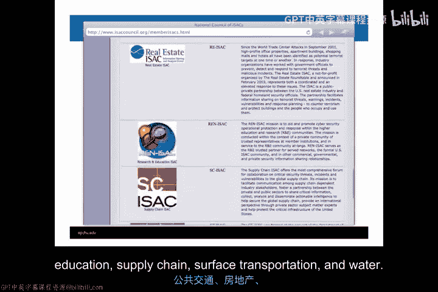

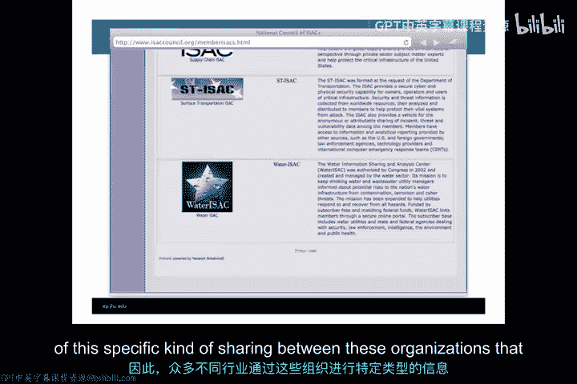

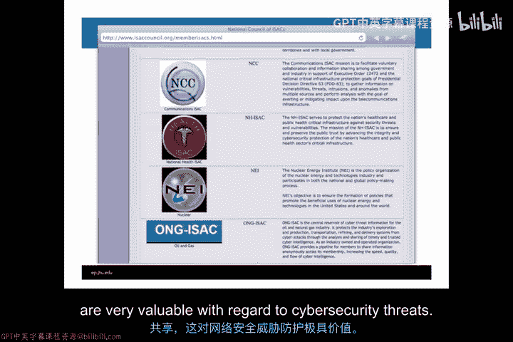

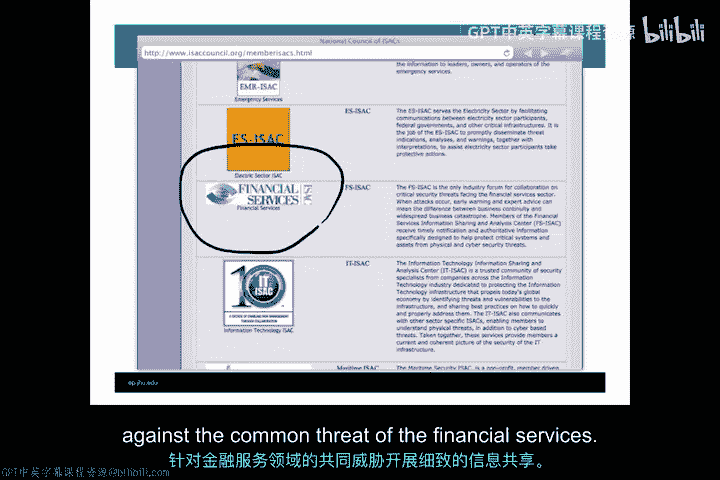

So sticking with the US government and information sharing for a minute， just recently。

 NIST has come out with a cybersecurity framework which you can find at this website down here with the framework this provides a roadmap that also includes automated indicator sharing as an area for development Well what is automated indicator sharing it is essentially IS alerts these are automated sharing of IDs and the responses from an intrusion detection system across a wide variety of public and private organizations so you can see and I'll leave it up here for just a minute that these kinds of sharing can provide the organization with actionable information and it is being supported in a way that hopefully will allow these organizations to see the benefit of doing this kind of sharing and really limit the liability that would be achieved or would have。

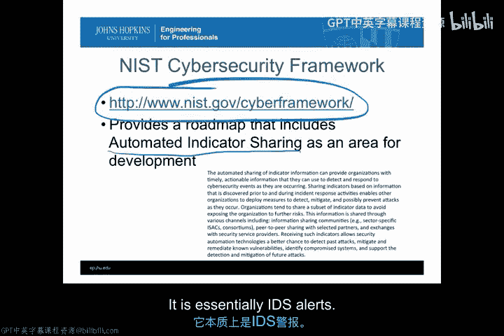

Based on the misuse of the information that's shared。

So this is the homepage for the NIST Cybersecurity frameworkra page where you can get to the entire text of what's happening with regard to the framework for improving critical infrastructure cybersecurity from this particular area you can also get to a roadmap under areas for development。

 alignment and collaboration。

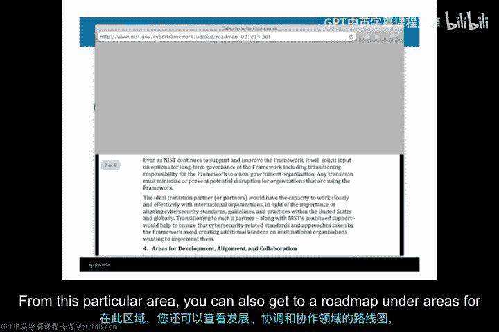

You have very prominently automated information or automated indicator sharing。

 So this is the specific area where I pulled the text， and it's part of this。

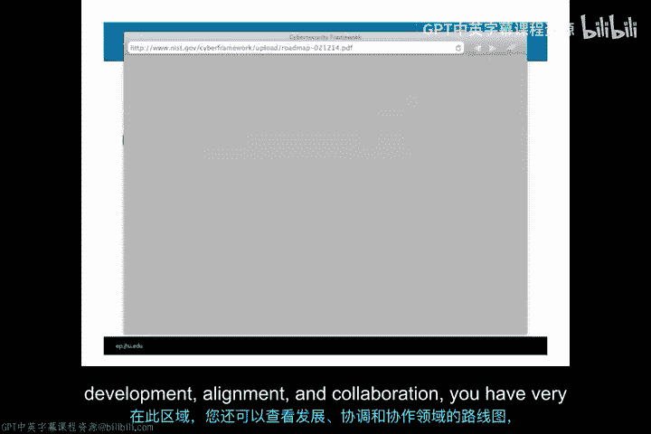

IP address that's right up here as part of the NIST Government。

 So this should provide or should help to provide some additional sharing possibilities for public and private sector organizations that would limit the ability。

 You can see， by the way， down here in the text that one of the things that's called out specifically are Iss and various consortiums that provide peer to peer sharing under trusted relationships with selected partners。

 So these really do promote the idea of IsX and other kinds of consortium to help share detailed technical information with regard to computer security。

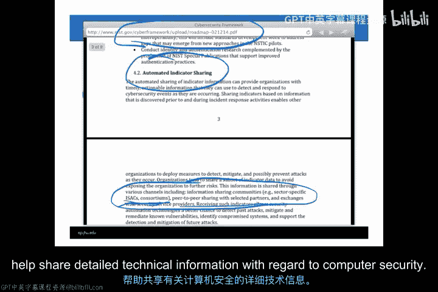

Now outside of the US government type of organizations。

 you get organizations like CAA CAA is an organization that is really designed to consolidate shared information across a wide number of organizations that would include university and public and private organizations in order to provide consolidated information about threats and vulnerabilities and the activities that are actually happening across the internet。

 they have an entire motivation for sharing， which I pulled up here pause the video for a moment and take a look at the motivation and see exactly what CADA is trying to do with regard to the sort of information sharing that's here。

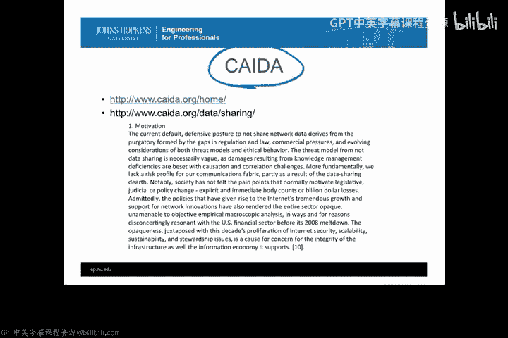

So here's the CAA webpage on data sharing and the promotion of data sharing， and as you can see。

 they're really serious about trying to pull in a number of data sets and then provide them so that you could download and use these data sets that contain a lot of information with regard to attacks and vulnerabilities and activity on the internet and it allows you to compare your organization to many other kinds of organizations that are there。

Another way to think about information sharing is there is an organization at Verizon that's called the vocabulary for event recording and incident sharing or Verris。

 so Verris produces an annual report every year about information especially data breach investigations。

 so this is a way to take consolidated information across the entire Verizon customer base and share it publicly in an annual report that creates statistics on incident classification and it produces an annual breach report。

Which is an excellent source of what things are happening sort of year to year。

 you can find it down here at the Verescommunity。net page。

 it really is an excellent source of data is designed to support anonymous reporting and if you're a Verizon customer。

 a corporate customer of Verorizon， your data is sort of automatically included in this report anonymously and there's a broad enough customer base that there's no way to reverse that attribution。

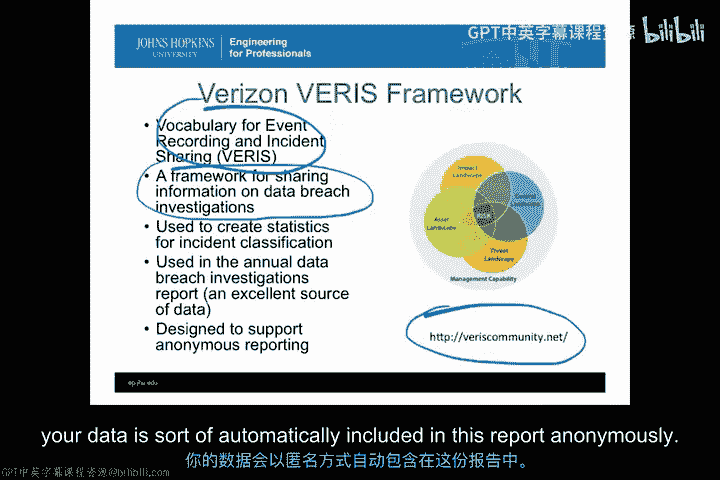

The framework that Verris uses for incident classification is also very interesting because they're really trying to understand who it is that's doing these kinds of things and what are they actually trying to do within the infrastructure。

 so you can see that they include all sorts of elements like the demographics， the discovery。

 the impact for incident classification you get the agent， the asset， the asset， the attribute。

 a lot of really good detailed information that leads to valuable statistical information in the variousris report that you get every year for data breaches。

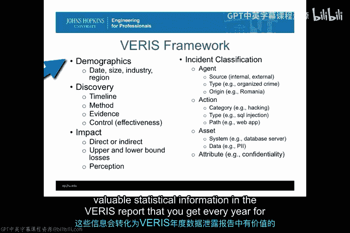

Eweek has an excellent article on how Verizon put together the annual data breach report and the vocabulary for event reporting and incident sharing is detailed and in terms of how it's used to actually create this report so it's an excellent example of how trusted data sharing has actually produced some really valuable information with regard to data breaches and especially sort of this is the the breach of credit card information and other kinds of things that we see so much in the news so I would certainly recommend taking a look at this Ewe article you can see it up here in the。

In the URL here， but easily found， you know， just searching for Veres and Ewe and this article will pop right out。

So in conclusion， should you share incident data that's really the question and like all good questions there's no single right answer it really depends on just what it is that you're able to do with this。

 are you part of a sector supported by an ISAC if so you have a trusted relationship with other organizations and sharing data can be done at relatively low risk。

 do you have an anonymous place to share incident data like Verris like Verizon are there places within the data sharing network that you can consolidate information such that you won't be exposing information that could come back and provide a more vulnerable arrangement for your own organization。

Can you or should you volunteer data for global benefit participating in CAA。

 depending on the kind of organization you are， you may think that volunteering some of the data and some of what you have is of greater global benefit and global good than the risks that you take by exposing data within your organization。

 So at the end of the day， it's always a calculation of to the risks outweigh the benefits。

 the benefits being information you can learn by participating in these frameworks and the ability to contribute to the global understanding of what's happening with regard to the IS alerts that are being gathered everywhere across these situations。

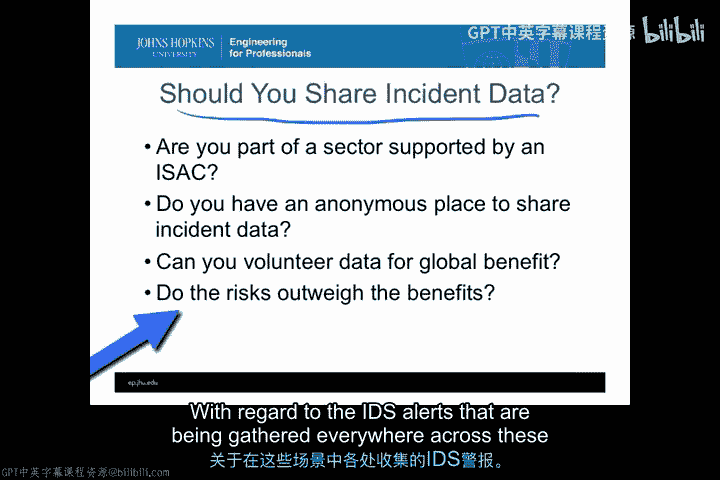