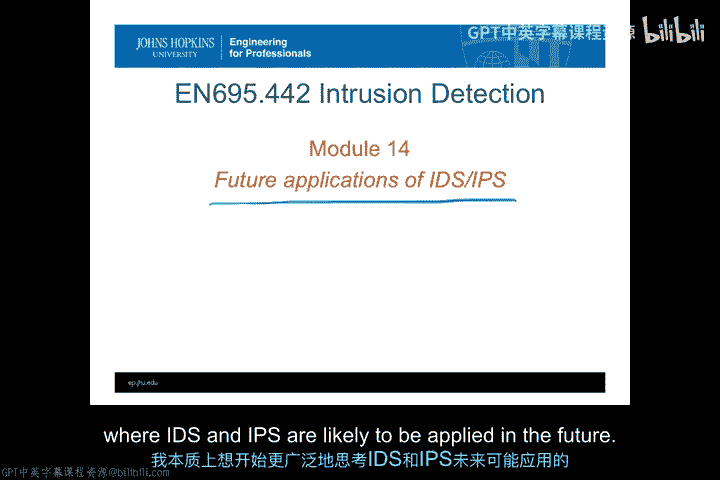
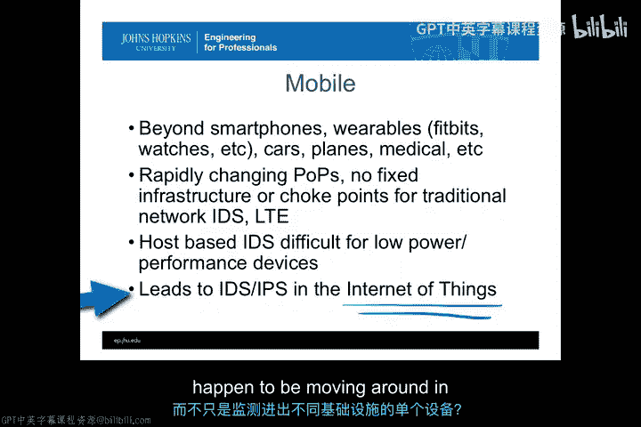
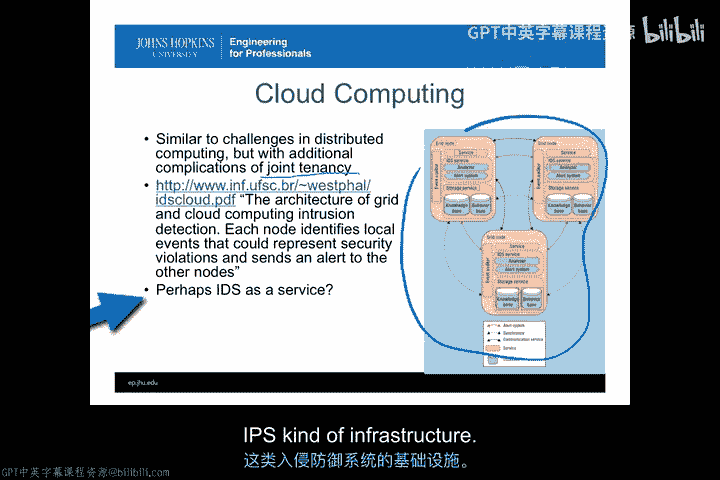
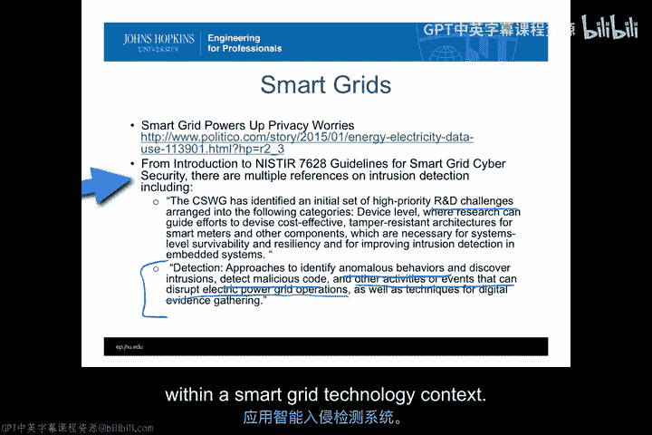
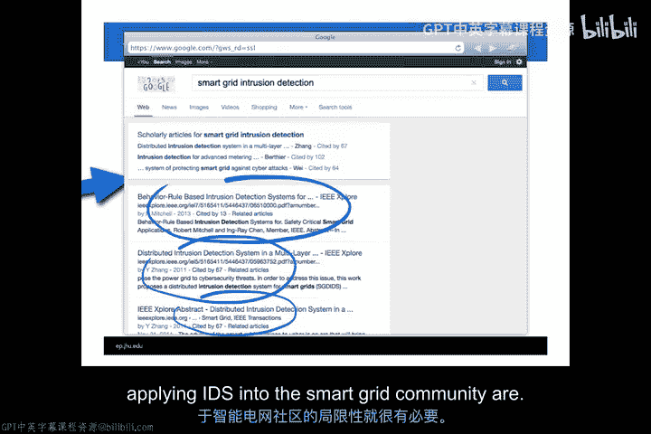
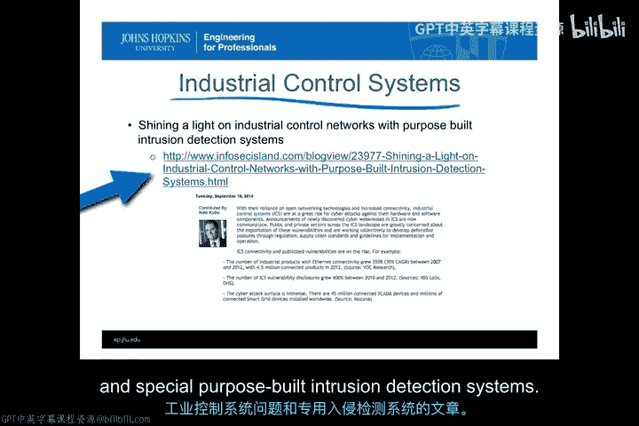
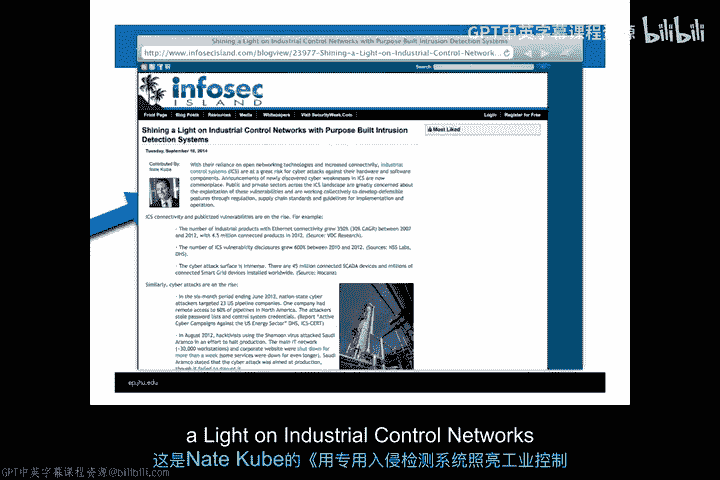
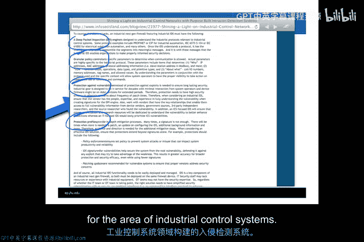
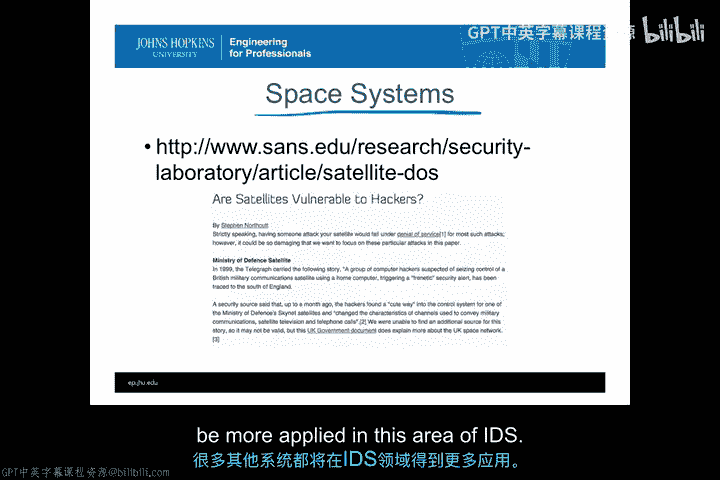

# 约翰霍普金斯大学《入侵检测｜Intrusion Detection》中英字幕 - P63：13_IDS-IPS未来应用场景.zh_en - GPT中英字幕课程资源 - BV1sGu1z5E2J

Finally， in this video within Module 14， I want to look at some of the places that IPS and IDS are likely to be applied outside of the traditional internet or IT kinds of environments that we have talked mostly about throughout this course。

Some of the areas we'll focus on here are ones that are very straightforward extension of what we've been looking at some of the mobile computing and will be more of a divergence with regard to some of the smart grids and industrial control systems and space based systems。

 so I want to essentially begin to think more broadly about where IDS and IPS are likely to be applied in the future。

So let's first talk about the application of IDS and IPS in the mobile environment and when I say mobile environment。

 I'm really talking beyond sort of the traditional smartphones that we have right now。

 This is not just how do I apply IS to my iPhone， but this is talking about beyond telecommunications getting into wearables like Fitbits and watches and as the eyewatch comes out and Google Glass and all of these other small devices that will be internet connected。

 what does it mean for an IS to monitor and to respond in an area。

Where we have all of these additional devices that are moving between security realms connecting and disconnecting to the home system。

 the work system， a coffee shop。 How do we actually begin to apply Ids to those worlds， Well。

 I think that's certainly an open area that we will need to be re resolving Some of it may be Iss that run on the smartphones where the smartphone is controlling some of these other areas。

 Perhaps we'll be running the Is inside of our car infrastructure in order to deal with this。

 When we're on a plane or deal with medical devices Where are we going to apply the Is technology。

It might come from the device that we carry around。

 it might come from the fixed infrastructure where we're actually walking through。

 but certainly we're going to be applying more of IS and IPS technology to this incredibly growing world of this mobile and wearable changing computer systems。

So as we start to try to resolve this problem of all these mobile devices and IDS。

 one of the things we'll have to realize is that there really is no point of presence is no fixed infrastructure that we can put a traditional based IDS that would essentially look at all of our traffic to and from each of these devices we can have a diverse and distributed IDS and try to coordinate across all this information。

Or we can rely on our service providers like our LTE provider。

 perhaps to perform IDS as of service for us within the rapidly changing infrastructure。

 perhaps we would be able to contract for this service as we move from infrastructure to infrastructure。

 from coffee shop to work to home。If there's anything common across the device management that could deal with the I S。

 perhaps that's one direction that a mobile I S could actually help。

 at least in the smartphone world。 Does this actually help with the wearables and other things that we might do。

 perhaps perhaps not， But if we take an approach of a distributed Is and apply it in the mobile realm。

 We might be able to get at some of these solutions。But remember in mobile。

 the other problem that we really need to solve is this sort of low power。

 low performance that we have in a lot of these devices。 Now， smartphones are powerful devices。

 but not every mobile device is going to be as powerful as a smartphone。 Fitbits， watches。

 all kinds of elements that might be moving around with us are likely not to have much in the way of power。

 resources， memory， computation ability to perform a lot of hostbased IS function or do the communication and coordination necessary across these devices to allow us to do coordinated Is across all of the devices there。

So this actually does lead to this whole， how do you do IDS and IPS in the Internet of Things。

 as we've talked about， that's becoming a major buzzword。

 a major kind of area of research within the IDS community is how do we deal with this sort of world of the Internet of things？

And one of the problems to resolve from an IDS perspective with regard to mobile and the Internet of things is how do we identify if an attack is across multiple kinds of devices that are all associated with the same person if a person is a target rather than a device or a piece of information。

 can we actually produce IDS within a mobile environment that can identify when an individual is being targeted。

 not just single devices that happen to be moving around in and out of these different infrastructures。

There's been a lot of talk to the application of IDS within the cloud computing environment and what we really mean here is this is a distributed computing environment。

 but we have the additional challenges of joint tenancy In other words。

 we don't have a single administrative domain within an area that we would want to be talking about protecting under an I or an IPS So in the idea of having coordination of sort of multiple grid nodes and sort of idea here。

 It isn't just the idea of coordinating across a distributed infrastructure。

 It's also the problem of how do I get administrative authority to look at the things that are important the observables that are important with regard to performing an I or an IPS function within my infrastructure So this particular slide set of Pf that that you could download does identify at least one reasonable model for producing。

an IDS within a cloud environment， but it doesn't really address the notion of who is it that should be controlling these IDSs。

 who should get the results of any detected intrusion and who investigates whether it's a real intrusion or a typey1 error。

One possible solution for this may be producing an Is as a service of the cloud computing environment。

 So this would be one that just like you would use the cloud environment to get a VM or use it to get a cloud service。

 You could perhaps get I S as a service as we more mature the idea of taking observables and moving them into detections that have the information that would be appropriate to the tenants of a cloud computing environment as opposed to the owners of that cloud computing environment。

 So it's an application environment that's rich for。😊，Some sort of advancement with the Is community。

 I would certainly expect this to be an area that IS is applied to in the near future。

 especially since cloud environments are now the target of many different kinds of attacks that we're seeing in the news in a number of places that are being reported。

 So we know that this is going to be a rich target environment。

 So that makes it a an appropriate environment for putting an IS IPS kind of infrastructure。

Another area in which we can see application of IDS becoming relevant in the very near future is in the area of electric power。

 especially in the area of smart grids and what's happening in the smart grid community so。

There's a couple of different even recent stories。 This is one from 2015 on privacy worries within the smart grid and the idea of how you would actually begin to put intrusion detection in order to resolve privacy issues as well。

 but the major。Place that you really want to look for information about Is within smart grids is this original NISist publication。

76，28 guidelines for smart grid cybersecurity。 Even a simple search across this reference for intrusion detection comes up with many different sorts of elements and recommendations within this guideline for smart grid cybersecurity。

 in terms of putting in and incorporating intrusion detection。

 intrusion prevention inside of the smart grid。 However。

 they do recognize that this is an R And D challenge。

 It's not something that we can take commercial products today and just directly apply into the smart grid。

 new kinds of technologies and approaches and products are required in order to achieve this idea of detection for anomalous behaviors and discover malicious code and other。

actctivities or events that can disrupt electric power。

 so this is getting very specific to how we actually apply the smart grid IDS within a smart grid technology context。

So even a simple Google search today pulls up several different types of academic and other articles all around smart gridd based intrusion detection systems。

 so if this is an area specifically that you will need to begin to apply IDS is in the outside world。

 it certainly makes sense to start to go and read the academic literature to make sure that you understand what the limitations of applying IDS into the Smart gridd community are。

And of course， smart grids are really just one example of applying IDS into industrial control systemsBeyond electric power。

 there are many other places where an IDS could possibly be applied into industrial control systems。

Probably one of the best most recent articles on this that we've seen today is this one by Nate Cobe on the issues relying for industrial control systems and special purpose built intrusion detection systems。

So this is the article by Nate Cobe onS a light on industrial control networks with purpose-but intrusion detection systems from here。

 if you sort of scroll down into the lower parts of this。

 you can see that the threats against this are pretty well established and are pretty repeated in terms of what we already understand from this class。

 so you won't see anything surprising with regard to the threat and with regard to the kind of leveraging of IDS existing IDS technology。

But a bit lower in the article， you can start to see some specific recommendations on how changes to what we've talked about with regard to IDS systems could be applied to IDS systems that are specifically built for the area of industrial control systems。

So finally， I wanted to talk about one other area in the application of IDS that seems to be relevant looking at a lot of the systems happening now。

 and that's looking at IDS in spacespace systems， as we transition from space being an area specifically where only governments have been involved to having more and more private industry become involved in space systems and satellites。

 it is more relevant to begin to think about how we can protect spacespace systems。

 especially the commercial technology around spacespace systems using IS and IPS around the specific applications required to control satellites and manned spaceflight。

 so the article by Stephen Northcut that I've referenced here below is one article that begins to talk about the vulnerabilities in a spacespace system and how that could be applied into what we might do。

with regardd to intrusion detection and prevention in the near future so I would expect also to see the application in space systems like the application in industrial control systems to be of serious interest in the near future。

 the one to five year timeframe as to where we see IDS begin to get applied into these kinds of systems。

So that's a very quick run at a number of different sorts of areas to think about with regard to the application of IDS。

 you can probably imagine other areas that I haven't touched on that it would also be relevant to an intrusion detection system。

 any place where we have the complexity， an attack infrastructure and some way of doing a classifier that would partition normal behavior from attack behavior or signature-based kinds of attacks that would happen in the system are amenable to the application of an IS and an IPS kind of technology。

 So beyond just the internet beyond just even the smartphone technologies you can imagine many。

 many other systems， they're going to begin to be more applied in this area of IS。

