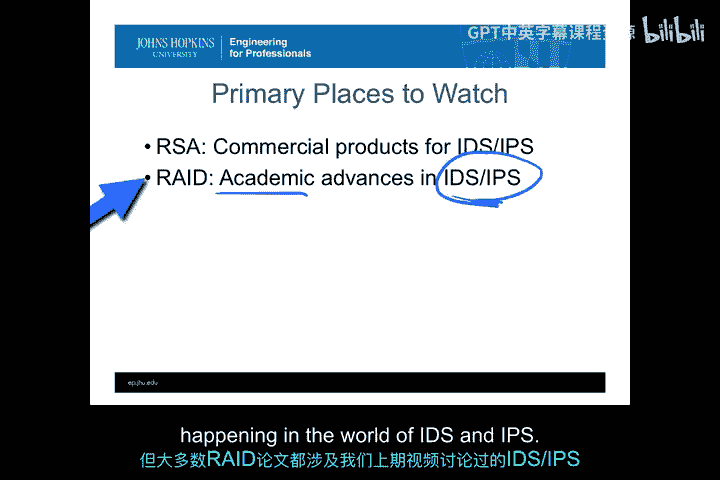
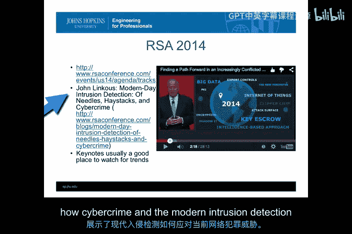
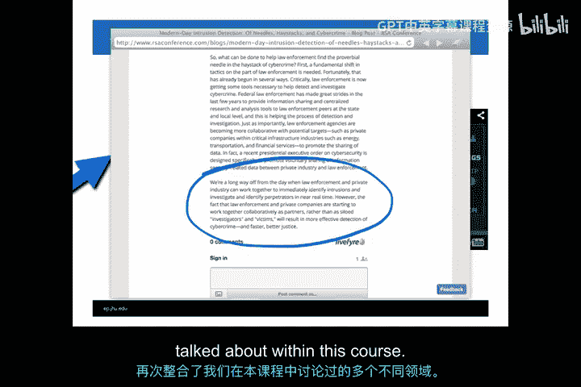
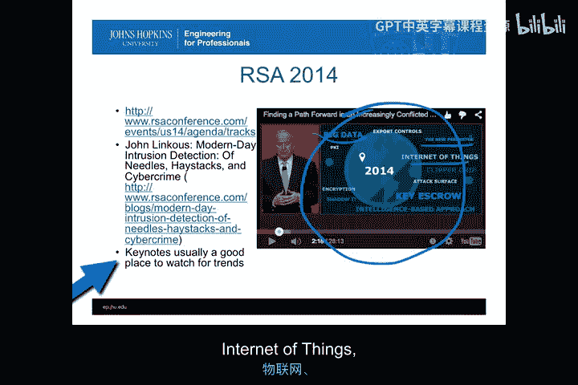
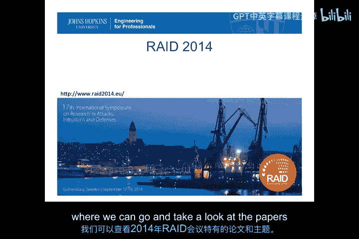
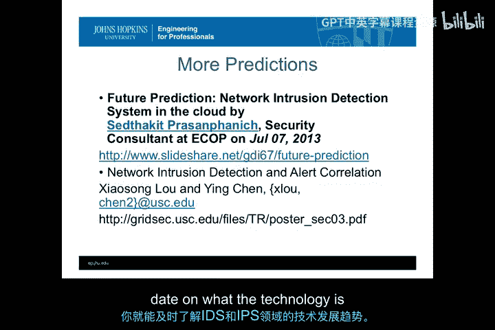

# 约翰霍普金斯大学《入侵检测｜Intrusion Detection》中英字幕 - P65：15_IDS-IPS发展前沿资讯获取途径.zh_en - GPT中英字幕课程资源 - BV1sGu1z5E2J

BecauseIn this video we're going to talk about where to stay current for IDS and IPS technology and for this I'm really drawing upon my own experience for how do I stay current within what's happening with IDS and IPS and there's really there's a lot of different places you can get information there's a lot of different areas and predictions and things you can look at。

 but there's only a few key places to track and if you track those key places you can stay pretty current in what's happening in the whole world of IDS and IPS。

So the two primary venues and primary places to watch are really RSA and RA。

 RSA is the major computer security conference that's always held in California Usually at the San Francisco Convention Center。

 It's a very， very large conference and vendor show。 Last year。

 they had 25 different technical tracks。 They fill the ballrooms。

 they fill the the areas with keynotes， but you don't necessarily have to go to RSA in order to keep up with what's happening in the world of IS and IPS。

 There's a lot of information that's produced out of RSA that allows you to sort of keep up with this as well。

 and we'll talk about some of the things that are coming out of there for the academic side。

Rid is the recent advances in intrusion detectionte conference。

 and this is an academic venue with peer reviewed papers that really get into specific technical challenges in understanding the different elements。

Of IS IPS， despite the name not every paper in RA is specifically about IDS or IPS。

 but most of the papers that you'll see at RA have something to do with one of the technical challenges that we will have talked about on the previous video with regard to what's happening in the world of IDS and IPS。

So in 2014， RSA of 2014， there was a series of both keynotes。

 corporations and tracks all having to do with things that are going on with regard to IDS and things that impact data。

 so the first place to basically look of course， is just looking at the various tracks that are available within RSA and that will be a big breakdown of everything that you can kind of see with regard to what's happening in the IDS community。

One of the things that I like to do with RSA every year is as the information and the tracks come out is I do simple searches across the agenda to look specifically for intrusion detection and other common phrases that are very much like intrusion detection so from that this year you can pick up talk from John Lys。

 modern day intrusion detection of needles， Haystacks and cybercrime there's a link here which is very valuable with regard to how cybercr and the modern intrusion detection is beginning to address some of these current threats。

So here's the blog that comes up when you do the search for intrusion detection across the RSA material that's there。

 and you'll find that you know from here。People like John Lnkcos in this case will talk about some of the more recent happenings。

 usually providing some stats and information that are very up to date and very recent with regard to what's happening in the commercial world with regard to identifying attacks。

 doing intrusion detection within the criminal market or within the。

Area of threat that's going to impact most businesses。So in the case of this blog。

 the point of it is you sort of read down the end， it really talks about law enforcement and the relationship between law enforcement and intrusion detection and identifying perpetrators and sort of bringing them to justice。

 again， bringing together a lot of the different areas that we've talked about within this course。

Finally， keynotes are an especially good way to watch for trends and keynotes in particular。

 if you look at sort of the keynote that Aovviello had within RSA 2014。

 you'll see a number of charts and pictures that bring together what are some of the key issues。

 you can see there's a lot of things here that we've talked about， big data， perimeter。

 Internet of things， intelligencebased approach， encryption。

 there's lots of the areas that are directly related to the issues that we've talked about within the intrusion detection world。

So this is why the next couple of videos that you'll have to watch really will come from some of the keynotes and some of the areas of concern within RSA as it begins to give you a very good idea of what are the issues that an intrusion detection system has to deal with as we move into the future。

So then we have Ra， the recent advances in intrusion detection， the conference。

 this is an international conference in 2013。 this was actually held in a really beautiful place in St。

 Lucia， as you can tell from sort of the background picture in 2014， this was in Gohenburg。

 Sweden and in 2015 this should come back to the United States and it's important to sort of watch for where do you see raid coming in if you get a chance to go to raid。

You can talk with a lot of the academics and individuals who are driving the future of the individual technology advances in intrusion detection and intrusion response。

 but even if you don't get to go to RAD， the papers and the topic areas from RA are really good synopsis of where the key issues in the academic community are in dealing with IDS IPS。

And so here's just the front page from RA 2014， where we can go and take a look at the papers and the topics that are specific to RA during 2014。

So one of the things that I like to do with regard to RA is I'll take from the agenda and from the abstracts and I'll simply create word clouds each year and start doing some comparison and just some visual analysis of what the topics seem to be and how they seem to be changing from year to year at these particular conferences at least gives me a good indication of how the focus of IDS research is sort of changing over time in 2014。

 of course， you can see some of the really big areas that were talked about here was of course Maware and web is some of the largest things networks are still extremely important when you see an analysis of course。

 that we have out until that side Some of the things that are smaller and have really gotten lower in terms of some of these areas or things like SSL you can see that that's really reduced inside cloud has not really seem to be much of a big deal。

In 2014 you'll see those are going to be of larger in sort of previous ones there's occasionally some names like Sal Stolfo that end up in very big print because they've contributed a lot to the things that are happening with regard to this conference so watching the names that pop up Christopher Zong is another one that is really popped up kind of in this area and really helps to understand better who is it that is participating and contributing to these major topics that are part of raid。

So compare that to the word cloud that I created in 2013。

 you can still see that malware is really important here。

 Mo was one that wasn't even one of the large elements that we had in 2014 cloud as I mentioned before。

 much bigger in 2013 than in 2014 that seems to have been really hyped up in 2013 and then lower with regard to what was actually put forward in 2014 in terms of this。

 so you know you get a sense of where some of the attacks and the names of the elements are focused within the community of raid。

And here is a word cloud that I did in 2012 across the RA conference as well。

 so when you start to say， well what were the major topics in 2012 that appeared to be important analysis。

 these are the first times that analysis really popped up as a major portion of what was being talked about during that time。

 so here are again， some areas where you can see growing and increasing emphasis within the academic community from 12 to 13 to 14。

Beyond just word clouds， if you want to be a little more specific。

 the other thing you can do is take a look just at the session titles。

 The session titles are grouped by the program committee to represent the major topics that are discovered。

 So you can see in 2013， the topics that we had from hardware to server， malware authentication。

 web cloud。 the best paper in this， of course， being something around mobile computing。

 Now compare that to what we had in 2014， where there's no hardware at all。

 most of the focus here is in network security and web。

 we've got a lot more concerned with malware than the one session that we had in 2013。

 we've got more in vulnerability analysis and in binary analysis。 And finally。

 the main keynote that we had is worth noting in 2014 because it was focused on the Internet of things。

 So just taking a look at the way the abstract is created for the keynote。

Can give you a sense of where the emphasis had shifted between 2013 and 2014 within the academic community。

Some other places that I don't pay too much attention to but are occasionally in the press quite a bit。

 and there are things you have to look for are places like the Gartner predictions and other sorts of these commercial predictions and what happens within an particular space。

 So this was the Gartner prediction that was know sort of back in the 2007 timeframe And you know it talks about the market for separate network I and firewall devices。

 It doesn't really get into what's going to happen next with regard to IS。

 Gartner is famous for claiming the death of IS in 2001 and they don't ever seem to get it quite right with what's happening in the world of IPS and IS So again。

 these kind of predictions always take with a grain assault in this class。

 I try to focus not around predicting what kind of commercial products we're going to see but what are the technical challenges that are most likely to be the focus of。

The research and commercial area for solving in terms of IDS。

 whether these turn into major products or even turn into any IDS advances at all。

 I think is difficult to tell。You can also get a lot of predictions out of places like RSA and some other things that get picked up by magazines and picked up by the popular press。

 And you can see that， you know these predictions are pretty generic。

 attackers are likely to get more sophisticated。 Well， that's a pretty easy thing to say。

 hackers are always going to learn more and get more sophisticated our attack surfaces will continue to expand。

 Well， sure， as we get more and more complex in our software and our systems， of course。

 our attack surfaces are going to expand。 The whole idea of losing our perimeter is basically just a recognition that we're going to be working with cloud environments and other sorts of distributed computing sort of moving forward。

 These changes are going to happen whether security teams are ready or not。 true。

 which is sort of why this class important to help keep up to speed on what's going on with regard to IS。

National governments。You know， failing to legislate on rules of evidence， information， sharing。

 reformation of privacy laws， I would say here that national governments do legislate the legislative process just takes much longer than the technology process of creating the threat or creating the technology。

It's likely that a rogue state will move beyond intrusion and attempt meaningful disruption。

 So this prediction was actually made prior to both Stuxnet and to the Saudi Aramco attacks that became very popular。

 so again。This is probably more of what a lot of people are thinking is the next big phase is not just theft of information。

 but actually attacking and creating damage within infrastructures。

Responsible people in organizations will move to intelligence based security models。 Okay。

 that's certainly a business model that seems to be growing。

But it's unclear as to how that is going to interact with the IDS technology that we have cloud oriented security services。

 sure， and we'll talk about that a little bit more even in the next video for this particular module。

Big data analytics， and as I said before， advances in big data analytics are very likely to help us within the IS community as well。

So there's a few more of these kinds of future predictions on network intrusion detection。

 some of them are a little bit more recent like this one from July of 2013。

 there's a couple that we've seen historically this one from 2003 but again pretty relevant to the sort of things that are happening today out of USC。

 so keeping up with where some of the experts think IDS is going is reasonable。

 although I think as you've seen from this class and this module so far。

 you probably have as much ability to look into the future and know what's going to be happening with IDS and IPS。

 as any of these kind of experts that are out there looking at the field。

Pretty much what they're saying is the same thing that we would come to the conclusion within the class just based on what is an IDS and what are the technological challenges that IDS are facing。

 So those are areas that I use to keep up and keep up to date with what's happening in the computer security and the IS world。

 so I think that if you sort of track RSA and track what's happening at RA。

 look a little bit at some of the other things that are happening within these predictions that you can stay pretty up to date on what the technology is looking like around this world of IS and IPS。

