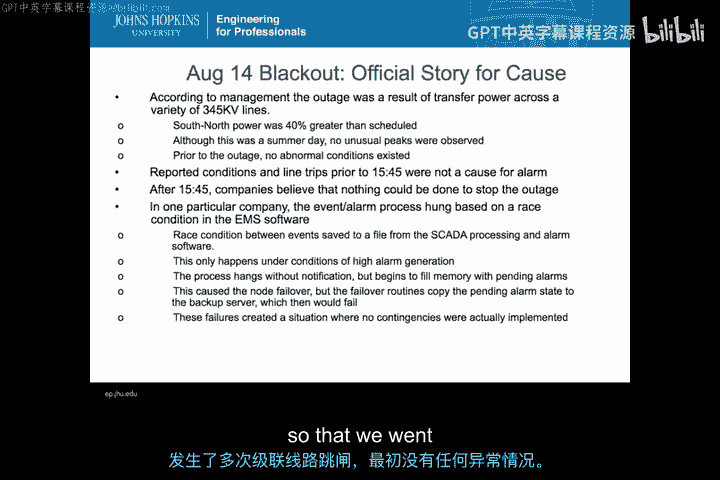
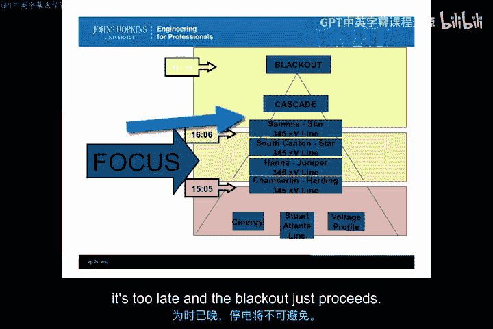
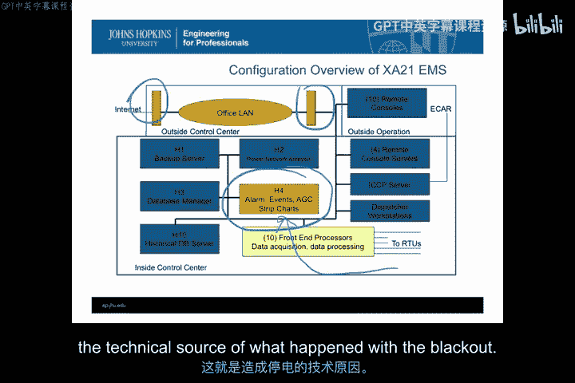
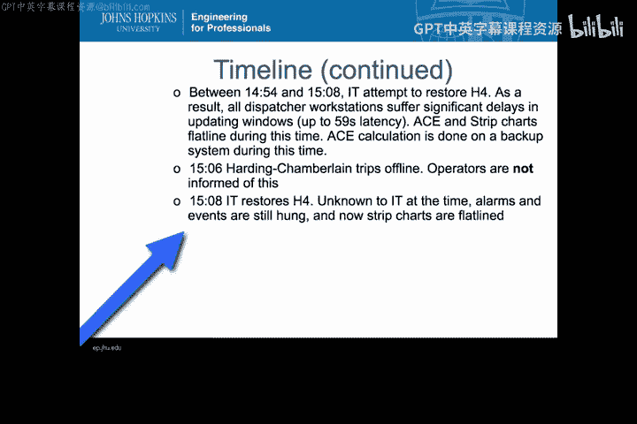
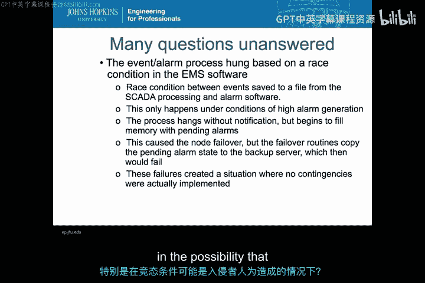
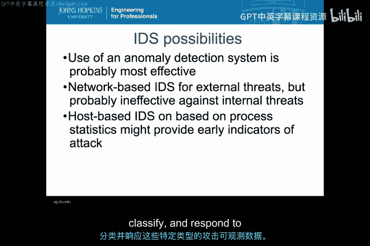

# 约翰霍普金斯大学《入侵检测｜Intrusion Detection》中英字幕 - P6：5_第二部分：威胁指标与检测类型映射分析.zh_en - GPT中英字幕课程资源 - BV1sGu1z5E2J

Okay， second case study， August 14，2003 into August 15，2003。

 The northeast from New York all the way up into the Great Lakes down into Pennsylvania goes absolutely dark。

This in particular is notional， but that's essentially the right idea of the nation。

 we had a whole corner in the northeast just go completely dark。

This is actually a real picture 15 August 2003， just in exactly what was going on in terms of where we are。

 So we have lots of things in Toronto already dark。 Boston， however， not dark。 New York， dark。

 all the way up into Pennsylvania， dark。 Albany， much darker than usual， all the way out here。

 Cleveland and Columbus dark。 So these are areas where the entire sort of northeast area within the US。

 all of a sudden， went completely dark。 Question was， Was this an accident or was this an attack。

If this assuming it could be an attack， what would we do in terms of an intrusion detection system with a scenario just like this。

 We're going to walk through the northeast blackout。

Some of the details on exactly what happened and begin to think about how what kind of IDS could have been selected if this were in fact an actual attack。

So there's a very extensive report on the August 14th Blackout。

 you can download it from the NRC websites， it's easy to find on a very simple Google search finding this exact report。

 the official story， the official story for the cause of the blackout was essentially that there was a power problem because of a result of too much power。

There were a number of cascading line trips so that there was we went from no abnormal condition at the beginning and again we had no abnormal conditions to start with。

 was not it was a summer day but not especially warm。

But the north south power， if you look at right here， the power was 40% greater than was scheduled。

So what that means was that there was a certain amount of load that was expected on the line and there was an unexpected peak about 40% greater than was actually scheduled for the power。

 This is not disastrous， but is definitely something that has to be handled and if it's not handled correctly。

 it can cause what we actually saw which was this series of line trips that began to start and take place all the way through 1545 when they thought that was the point of no return and suddenly we had the blackout。

 there was one particular company in Ohio where this process the actual computer that ran the EMS software。

 which is the energy management system software in the transmission lines was basically suffered from a vulnerable race condition this race condition caused the program not to die but simply to hang and because this program was no longer running effectively。

But had not failed， it did not swap over to a backup system。

Because it didn't swap over to a backup system。 Nobody recognized that this condition。

Kept the alarms from the sc of systems from actually being reported to the people that could do something about it。

 So the process hangs without notification begins to fill memory with pending alarms causing eventual node fail over。

 But when the node failed over， it copied the routines that were hung over to the new server。

 and this created the situation where no contingencies by the human beings who were supposed to see these incidents could actually be implemented。

 So the real cause of the blackout was this race condition did not produce information to the agents both at the east and the West desks that could have actually done something about。

Creating a putting more load or a shedding load off the lines to keep these lines from tripping and keep the cascading effect from happening。

 So race condition， is it a security race condition or was it just an accident， Well。

 this race condition happens under conditions of high alarm generation。 It was repeatable。

 It could be forced， but in this case， there was no logging to show that it was anything other than an accident。

 the kicker being， of course， that there were no logs at all。

 there were no logs for access to any of these machines to know for sure。

 if this was a security incident or an accident， However。

 given that it could be reproduced as an accident， when high alarms were generated。

 the entire blackout was actually deemed an accident in this case。 But let's speculate for a minute。

 Let's say that this particular kind of case could be forced by an adversary。

 It certainly a very high severity kind of problem。 and。

If an intruder could actually force a race condition that would force this to happen， how would we。

Create an I S or what type of I S would we use in this particular case。

So here are some details in exactly the way that the blackout happened。 So there's this。

Point before 1515， where there were a number of lines that were moving and began to trip out。

 at this point， everything was quite fixable。 These lines， the synergy。

 the Stet Atlanta and the voltage profile alerts that were coming in。

 had they been recognized at that time， there were some very simple procedures for simply re rerouting power。

 so that we would have not and gotten any trips at all。 However， between 1505 and 1606。

 We had a number of very serious line trips。These 3。

45 K V lines are really high power transfer lines all the way across Ohio。

 These are the lines that transfer the main power from the generation to the substations that distribute the power out。

From the first one and the second， there's still some things you could do。

 But now the problem is getting more severe。 By the time you get to the south Canton star line。

 the problem is getting so severe that there's very little you can do about it。

 And by the time you get to the Sam star， you cascade the rest of it and you end up with a blackout somewhere right around this time period。

If the dispatchers had seen it before this， they could have done something and no blackout。

 If they see it after this， it's too late and the blackout just proceeds。

The key to this whole basically this entire problem is the particular architecture of the energy management system。

 this was called the XA21 was actually an IBM product that was used to control SCta systems these right here。

Are firewalls between the internet and this energy management service。

This will be important because originally this entire energy management service was never designed to be connected to the internet。

 which is why theres no logging。 there are shared group passwords。

 the security of all of these systems down inside of here was not designed to be significant。

 They were designed to be standalone and go straight out to the the remote units that actually controlled thecata systems。

 This was very common in systems all the way up into the 90s。And these systems stay in place for 20。

30 years。 So just because something was into the 90s doesn't mean it was ever actually updated。

 These are old IBM AI X systems。 You can't get these systems anymore。 They are not modern systems。

 They are old systems， and they were old at the time of the blackout。What they did have however。

 is they had significant redundancy。 All of these servers were identical。

And they could each take on the service of any of the other areas， this backup server。

Was the first hot standby that if any of H2， H4， H3， H10， if any of those had gone dead。

 they would have immediately been picked up with their current state in H1 and continued。

 The fail over systems were really designed so that there would be no accidents that could happen that would prevent this from failing over。

 Now， for this particular blackout， H4 is the host of interest。

 This is the host that actually takes all of the information from the front end processors。

And takes all that information， moves it in， creates the script charts that run on the wall。

 the alarms and the events that the dispatchers at the desk actually get to see。

 It was the processes inside of H4 that were such that they could not present the events to the end users。

This machine， because it failed， but not in a way that immediately failed over to one of the other servers。

 was the source， the technical source of what happened with the blackout。

So let's walk through the timeline a little bit。 So at 1414。

 the process that generates this vent and alarms on each four hangs with no notification。

 This was the race condition that actually created everything。 At that point。

 five remote terminals began to cue the events that were supposed to go through this particular process and out to the dispatchers。

 and they began to fill the queuesza on the available resources。 Very quickly。

 those remote terminals fail。 And with two minutes of that failure。

 We have a hot swap over to one of the backs and I T is paged。 I T， however。

Didn't really understand where the problem was， because the failures were terminals in the northern region。

 Western and southern region， not in H4， not in the particular place where the problem really was。

Finally， at 1441， H4 actually does fail based on the cute events and and gets copied over to H1。

 That was the backup server。 The copies copied the state of that process that was hung from H 4。

 and the alarm still failed。 The reason it copied the state over was the process was shown to still be running。

 There was nothing that indicated that that process wasn't working properly。 So， of course。

 as soon as it was over to H1， it immediately failed as well。 And I T was paged again。At 1454。

 H1 fails in the same way that H4 fails。 Now， not only all the processes with alarms。

 the AGC calculation and all the strip charts fail。 Now， imagine if you will。

 that your're sitting in the middle of this power distribution center。

 One entire wall is set up of a whole wall of strip charts giving you the power profile of every substation within the reach of that transmission grid。

All at one time at 1454， exactly， every one of those charts flatlined。

 Nobody noticed because nobody actually looked at the wall charts。

 Those are a hold over from the days when that used to be the best indicator。

 But the two people who are watching are watching their terminals。

 their terminals are giving them a should be giving them alerts。 But in this case。

 because of the failed process。 No alerts are being generated。

 and the dispatchers have no indication on their screens that anything is wrong。

So IT kicks into gear between 1454 and 1508 attempting to restore H4。

 Now understand IT's main job is not to fix security problems。

 their job is to keep the systems up and running so since the ACE and the strip charts were all flatlined this time。

 the calculations are done on a backup server。But by 1506。

 because the dispatchers have not been alerted that anything else is wrong。

 that nothing else is wrong。 Harding Chamlain trips。 Now。

 the operators are not informed about this first trip。

 This is the first of those forward trips that I said was in the significant focus area that was sitting right there right at the point where you know。

 we don't know what's going on， but the problems are starting to really escalate。1508。

 I T does restore and get H4 back up and running， but not the state is still bad。

 As are still not being generated。 Evens are still hung and the strip charts are flatlined。

 Basically， all I T really did was take the H1 state， copy it back to H4。

 Vooted it up and got it running again。

Okay， now we're getting down to some serious time， 1532 Hannah Juniper。

 this is the second of those bad things， trips， company operators are still not informed we're almost at the point of no return right now。

 this is just about it as soon as we get to the star South Canton lines and they begin to overload and Sam star begins to overload。

 this is the point of no return after 1541， 1542 they say it is really nothing that could be done to prevent the blackout。

There was an interesting thing at 15401542， the West desk dispatcher notices finally that I T alarms and events aren't working。

 The East desk dispatcher， however， who sits 10 feet away from this dispatcher is not notified。

 It's the East De dispatcher that controls Samstar Hangenniper。

 It's that dispatcher that would need to know that those events had actually failed。

After this amount of time IT is attempting to restore H4。

 the workstations are again suffering laency once again， all of these things are failing。

 but the dispatchers don't know anything at all about it。Finally， at 1559， I restores H4。

 but the alarms and events were still not processing。 strip chart are still flatlight。

 and nobody notices。 I stops working on the problem because now we've got a bigger crisis。

 the lines are starting to trip and in fact， at this point at 6006 when the SA Star trips。

 the power goes out at the distribution center where the dispatchers are actually sitting。So。

After the outage at midnight was the first time they could cold， reboot the machines。

 finally restart from the race condition and get everything working。

 Why couldn't they reboot before that period of time， Because their procedures say you never。

 ever reboot the system during the day when the load is high。

 you can only reboot the systems in the middle of the night when the load is the least amount coming across the grid。

So there's an awful lot of questions that are just completely unanswered in this case。 You know。

 there's a raise condition。 This only happens under high conditions。

 The process hangs without notification。 This caused the node to fail。

 and it created a situation where no contingencies were actually implemented。 So where did。

Where did this system go wrong and could an intrusion detection system have helped。

 especially in the case， in the possibility that the race condition was actually forced by an intrusder？

When we talk about the possibilities of an intruder， remember back to the architecture。

 The EM M S system was designed to be standalone。 It was now connected through a router and a firewall directly to the land。

 It's unclear exactly what the firewall configuration filters， because。

The I T was able to remote log in directly to any of these servers from their homes。

 The reason they could do that was because they wanted to be able to get into the system to fix them as quickly as possible。

 But it also gave anybody the ability to get into the E， M S with full control。

 All of all of the system as route。 any time they wanted to get into unlogged。

And with very little verification， simple route password shared amongst a lot of users。

 and it was using X windows， which actually required。That a remote execution using a very simple。

 easily sniffed command with the password embedded could go to the system to open up an outbound shell to the X Windows server that's running on the IT person's home computer。

That could have been anybody's computer and it would have been completely undetectable。

 so that's the architectural issue that we have to worry about for the particular kind of IS that might have forced this problem。

So just to recap on some of the things that we've said。

 the EMS system consists of an old AIX system primarily running on R 600s with X windows as the primary interface。

 No patches since 1998， No OSs logging maintained very minimal authentication fully functional consoles and very few vendor upgrades that ever actually happen。

 So this is the actual system。 Now， you might say why would we apply an Is to a system like this。

 just disconnected。 The problem is you can't。 This system has to be connected to the office land because of telemetry。

 the office land has to be connected to the internet in order to comply with government regulations。

 these systems do have connections all the way through Now today。

There would be much more stringent firewall controls after this blackout。

 There are much more rigorous processes for directly getting into these systems。

 and there are more security upgrades that are actually being done。

 But during the time of this particular blackout in 2003。 and for many years after that。

 these kinds of architectural issues were continued。So what ideaS should we use。

 Are threats could be internal， They could be external。 They could be supply chain。

 They could be embedded。 Where are the biggest threats that we're seeing here。

 Not so much internal threats。 In this case。 The threats that we're really focused on here are external threats。

 These are particular actors on the outside criminal organizations。

 nation states high end intruders that would be have motivation to want to shut down or control the power grid。

Expose vulnerabilities abound。 There are plenty of places to look。

 The risk is clearly significant based on severity。

 and signatures would probably not be very effective。

 as many of the attacks like this race conditions would really be consisting of zero day kinds of attacks。

 however。This is the this is the key for us on this particular case。

 The advantage that we have is that。The system is very regular in terms of access and use， very。

 very regular， it only runs a few processes， it only does a few things。

 this should tell us immediately that we might be very successful at applying a host level or network level anomaly detection system that we could actually use for this。

So in this case， probably our best bet is going to be used an anomaly detection system。

 probably most effective in this case， we want to use a network based IDS for an external threats。

This is probably ineffective against internal threats， but as I mentioned。

 external is probably going to be our main focus right now。And finally。

 we may want to consider some kind of host-based IDS based on process statistics that might give us an early indicator that somebody is actually messing around inside the systems that we missed on our networkbased anomaly detection system。

 so in short， in this kind of a situation， we probably want to begin to look at products that would give us a network based anomaly detection system to help us with zero days coming into the host based IDS which is more of an integritybased system that can lock us in on the process statistics and provide early indicators of what might happen in the attacks in this particular highs stake scenario。

So now given these two different kinds of scenarios you see that there's a lot of different kinds of IDS choices we might make。

 but in the case of selecting the IDS， the most important things are consider the threat。

 consider the severity of the results that could come from that threat。

 where are the observables going to be located and understand the details and the functions and the context of the organizations that are going to be running the IDS because that's going to give us the best indicators of what observables do we really need to look for in order to identify。

 classify and respond to these particular kinds of observables for attack。

