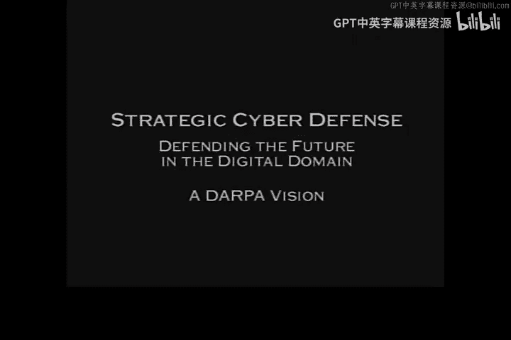
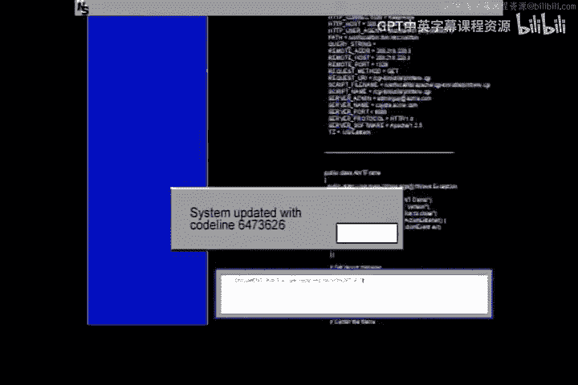
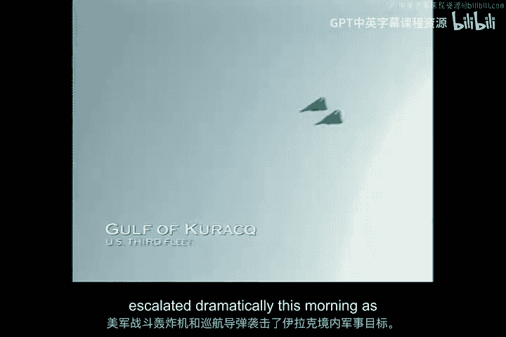
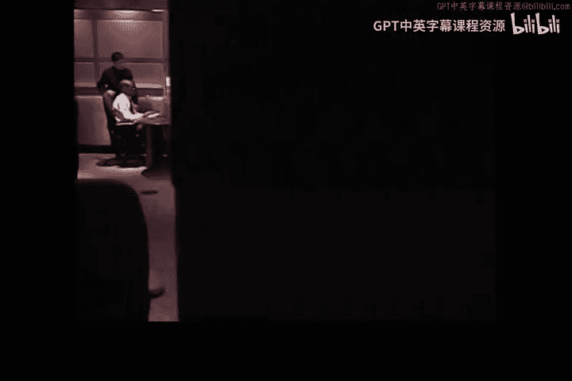

# 约翰霍普金斯大学《入侵检测｜Intrusion Detection》中英字幕 - P7：6_选修：DARPA战略网络防御技术.zh_en - GPT中英字幕课程资源 - BV1sGu1z5E2J

嗯。

🎼Yeah。The parcel has been delivered。The situation in the Middle East escalated dramatically this morning as U。

 fighter bombers and cruise missiles struck at military targets inside Iraq。

 the USS State Department released classified satellite photos which it claimed show kki forces attacking across the border of neighboring on Dia a longtime US ally and the region's major oil producerak condemned the attack and threatened an immediate response aimed at quotethe heart of the Western devil unquote now what the statement pretends is not yet clear。

 but it must be taken seriously in light of this morning's hostilities this is Charles Wright reporting live on the Gulf。

I got。🎼怎么下。How much is？🎼クバ。🎼Bね。🎼三包药。🎼Video conference，明静。Edmiral Wells。

 a senior sit rep on our morale problems。Can't say I recall anything like this No sir pony letters describing infidelities at home from supposed family neighbors。

 very scary， anonymous email saying you have a nice family， then listing kids names， addresses。

 pictures， current schools， class schedules， make model license of cards etc ce。

 we no actual threats of course but drives our guys crazy credit problems caused by sophisticated yet fraudulent credit reports it's affecting much of the task force from it listed on up all of its cyber based as it were yes sir creating significant morale problems。

Tokyo roses has come a long way， and you think this stuff is being generated by the krakiis。

Could be we've now engaged strong authentication protocols。

 which seems to be solving many of the problems， I think。🎼Major failure of network detection。🎼他们。

🎼Intrusion protectionte agent。As isolated and now。🎼Situation data transferred to JTF。

Systems restored。As I was saying， the digital certificates seem to be doing the trick。

They've stopped the intrusion。Jack analyzed note3， what was this？

That node was the To's 37 commercial relay satellite。

 seems to be completely shut down according to network monitors。

The intrusion detection system points to an attack on its ground control system。

Based on another attacks the IDS is seeing right now it does not seem to be an attack on the military infrastructure。

 it appears to be a collateral effect of a general attack。

 we need to elevate this generating flash Oprep3 tighten down the conceptat boundary controllers to block that attack sequence and start trace back。

Auto forensics should have countermeasures developed in。N0 seconds。

 soon as those countermeasures are validated， ship the new signatures。People。

The situation is more serious than we thought。We've received orders from S IW。Go to Infocon Delta。

Should we switch over to DOD special reserve mechanisms as a precaution no？

I want to hold that one back for a class one cyber attack。

I want a reevaluation of the situation impact on our mission Ae， sir。🎼Updated mission set。

🎼All components。Infocon Delta， High assurance VPNs。All comes over external networks。

Internal encryption。Were spent all non essential traffic。

🎼Etablish no fly zones on all of our unclassified internetnet。

Activate wrappers of all critical machines and applications at recommended policy level。

This is no coincidence Comp override， initiate level tango policy intitute immediate reauthentation across the board tighten to levelo policy。

Stage one countermeasures deployed。Sir， you'll note updated mission status on the main screen。

 the attack could have seriously impacted our ability to achieve our objectives。

🎼The countermeasures we've employed have been effective。 We're within 5% of timeline。 Very good。

 keep me posted should anything change。 Admiral， we have an NLN report screen too。

 This may be relevant。The problem began this morning and it apparently not limited to this city all across the frigid eastern seaboard a series of power failures have had serious effects。

 leaving many people in dire straits without heat lights or water traffic accidents have brought everything to a stop stranding motorists in freezing weather banks have been hard pressed to explain severe atmlfunction across several states all business transportation and communications are feeling the effects of the outages random or not they've caused quite a scare particularly set against the backdrop of the tense minimal East situation Corak continues to express outrage over what it is calling unprovoked military aggression。

🎼Same information more efficient。🎼Good。Screen one， please。Bobby， we've gone to Infocon Delta。

 what's happening？🎼We're taking hits across the board， financial sector transportation。

 especially power， and we're seeing the same thing in friendly countries in Western Europe and the Middle East。

 not as bad， but significant。🎼Fryme one alert NSC Sc one， open it and conference existing BTC。

The president is declaring a national cyber emergency。Shifting NC to a primary defense role。

This gives NIPC a dramatically increased IA coordination role with legally protected information sharing and significant IA directive power。

According with proceduresced， the NIPC director is designated commander。Colonel Maxwell from Jag。

And Ms。 Elston from the Department of Justice will assist。Understood。

I want status reports from all sectors ASap we're checking with the power sector defense control center now。

Jim。What's going on across the sector， we've analyzed the ongoing penetrations。

The break ins are occurring here in the east at these specifically more vulnerable generator and transmission control facilities。

These attackers really know what they're doing based on their pattern so far。

 we see additional attacks hitting these probable targets， I need tracebacks。🎼Under way。

All rightWe have a 96% probability on the next target based on what they've done so far and a hypothesized objective of collapse in East Coasts power grid。

 do we go fishbowl for observation and forensics affirmative？

Search for what might be common across the targets hit so far。

Let's see what this guy's after and how he's doing it。

I want to clone the likely target sites at the fishbowl。

And deploy rerouting software to those sites that will redirect the attacks and other traffic to the fishbowl。

Can you get me more than one site simulation and attack negative this technology is extremely resource intensive。

 we only have one semi operational fish bull and that can only handle one site simulation and attack at a time。

Well， let's make it a good one。We have a go， that's affirmative。Computer。

 deploy cloning and diverter software working。This attack is so fast， it must be scripted。

Where do they get the inside information？It looks like they're going after the utility's grid control systems。

They just sent some strange set of characters to an unusual port on the system control server。

The Novo self control software just responded and shut down the other control ports on the server。

We are in deep trouble。There's evidently a Trojan horse in there。

Novicof is used by over half of our control centers。No question。

They're trying to cause massive power disruptions。Look at the down and distance projection。

 attacks confined to the east Coast and time for dark rush hours。

Washington and New York control areas have reported significant physical damage to 21100 megawatts。

Alysis of。🎼Doctorors in today's attack。🎼No风 song。🎼From software。🎼7。6 is used by at least one utility。

control area。We've got 20 minutes to get things contained and controlled。Or else we're going down。

🎼Given projected rate of intrusions and current demand patterns。

 Cascading failure will begin at approximately 1630 East Coast islandization。🎼Is not predictable。

Computer。Order all security coordinator regions and their control areas to isolate immediately any attack subcontrol areas。

Then start shutting down any and all Novo So control systems in their areas。

 beginning with version 7。6。Use any available backup control systems。Then analyze high。

 medium and low preemptive islandization COAs in light of those actions and timelines。

Preliminary reports indicate that switching into backup control systems。

🎼Will take a minimum of two hours。I need more bandwidth， you've got to get ahead of these guys。

We're running a genetic algorithm to focus tactics。

It looks like the reflexive response capabilities seem to be buying us more time。🎼Recommended COA。

 medium options。🎼ね。I don't like that projected casualty range， I'm overriding。

Recommended low preemptive islandization COA based on cost benefit assessmentory。

I concur implementing。S， we've protected new attacks， they look to be primarily on the west Coast。

 different mechanisms， time bombs， Trojan horses， insiders。🎼Make it stuff。A board implementation。

Reanalyze COAs。Working。We've got to go with the high COA。We'll take some serious casualties。

 there'll be traffic fatalities， medical emergencies。

It'll get worse as these cities go dark and the temperatures dip even lower。

But this current model says we don't have any choice。Agring。Implementing COA high。Well。

I think we've dodged another bullet。But somebody better put these SOBs out of commission before our luck goes south。

🎼。ビデ？🎼information warfare。director Ma screen what kind of attack methods are we seeing？Sir。

 if we filter out the levels and types we routinely see with hackers and low level industrial espionage。

 these。🎼Are the ones of interest。Now based on capabilities。

 we have 300 organizations and our governments with the means and motives to attack the power grid。

 financial and transportation sectors in the manners we've identified What are we getting from IA sensors Well we still can't confirm if you're experiencing a single coordinated attack or a couple of major offensives against us。

Are we fighting more than one adversary it possible， Let's see if there's a suggestive pattern。

 computer， display attack roots and current sensor configuration。

So I recommend activating probes through all level one and two systems and foreign networks。

There's a hole here。We'll need to deploy class three sensors to disambiguate in this area。I agree。

 do it。Ation dinner。Standing authorization for transit is Class2。Ma。

 I'm recommending deploying class2 now to get partial info Okay A that part of the network is a coalition ally I'll request NCA authorization to use Class3 Very good I want to maintain intensive software integrity checks across the board no surprise。

We're down to 130 likely adversaries。🎼92。57。Holding。57。What else can we do to narrow the list？

I'm running an intrusion anomaly report correlation。We're down to 12 probable suspect organizations。

With what we've got， that's as far as we can get workable。

 let's run an adversary course of action analysis on each candidate。Here we go。

LetsPlay a little chess。Folks， we've got a new problem here。Go ahead， Coronado。

My field commanders in theater are reporting severe ammunition shortages and snafus。

 incorrect caliber ordinance， mismatched parts， supplies arriving late。

 but confirmed on time by redundant system checks。Perfect correlation， confirmed deliveries。

 but it's not right。Suggest you institute extra integrity and procedural checks。

 it'll help reduce the problem but it'll also degrade performance so be aware Roger that。

I think we've got a common failure point。Look at that application。

Run the malicious Code detection Su with database corruption checking。

System is now analyzing the system policies and access histories we can determine what users had developer maintenance and or administrative access to each of the problem areas。

In the software or database within the last six months。Here we go， folks with access。

Some government guyss。It' a military。Thus a few vendors and contractors。

 every one of these people had opportunity Well， let's see if there's anything fishy about any of them。

Computer， get me the FBI， departments of Justice and Treasury onlineline。

We've completed checks on our suspects， most check out to be legitimate。There are。

Seven still unexplained， some with suspect political leanings and appeal with questionable bank accounts。

I've got a simultaneous translation， main screen interpol。

Two of these people have Swiss bank accounts， one owns a corporation in the Maldives if we have more news we'll pass it on We check out the three people with suspect political backgrounds。

None are considered to be suspects in this case。 we will， of course， keep you posted。🎼We're down to。

4。And one of them appears to be unrelated to any of the 2 suspected terrorist groups。

Just a crooked vendor is a about to go out of business。

But the other three could be tied into one or more of the groups。

I'm running a program to match the malicious code we found with programming profile subsets for all 12 suspect organizations。

Let's check them out in detail， I want to know everything there is to know。

 get some eyeballs on this now computer generate sit rep to sync IW。Let's get these guys。🎼Gentleman。

We believe we may have just pieced together the puzzle。

The pattern of events indicates a conspiracy of coordinated cyber terrorist activity。

Our analysis has identified a pattern that is far from random。

It is our assessment that a transnational collection of cyber terrorists controlled and funded by Kaak is our culprit that fits with our analysis of Karaki objectives。

Their goal is to split the coalition undermine US。 resolve， drive us out of the region。

No they can't beat us in a traditional military showdown。

It looks like cyber terrorism is a major part of their strategy。

Our analysis has led us to a corporation which we believe is directing and coordinating these activities。

Its name is Transnational Global Resources and it's headquartered on the Karaki owned island of Tamborura and the Gulf of Kaak。

Now here are the options we're looking at。We'll give you a full briefing at 1500 to take to the President。

🎼Spadic blackouts across the US last night made for frustrating commutes on both coasts。 Indeed。

 as many as 50 traffic fatalities have been blamed on the outages。 No cause has been announced。

🎼On the international front， a global news network poll shows that American support for the coalition action against Kurak has dropped precipitously。

 possibly due to anxiety over the recent spate of cyberrelated domestic problems。😊，本当にがつねアシャゃなだべこう。

Jack per the president's authorization Week commenced Operation Sandstorm at 0930 we initiated an IW counterattack on the infrastructure of transnational global resources。

Andsideber targets of opportunity inside Corak。Initial reports are encouraging。

The kraki government has had enough。They've opened back channelnel communications with state。

Apparently they are shocked， shocked to discover that a cyber terrorist organization has somehow been linked to them。

Naturally， Cor has given us their blessing to take them out。

Wednesday's rash of power outages and computer glitches was apparently due to the actions of a sophisticated terrorist operation based in the Middle East the US military working in concert with the NIPC has destroyed the operation and captured its leaders more as details become available on the international front tensions have ease perceptibly in the wake of G's unilateral withdrawal from Aia the stock market is rebounding with the vengeance。

Hey boss， you want a hot stock tip， how's that kraki pencils。

 apparently they are in high demand right now， seems they've been having some computer problems over the last few days。

That's insider trading Yes sir。🎼Confirming transition to infofocon alphapha。JTF on stand down status。

Lessonons learn database， updating and disseminating， study goes。

