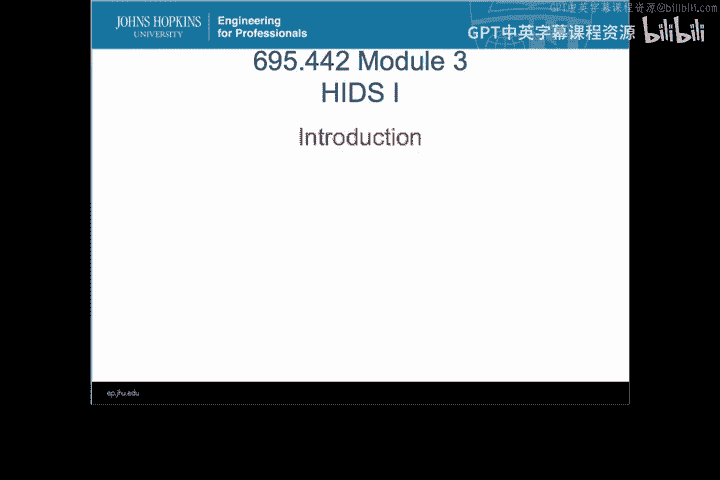
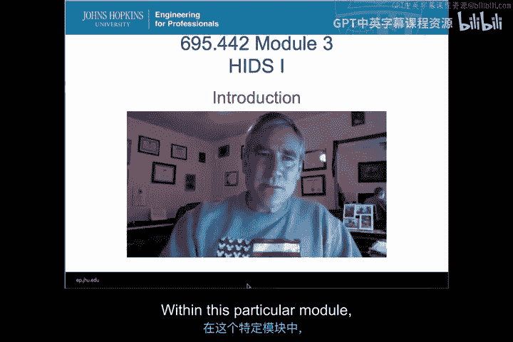
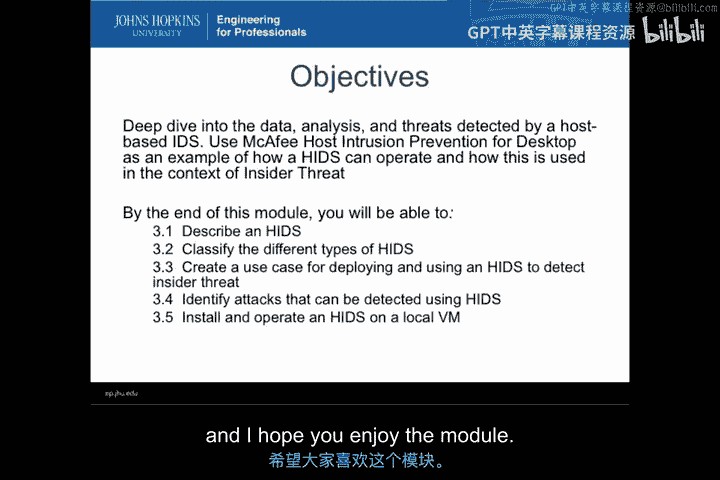

# 约翰霍普金斯大学《入侵检测｜Intrusion Detection》中英字幕 - P8：7_导论.zh_en - GPT中英字幕课程资源 - BV1sGu1z5E2J

Okay， welcome to module 3 of 695442 intrusion detection model in this module we're going to get into host intrusion detection systems as one really good example of the way you can use information that comes directly from observables on your host to inform an intrusion detection system that can classify those events and then take them and either do something directly with them as a hips would do or to just report them out so that it would increase incident response。

So within this particular module we're going to be doing a number of things the first thing that we're going to get into is ability to describe the IDS so this is I want you to be able to recognize and IDS and understand what it is that's common across all HiIDs and hips systems we're then going to classify the different types of HiIDS there are several different types depending on what the observables are they come from the platform and how the HiIDs actually classifies events so you'll be able to see the different types and we'll have examples of those out in the commercial sector so that we'll be able to apply those directly to to products that you probably already somewhat familiar with then we're going to build on the case study on inside or threat that we covered in the last module to be able to create a structure for deploying and using HiIDs in order to direct detect inside or threat inside of a large complex enterprise。

So you should be able to take all the information that we start to talk about the different types of HiDs。

 what the HiDs can do， how they can alert， how they can protect and apply it directly to the insider threat case study that we had last time we should be able to identify attacks the different types of attacks beyond just insider threat what attacks in detail can actually be detected using a HiIDS so we're going to break down the different types of attacks that might actually be done and finally you're going to be able to have some more practical experience and really configuring aHIDS on your virtual machine that you're running there so。

I hope you enjoy this module that we really start to dig into one particular type of intrusion detection system。

 the type that really looks at all different observables on your host and begins to really help to understand the challenges of what it would take to actually create a host-based intrusion detection system that operates within a large complex and diverse enterprise。

 so without further ado， let's get onto the material and I hope you enjoy the module。

