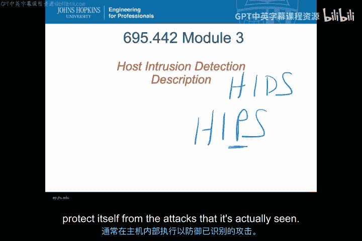
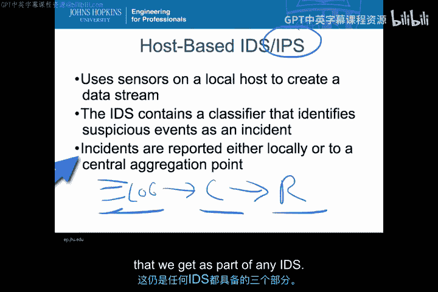
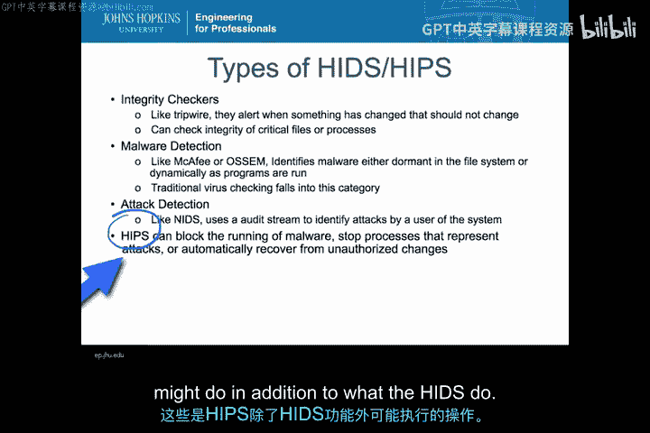
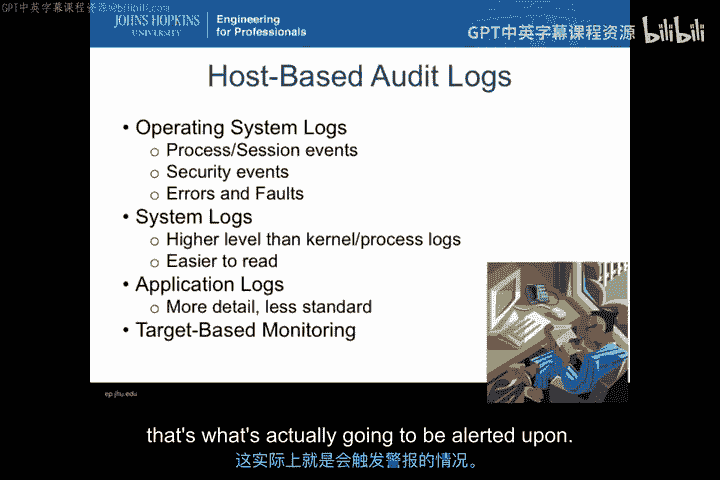
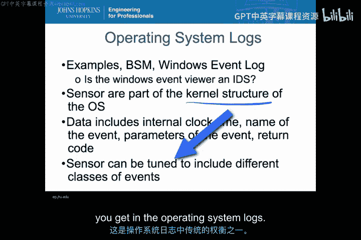
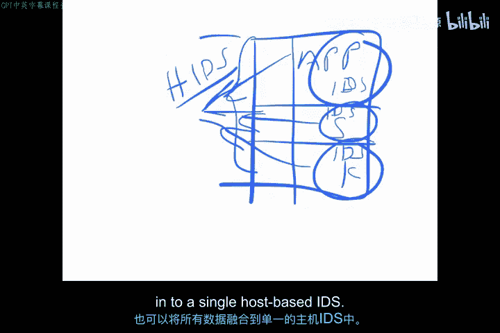
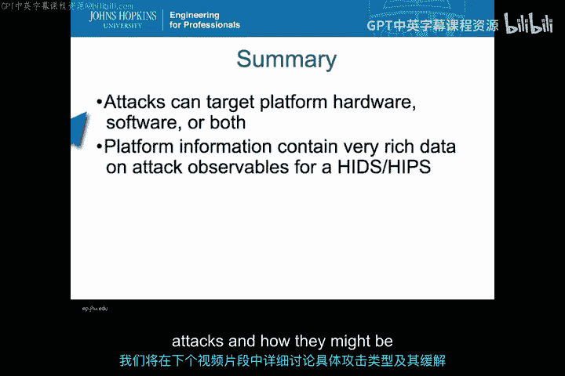

# 约翰霍普金斯大学《入侵检测｜Intrusion Detection》中英字幕 - P9：8_主机入侵检测系统原理.zh_en - GPT中英字幕课程资源 - BV1sGu1z5E2J

Okay， so in this module in this video we're going to go ahead and begin to describe in high levell terms the idea of host intrusion detection。

 this is where we're going to focus pretty much on things that are on the platformum form as opposed to what's on the network。

 so if you think of a host kind of out here and you think of your network，Sort of in this side。

 your network sensors are going to be passively listening to your network and everything that's coming in on the host。

 all of the log files and everything else that are here are going to be the sensors in to some hostbased IDS that's running at least partially。

 if not entirely on the host system。So throughout this module， whenever I say hostt IDS。

 what I really mean， of course， is it's the same thing as a HiIDS。Host intrusion detection system。

 If I talk about a hips。A host intrusion prevention system。

 what this means is that in addition to detecting some kind of event on the host。

 the host is actually going to take some kind of an action。

 usually within the host itself in order to protect itself from the attacks that it's actually seeing。

So just like all IDSs， a host based IDS has three main parts。

 it's got the sensors from the local host that create a data stream that it's going to be used to feed the IDS it's got a classifier that takes those events and identifies which ones among them are designated as suspicious or things that need to be followed up on these are called the incidents or the suspicious event elements that are coming out of the IDS and then finally of course there's the reporting element in this case the incidents can either be reported locally on the host that it's running or to some kind of central aggregation point over the network and of course if we're talking about the use of an IPS part of that may actually be reacting directly to the incidents that are found in order to do some blocking action or some kind of action directly on the network so again our sensors are going to be that the log files on on the network which are going to feed into our classifier。

Whi then feeds into our reporting section。 So we still have those three parts that we get sort of as part of any ideas。

So when we talk about the different types of hips or hips， there are three basic types。

 The first type is the integrity checkers。 These are the ones that。Like tripwire。

 they sort of alert when something has changed。 They look for really important files or other elements within the system that should never change。

 and the fact that they changed。The only reason they should ever change is because of some kind of an attack or some kind of an incident。

 So these integrity checkers， then we have malware detection。 So these are like virus detection。

 They identify any kind of Trojan horses， any sort of malware viruses。

 things that are running on your system。 They can do it either statically or dynamically。

 So they can look at the files that are dormant in your system。

 or they can check programs as they're running to see if they can identify the malware。 And as I say。

 traditional virus checking sort of gets into this。

 And then there's the traditional attack detection。

 This was the original types of hostbased Is like knives。

 that we talked about a little bit in module 1。 This uses the audit streams that are generated by applications in other places in the system to identify actual attacks that are currently going on。

 This is a little different than malware detection。 This is looking more at interactive attacks。

 things that insiders or other people who are logged into the system are actually doing and。

Of course， when I talk about a hips， you know we've said before that hips is all of these same kinds of things can also run as a hips。

 but in addition to the detection， the hips can block the running of malware。

 they can stop processes。 They can automatically recover。

 they can basically do any action that a user could do automatically。

 And at the local host there's often enough context to be able to take some really good positive。

Elements to stop it so you can imagine with virus detection。

 you can stop the viruses from running from worms from the malware for integrity checkers。

 you can put the file back if a file should never change if you're if you detect some kind of user running a process they shouldn't run you can kill the process so these are the sorts of things that a hips might do in addition to what the His do。

So regardless of the type of IDS， the IDS collects information from the host。

 that's what makes it a hostbased intrusion detection system or aHIDS So there are three common places where activity is collected and then of course there's this other category that we'll talk about of targetbased monitoring so in the operating system logs itself these are the traditional audit logs that check stats on processes。

 events or file access failures， things that should not have happened so these are the traditional kinds of think of them as the windows audit logs or audit logs you can get on any given operating system that talks about what the activity is describes the activity in a log file then there are somewhat different than higher level logs that you get at the operating system level these are things that run more at the user level like last log or things on the user side that are a little bit closer to the activity that's happening。

the applications， then you can get all the way up to the application logs。

 these are like your mail log files， send mail log files or things like your web log files that go into detail about the interaction of things that are actually happening on your web services。

Now， as I said before， targetbased monitoring is a little bit different。

 Tabased monitoring says that I'm going to point my sensor at something that should never change。

 so the sensor is actually checking and when you get a value that's sort of read out of it。

 It's really trying to compare it to a standard or a baseline value to see if something is actually changed。

 So these targetbased monitorings are doing some kind of either crypto checkum on a file or some sort of very standard way of looking at information that shouldn't ever change and so that the Is can actually alert if the information ever does change。

 So it's a little different than these other audit logs in that these other audit logs are designed to be dynamic and changing based on the activity。

 whereas in a targetbased monitor， you should get the same value out of the sensor every time。

 if you don't get the same value， that's what's actually going to be alerted upon。

So within the operating system， there are a number of different log files that you might have。

 and it depends on the operating system that you're running。

 It depends on exactly what sorts of things are collected on Unix we have things like the Berkeley system monitor or the Berkeley security monitor。

 which really gets into understanding what kind of security events are appropriate for Linux or Unix in general。

 the Windows event log is specific to the Windows operating system。

 as you might imagine the event log itself can sometimes include a little bit of alerting even inside the event log application。

 This kind of makes the event log system， an IS in its own right。

 the Hs in its own right in that it has sort of the collection of the Windows events。

 it has something that actually classifies those events into something of suspicious nature。

 and it has some kind of alerting function that can alert the user is to what's going on。

These sensors are normally part of the kernel structure。

 So when we talk about where are the sensors actually located for operating system logs。

 they tend to be deep down in the system and away from where the user can actually manipulate them。

 this is valuable because you want to try to keep it outside of a traditional user's hands。

 Now this is only good， of course， if you have a separation between your administrator or your privileged users at your ordinary users。

 If you don't have that separation or if you always log into your Windows system or your Mac system as an administrator access。

 then any intrusion that happens that potential perpetrator has access to the kernel structure and access to all of the things that would be creating alerts within the IS。

 It's one of the dangers of a hostbased Is is you're very close to the potential person or malware that's actually doing the incident。

 a lot of the data that's included down here。Come from the internal so you can imagine the clock time。

 the names of the event parameters， these are all parameters with respect to the way the operating system or the kernel would see these events。

 these are very low levelvel events which often makes it difficult to trace from those events to some kind of a high-leve application oriented attack that's actually happening and of course the sensors themselves can be you know either very verbose and collect a whole lot of information like every single file access or they can be tuned to create less information less information that's created from the operating system logs of course。

 the less information the classifier will have to indicate whether some kind of event is actually happening it's one of the traditional tradeoffs you get in the operating system logs。

System logs， as opposed to operating system logs are sort of one step up the stack from the kernel or the underlying operating system。

 These are system utility logs， things that run very close to or at the user level。

 and they tend to log things at approximately what the user is is doing in the user level of activity。

 So in units， you can imagine things like last log and history up time。 the su logs。

 These are all logs that are created a little bit higher than your operating system logs。

 So they tend to be collected more at the service level。

 As opposed to what the operating system level。 Not always。

 sometimes there are hooks into the kernel to get these logs and it depends a lot on the specific implementation of that particular system。

 but in general， you would expect systems logs to be at the service level rather than the kernel level。

 The system logs themselves are always very specific to some kind of type of event usually centered around a service。

 So the login service。or some other sort of service that's actually running within the system。

 one of the standard services on the system， so they're not as general as application logs。

 they're not as detailed as operating system logs and they tend to have somewhat less standardized formats so that you have to within your IDS classifier taken into account that you may not have a canonical form that you can actually use to process these events into your classifier in order to find which one of the events is suspicious so these sensors since they're part of a system service that sort of run that way they each tend to create their own independent log file so these log files are like independent data streams that can run into your classifier now that leads you to two immediate problems that are going to come into your classifier the first is that these log files are may not be compatible with each other with regard to their granularity in time the kinds of events that the way the。

synyntax is structured so that you're probably going to have to write some kind of parsing engine in order for the classifier to understand all of these different formats within your system log Now the other problem that you get with this in terms of having to write those is that fusing the data is actually then going to have to be an important part of what the classifier does so rather than just take a single set of log files and partition them into and non- suspicious events now you've got to classifier that has to take different data streams merge them together and put them together in order to find the sort of suspicious system behavior。

Application logs are kind of the highest level of hostbased logging that you can get。

 These are logs that are specific to individual applications on your system。

 not necessarily the services like I talked to before。

 but applications that are running sometimestime at the user level sometimes at a special account level So we count things like web access logs and email logs because those tend to be running within their own account。

 not as system or as root database logs if you're running a separate Sql style database or Mysql or some other kind of of database element that's collecting logs。

 again， these are running at the level of the application that's running So if the user is running an application。

 the logs are going to be collected at that user level。

 this is important to realize because if the logs are actually being collected at the user level。

 they are accessible to be changed potentially modified by the user running it So although this has much more specific information。

Of various kinds of attacks， including system information and application specific information。

It's also accessible to be modified by the user。 So the integrity of the application logs themselves may not be as good as the integrity of operating system or system information。

Usually， the sensors are built in as part of the application。 and， of course。

 they have a lot of the same difficulties that I just talked about with regard to system service logs in that they can have different formats。

 different ways to compose these elements。 So the classifier again。

 may have a difficult time actually trying to chew on these application logs in order to find suspicious events。

So within the host。You obviously you've got this sort of idea that there's the low level kernel based logs。

 there are system services logs， and there's application logs。That are sort of up higher。

All of these logs can feed into essentially some kind of IDS。Some kind of hi system。

 So the hi system can take things from each。Or they can take it from one。

 or you can run individual IDSs。Inside of each one of these。

 so there's a different type of IDS that could run within each given area。

 or you could fuse all the data in to a single host based IDS。

So that leaves us basically to talk about target based monitoring。

 This was the idea of integrity checking across anything on the system that's supposed to be static。

 You basically have to in advanced， pick out your target。

 your specific assets that are going to be used to produce an activity record of changes to that object。

 The kinds of applications that run this are like tripwire or stackguard。

 These are elements that check for things that should not change。 And when they change。

 they essentially give you some kind of an alert。Now you don't really have to look at files necessarily。

 you can also look at memory to look and see if there are things happening even sort of down into your basic level of your bios or something down within the system so you can look for modification of things that are not just files Basically you can look for anything that ought to remain constant these can include values that might normally be dynamic within the kernel。

 for example， so you could pick out certain kinds of kernel activities and make sure that they remain constant as well so you can use parameters you can use anything from registers or anything that ought to have some kind of fixed value and that's the way that you can actually feed into a target-based monitor。

Now， the main issue you get with this sort of thing is picking the right asset to monitor if you pick an asset that's really is going to be part of an attack。

 you do very， very well at identifying those things that an intruder would have to change if you pick the wrong assets and you're not monitoring the correct things。

 then obviously target based monitoring isn't going to be very useful to you。

Regardless of where the sensor is in your system， you have to securely manage this data。

 You've got to basically make sure that however you get these sensor logs into your classifier。

 they have to be securely managed if they are accessible to change themselves。

 Then your Is is only going to be as good as the integrity of the flow of sensor data。

 So this is everything from very simple to like what happens when your disk fill up。

 What do you do with the events， Do you throw away old events。

 Do you throw away the new events do you stop the system。

 What do you do when you get these kinds of errors。

 How do you actually modify and verify the integrity of the monitor data that you have。

If the data is changing all the time， it's not the same as using a target based system on the monitor data。

 but you do want to verify that what the classifier is getting actually comes in。

And as I've mentioned before， you still have the problem about how do you compose different audit sources。

 How do you put them together， especially if they're from different layers within the operating system within the host。

 And what about performance issues， We haven't talked too much about performance。

 But if you're talking about a His that's running in parallel with other applications and critical functions on your system。

 Well， what do you do when the His begins to take up too many resources on your system。

 both in terms of memory and disk and a number of whatever it is that you have that you need for your applications。

 you've got to worry about what happens if the His begins to cut into those resources。

 So these are some of the difficulties in primary tradeoffs that you have when you're thinking about a His。

So in summary， you can actually get information from a huge number of layers in the platform all the way from the hardware to the firmware。

 inside the bus and the internal network， your distance storage， all of your OS layers。

 your frameworks in your DLs all the way up to your applications。

 any one of these areas can produce system logs and valuable information that could be the target of an attack。

 Now， each one of these areas may be unique to specific kinds of attacks。

 and we're going to talk about that in one of the future videos that we have for this module。

 but in each one of these cases you're looking for attacks at different areas within your operating system。

So when we talk about a His and the hits is looking for attacks， attacks， of course。

 require some kind of a vulnerability in order to operate at all。

 Those vulnerabilities from the host standpoint can be physical。 They can also be software。

 but they can be physical。 you could have physical probes onto the motherboard in order to look at data being transferred chip to chip。

 you can plug things between peripheralables， you can plug in additional cards and coprocessors and look at dissectorors。

 So unlike what we normally think about with regard to remote attacks。

 Sometimes you want to look for platform vulnerabilities that are a little different than just the classic find a software vulnerability and exploit it。

 But of course， the software vulnerabilities exist too。

 So I have both physical and software potential vulnerabilities that I might want to check for with a His。

 So a His that's checking for hardware penetration and actually sort of looking through are often grouped into the antitampper。

The idea of I can detect when my box is opened up or when something physically touches my my motherboard。

 some of the vulnerabilities may be mitigated by things like quantum networking in addition to antitamper or other things maybe even as simple as just making sure that you can't plug in a card or a coprocessor。

 making sure that your peripherals are locked out and that you can't do anything。

 So turning them off by software is usually not sufficient because then you have software vulnerabilities that could enable physical vulnerabilities。

 So remember， the log files that you're getting and that information you're getting from a His isn't all just about somebody remotely or locally coming in and changing the software You may actually have physical oriented attacks。

 We're going talk a little bit more about that in some of our exercises as well。So just to wrap up。

 remember that attacks can target platforms， hardware， software or both。

 and that these platform information sources that we have are an extremely rich data set on attack observables。

 Remember， you're very close to the elements that are being attacked。

 That means that you are probably in the best place to actually detect the kinds of attacks that are happening within here。

 You also in the best place to actually do some mitigation， local mitigation on the files。

 without getting into a whole lot of different coordination？

 But with that power comes a number of significant challenges。

 including how would I actually distribute hostbased intrusion detection largely across my enterprise and try to coordinate any of the information across them。

 How do I keep things like signatures up to date for viruses or malware。

 how do I actually distinguish between normal behavior and abuse behavior at the platform level。

 So again， there are lots of challenges。With regard to this performance， of course。

 also being in there as a main challenge， but in summary。

 remember that the host based intrusion detection systems are close to the attack， very。

 very valuable in terms of information and allow us to really get a handle sometimes on taking some of the automated action。

So that's going to do it for this particular video。

 we will move into more details on exactly what kinds of attacks and how they might be mitigated in the upcoming video segment。

