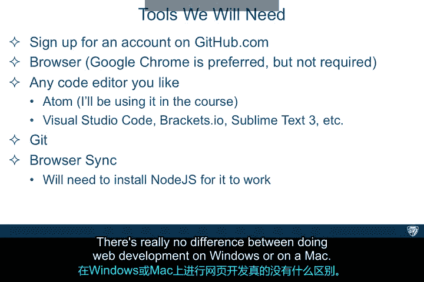
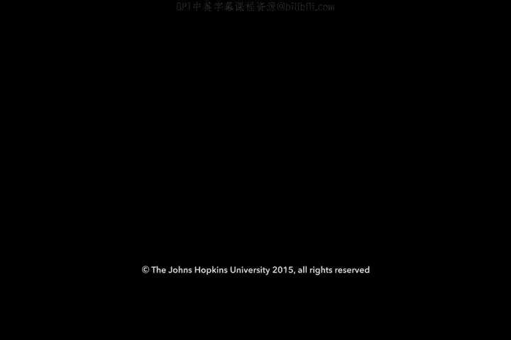

# 003：我们需要什么 🛠️

在本节课程中，我们将介绍如何为后续学习设置开发环境。我们将逐一讲解所需的工具和账户，并说明它们的作用。

## 概述
在本节中，我们将学习搭建一个完整的 AngularJS 开发环境所需的核心组件。这包括代码托管、浏览器、代码编辑器、版本控制工具以及一个能提升开发效率的本地服务器工具。

## 开发环境组件
以下是构建开发环境所需的各项工具和账户。

### 1. GitHub 账户
首先，你需要注册一个 GitHub.com 账户。这个过程非常简单，只需提供用户名、密码和电子邮件地址即可完成。

### 2. 网页浏览器
在后续课程中，你需要使用一个网页浏览器。我将使用 Google Chrome，这是个人偏好的选择，因为它内置了非常先进的、对网页开发很有帮助的 Chrome 开发者工具。但这并非强制要求，你可以使用任何你喜欢的浏览器。

### 3. 代码编辑器
你需要一个在本课程中使用的代码编辑器。我将使用 Atom 代码编辑器。它是免费的，功能强大，并且拥有大量可以帮助你编码的插件。它实际上也是由 GitHub 开发的。当然，你不必使用它，也可以选择同样是免费的 Visual Studio Code 或 Brackets。Sublime Text 3 也是免费的，但最终会要求你付费。基本上，请选择一个你喜欢并能高效使用的编辑器。

### 4. Git 版本控制工具
我们需要 Git 工具，原因有几个。第一，如果你想成为一名更专业的网页开发者，至少需要对 Git 有所了解。在本课程中，我们将使用最基础的 Git 命令，不会深入探讨，但你应该至少熟悉并初步接触这些最基础的命令。

### 5. Browser Sync 工具
我们还将使用一个名为 Browser Sync 的工具。我会展示这个工具的实际功能。它将帮助我们在本地机器上开发时，能够实时地在浏览器中看到我们在编辑器中编写的所有更新，而无需手动点击刷新按钮。Browser Sync 工具实际上是一个 Node.js 组件或包，我们需要安装 Node.js 才能让它工作。

## 操作系统说明
接下来的几个视频，我将分为 Mac OS 和 Windows 两部分进行讲解。我会在 Mac OS 上解释所有步骤，同样也会在 Windows 上解释所有步骤。因此，请根据你在后续课程中使用的操作系统进行选择。

我本人将使用我的 Mac 电脑进行演示。但如果你使用的是 Windows，请不要担心界面按钮看起来略有不同。除了 Windows 和 Mac OS 在输入两三个命令时存在差异，以及外观略有变化之外，整个课程的其余部分几乎没有区别。在 Windows 或 Mac 上进行网页开发本质上是一样的。

## 总结
本节课我们一起学习了搭建 AngularJS 开发环境所需的五个核心部分：**GitHub 账户**、**网页浏览器**、**代码编辑器**、**Git 工具**以及依赖于 **Node.js** 的 **Browser Sync** 工具。下一节，我们将开始动手，根据你的操作系统（Mac 或 Windows）来逐步安装和配置这些工具。