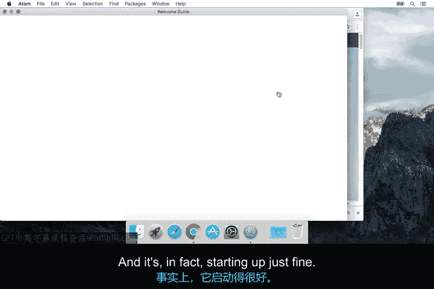
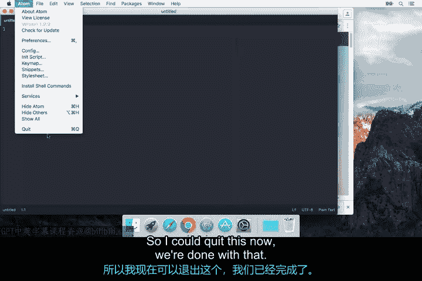
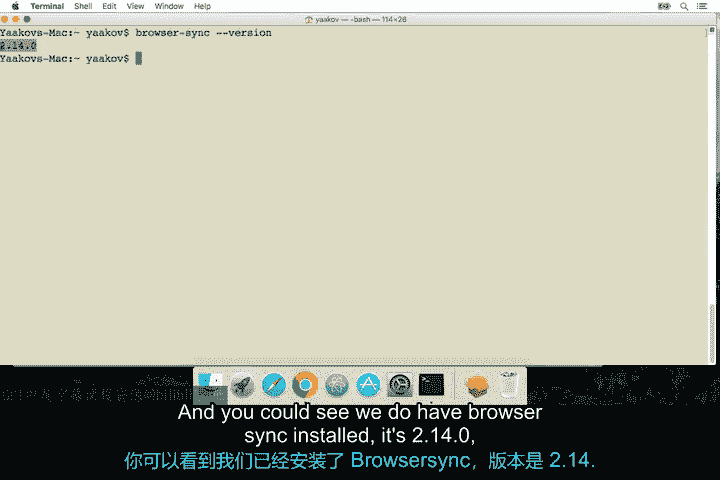
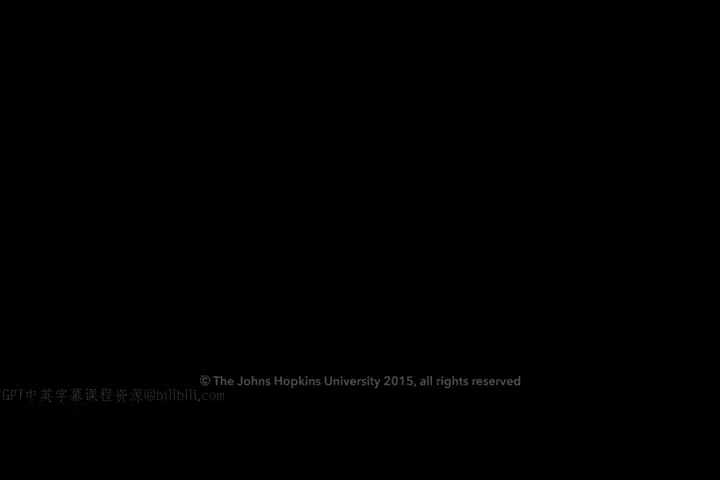

# 004：Mac开发环境设置（第1部分）💻


## 概述
在本节课中，我们将学习如何在 Mac 电脑上设置开发环境。我们将安装代码编辑器、版本控制工具、JavaScript 运行环境以及一个实用的开发服务器工具。这是开始使用 AngularJS 进行开发的第一步。

---

## 安装 Atom 编辑器

首先，我们需要安装一个代码编辑器。我们将使用 Atom 编辑器。

以下是安装步骤：



1.  打开 Chrome 浏览器，访问 `atom.io` 网站。
2.  点击下载按钮，下载 ZIP 文件。
3.  下载完成后，在 Finder 中双击该 ZIP 文件进行解压。
4.  将解压出的 Atom 应用文件拖拽到“应用程序”文件夹中。
5.  可以删除原始的 ZIP 文件。

现在，让我们验证 Atom 是否安装成功。从启动台（Launchpad）中找到并点击 Atom 图标启动它。首次启动时，系统可能会提示该应用来自互联网，确认打开即可。启动后，关闭欢迎界面，Atom 编辑器就准备就绪了。你可以将其拖入 Dock 栏以便快速访问。



---

## 安装 Git

上一节我们安装了代码编辑器，本节中我们来看看如何安装版本控制工具 Git。

在 Mac 上，我们可以通过安装“命令行开发者工具”来获取 Git。

以下是安装步骤：

1.  打开“终端”（Terminal）应用程序。
2.  在终端中输入以下命令并按回车键：
    ```bash
    git --version
    ```
3.  如果系统提示需要安装命令行工具，请点击“安装”按钮并同意许可协议。
4.  等待下载和安装完成。

安装完成后，再次在终端中输入 `git --version`，你将看到类似 `git version 2.7.4` 的输出，这表明 Git 已成功安装。这个版本对于我们的学习已经足够。如果你想安装最新版本，可以访问 Git 官网下载。

---

## 安装 Node.js 和 npm

接下来，我们需要安装 Node.js 运行环境及其包管理工具 npm。它们对于管理项目依赖至关重要。

以下是安装步骤：

1.  在浏览器中访问 Node.js 官网的下载页面。
2.  选择适用于 Mac 的 64 位安装包（.pkg 文件）进行下载。
3.  下载完成后，在 Finder 中双击安装包文件。
4.  按照安装向导的提示，逐步点击“继续”，同意许可协议，并最终点击“安装”。
5.  系统可能会要求输入管理员密码以完成安装。

安装完成后，我们需要验证安装是否成功，并确保环境变量配置正确。打开终端，输入以下命令：
```bash
echo $PATH
```
检查输出中是否包含 `/usr/local/bin` 路径，它通常已自动配置好。

现在，让我们验证 Node.js 和 npm 的安装。在终端中分别输入以下两个命令：
```bash
node --version
npm --version
```
你将看到类似 `v4.5.0` 和 `2.15.9` 的版本号输出，这表明它们已安装成功。

---

## 安装 BrowserSync

最后，我们将安装一个名为 BrowserSync 的开发工具。它可以在你修改代码时自动刷新浏览器，极大提升开发效率。

以下是安装步骤：

1.  在浏览器中搜索 “browsersync”，进入其官方网站。
2.  官网会给出安装命令：`npm install -g browser-sync`。这里的 `-g` 参数表示全局安装。
3.  复制该命令。
4.  回到终端，粘贴命令并执行。如果你不是管理员，可能会遇到权限错误。
5.  如果遇到权限问题，可以在命令前加上 `sudo` 以管理员权限运行：
    ```bash
    sudo npm install -g browser-sync
    ```
6.  输入你的用户密码，等待安装完成。安装过程中可能会出现一些警告信息，但只要最终成功完成即可。

安装完成后，在终端中输入以下命令来验证：
```bash
browser-sync --version
```
如果看到版本号（例如 `2.14.0`），说明 BrowserSync 已成功安装。

---





## 总结
本节课中，我们一起学习了在 Mac 上设置前端开发环境的核心步骤。我们成功安装了 **Atom 编辑器**、**Git 版本控制工具**、**Node.js 运行环境**（包含 **npm** 包管理器）以及 **BrowserSync** 开发服务器。现在，你的电脑已经具备了开始进行 AngularJS 应用开发的基本工具。在接下来的课程中，我们将利用这些工具创建我们的第一个项目。