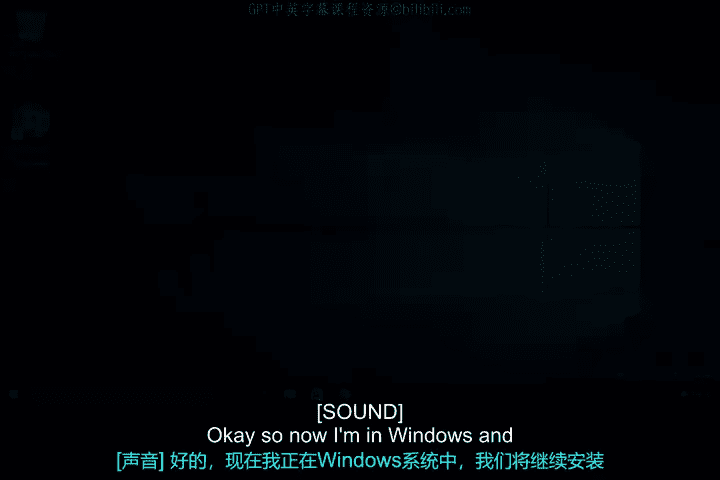
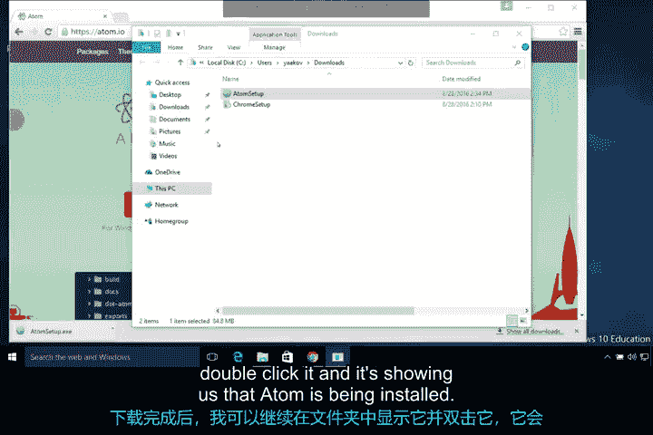
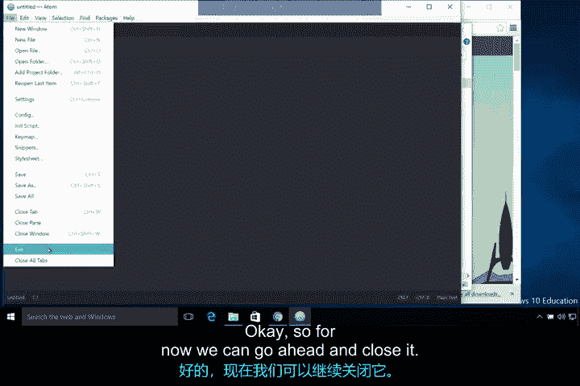
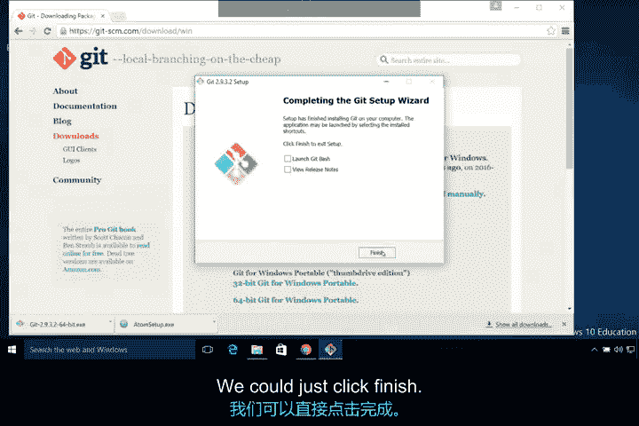
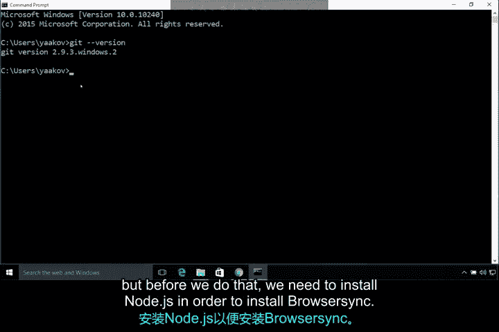
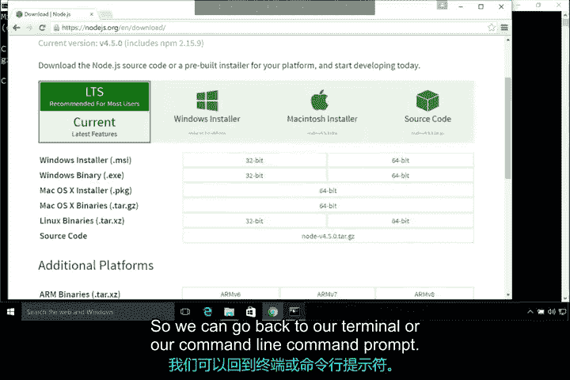
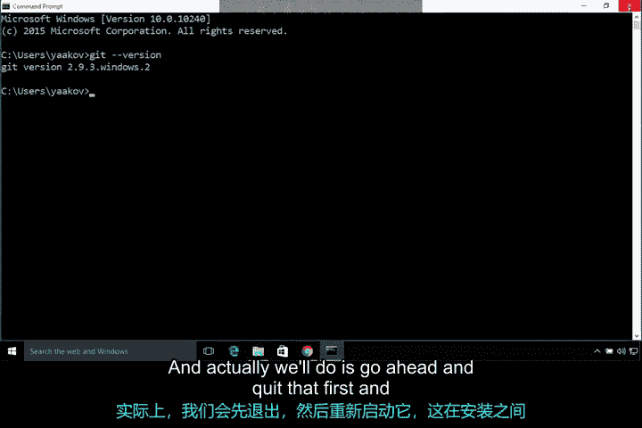
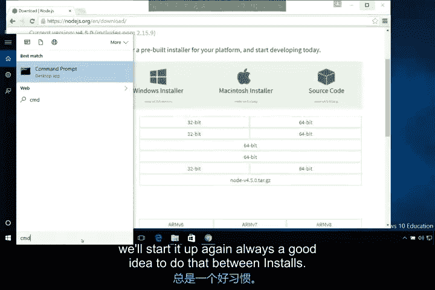
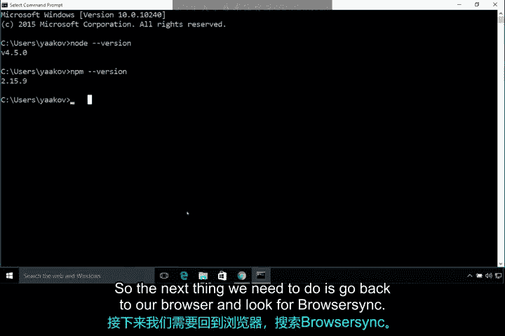
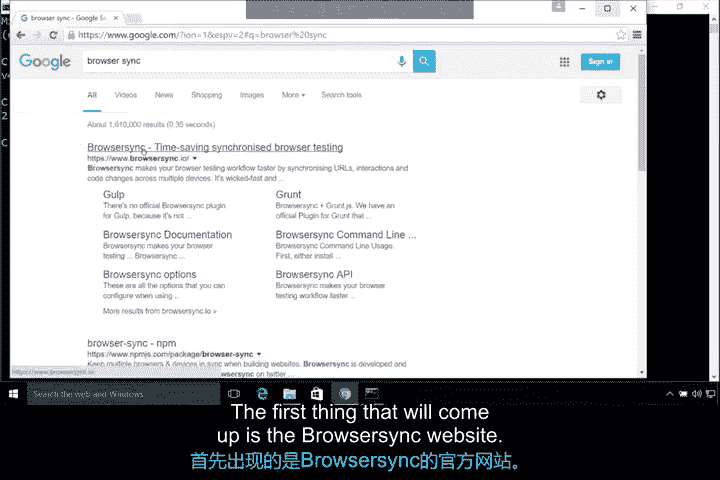

# 006：Windows开发环境设置（第1部分）🛠️




在本节课中，我们将学习如何在 Windows 操作系统上设置开发环境，为后续的 AngularJS 学习做好准备。我们将安装浏览器、代码编辑器、Git、Node.js 以及一个名为 Browser Sync 的开发工具。

---



## 安装浏览器 🌐



首先，你需要一个浏览器来运行和测试你的 Web 应用。虽然你可以使用 Internet Explorer，但本课程强烈推荐使用 **Google Chrome**。我们将假设你已经知道如何下载和安装 Chrome 浏览器。

## 安装代码编辑器 📝

接下来，我们需要一个代码编辑器。本课程将演示如何安装 **Atom** 编辑器。当然，你也可以选择其他你喜欢的编辑器。

以下是安装 Atom 的步骤：
1.  访问 Atom 官方网站下载安装程序。
2.  运行下载好的安装文件。
3.  按照安装向导的提示完成安装。
4.  安装完成后，你可以关闭欢迎界面。

现在，Atom 编辑器已经成功安装并可以运行。



## 安装 Git 🗂️

Git 是一个版本控制系统，对于管理代码非常重要。



以下是安装 Git 的步骤：
1.  在浏览器中搜索“download Git”并访问官网。
2.  下载适用于 Windows 的最新版本安装程序。
3.  运行安装程序，并按照向导进行安装。在安装过程中，建议选择以下选项：
    *   在桌面上创建快捷方式图标。
    *   选择“Use Git from the Windows Command Prompt”选项，以便在命令行中使用 Git。
4.  安装完成后，打开“命令提示符”（CMD），输入以下命令来验证安装是否成功：
    ```bash
    git --version
    ```
    如果成功显示版本号（例如 `git version 2.9.3`），则说明 Git 已正确安装。

## 安装 Node.js 和 npm ⚙️

Node.js 是一个 JavaScript 运行时环境，而 npm（Node Package Manager）是它的包管理器。我们需要它们来安装其他工具。







以下是安装 Node.js 的步骤：
1.  在浏览器中搜索“download node JS”并访问官网。
2.  下载适用于 Windows 64 位的安装程序（.msi 文件）。
3.  运行安装程序，接受许可协议，并按照默认设置完成安装。
4.  安装完成后，**重新打开**命令提示符，然后输入以下命令验证 Node.js 安装：
    ```bash
    node --version
    ```
5.  接着，验证 npm 是否也已正确安装：
    ```bash
    npm --version
    ```
    如果两个命令都返回了版本号，说明安装成功。



## 安装 Browser Sync 🔄

Browser Sync 是一个开发工具，可以在你修改代码时自动刷新浏览器，提升开发效率。



以下是安装 Browser Sync 的步骤：
1.  在浏览器中搜索“browser sync”并访问其官网。
2.  官网会显示安装命令。我们需要使用 npm 进行全局安装（`-g` 参数代表全局安装）：
    ```bash
    npm install -g browser-sync
    ```
3.  在命令提示符中粘贴并运行上述命令。npm 将自动下载并安装 Browser Sync。
4.  安装过程可能会有一些警告信息，只要最终完成即可。安装完成后，输入以下命令验证：
    ```bash
    browser-sync --version
    ```
    如果显示了版本号，则说明 Browser Sync 已成功安装。

---


本节课中，我们一起学习了在 Windows 系统上搭建开发环境。我们成功安装了 Google Chrome 浏览器、Atom 代码编辑器、Git 版本控制系统、Node.js 运行时（包含 npm 包管理器），以及 Browser Sync 开发工具。现在，你的开发环境已经准备就绪，可以开始进行 AngularJS 应用开发了。