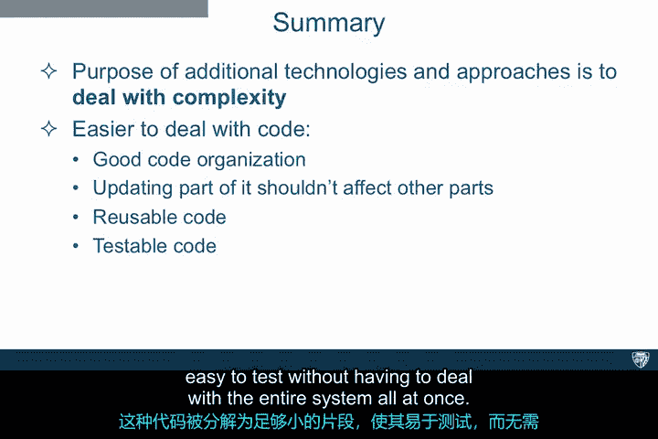

# 008：为什么不保持简单 🧐

在本节课中，我们将要学习为什么在开发 Web 应用时，我们需要引入像 AngularJS 这样的框架，而不是仅仅使用简单的 HTML、CSS 和 JavaScript。理解这个“为什么”能帮助我们更好地掌握后续的复杂概念，并认识到这些框架的价值所在。

在深入探讨 AngularJS 的具体主题，如解释作用域（scope）、服务（services）、指令（directives），以及 Angular 使用的通用编程概念，如模型-视图-视图模型（MVVM）架构之前，退一步思考并理解这种整体方法背后的原因会非常有帮助。当你学习新事物时，越能理解事物为何以特定方式组合在一起，不仅有助于你理解和记住信息，还能让你的努力变得有意义。没有人喜欢做毫无意义的事情，尤其是当事情变得更复杂时，而 Angular 确实可能变得复杂。

但是，如果你知道并理解你所采用方法的价值，你就会对事物有完全不同的看法。你可以欣赏你追求的目标，并判断你离那个目标还有多远。在本课程中，我会逐步解释所有内容，所以你无需过于担心复杂性。然而，了解让事情变得不那么简单的动机仍然很重要。

那么，Angular 和其他此类框架试图实现的目标是什么？为什么不保持简单，为什么要让事情复杂化？

我所说的“保持简单”是什么意思？从之前的课程中，你已经了解了驱动 Web 的核心技术。你知道如何使用 HTML 来构建网页结构，可以使用 CSS 来布局和样式化页面，还可以添加功能使页面变得生动，例如从服务器或 Web 上的其他服务请求数据。那么，问题来了：为什么还要添加其他东西？

让我们看看随着项目不断添加更多功能，你的项目代码库会发生什么变化。显然，随着功能的增加，代码库也会随之增长。最重要的是，承载功能的 JavaScript 代码在规模和复杂性上都会增长。即使规模不变，复杂性也肯定会增加。

因此，对于最初问题的直接答案是：我们开发者并不是在引入所有这些复杂的框架和编码方法，从而使事情变得复杂。恰恰相反，如果没有这些方法，我们的代码本身就会变得复杂。这些框架和方法的存在是为了帮助我们处理这种复杂性，并将其控制在可控范围内。

问题在于，我们如何在一定程度上控制规模，但更重要的是，如何控制代码库的复杂性？控制复杂性意味着什么？我们试图实现什么？换句话说，我们希望代码具有哪些特性，才能认为它不那么复杂且相对容易处理？让我们回顾一些基本特性。

以下是构建可维护代码时需要考虑的几个关键特性。

*   **良好的代码组织**：我们需要某种方式来组织代码的不同部分，以便快速找到负责特定功能的代码。请记住，这不仅是为了你自己，还需要以尽可能清晰的方式组织代码，以便你的团队成员理解。这里有一个很好的经验法则：考虑让一个全新的开发者加入团队需要什么。向新开发者解释功能代码在代码库中的位置是否相当直接明了？
*   **可维护性与低耦合性**：应用程序的需求总是在变化。变化可能源于客户需要新功能、业务规则改变，或者因为某些需求在开发后期才被正确理解。因此，我们需要提前为此做好准备。如果某个业务规则发生变化，我们不希望重写整个应用程序。事实上，我们希望尽可能少地更改代码，以集成新的变更，并让其余代码甚至察觉不到任何变化。
*   **代码可重用性**：多次编写相同的功能会极大地浪费时间，尤其是在同一个应用程序中。然而，比最初重复花费时间更糟糕的是，想想当我们需要更新该功能时会发生什么？我们不得不在多个地方进行更新。当然，这种情况很容易导致简单的错误，并在代码中引入难以追踪的缺陷。因此，当我们开始思考如何编写某个功能时，至少应该花一点时间思考是否需要让代码更通用，并以一种可以在应用程序中多个地方使用的方式来编写它。
*   **代码可测试性**：最后，你如何确信你的代码确实在工作？答案是测试。但如何测试？你可以启动整个系统，看看代码是否“一切正常”。但如果你只是编辑了几个小函数，甚至还没有完成整个功能的编码，这是否是高效和合理利用时间的方式？可能不是。相反，你需要以这样一种方式编写解决方案：可以独立测试其中的小部分，而无需部署整个 Web 应用程序。这意味着在编码时，你必须牢记这个想法，并将功能分离成更小、可测试的组件。

上一节我们探讨了为什么代码会自然变得复杂，以及我们希望代码具备哪些特性来对抗这种复杂性。本节中，我们来总结一下引入额外技术和方法的真正目的。

总而言之，额外技术和方法的**目的**不是让事情变得更复杂，而是为了处理随着功能增长，代码本身带来的固有复杂性。

我们还讨论了拥有易于处理的代码意味着什么。首先，我们需要良好的代码组织，以便能够快速找到需要处理的相关代码。其次，更新部分代码不应同时影响其他部分。这将允许我们编写更小的代码块，而无需在每次更新小东西时处理整个系统。我们还希望编写可重用的代码，不希望两次编写相同的代码，当然也不希望在多个地方调试它。

最后，我们需要能够编写可测试的代码，即编写足够小的代码块，使其易于测试，而无需一次性处理整个系统。

