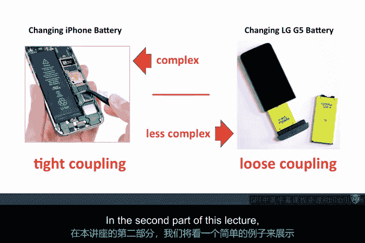

# 009：为什么代码会变得复杂 🎼

在本节课中，我们将要学习为什么代码会变得复杂，特别是探讨导致代码失去我们之前讨论过的良好特性的原因。我们将重点关注两个核心概念：高内聚和低耦合。

---

## 代码复杂化的原因

代码变得复杂的原因有很多。其中一个原因是人们编写了难以阅读的代码。

以下是导致代码难以阅读的几个具体表现：

*   **糟糕或不一致的编码风格**：例如，在文件的一部分使用一种编码方式，在另一部分使用另一种方式，空格使用混乱。
*   **难以理解的函数或变量名**：使用含义模糊或过于复杂的命名。
*   **缺乏注释或API文档**：代码没有足够的说明来解释其功能。

难以阅读的代码问题相对容易解决，只需根据某种风格指南重写或格式化代码即可。

然而，有一个更棘手的问题，这也是软件工程领域多年来一直试图解决的难题，那就是**缺乏高内聚和低耦合**。

---

## 理解高内聚与低耦合

上一节我们介绍了代码复杂化的表面原因，本节中我们来看看更深层次的设计原则问题。

### 什么是高内聚？

高内聚是指**在某个代码边界内，小的功能片段彼此之间紧密相关**。

这里提到“代码边界”有几个原因：
1.  在不同编程语言中，这个原则所指的边界可能不同，可能是类、模块或函数。
2.  更重要的是，这取决于你的设计目标。你可以为整个模块设计高内聚，也可以为一个简单的函数设计高内聚，这取决于你关注代码的哪个层面。

简单来说，**高内聚衡量的是“一个事物是否专注于做好一件事”**。

一个高内聚的功能块可以调用其他函数来实现目标。关键在于，所有这些被调用的函数都与主功能的目标高度相关，它们共同完成同一件事，只是分工不同。

让我们看一个有趣的例子。比较我的每日日程和我的电脑（Mac）的“日程”：
*   **我的日程**：包含起床、刷牙、喝咖啡、编码、工作、吃晚餐、制作Coursera课程、吃夜宵饼干、减肥等。这些事项彼此之间存在冲突（比如吃饼干和减肥），并非100%相关，因此**内聚性低**，处理起来更复杂。
*   **电脑的日程**：非常简单：闪灯、运行、睡眠、关机。它只做几件高度相关的事，因此**内聚性高**。

低内聚正是使人类日程（以及类似结构的代码）变得复杂的原因。

### 什么是低耦合？

低耦合意味着**一个组件对另一个组件的依赖尽可能少**。

在软件中实现低耦合是好事，它能显著降低开发的复杂性。因为当你处理一个松散耦合的小部件时，你无需担心系统的其余部分。

最简洁的说法是：在软件组件中，如果**更改一个组件时，不需要更改另一个组件**，那么它们就是低耦合的。

例如，假设有一个运行良好的购物车组件，然后你添加了一个处理信用卡支付的组件。如果这两个组件是松散耦合的，那么当我们改变信用卡处理方式时，购物车代码完全不需要改变。它不关心信用卡处理组件内部如何工作，只需要能够调用它即可。

现实生活中的例子：更换iPhone电池是一个相当复杂的过程（紧密耦合），而更换LG G5电池则很简单，只需按一下按钮，电池弹出，换上新电池即可（松散耦合）。

---

## 在软件中的体现

那么，这些概念如何在软件中体现？具体到我们的目的，它们如何在Web应用软件中体现？

在本次讲座的第二部分，我们将通过一个简单的示例来具体观察这些概念。

---

## 总结

本节课中我们一起学习了代码复杂化的原因。我们了解到，除了难以阅读的代码外，更深层次的问题是缺乏良好的设计原则，即**高内聚**和**低耦合**。高内聚要求一个代码单元专注于做好一件事，而低耦合要求不同单元之间的依赖最小化。遵循这些原则是编写易于维护和扩展的软件的关键。