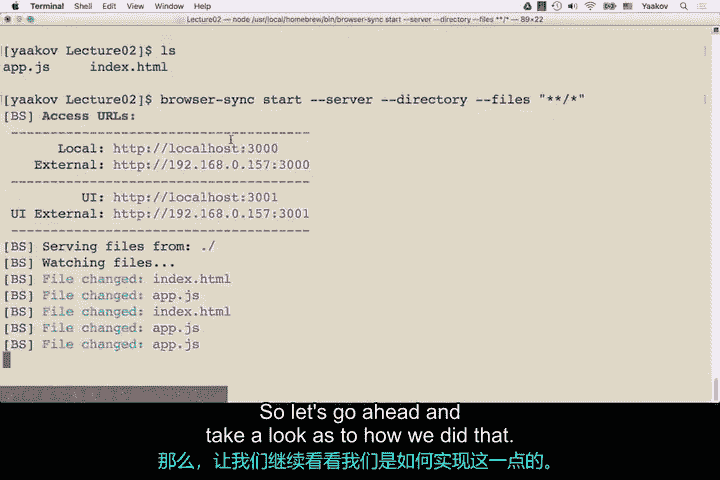
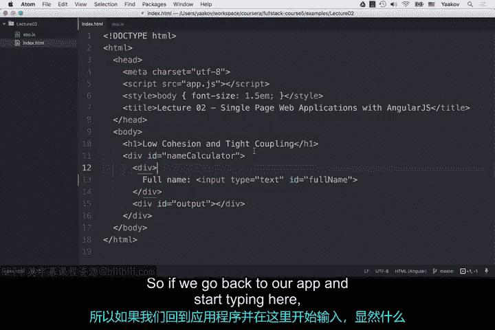
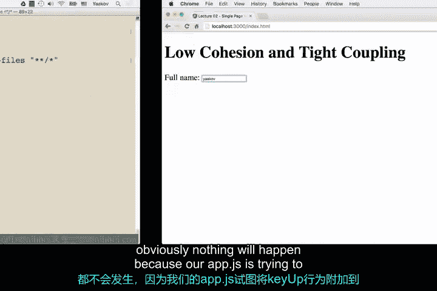
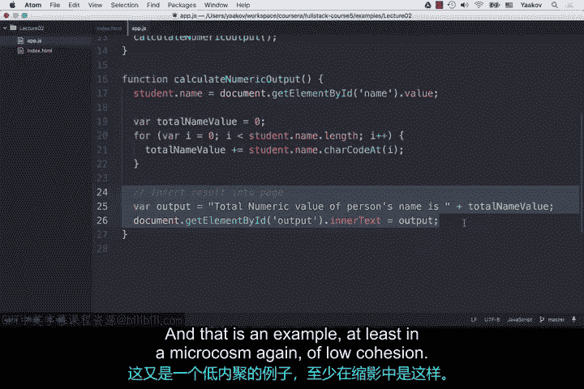
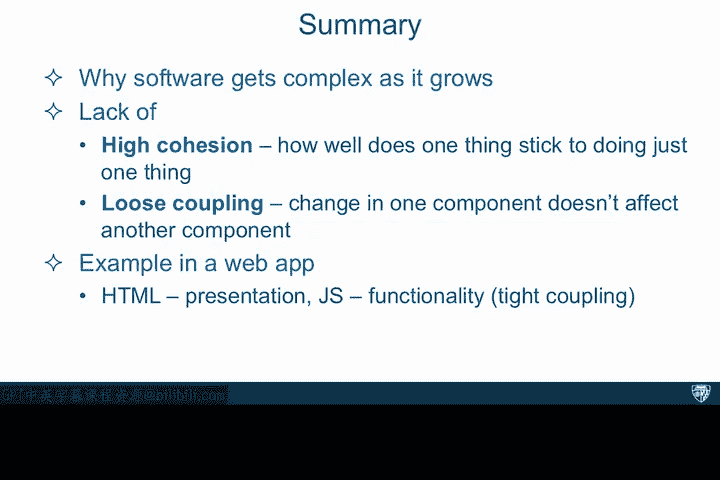

# 010：为什么代码会变得复杂

在本节课中，我们将要学习为什么软件会随着增长而变得复杂。我们将通过一个具体的网页应用示例，分析低内聚和紧耦合这两个核心问题，并理解它们如何影响代码的可维护性和可扩展性。

## 一个设计糟糕的示例

为了展示一个低内聚且紧耦合的糟糕设计示例，我们来看一个简单的应用。当你在输入框中输入名字时，应用会根据每个字符的 ASCII 码值，实时计算并显示你名字的总数值。随着你输入或删除字符，这个数值会动态更新。

让我们来看看这个功能是如何实现的。我们的应用包含两个文件：`index.html` 和 `app.js`，它们位于 Git 仓库示例文件夹的 `lecture 02` 目录中。

在我们的 HTML 文件中，需要关注的主要是两个标签：一个是 ID 为 `name` 的输入框，我们将为其附加一些行为；另一个是 ID 为 `output` 的占位符标签，用于显示结果。

## 分析 JavaScript 代码

现在，我们跳转到 `app.js` 文件。首先，我们定义了一个名为 `student` 的对象字面量，其 `name` 属性初始为空字符串。

接下来的代码主要设置了几个事件监听器。第一个监听器监听 `DOMContentLoaded` 事件，当整个页面加载完毕并实例化在浏览器内存中时，会触发其回调函数。这个函数会找到 ID 为 `name` 的输入框元素，并为其设置一个 `keyup` 事件监听器。

`keyup` 事件触发时，会调用 `calculateNumericOutput` 函数来计算输入框中文本的数值。

## 深入 `calculateNumericOutput` 函数

这个函数首先从 HTML 输入框中获取值，并将其存入 `student.name` 属性。接着，它遍历这个名字字符串，累加每个字符的字符编码值。然后，它生成一个输出字符串，例如“total numeric value of a person's name is: 123”。最后，它找到 ID 为 `output` 的元素，并将其 `innerText` 属性设置为这个输出字符串。

那么，这段代码有什么问题呢？实际上，问题不少。

## 紧耦合的问题

首先，`index.html` 文件负责展示内容，属于表现层。而 HTML 和 CSS 的核心职责是呈现，不应包含功能逻辑。如果我们将功能逻辑与表现层紧密绑定，就会产生紧耦合。

例如，如果设计师决定将输入框的 ID 从 `name` 改为 `fullName`，我们的应用就会崩溃。因为 `app.js` 中的代码正试图将 `keyup` 行为附加到 ID 为 `name` 的元素上。这个改变会导致事件监听器失效，用户输入时不再有任何反应。

这就是紧耦合的典型表现：我们的应用功能代码（JavaScript）过度依赖于表现层代码（HTML）的具体实现细节。这不仅限于 `name` 这个 ID，`output` 这个 ID 也存在同样的问题。

## 低内聚的问题

接下来，我们看看 `calculateNumericOutput` 函数。一个函数应该只做一件事，或者处理紧密相关的事情。但仔细观察这个函数，它做了许多看似完全不相关的事情：

1.  从 HTML 中获取输入值（与表现层紧耦合）。
2.  计算字符串的数值总和（核心计算逻辑）。
3.  将结果格式化并插入到 HTML 文档中（再次与表现层交互）。

这个函数承担了过多不相关的职责。更好的设计应该是：获取输入字符串的功能独立出来，计算数值的功能独立出来，将结果插入页面的功能也独立出来。`calculateNumericOutput` 应该只负责接收一个字符串并返回其计算后的数值。

虽然在这个小应用中问题不大，但这在微观上是一个低内聚的典型例子：同一个函数内包含了彼此关联度不高的功能。

## 课程总结

本节课中我们一起学习了软件复杂度增长的一个主要原因。

我们讨论了**高内聚**的重要性，即一个模块或函数应专注于完成单一、紧密相关的任务。我们也探讨了**松耦合**，即一个组件的改变不应直接影响另一个组件。

通过一个真实的网页应用示例，我们看到了**紧耦合**的危害：当表现层（HTML）的改动直接迫使功能层（JavaScript）也必须改动时，代码就变得脆弱且难以维护。同时，我们也看到了**低内聚**的例子：一个函数混杂了多个不相关的职责。

优秀的软件设计追求**高内聚**和**松耦合**。在后续课程中，你将看到 AngularJS 如何帮助我们实现这两个目标，从而构建更清晰、更易维护的应用程序。