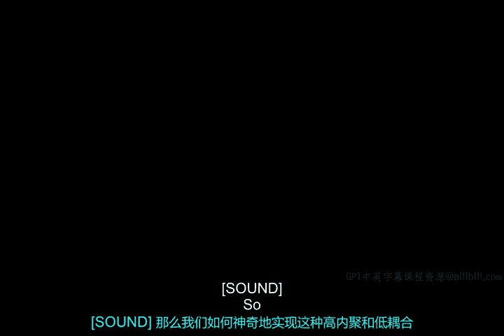
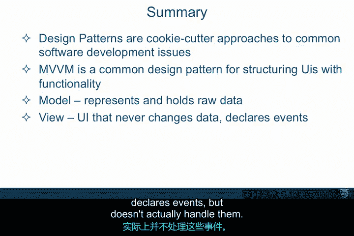

# 011：模型-视图-视图模型（MVVM） 🧩

在本节课中，我们将要学习一种名为“模型-视图-视图模型”（MVVM）的软件设计模式。这种模式是构建用户界面（UI）及其相关功能的常用方法，其核心目标是实现代码的高内聚和低耦合。

---

## 如何实现高内聚与低耦合？ 🤔

上一节我们介绍了高内聚和低耦合的概念。那么，我们如何神奇地实现这两个目标呢？

希望你已经开始明白，我们不仅需要考虑代码要实现什么功能，还需要思考如何组织代码结构。我们需要将代码分解成几个独立的功能模块，让它们协同工作，以实现所需的业务逻辑。我们需要一个一致的方法，但具体采用哪种方法呢？

我们可以从头开始设计架构，并尝试实现它，以验证其能否适应代码库的增长。如果你从事研究工作，可能会这样做。然而，如果你希望尽快实现功能，你会向更有经验的人寻求针对你特定情况的建议。

幸运的是，由于类似的情况反复出现，开发者们多年来已经为这些情况总结出了一套“现成”的解决方案。这些方案的具体实现在不同框架之间，甚至不同开发者之间可能有所不同，但如何构建此类解决方案的总体思路是相当标准的。

这些开发者们为符合特定模式的问题所提出的设计和架构解决方案，被称为**设计模式**。

---

## 什么是设计模式？ 🏗️

在非标准情况下，你通常需要一些经验来识别你试图解决的问题是否符合某个我们已有现成解决方案的模式，即一个设计模式。

然而，在相当常见的情况下，比如设计一个带有某些功能的用户界面，开发者们会使用标准的设计模式。在我们的案例中，就有这样一个模式，它被称为**模型-视图-视图模型**（MVVM）。

---

## MVVM 架构的关键组件 🔑

接下来，我们来看看模型-视图-视图模型（MVVM）架构的一些关键组件。

### 模型（Model）

第一个组件是**模型**。它代表并持有原始数据。这些数据可能直接来自数据库，或来自服务器的 REST API 调用。

*   这些数据中的一部分可能会以某种形式在视图中显示。
*   但这并不意味着所有数据都会被显示，甚至可能没有任何数据被直接显示。
*   很可能，你会从服务器获取一些值，对它们进行相加或其他操作，然后将操作结果显示给用户。

以下是模型组件的一些关键点：
*   此组件还可以包含从某个源（例如，通过向服务器发起 AJAX 调用）检索数据的逻辑。
*   关于此组件，需要记住的最重要一点是：**它不包含任何与显示实际模型相关的逻辑**。它不知道数据将如何被显示，也不知道谁负责显示它，它只包含数据。

### 视图（View）

另一个组件是**视图**。视图相当简单，它就是用户界面。在 Web 应用中，视图就是 HTML 和 CSS。

*   它只显示提供给它的数据，从不更改这些数据。
*   此外，它以声明式的方式广播事件，但从不自己处理这些事件。

这里“声明式”意味着你无需编写任何 JavaScript 代码来触发或引发视图中的事件。视图只是声明性地指出：如果发生此类事件，我们应该去哪里处理它，并指向我们即将讨论的**视图模型**。

### 视图模型（ViewModel）

下一个组件是我们的**视图模型**。视图模型是视图状态的表示。它是代表视图的数据模型，可以看作是视图的“背面”。

*   它持有视图中显示的数据。
*   它响应事件，换句话说，它执行**表示逻辑**。
*   如果存在某些业务逻辑（如数据处理），它通常会调用其他功能来完成。

关于此组件，需要记住的最重要一点是：**它从不要求视图显示任何内容**。这意味着它从不直接操作 DOM。它从不调用 `getElementById`，甚至一开始就不知道 HTML 中存在哪些 ID，它也不关心这些。这实现了我们之前提到的视图（HTML 和 CSS）与视图模型（支持该视图表示逻辑的 JavaScript）之间的**低耦合**。

### 声明式绑定器（Declarative Binder）

这个设计模式还有一个至关重要的组件，那就是**声明式绑定器**。

*   声明式绑定器以声明方式将视图模型的模型绑定到视图。
*   它是我们刚刚讨论的视图模型与包含 HTML 和 CSS 的视图之间的“粘合剂”。

这里的“声明式”意味着你无需为此编写任何代码。这就是框架发挥作用的地方，框架为你完成了这个“魔法”。

*   这个组件，即声明式绑定器，是整个 MVVM 模式的**关键推动者**。没有它，你将不得不手动编写所有这些绑定，整个模式也就无从谈起。

---

## MVVM 架构示意图 📊

让我们来看一个示意图。

我们知道有我们讨论过的这三个组件：视图、视图模型和模型。

*   **视图**是我们的 UI 表示。
*   **视图模型**是我们的表示逻辑。
*   在 Web 应用中，视图使用 HTML 和 CSS 实现，而视图模型和模型则使用 JavaScript 实现。

通常的过程是：表示逻辑（视图模型）向模型请求一些业务数据或某种数据。模型将该数据返回给视图模型。此时，视图模型将该数据绑定到视图内部的某些组件或元素上。这种数据绑定以声明方式发生，这意味着你实际上并不操作视图内部的任何东西，你不需要为了在视图中显示视图模型的数据而去操作 DOM。

---

## AngularJS 的灵活性 💪

AngularJS 足够灵活，能够认识到模型-视图-视图模型（MVVM）并非放之四海而皆准的解决方案。由于框架不希望将开发者限制在单一方法内，AngularJS 的某些特性允许你脱离 MVVM 模式，采用你认为最适合当前情况的任何其他模式。这甚至到了允许你在 JavaScript 代码中直接操作 DOM 的程度。

这使得该框架极具适应性，因为几乎总有一种简单的方法可以将其他 JavaScript 库集成到其中。例如，如果你想将 AngularJS 与 D3.js（一个非常流行且功能强大的图形库）一起使用，你可以轻松做到。

正因为如此，Angular 有时也被称为 **模型-视图-任意** 或 **Mv***，因为它不限制你使用 MVVM 模式，而是让你可以选择使用它，也可以选择不使用。

---

## 总结 📝

本节课中我们一起学习了以下内容：

*   **设计模式**是针对常见软件开发问题的现成解决方案。
*   我们将要使用的一种设计模式叫做 **MVVM**，它代表模型-视图-视图模型。这是一种用于将 UI 与某些功能结合在一起的常见设计模式。
*   该模式中的**模型**代表并持有原始数据。
*   该模式中的**视图**是用户界面，它从不更改数据，并声明事件但不实际处理它们。
*   **视图模型**是用户界面状态的数据表示。
*   该设计模式的最后一部分是**声明式绑定器**，它以声明方式将视图模型绑定到视图。
*   AngularJS 足够灵活，不局限于 MVVM，而是允许根据具体情况和开发者的选择使用其他设计模式。
*   总的来说，包括 MVVM 在内的设计模式的目标，是在接下来的几讲中实现高内聚和低耦合。我们将使用 AngularJS 重新实现同一个名称计算器示例，同时更好地实现高内聚和低耦合的目标。