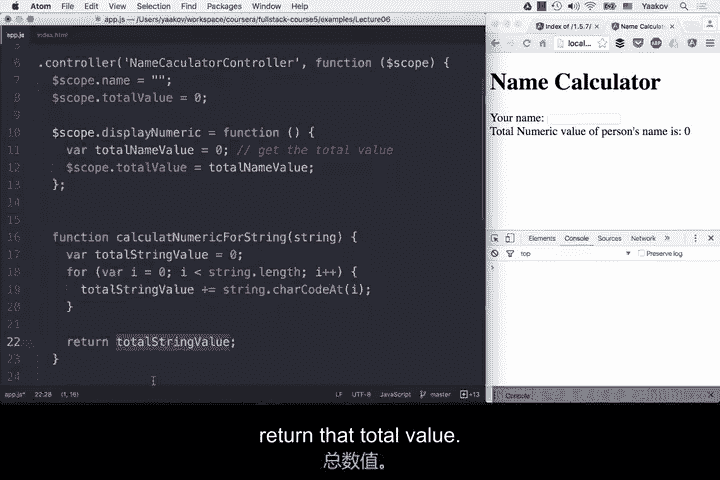
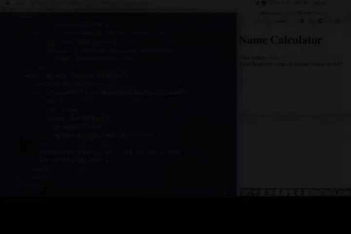

# 014：在AngularJS中实现名称计算器示例 🧮


## 概述
在本节课中，我们将回顾最初编写的应用程序，并使用 AngularJS 重写整个程序。我们将看到模型-视图-视图模型（MVVM）架构的概念在我们的代码中生动地体现出来。

## 项目初始化与设置
上一节我们介绍了 AngularJS 的基本概念，本节中我们来看看如何搭建一个具体的应用。

目前，我位于编辑器中的 `lecture 06` 文件夹，该文件夹位于 `fullstack-course5-examples` 目录下。可以看到，我已经在 HTML 文件中进行了一些设置，并且浏览器已经可以显示我的 HTML 页面。

现在，让我关闭文件浏览器，专注于编辑器。可以看到，我们已经在此处设置了 AngularJS，并且在 `app.js` 中也进行了配置。其余的 HTML 内容目前相当简单，只有一个 `<h1>` 标题“Name Calculator”和一个作为输入字段的文本框。

## 创建 AngularJS 模块和控制器
接下来，我们转到 `app.js` 文件并启动我们的应用程序。

我已经为自己预设了立即调用函数表达式（IIFE）并使用了严格模式，以避免犯错。首先，我要创建一个 Angular 模块。创建模块的方法是调用 `angular.module`，我们将其命名为 `NameCalculator`。

```javascript
angular.module('NameCalculator', []);
```

至于依赖项，它没有任何依赖，所以我们将其留空。

然后，我们将创建控制器，并将其命名为 `NameCalculatorController`。负责该控制器的函数将在此处定义。

```javascript
angular.module('NameCalculator', [])
.controller('NameCalculatorController', function($scope) {
  // 控制器逻辑将在这里编写
});
```

我们在此处指定了 `$scope`，这个对象将用于与我们的视图（即 `index.html`）进行通信。到目前为止，我们已经声明了模块和控制器。

## 将模块和控制器绑定到视图
现在我们需要做的是将它们连接到我们的视图 `index.html` 中。

我们指定 `ng-app` 的地方是整个应用程序的入口点。只要它在我们将要绑定的控制器之上，并且包含我们将要处理的一大块 HTML，具体放在哪里并不重要。通常我们可以将其放在 `<html>` 标签上，但这次让我们稍微改变一下，将其放在 `<body>` 标签本身。

```html
<body ng-app="NameCalculator">
```

现在，`NameCalculator` 这个模块已经绑定到 `<body>` 标签，因此它控制从 `<body>` 开始到结束的所有内容。

在这里，我们有几个 `<div>` 标签。我们将 `ng-controller` 绑定到其中一个上。

```html
<div ng-controller="NameCalculatorController">
```

编辑器在这里给了我一些提示。保存后，应该没有错误。现在我们已经将两者绑定在一起了。

## 在控制器和视图之间共享数据
我们希望在我们的控制器和视图之间共享一些数据。一是要输入姓名的人的名字，二是要显示的初始值。

因此，我们在控制器中定义 `$scope.name` 并初始化为空字符串，同时定义 `$scope.totalValue` 并初始化为 0。

```javascript
$scope.name = "";
$scope.totalValue = 0;
```

保存后，我们现在可以直接在 HTML 页面上输出这些值。转到 `index.html`，我们可以这样写：

```html
<p>Total numeric value of person's name is: {{totalValue}}</p>
```

一旦我们这样做，`totalValue` 现在显示为 0，因为它从我们的 `$scope` 中获取了这个 0。

我们还没有真正绑定 `name`，所以现在让我们来做这件事。在 HTML 中，我们希望将 `name` 绑定到输入元素。我们通过 `ng-model` 指令来实现这种绑定。

```html
<input type="text" ng-model="name">
```

随着输入框中的名字变化，我们 `$scope` 对象中的 `name` 也会随之改变。如果我们想验证这一点，可以快速在这里再放一个值 `{{name}}`，然后当我们在这里输入时，该值将显示在总数值下方。验证完毕后，我们可以移除它。

## 实现动态计算功能
我们需要某种方式让控制器知道，每次用户按下按键时，我们都应该查看模型（即我们的 `name`），重新计算总值，并通过更新 `$scope` 来输出这个总值。

我们可以通过 `ng-keyup` 指令来实现。我们将绑定一个作用域上的函数，我们称之为 `displayNumeric`。

```html
<input type="text" ng-model="name" ng-keyup="displayNumeric();">
```

保存后，由于我们尚未定义此函数，因此不会发生任何事情。现在让我们转到 `app.js`，在 `$scope` 上定义 `displayNumeric` 函数，使其对视图可见。

```javascript
$scope.displayNumeric = function() {
  var totalNameValue = 0; // 获取总值
  // 计算逻辑将放在这里
  $scope.totalValue = totalNameValue;
};
```

剩下的就是实际计算它。让我们编写一个函数来完成这个任务。我们将编写一个常规函数，称之为 `calculateNumericForString`，并传递一个字符串给它。

```javascript
var calculateNumericForString = function(string) {
  var totalStringValue = 0;
  for (var i = 0; i < string.length; i++) {
    totalStringValue += string.charCodeAt(i);
  }
  return totalStringValue;
};
```

这段代码所做的是：从 0 开始，遍历字符串，对于字符串中的每个位置，找出其字符代码，将其加到总值中，然后返回该总值。

现在，我们只需要在 `displayNumeric` 函数中调用它，而不是使用 0。我们将调用该函数，并将 `$scope.name` 传递给它，因为这将随着我在这里输入内容而更新。



```javascript
$scope.displayNumeric = function() {
  var totalNameValue = calculateNumericForString($scope.name);
  $scope.totalValue = totalNameValue;
};
```

一旦我们计算出该数值，它将保存在 `totalNameValue` 变量中，然后我们将其复制到 `$scope` 中，这将自动更新视图中的 `totalValue`。

保存后，现在如果我们开始在这里输入，例如输入我的名字，你会看到随着我输入或删除内容，数值会自动变化。

## 设计视角的代码回顾
让我们从设计角度再看一下我们的代码。在我们的 `app.js` 中，我们从未真正触及视图，也没有尝试弄清楚视图是如何实现的。视图中甚至没有任何 ID。

我们所做的是声明性地说明这个输入字段应该绑定到视图模型（即我们的控制器）中 `$scope` 上的 `name`。每当有事件发生（即有人按下或释放按键）时，它应该调用这个同样绑定到我们视图模型（即控制器，特别是 `$scope`）的函数。

这为我们的视图或 HTML 提供了很大的灵活性。我们可以随意改变整个结构，而功能完全不受影响。换句话说，无论你最终如何显示该名称的数值，或者如何从用户那里获取名称，`app.js` 中的代码都将保持不变。



## 总结
本节课中，我们一起学习了如何使用 AngularJS 重构一个简单的名称计算器应用。我们实践了创建模块和控制器、进行数据绑定、以及通过指令响应用户事件。核心在于理解了 MVVM 模式如何通过 `$scope` 实现模型与视图的分离，从而提高了代码的灵活性和可维护性。