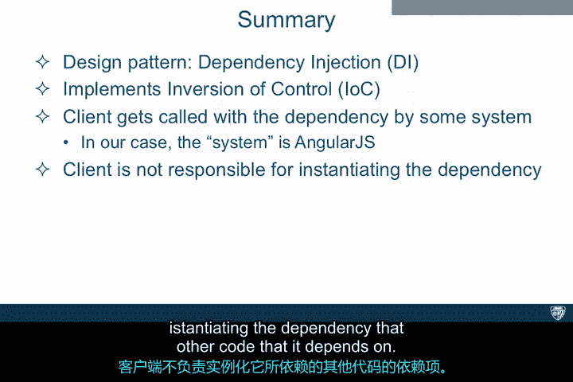

# 016：依赖注入

在本节课中，我们将学习另一个在 AngularJS 中广泛使用的重要概念——依赖注入。

## 概述

在本节中，我们将探讨依赖注入的概念。我们将了解它是什么，为什么它很重要，以及 AngularJS 如何利用它来帮助我们构建更灵活、更易测试的应用程序。

## 什么是依赖注入

我们已经见过在 AngularJS 中创建模块和控制器的模式。控制器函数接收一个 `$scope` 对象。这个 `$scope` 对象是一个复杂的对象，它是由 AngularJS 为我们实例化并提供的。我们获取这个对象的方式，就是通过依赖注入。

所以，依赖注入是另一个设计模式。我们已经见过模型-视图-视图模型模式，现在又有了依赖注入。它是一种实现“控制反转”以解决依赖关系的设计模式。

## 理解控制反转

为了理解控制反转的含义，让我们看一个购物车的例子，看看通常是如何构建组件的。

常规的控制方式是：如果我们有一个购物车模块，我们可以有一个单独的模块叫做 `CardProcessingBank1`，用于处理特定银行的信用卡交易。它有一个 `charge` 方法，接收信用卡号和金额。我们为特定银行创建这个模块，是因为每个银行可能有特定的 URL 和 API。

我们不希望将所有代码直接塞进购物车模块，因为那样购物车模块会与特定银行的 API 紧密耦合。我们不希望这样。

通常，我们会在购物车模块内部实例化信用卡处理模块，然后调用它的 `charge` 方法。从图中可以清楚地看到，购物车模块依赖于 `CardProcessingBank1` 模块。

但是，如果明天我们决定换一家银行，或者因为手续费更低而想使用另一家银行，会发生什么？我们就必须编写另一个 `CardProcessingBank2` 模块，它也有相同类型的 `charge` 方法。这意味着我们的购物车代码必须稍作修改，在实例化信用卡处理模块时，需要创建 `CardProcessingBank2` 的实例。

这里存在一个大问题：我们必须更改购物车内部的代码。仅仅因为我们更换了处理信用卡的银行，就需要修改购物车代码，这再次形成了紧耦合。

## 测试带来的问题

如何测试购物车？假设购物车只有几个简单的方法，如 `addToCart` 和 `removeFromCart`。在这种场景下，为了测试购物车是否能正确地向数组添加或移除商品、计算总价和税费等，你不得不实例化一整套信用卡处理系统。这很不合理。

当然，我们可以创建一个假的信用卡处理模块，并在购物车中实例化它。但这又要求我们更改购物车内部的代码。为了测试而临时更改我们正在测试的函数内部的代码，似乎是一个倒退且糟糕的主意。谁能保证我们在为测试更改代码，然后再改回去的过程中不会出错？

## 解决方案：控制反转

解决方案就是控制反转。在这种方法中，我们的购物车函数或模块接受一个信用卡处理模块作为参数。我们仍然会调用该信用卡处理模块的 `charge` 方法，但现在使用的是从外部传入的实例。

我们仍然可以有那些独立的模块，但在这个案例中，某个更上层的系统将负责实例化信用卡处理模块。例如，系统会实例化 `CardProcessingBank1`，然后调用购物车模块，并将这个新实例传递给它。

在这种场景下，如果我们需要换一家银行进行信用卡处理，购物车代码完全不需要改动。这就是为什么控制反转有时被戏称为“别打电话给我们，我们会打给你”。因为正如你所见，购物车不再主动调用并实例化信用卡处理模块；相反，系统会调用购物车模块，并向其提供要在内部使用的信用卡处理实例。

## 总结

本节课中我们一起学习了另一个名为依赖注入的模式，简称 **DI**。它实现了一种称为控制反转的方法，通常缩写为 **IoC**。

在这种方法中，客户端（如我们的控制器或服务）的依赖项由其他系统（在 AngularJS 中就是框架本身）调用时提供。其核心要点在于，客户端不负责实例化它所依赖的其他代码。

通过依赖注入，我们能够编写出更松耦合、更易维护和测试的代码，这是构建健壮 AngularJS 应用的关键。

