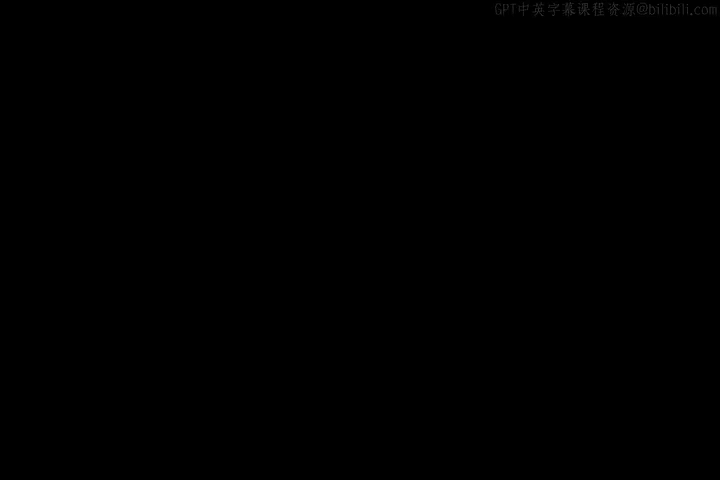
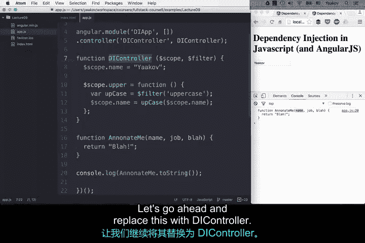
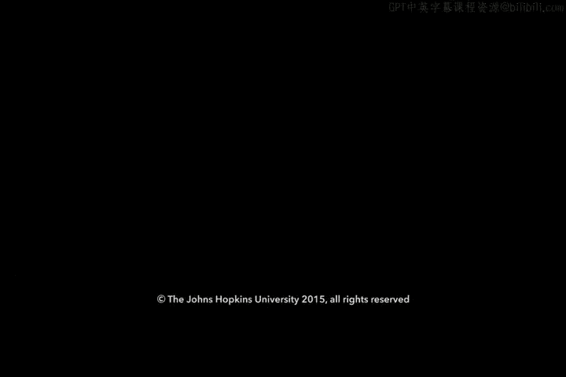

# 017：依赖注入在 JavaScript 中的工作原理 🔧




在本节课中，我们将要学习依赖注入在 JavaScript 中的具体实现原理，特别是 AngularJS 是如何实现这一机制的。我们将通过构建一个简单的应用，并探索 AngularJS 的一些特殊服务来揭示其背后的“魔法”。

---

## 理解依赖注入的实现

上一节我们介绍了依赖注入的基本概念，本节中我们来看看如何通过代码实现它。我们将构建一个简单的 AngularJS 应用，并探索几个关键的 AngularJS 服务。

首先，我们位于 `lecture 09` 文件夹中，这里有一个非常简单的应用。目前，我们只是实例化了一个名为 `Dapp` 的应用，并将其绑定到 HTML 元素上。同时，我们定义了一个名为 `DIController` 的控制器。

在控制器中，我们将 `scope` 服务的 `name` 属性绑定到视图模型上。`scope` 是连接视图模型（ViewModel）和视图（HTML）的“胶水”。

```javascript
angular.module('Dapp', [])
.controller('DIController', DIController);

function DIController($scope) {
  $scope.name = "Yaakov";
}
```

在 HTML 中，我们通过 `ng-model` 指令将输入框与 `$scope.name` 进行双向绑定。

---

## 引入过滤器服务

接下来，我们希望实现一个功能：当输入框失去焦点时，其中的文本自动转换为大写。为此，我们将引入另一个 AngularJS 服务：`$filter`。

我们可以像注入 `$scope` 服务一样，将 `$filter` 服务注入到控制器中。`$filter` 服务用于创建格式化数据的函数。

以下是实现步骤：

1.  在控制器函数中添加 `$filter` 参数。
2.  在 `$scope` 上创建一个名为 `upper` 的函数。
3.  在这个函数内部，使用 `$filter` 服务获取一个名为 `uppercase` 的过滤器函数。
4.  使用这个过滤器函数来更新 `$scope.name` 的值。

```javascript
function DIController($scope, $filter) {
  $scope.name = "Yaakov";

  $scope.upper = function() {
    var upCase = $filter('uppercase');
    $scope.name = upCase($scope.name);
  };
}
```

在 HTML 中，我们使用 `ng-blur` 指令来绑定 `upper` 函数。

```html
<input type="text" ng-model="name" ng-blur="upper()">
```

现在，当你在输入框中输入文本并移开焦点时，文本会自动转换为大写。

---

## 揭秘依赖注入的“魔法”

现在，核心问题依然存在：AngularJS 是如何知道应该在何处注入 `$scope` 和 `$filter` 服务的呢？

为了理解这一点，我们先来看一个普通的 JavaScript 函数。

```javascript
function annotateMe(name, job, blah) {
  return "blah";
}
console.log(annotateMe.toString());
```

如果你在控制台打印这个函数的字符串形式，你会得到包含整个函数定义的字符串。这个字符串包含了参数名 `name`、`job`、`blah`。

这意味着，如果我们解析这个字符串，就可以提取出参数的名称。AngularJS 正是这样做的：它解析控制器函数的字符串表示，提取参数名，然后在其内部的服务注册表中查找匹配的服务，最后在调用函数时将这些服务作为参数传入。

---

## 使用 $injector 服务



AngularJS 中负责这项工作的服务是 `$injector`。我们甚至可以将其注入到控制器中，并查看它的功能。

`$injector` 服务有一个 `annotate` 方法，它可以返回一个函数的所有参数名称组成的数组。

```javascript
function DIController($scope, $filter, $injector) {
  // ... 控制器逻辑 ...

  console.log($injector.annotate(DIController));
}
```

运行上述代码，控制台将输出 `['$scope', '$filter', '$injector']`。这就是 AngularJS 内部用来确定依赖关系并执行注入的机制。依赖注入的“魔法”就此揭晓。

---

## 总结



本节课中我们一起学习了依赖注入在 JavaScript 和 AngularJS 中的工作原理。我们通过一个简单的应用，实践了如何注入 `$scope` 和 `$filter` 服务。更重要的是，我们揭示了 AngularJS 实现依赖注入的核心机制：通过 `$injector` 服务解析函数参数，并动态注入相应的服务实例。理解这一原理，有助于我们更好地使用和调试 AngularJS 的依赖注入功能。