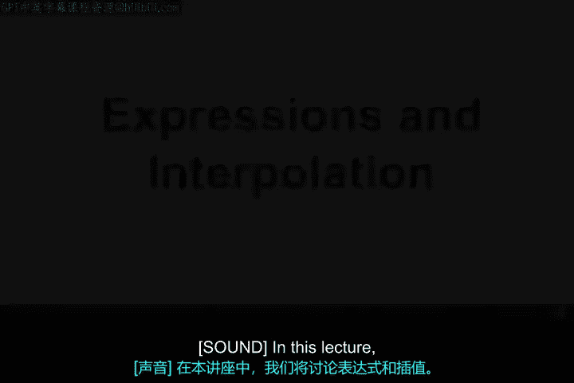
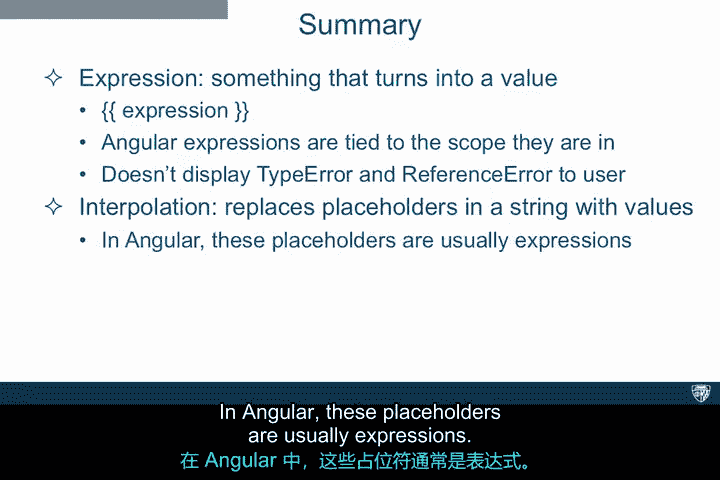

# 019：表达式和插值





在本节课中，我们将要学习表达式和插值。

## 什么是表达式？🤔

表达式是能够被求值为某个值的代码片段。在 Angular 中，我们已经见过表达式，它们就是位于双大括号 `{{ }}` 中的内容。这些双大括号有时也被称为“胡须”或“把手”。

Angular 会处理这些表达式。你可以将它们粗略地理解为类似于在 JavaScript 中调用 `eval()` 的结果，但在几个关键方面有所不同。

首先，表达式在**作用域**的上下文中执行。这个作用域就是我们一直在说的 `$scope`。表达式可以访问放置在 `$scope` 上的属性。

其次，如果表达式求值过程中发生类型错误或引用错误，Angular 不会抛出这些错误，而是简单地显示一个空字符串或空值。

此外，与 `eval` 语句不同，Angular 表达式中不允许使用控制流函数，例如 `if` 语句等。

表达式还可以接受一个**过滤器**或过滤器链，以特定方式格式化字符串输出。我们将在后续课程中详细学习过滤器。

## 什么是插值？🔗


“插值”这个术语是计算机科学中的一个专业说法，指的是处理包含一个或多个占位符的字符串字面量的过程，这些占位符随后会被实际值替换。

简单来说，你有一个包含某种占位符的字符串，解析这个字符串，找到这些占位符，并用与占位符名称对应的值替换它们。

例如，在 Angular 中，字符串 `"Message: {{ message }}"`，假设 `message` 属性等于 `"hello"`，就会被插值为 `"Message: hello"`。

这里有一个重要的注意事项：`message` 变量（或属性）仍然连接到作用域上的原始 `message` 属性。如果作用域（即 `$scope`）中的 `message` 以任何方式被其他过程更改，插值的结果也会随之改变。

## 代码示例演示 💻

现在，让我们跳转到代码编辑器，看看一些具体的例子。


我回到了编辑器，位于 `lecture11` 文件夹的 `fullstack-course5-examples` 目录中。这里的设置与我们之前看到的非常相似。

我们有一个 `index.html` 文件，一个驱动应用的 `app.js` 文件，以及 `angular.min.js`。

让我们看看 `index.html` 中的内容。我们使用 `ng-app` 指令设置了名为 `MsgApp` 的应用，并使用 `ng-controller` 指令设置了一个名为 `MsgController` 的控制器，它控制着这一块 HTML。

在 `app.js` 中，我们创建了模块 `MsgApp`，并注册了一个控制器，其驱动函数是 `MsgController`。为了防止代码压缩时出现问题，我们为控制器函数对象附加了一个 `$inject` 属性。

目前，我们只是在 `$scope` 服务上放置了一个 `name` 属性，并将其设置为字符串 `"Yaakov"`。

我们已经见过这种插值和表达式求值。在 HTML 中，我们可以直接写 `{{ name }}`。保存后，由于浏览器同步工具在工作，页面会更新为显示 `"Yaakov"`。

但我们能做的远不止这些。我们还可以在 `$scope` 服务上定义一个方法或函数，然后在表达式中使用它。

让我们在控制器中定义一个函数：
```javascript
$scope.sayMessage = function() {
    return "Yaakov likes to eat healthy snacks at night!";
};
```

定义完成后，我们可以回到 `index.html`，并写下 `{{ sayMessage() }}`。注意，因为这是一个函数，我们需要加上括号来调用它。保存后，页面会显示 `"Yaakov likes to eat healthy snacks at night!"`。

实际上，Angular 正在评估位于 `ng-controller` 开始和结束标签之间的字符串，并对它们进行插值。换句话说，它寻找这些占位符并对其进行求值。在这个例子中，它求值的是一个函数调用。

如果你查看页面源代码（不是开发者工具中的“元素”面板，而是原始的 HTML 源代码），你会看到 `ng-controller` 内的原始状态仍然是 `{{ sayMessage() }}`。但如果你查看“元素”面板，你会看到它已经被替换为实际的字符串值，并与周围的文本连接在一起。

我们可以连接多个占位符。例如，我们可以写：
```html
{{ name }} has a message for you: {{ sayMessage() }}
```
保存后，页面会显示 `"Yaakov has a message for you: Yaakov likes to eat healthy snacks at night!"`。你可以看到，所有这些字符串被连接在一起，形成了这个 `div` 元素的内容。

之前提到过，如果表达式求值导致引用错误或类型错误，Angular 不会抛出错误，而是输出空值。让我们来测试一下，将表达式改为一个不存在的属性，例如 `{{ someNonsense }}`。

保存后，你会发现页面上没有显示任何错误信息，完全是空白的。查看“元素”面板，你会发现那里什么都没有。因为 `someNonsense` 在作用域上不存在，求值出错，Angular 就将其渲染为空。

当我们改回正确的表达式时，页面内容又会正常显示。

## 总结 📝


本节课中我们一起学习了 Angular 中的表达式和插值。

我们首先介绍了表达式。表达式是能求值为某个值的代码片段，在 Angular 中用双大括号 `{{ }}` 表示。Angular 表达式与它们所在的作用域紧密绑定，可以访问该作用域上的属性。一个重要的特性是，Angular 表达式不会向用户显示类型错误或引用错误，这非常有用，因为你肯定不希望错误信息直接出现在 HTML 页面上。

接着，我们探讨了插值。插值是一个处理字符串字面量中占位符的过程，会用实际值替换这些占位符。在 Angular 中，这些占位符通常是表达式。当占位符的值（即作用域上的属性）发生变化时，插值的结果会自动更新，这是 Angular 数据绑定的核心优势之一。

通过实际的代码示例，我们演示了如何在 HTML 中使用简单的属性插值、调用作用域上的函数，以及 Angular 对错误表达式的静默处理。





