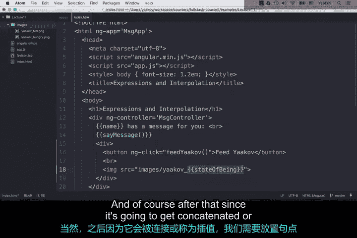
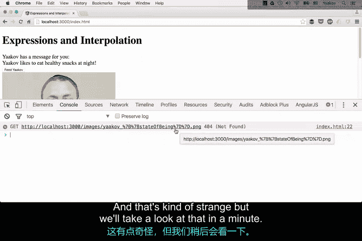
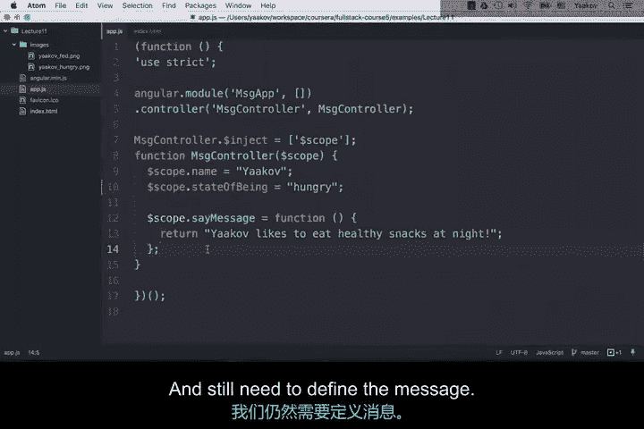
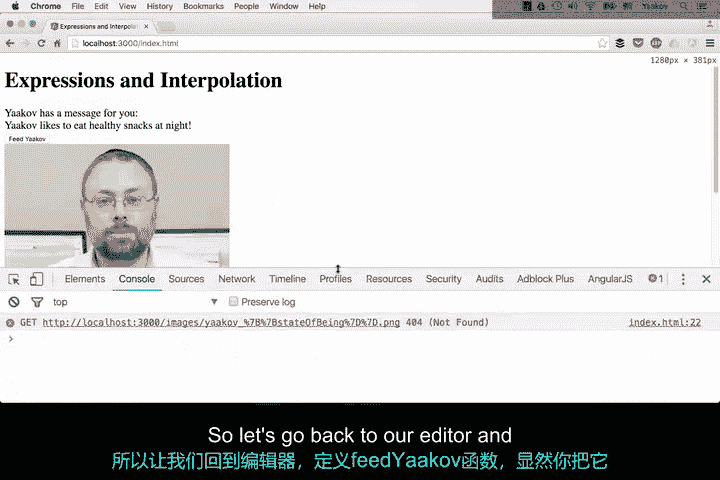
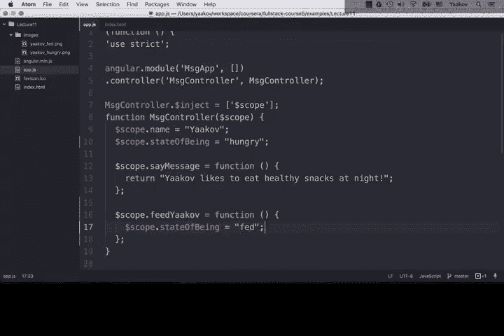
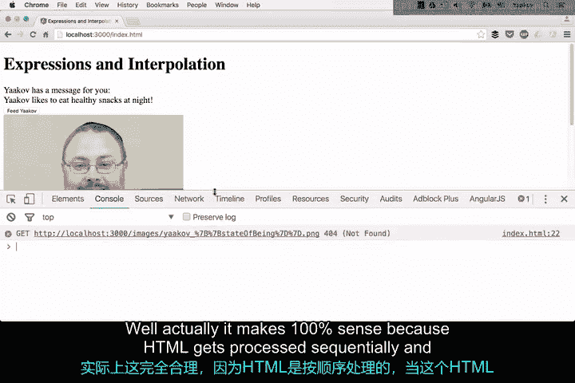
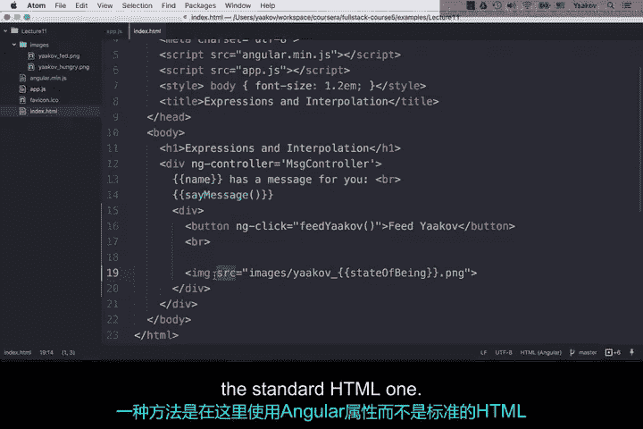
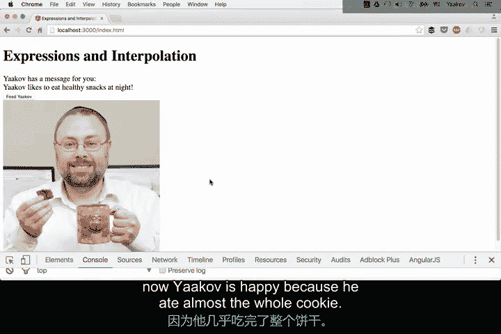
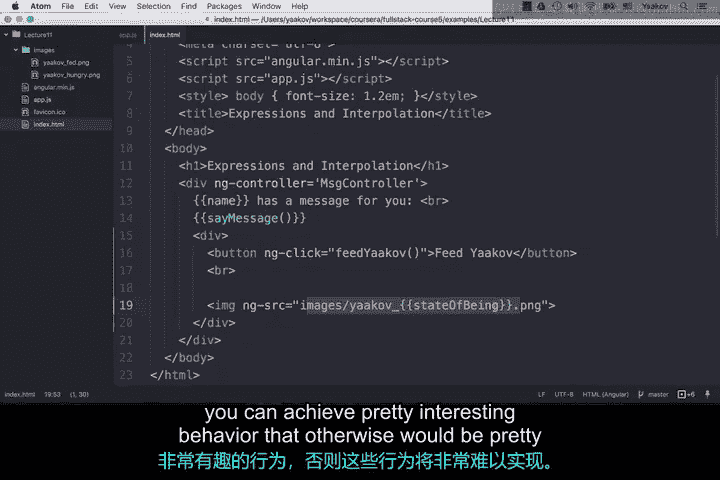

# 020：表达式和插值

在本节课中，我们将学习如何在 AngularJS 中使用表达式和插值，实现动态更新网页内容的功能。我们将通过一个有趣的示例——一个可以“喂食”并改变状态的图片应用，来演示表达式不仅可以在标签内容中使用，还可以在标签属性中使用。

---

在上一讲的第一部分，我们创建了一个消息应用，它能够使用插值和表达式来输出一些我们在控制器内的 `$scope` 上设置的消息。现在，我们将展示一个更有趣的示例，同时演示表达式不一定只能放在标签体内，它们也可以成为标签属性的一部分。使用这种技术，可以实现非常巧妙的效果。

我仍然位于课程 `lecture11` 文件夹的 `fullstack-course5/examples` 目录中。我添加了两张图片：`yaakov_hungry.png` 和 `yaakov_fed.png`。我们将创建一个 `div`，请注意这个 `div` 位于带有 `ng-controller` 属性的 `div` 内部，这是为了与特定控制器的 `$scope` 进行通信。

我们在这里创建一个新的 `div`，只是为了在视觉上将之前的信息与我们即将实现的功能分开。

我们的目标是：在网页上显示一张图片，图片内容是“饥饿的 Yaakov”。然后，我们将添加一个写着“喂食 Yaakov”的按钮。点击该按钮后，图片应切换为另一张图片，即“吃饱的 Yaakov”。换句话说，Yaakov 已经被喂饱了。

我们将从创建一个按钮开始。按钮的文字是“喂食 Yaakov”。对于这个按钮的点击事件，我们希望由 Angular 和控制器来处理，因此我们将使用 `ng-click` 指令。在 `ng-click` 中，我们指定要触发的功能，即切换或更改图片。我们将调用一个名为 `feedYaakov` 的函数，这个函数稍后需要实现。

现在，我们可能需要一个换行，通常我会进行样式设计，但目前我们专注于功能，所以简单的换行就足够了。

接下来，我们需要为图片创建一个占位符。我们将使用 `img` 标签，暂时不写 `alt` 属性。`src` 属性将指向 `images/` 目录，后面跟着 `yaakov_`。这里的关键是我们不知道要显示哪张图片，我们想显示反映 Yaakov 状态的图片。Yaakov 最初可能是饥饿的，然后被喂饱。因此，我们需要在这里使用表达式。我们将使用 `stateOfBeing` 这个变量来表示 Yaakov 的状态。这个表达式将被插值到字符串中，最终形成完整的图片路径，例如 `yaakov_hungry.png` 或 `yaakov_fed.png`。

让我们看看网页。可以看到“喂食 Yaakov”按钮，但出现了一个错误。这是合理的，因为我们还没有图片，这只是一个表达式，我们还没有在 `$scope` 上设置这些变量。

我们需要回到代码编辑器，定义 `stateOfBeing` 属性和 `feedYaakov` 函数。让我们打开 `app.js`，在 `$scope` 上添加一个名为 `stateOfBeing` 的属性，并将其初始值设为 `"hungry"`。

保存后，快速查看网页，现在图片应该显示出来了。我们看到的是 `yaakov_hungry.png` 图片。但我们仍然看到一个 404 错误，因为它找不到图片，这有点奇怪，我们稍后会检查。

回到编辑器，我们仍然需要定义 `feedYaakov` 函数。我们需要将其放在 `$scope` 上。这个函数的作用是在点击后，将 `stateOfBeing` 变量的值切换为 `"fed"`。

保存后，回到浏览器。当我们点击“喂食 Yaakov”按钮时，不同的图片显示出来，Yaakov 看起来很开心，饼干几乎被吃完了。

但奇怪的是，查看控制台，我们仍然看到 404 错误，提示图片未找到。为什么这张图片找不到呢？这完全合理，因为 HTML 是按顺序处理的。当浏览器逐行处理这个 HTML 页面时，在处理到 `img` 标签这一行时，我们的 `stateOfBeing` 还没有被定义。实际上，AngularJS 还没有处理这段 HTML，还没有查找这些占位符并用值替换这些表达式。因此，浏览器尝试从这个 URL 获取图片，而这个 URL 仍然包含 `{{` 和 `}}`，所以是无效的，导致了 404 错误。一旦 Angular 处理了这部分，它就会用正确的 URL 替换这个占位符，我们就能看到图片，但控制台中的 404 错误信息仍然存在。

我们如何解决这个问题呢？使用常规的 HTML 技巧无法解决，但可以使用 Angular 来解决。我们需要以某种方式告诉浏览器不要立即尝试获取这个 URL，而是只在 Angular 准备好解释这些占位符时才获取。一种方法是在这里使用 Angular 的属性，而不是标准的 HTML 属性。这个 Angular 属性就是 `ng-src`。

保存后，回到网页，现在没有错误了。因为图片只在 Angular 获取到这个 HTML 并将所有表达式转换为它们的值之后才被获取。现在，刷新页面以确保，即使浏览器同步正在工作，你也能看到拿着饼干的 Yaakov。点击“喂食 Yaakov”按钮，保存在 `$scope` 上的 `stateOfBeing` 变量将其值更改为 `_fed`，现在 Yaakov 很开心，因为他几乎吃掉了整个饼干。

---

在本讲的这一部分，我们并没有看到什么全新的内容，但你看到了表达式的另一种用法或思路。由于你甚至可以在属性值中使用表达式，因此可以实现一些非常有趣的行为，而这些行为在其他情况下可能很难实现。

本节课中，我们一起学习了：
1.  如何在 HTML 标签属性（如 `src`）中使用 AngularJS 表达式。
2.  如何使用 `ng-click` 指令绑定点击事件到控制器中定义的函数。
3.  如何通过改变 `$scope` 上的数据，动态更新视图（如图片）。
4.  使用 `ng-src` 替代 `src` 属性，以避免因表达式未及时解析而导致的 404 错误。

通过这个简单的“喂食 Yaakov”示例，我们巩固了表达式和插值的概念，并展示了它们在构建交互式 Web 应用中的强大能力。