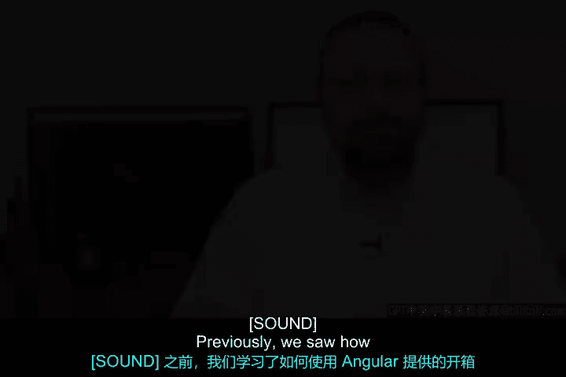
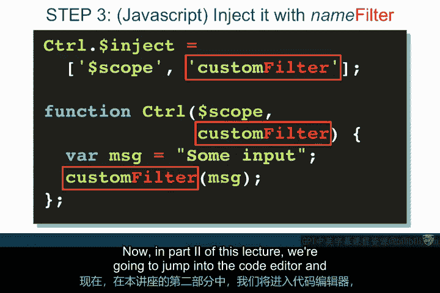

# 024：创建自定义过滤器 🎼

在本节课中，我们将要学习如何创建自定义过滤器。之前我们已经了解了如何使用 Angular 内置的过滤器，但这并不总是能满足需求。因此，本节将详细介绍创建自定义过滤器的步骤和原理。

## 概述

之前我们学习了如何使用 Angular 提供的开箱即用的过滤器，但这并不总是足够的。因此，在本讲中，我们将学习如何创建我们自己的自定义过滤器。这个过程包含几个关键步骤。

## 创建自定义过滤器的步骤

以下是创建自定义过滤器需要遵循的几个核心步骤。

### 第一步：定义过滤器工厂函数

首先，我们需要定义过滤器工厂函数。顾名思义，这实际上是**工厂设计模式**的一个例子。工厂是代码中的一个中心位置，用于生产新的对象或函数。在我们的例子中，这个名为 `customFilterFactory` 的工厂函数，会为整个过滤机制生产出我们的过滤函数。

为了让 AngularJS 正常工作，我们需要创建一个能生产过滤函数的工厂。至少，过滤函数本身需要接收一些输入作为参数，然后通常返回该输入的某个处理后的版本，也就是过滤后的输出。

### 第二步：向模块注册过滤器工厂

第二步是向我们的模块注册这个过滤器工厂。我们注册控制器的方式非常相似。对于控制器，我们在模块上调用 `.controller` 方法，并给它一个名称和一个负责控制器的函数。对于过滤器，我们在模块实例上调用 `.filter` 方法，指定过滤器的名称，并引用负责创建过滤函数的过滤器工厂函数。

过滤器名称必须是有效的 AngularJS 表达式标识符。一个安全的命名方式是使用任何在 JavaScript 中有效的变量名。而工厂函数本身的名称（例如 `customFilterFactory`）可以任意选择，它与我们在 AngularJS 中注册工厂时使用的名称没有关联。然而，将它们命名为相似的名称是个好习惯，以免日后混淆。

### 第三步：注入并使用过滤器

现在，我们需要将过滤器注入到我们计划使用它的任何组件中。在这个例子中，我们计划在控制器内部（也就是直接在 JavaScript 中，而不是在 HTML 中）使用它，因此我们需要将它注入到控制器函数中。

我们按照之前常用的方式来完成注入：在控制器函数的 `$inject` 属性数组中添加一个值，然后在定义控制器函数时，在相同位置将其指定为一个参数。

显然，注入过滤器的最终目的是使用它。在最后一行代码中，你可以看到我们使用了自定义过滤器，并将我们的消息作为输入传递给它。

**请注意**：我们注入的过滤器名称，并不是我们注册工厂时使用的名称。实际上，我们使用的名称是原始注册的名称加上单词 `filter`，如红色部分所示。

**同时请注意**：与我们之前见过的 `$filter` 服务不同，调用 `customFilter` 实际上是调用了过滤函数。如果你还记得，调用 `$filter` 服务并不会直接调用过滤函数，而只是为我们创建过滤函数。这两点并非巧合。

## 深入理解：工厂与函数

让我们回顾一下。当我们注册过滤器时，我们真正注册的是一个创建过滤函数的工厂。

另一方面，我们之前看到，当你调用 `$filter` 服务并指定你想要实例化的过滤函数（例如 `uppercase`）时，`$filter` 服务会调用 Angular 已经提供的 `uppercase` 过滤器工厂，来创建大写转换过滤函数。

得到过滤函数后，你可以用提供的值来执行它。

然而，当我们将自定义过滤器直接注入到控制器时，Angular 会为我们调用我们注册的过滤器工厂（例如 `customFilterFactory`），并允许我们注入该工厂的产物，也就是工厂返回的任何东西，即我们实际的过滤函数。

在这个过程中，Angular 为我们注入的实际过滤函数命名，使用的名称是我们注册工厂函数的名称加上附加在末尾的单词 `filter`。

所以，如果我们注册了一个名为 `Custom` 的工厂函数，AngularJS 将执行我们的工厂来创建实际的过滤函数，并将其命名为 `CustomFilter`，即在注册的工厂名称末尾附加 `Filter`。

**顺便一提**：因此，在自定义过滤器工厂名称的末尾使用 `filter` 可能是个坏主意。例如，如果你将自定义过滤器工厂函数命名为 `customFilter`，Angular 会在其后附加单词 `filter`，你将被迫使用 `customFilterFilter` 这样的名称来注入它，这有点尴尬，所以请避免这样做。

## 核心步骤回顾

以上是很多背景细节，但它确实有助于你理解正在发生的事情，而不是死记硬背奇怪的规则。内容很多，如果你第一次没有完全理解，建议你回看这部分内容。现在，让我们再次回顾一下基本步骤。

**第一步**：定义我们的过滤器工厂函数。这是一个创建并返回过滤函数实例的函数。

**第二步**：向模块注册我们的过滤器工厂。我们通过调用 `.filter` 方法来完成，给它我们的过滤器名称，并指定负责创建过滤函数的过滤器工厂函数。

**第三步**：至少如果你试图直接在 JavaScript 内部（如在控制器或类似的地方）使用你的过滤器，那么你需要注入该过滤器，注入的名称是你注册的过滤器名称加上附加的单词 `filter`，如本例中的 `customFilter`。

## 总结

本节课中，我们一起学习了创建 AngularJS 自定义过滤器的完整流程。我们首先定义了过滤器工厂函数，然后将其注册到模块中，最后在控制器中注入并使用它。我们还深入探讨了过滤器工厂与 `$filter` 服务之间的区别，以及 AngularJS 内部如何命名和注入这些函数。

在下一部分，我们将进入代码编辑器，亲眼看看这些概念的实际应用。