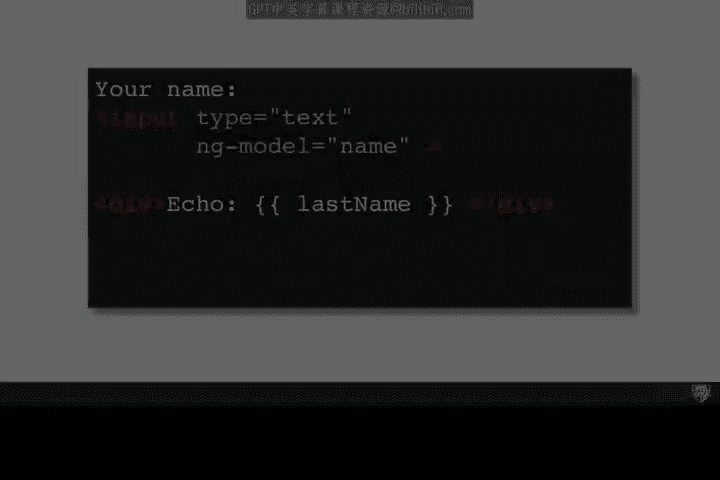
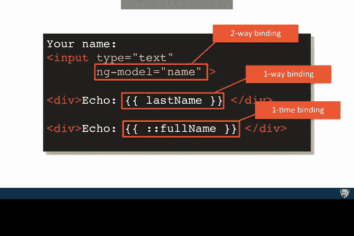
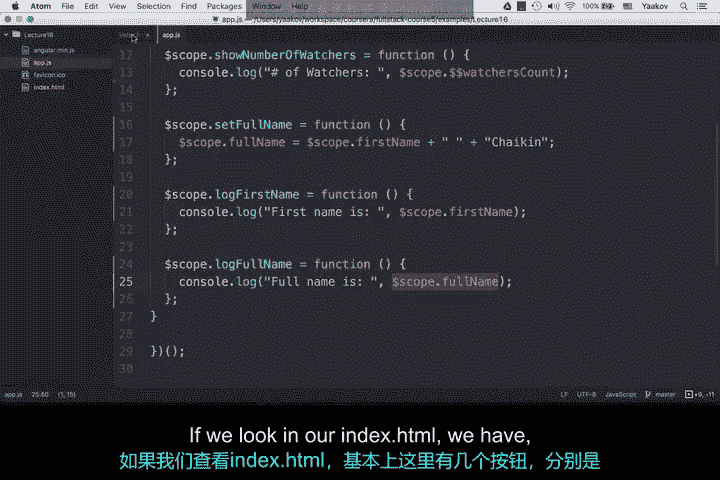
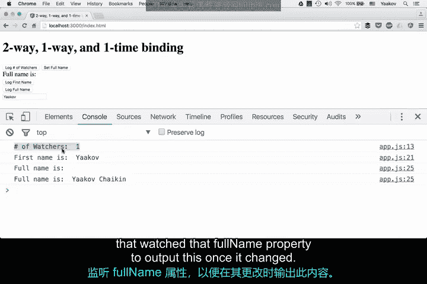
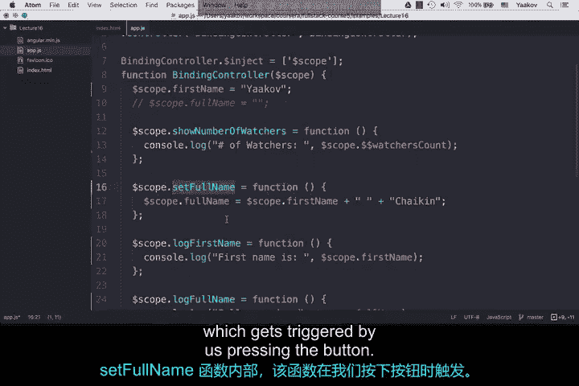
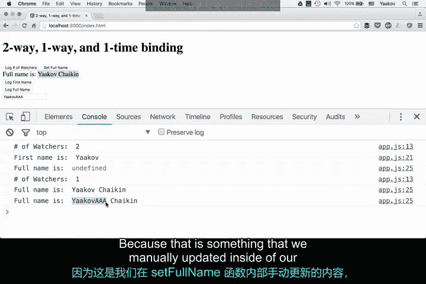
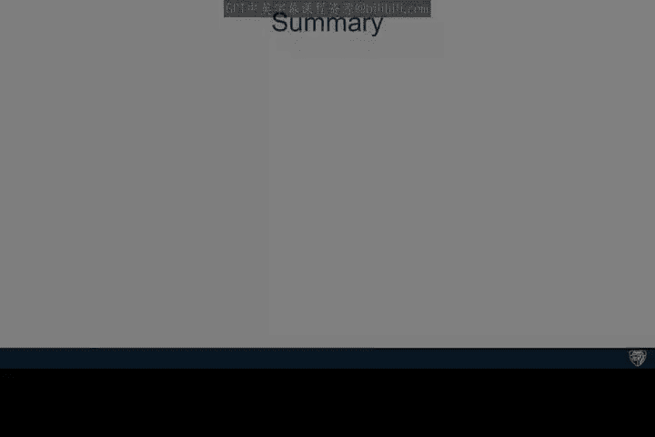
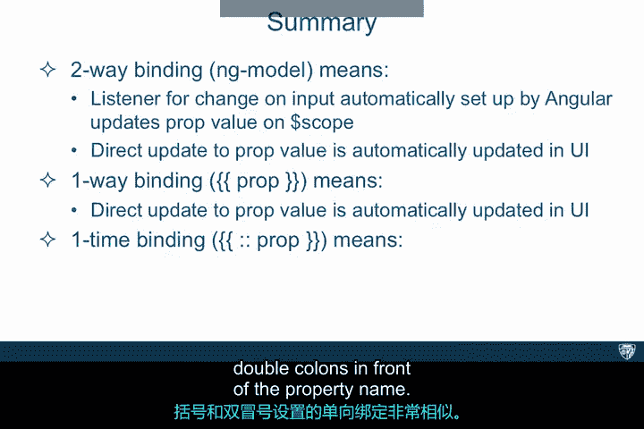

# 031：双向绑定、单向绑定和一次性绑定


## 概述
在本节课中，我们将要学习 AngularJS 中的三种数据绑定策略：双向绑定、单向绑定和一次性绑定。我们将探讨它们的工作原理、区别以及各自的适用场景。



---

## 双向绑定与单向绑定的概念
上一节我们介绍了数据绑定的基础。本节中，我们来看看双向绑定和单向绑定的具体含义。

双向绑定和单向绑定的概念我们已经有所了解。一次性绑定的概念我们将在本讲中更详细地探讨。之后，我们将比较和对比这些不同的绑定策略。

---

## 双向绑定详解
双向绑定的含义是，AngularJS 不仅会为作用域上的属性设置一个监视器，还会在输入元素上设置某种监听器。这样，如果输入元素的值发生变化，该变化会反映在作用域上的属性中。

以下是一个双向绑定的代码示例：
```html
<input ng-model="name">
```

在这个例子中，用户可以通过在文本框中输入来影响 `name` 属性，作用域上的 `name` 属性会随之更新。同样，如果在控制器中更新了 `name` 属性，该值也会自动更新并反映在用户界面上。

---

## 单向绑定详解
单向绑定通常通过双花括号插值实现。以下是单向绑定的代码示例：
```html
<p>{{lastName}}</p>
```

这个值在浏览器中发生变化的唯一方式是控制器内部更新了作用域上的 `lastName` 属性。我们无法直接通过双花括号从浏览器或用户端影响 `lastName` 的值。因此，这是一个单向绑定的例子。

---

## 监视器与性能考量
如果我们设置大量绑定，AngularJS 会为我们创建大量监视器。摘要循环会遍历我们拥有的每个监视器列表，并检查在上一个循环中是否发生了任何变化。

这些循环可能会运行几次。如果拥有成千上万个监视器，显然会花费一些时间，从而导致应用程序性能下降。经验法则是每个页面的监视器不应超过 2000 个。不过，实际数量取决于用户机器的类型、速度和承载能力。



然而，有一点是明确的：在摘要循环期间，最小化监视器列表中活动监视器的数量是可取的。

---

## 一次性绑定介绍
实现这一目标的一种方法是设置一种特殊的一次性绑定。一次性绑定看起来与单向绑定非常相似，只是在属性名称前加上双冒号。

以下是单向绑定和一次性绑定的对比：
*   **单向绑定**：`{{propertyName}}`
*   **一次性绑定**：`{{::propertyName}}`

双冒号告诉 AngularJS，它应该为该属性设置一个监视器，但一旦该属性被初始化，AngularJS 的摘要循环就会启动，更新用户界面中的该属性，重新绘制浏览器，属性值将呈现给用户。此时，AngularJS 会自动移除该特定属性的监视器。

当然，这样做的缺点是这只发生一次。因此，如果在应用程序运行过程中该属性被更新，该更新将不会反映在用户界面中。



然而，对于某些属性，例如用户的完整姓名，在应用程序的整个生命周期中预计不会改变，我们仍然需要能够将其插入到 HTML 模板中，但不需要在应用程序的剩余生命周期内每次都监视和检查该属性。

---

## 代码演示与分析
让我们进入代码编辑器，看看这个概念的实际应用。

我们有一个简单的绑定应用程序。控制器中有几个属性：`firstName` 初始化为 “Yaakov”，`fullName` 初始化为空字符串。

我们还有一个之前见过的函数，用于显示摘要循环中的监视器数量。我们将把它绑定到一个按钮上，以便随时点击查看有多少个监视器。

此外，我们有一个 `setFullName` 函数，它将 `fullName` 属性设置为 `firstName` 加上空格和我的姓氏 “Hikinghen”。这将更新 `fullName` 属性。

在 HTML 模板中，我们有一个使用 `ng-model` 在 `firstName` 属性上设置双向绑定的输入元素。这意味着如果在这里输入内容，`firstName` 属性会随着我们的输入不断更新。



我们还有一个对 `fullName` 的一次性绑定，以及几个用于记录 `firstName` 和 `fullName` 的按钮。

---

## 关键问题与解决方案
如果我们现在点击“显示监视器数量”，会看到监视器数量是 1。这应该让我们稍作停顿。为什么是这样？我们希望这里的 `fullName` 属性能够显示，但只有一个监视器。

如果我们查看 HTML，会发现 `{{::fullName}}` 确实应该创建一个监视器。但结果显示只有一个，这意味着要么这个没有创建监视器，要么发生了其他情况。



让我们记录一下 `firstName`，结果是 “Yaakov”，这符合预期。再记录 `fullName`，目前是空字符串。我们可以设置 `fullName`。点击“设置全名”按钮后，再记录 `fullName`，可以看到它是 “yaakov hikinghen”。但问题是，它仍然没有显示在页面上。为什么？

部分原因我们已经讨论过。我们没有额外的监视器来监视 `fullName` 属性，以便在其更改时输出。让我们回到代码中，看看能否找到这个问题的根源。

如果你看前面，会发现我们已经将 `fullName` 初始化为空字符串。这就是问题的根源。如前所述，一旦一次性绑定的属性被初始化，AngularJS 的摘要循环就会遍历所有监视器，将此值输出到浏览器，然后移除其监视器。这意味着，具有一次性绑定属性的 HTML 模板将永远不会再次更新，因为监视器已不存在。

解决方法是简单地注释掉初始化 `fullName` 的那行代码。这意味着该属性第一次被初始化将是在我们的 `setFullName` 函数内部，该函数由我们按下按钮触发。

保存更改后，回到浏览器，点击“显示监视器数量”，现在情况好多了。现在有两个监视器。记录 `firstName` 是 “Yaakov”，记录 `fullName` 是 `undefined`，这正符合我们此时的期望。因为如果它已经被定义，那就为时已晚，监视器已经被移除了。





现在，如果我们点击“设置全名”，你会看到它立即出现在这里。但如果我们再次点击“显示监视器数量”，它不再是两个，而是一个。因为一旦我们一次性绑定到 HTML 模板，就不再需要那个监视器了。我们可以节省性能，将该监视器从监视器列表中移除。因此，这就是为什么这里只有一个监视器。

与此同时，双向绑定将继续工作。例如，如果我现在记录 `fullName`，它是 “yaakov Hihen”。但是，如果我更新名字，比如在这里输入 “AAA”，这意味着作用域上的 `firstName` 属性会在末尾额外添加三个字母 “A”。如果我此时执行“设置全名”，它将使 `fullName` 属性变为 “yaakov AAA hikinghen”。但这不会改变 HTML 模板中显示的内容，因为那是一次性绑定。然而，`fullName` 属性实际上会包含更新后的 `firstName`，因为这是我们在 `setFullName` 函数中手动更新的。

---

## 总结
本节课中我们一起学习了 AngularJS 的三种数据绑定策略。

*   **双向绑定**：通过 `ng-model` 属性在输入元素上设置。这意味着 AngularJS 会为输入元素的值变化设置监听器，任何变化都会自动更新到作用域上的属性。同时，任何对属性的直接更新也会自动反映在用户界面上。这显然是使用监视器完成的。
*   **单向绑定**：通过属性周围的双花括号自动设置。这只意味着一件事：控制器内部或类似情况下对属性值的直接更新会自动更新到用户界面，并且监视器仍然保留。
*   **一次性绑定**：看起来与单向绑定非常相似，通过属性名称前的双花括号和双冒号设置。这意味着属性的初始值会自动更新到用户界面，然后该属性的监视器会被 AngularJS 自动移除，因此用户界面永远不会再因该属性的任何更新而更新。




通过理解这些绑定策略的区别和适用场景，你可以更有效地构建高性能的 AngularJS 应用程序。