# 033：带过滤器的 ng-repeat 🎼


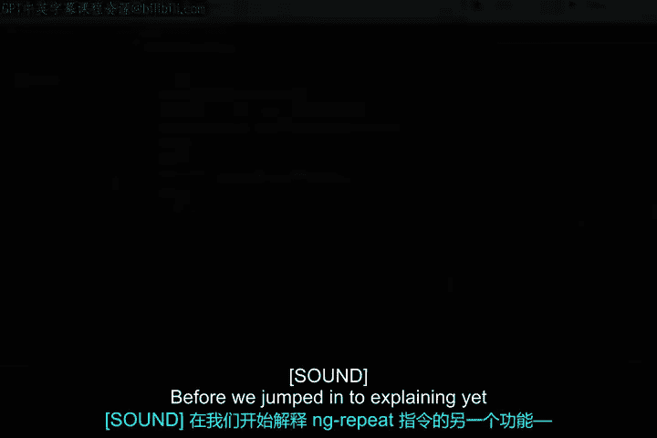


在本节课中，我们将要学习 AngularJS 中 `ng-repeat` 指令的一个强大功能：**过滤器**。我们将从 JavaScript 数组的 `filter` 函数讲起，然后学习如何在 AngularJS 的 `ng-repeat` 中应用内置的 `filter` 过滤器，最终实现一个用户可实时搜索的列表。

在深入讲解 `ng-repeat` 的过滤功能之前，我们先来了解一下 JavaScript 中过滤器的一般概念及其工作原理。

我现在位于 `lecture 18` 文件夹中，该文件夹在 `fullstack-course5` 的 `examples` 目录下。这里有两个额外的文件：`filter.html` 和 `filter.js`。`filter.html` 是一个简单的 HTML 页面，它只需要引入我们的 `filter.js` 脚本。

让我们打开 `filter.js` 文件。目前，它只有一个包含数字 1 到 10 的简单数组，我们只是将这个数组打印到控制台。

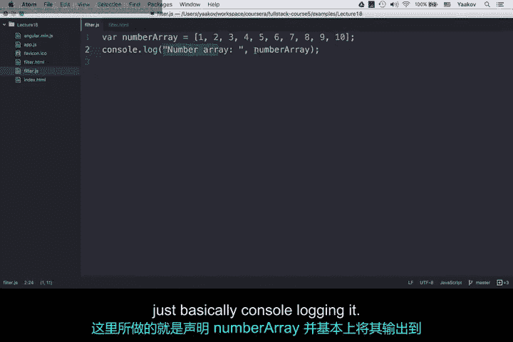

```javascript
var numberArray = [1, 2, 3, 4, 5, 6, 7, 8, 9, 10];
console.log(numberArray);
```

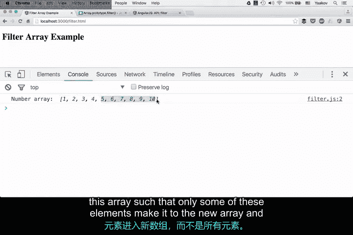

如果我们打开浏览器查看控制台，会看到它确实打印了 1 到 10。

过滤数组的概念是：对数组应用某种函数，使得只有部分元素能进入新数组，而不是全部。

让我们访问 Mozilla 开发者网络，查看数组原型上的 `filter` 函数。`filter` 方法会创建一个新数组，其包含通过所提供函数实现的测试的所有元素。


基本用法是：在原始数组上调用 `filter` 函数，传入一个回调函数和一些可能的额外参数。返回值是一个包含通过测试的元素的新数组。传入回调函数的参数是数组中的每一项。

让我们回到代码编辑器，编写第一个过滤器。

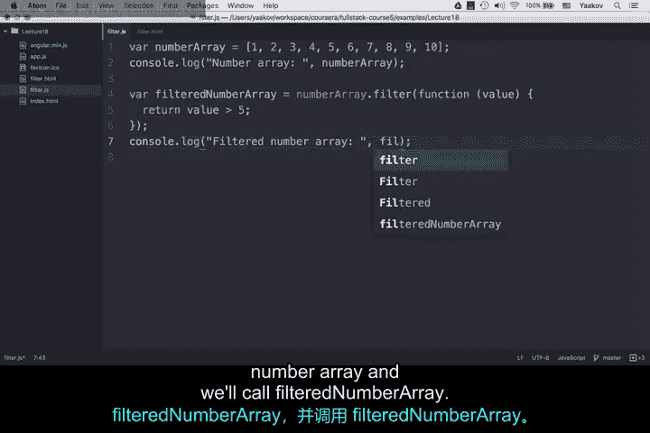

```javascript
var filteredNumberArray = numberArray.filter(function(value) {
    return value > 5;
});
console.log(filteredNumberArray);
```

我们创建了一个新数组 `filteredNumberArray`。我们在原始 `numberArray` 上调用 `filter` 函数，并传入一个匿名函数。这个函数的参数 `value` 是数组中的每一项。函数需要返回一个布尔值，表示该项是否“通过测试”。这里我们返回 `value > 5`，意味着只有大于 5 的数字才会进入新数组。

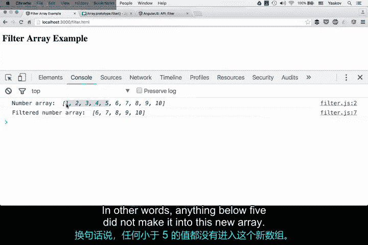

保存代码并刷新浏览器，可以看到 `filteredNumberArray` 现在只包含 6 到 10 的数字。


我们可以让代码更优雅一些。由于我们有一个函数作为另一个函数的参数，我们可以将其提取出来，定义一个命名函数。

```javascript
function aboveFiveFilter(value) {
    return value > 5;
}
var filteredNumberArray = numberArray.filter(aboveFiveFilter);
console.log(filteredNumberArray);
```

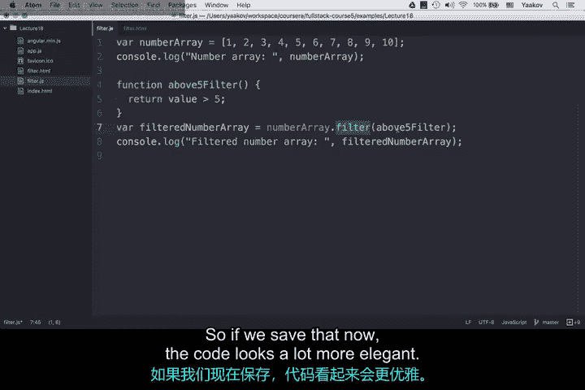

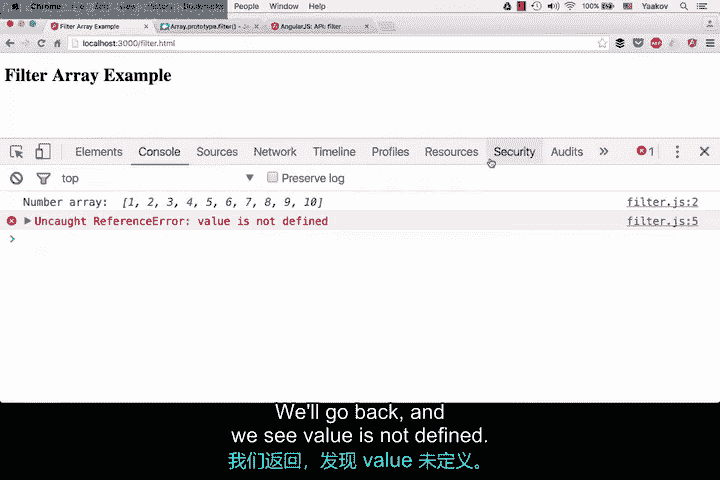

现在代码看起来更清晰了。保存后，我们依然会看到过滤后的数组 `[6, 7, 8, 9, 10]`。

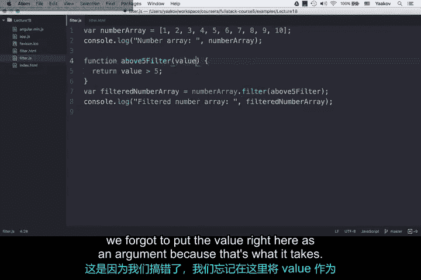

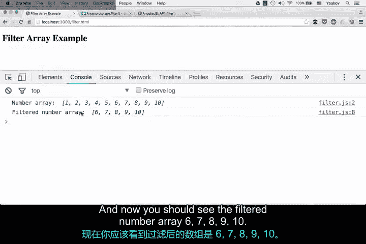


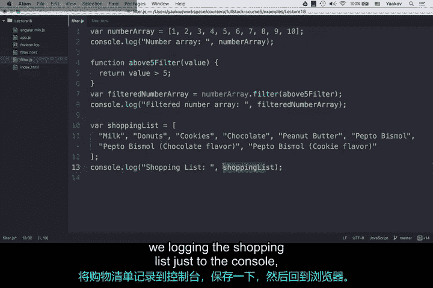


以上就是关于数字数组的过滤。那么，如果我们有一组字符串呢？让我们粘贴一个准备好的数组，它来自上一讲的购物清单。

```javascript
var shoppingList = [
    "Milk", "Donuts", "Cookies", "Chocolate", "Peanut Butter",
    "Pepto Bismol", "Pepto Bismol (Chocolate flavor)", "Pepto Bismol (Cookie flavor)"
];
console.log(shoppingList);
```

保存并刷新浏览器，可以看到控制台打印出了这 8 个购物项。


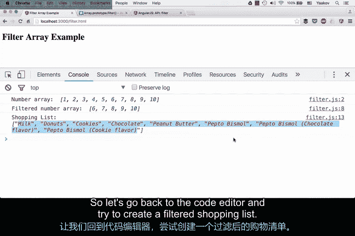

现在，让我们回到代码编辑器，尝试为这个购物清单创建一个过滤器。我们将搜索包含特定字符串的项。

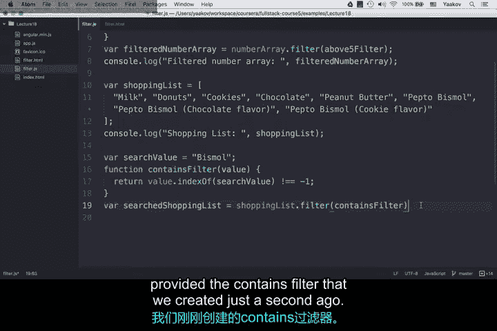

```javascript
var searchValue = "Bismol";
function containsFilter(value) {
    return value.indexOf(searchValue) !== -1;
}
var searchedShoppingList = shoppingList.filter(containsFilter);
console.log(searchedShoppingList);
```

我们定义了一个搜索字符串 `searchValue` 和一个 `containsFilter` 函数。该函数检查数组中的每一项 (`value`) 是否包含 `searchValue` 字符串（使用 `indexOf` 方法，如果找不到则返回 -1）。然后我们调用 `filter` 函数并传入这个过滤器。

保存并刷新浏览器，可以看到 `searchedShoppingList` 只包含带有 “Bismol” 字样的三项。


现在，让我们将这些知识应用到 AngularJS 和 `ng-repeat` 中。我们希望能够在 `ng-repeat` 输出数组时动态地过滤它。

首先，访问 AngularJS 官网的开发者指南，查看内置过滤器。其中有一个名为 `filter` 的过滤器（名称有些重复），它的作用是从数组中选择一个子集并作为新数组返回，这和我们刚才使用的 `filter` 函数功能一致。

在 HTML 模板绑定中，它的用法是：一个过滤表达式，后跟一个管道符 `|`，然后是单词 `filter`，再跟一个表达式。如果这个表达式是一个字符串，那么它将用于匹配数组的内容（数组中的字符串或具有字符串属性的对象），所有匹配的项都会被返回。


让我们回到代码编辑器，介绍我们将要实际使用的应用程序。关闭之前的文件，打开 `index.html` 和 `app.js`。

在 `index.html` 中，有一个简单的 `ng-repeat` 循环遍历 `shoppingList`。在 `app.js` 中，`shoppingList` 就是我们之前使用的同一个数组。

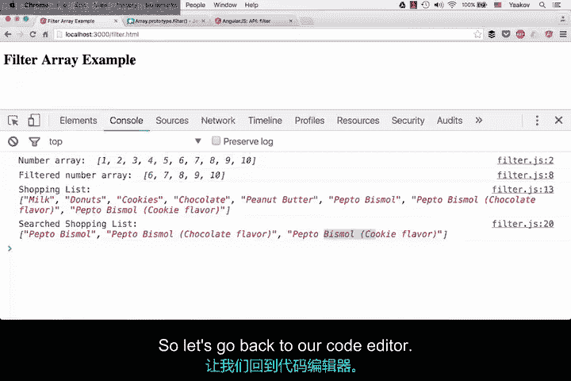

```html
<!-- index.html 片段 -->
<ul>
  <li ng-repeat="item in shoppingList">{{ item }}</li>
</ul>
```

```javascript
// app.js 片段
angular.module('ShoppingListApp', [])
.controller('ShoppingListController', function($scope) {
  $scope.shoppingList = [
    "Milk", "Donuts", "Cookies", "Chocolate", "Peanut Butter",
    "Pepto Bismol", "Pepto Bismol (Chocolate flavor)", "Pepto Bismol (Cookie flavor)"
  ];
});
```

保存并在浏览器中打开 `index.html`，可以看到我们的购物清单。

现在，让我们在 `index.html` 的列表上方创建一个输入框，用于绑定搜索关键词。

```html
<input type="text" ng-model="search" placeholder="Search...">
<ul>
  <li ng-repeat="item in shoppingList | filter:search">{{ item }}</li>
</ul>
```

我们创建了一个 `input` 元素，并使用 `ng-model` 将其双向绑定到一个名为 `search` 的属性上。然后，在 `ng-repeat` 中，我们对 `shoppingList` 数组应用了 `filter` 过滤器，过滤的条件就是 `search` 这个字符串。

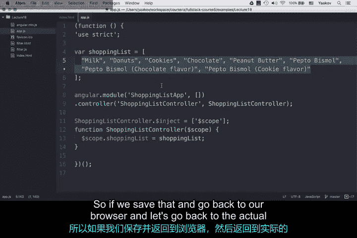

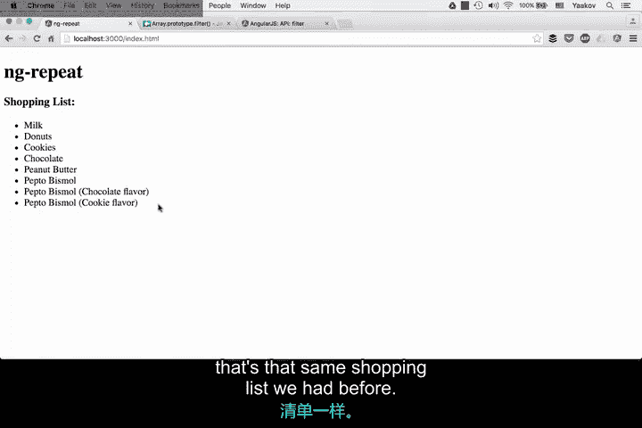

现在会发生什么呢？当我们在输入框中打字时，`search` 属性会自动更新。由于所有这些都是通过 AngularJS 的 `$digest` 循环中的监视器注册的，过滤器会自动生效，我们的购物清单会根据输入框中提供的搜索字符串自动被过滤。

让我们在浏览器中查看效果。页面加载后显示完整的购物清单。当我们在输入框中输入 “Bismol” 时，列表立即只显示包含 “Bismol” 的三项。当我们删除文字时，列表又逐渐变回完整。输入 “Milk” 则只显示 “Milk”。


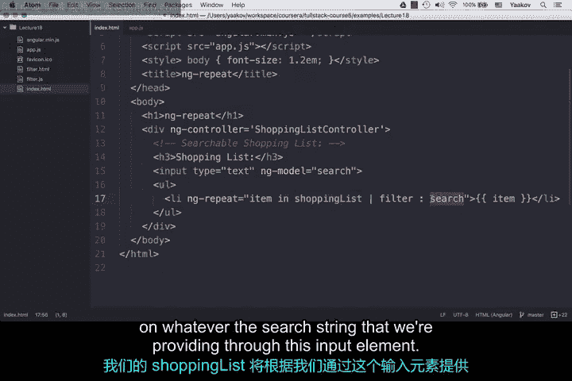

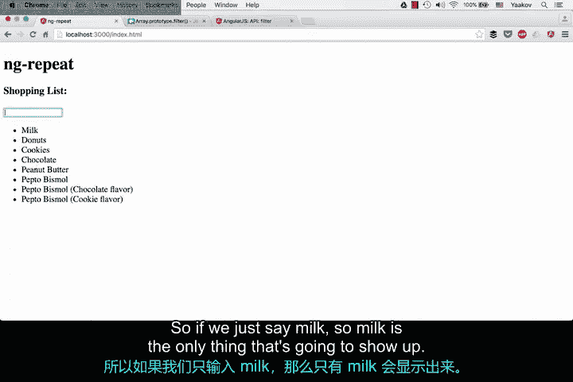

回到代码编辑器，可以看到使用 `filter` 过滤器基本上实现了和我们在 `filter.js` 中相同的功能：它使用搜索字符串来判断购物清单数组中的每一项是否匹配。由于我们通过双向绑定更新了 `search` 属性，`ng-repeat` 中的列表得以实时过滤。


这样，我们就实现了一个用户可搜索的列表，用户只需输入搜索词，列表就会根据该搜索词自动过滤。


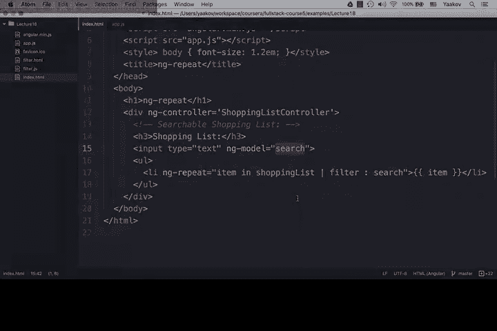

## 总结 📝

本节课中我们一起学习了以下内容：

1.  **JavaScript 数组的 `filter` 函数**：这是一个存在于数组对象上的特殊函数。它的作用是创建一个新数组，新数组中的每个元素都满足传入 `filter` 函数的比较函数所设定的条件。其基本语法是：
    ```javascript
    var newArray = originalArray.filter(function(item) {
      // 返回 true 或 false
      return condition;
    });
    ```

2.  **AngularJS 的内置 `filter` 过滤器**：AngularJS 提供了一个名为 `filter` 的过滤器（名称有些重复），它封装了我们上面讨论的数组 `filter` 函数的功能。


3.  **过滤器的应用**：当以字符串作为参数传递给 AngularJS 的 `filter` 过滤器时，它会过滤原始集合（或数组），将数组中的所有字符串项与提供的搜索字符串进行匹配。

4.  **在 `ng-repeat` 中实现实时搜索**：我们在代码中通过以下方式应用它：
    ```html
    <input type="text" ng-model="searchString">
    <div ng-repeat="item in collection | filter:searchString">
      {{ item }}
    </div>
    ```
    我们将搜索字符串 `searchString` 绑定到一个文本框输入元素上。这使得用户可以随时在文本框中输入任何字符串，该字符串将作为过滤 `ng-repeat` 所遍历的集合（`collection`）的搜索条件。因此，`ng-repeat` 会根据用户在该搜索框中输入的内容来更新用户界面。

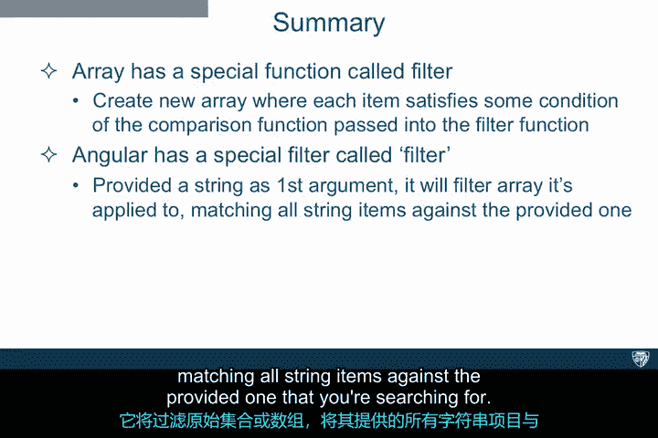


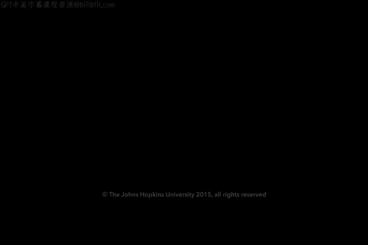

通过本讲的学习，你已经掌握了如何使用 AngularJS 的过滤器来增强 `ng-repeat` 指令，从而创建出交互性更强、用户体验更好的动态列表。