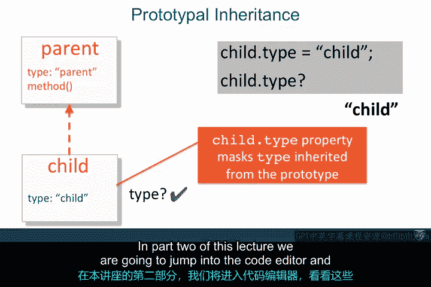
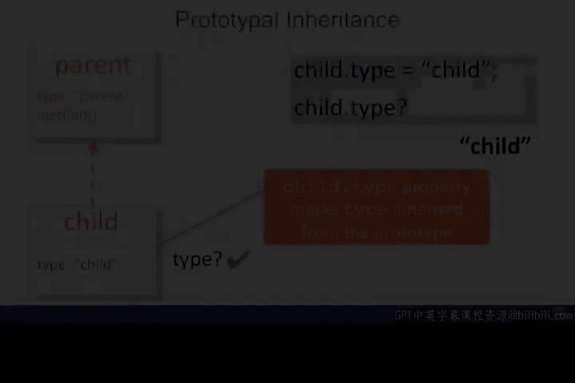

# 034：原型继承（第1部分）


在本节课中，我们将要学习 JavaScript 中一个非常基础且重要的概念：原型继承。理解这个概念对于后续掌握 AngularJS 中更优的控制器语法至关重要。如果不理解原型继承，我们可能只是在死记硬背一些奇怪的规则，而不是真正理解其工作原理。

## 什么是继承？

首先，我们来探讨一下什么是继承。继承是指一个对象或类基于另一个对象或类，使用相同的实现或相同的值。

例如，如果你有一个“动物”对象或类，它可能拥有一些属性，比如“腿的数量”，以及一个名为“行走”的方法。然后，你可以有另一个名为“狗”的类或对象，它以某种方式从“动物”类或对象继承。这样一来，“狗”对象或类就可以访问“腿的数量”属性和“行走”方法。

不同的编程语言实现了不同类型的继承。总的来说，这种技术用于代码复用以及构建逻辑实体结构。请注意，为了便于理解，我们在此不严格区分子类型和继承等术语，这些定义足以满足我们的学习目的。

## 原型继承

与基于类、规则更复杂、需要记忆大量细节的面向对象继承不同，原型继承基于对象实例，非常简单直接。原始的对象实例会成为所有后续创建对象的原型。

在这个例子中，我们有一个名为 `parent` 的对象，它有一个 `type` 属性，其值为字符串 `"parent"`，还有一个名为 `method` 的方法。

```javascript
let parent = {
    type: 'parent',
    method: function() {
        console.log('This is a method from parent.');
    }
};
```

然后，如果我们创建一个基于 `parent` 对象的 `child` 对象，这个 `child` 对象最初只是一个空对象。

```javascript
let child = Object.create(parent);
```

然而，如果我们尝试计算表达式 `child.type`，JavaScript 引擎会首先在 `child` 对象中查找 `type` 属性。在这个例子中，`child` 对象本身没有这个属性。

因此，JavaScript 引擎会沿着原型链向上查找，看哪个对象是 `child` 对象的父对象。在这个例子中，父对象就是 `parent` 对象本身。引擎会询问 `parent` 对象是否拥有 `type` 属性。在这个例子中，`parent` 对象确实拥有这个属性，其值为字符串 `"parent"`。

所以，`type` 属性会被解析为 `parent` 对象的 `type` 属性，这意味着表达式 `child.type` 最终会被解析为字符串 `"parent"`。

## 原型链与属性遮蔽

之所以称之为原型链，是因为它不局限于一个对象及其子对象，它可以有孙对象、曾孙对象等等。换句话说，你可以基于 `child` 对象创建另一个对象，那么当前的 `parent` 对象就会成为这个新创建对象的“祖父”对象。

然而，如果我们不是计算 `child.type` 表达式，而是在 `child` 对象上设置一个 `type` 属性，会发生什么呢？这时，`child` 对象将不再为空，它会拥有一个名为 `type` 的属性，其值为字符串 `"child"`。

```javascript
child.type = 'child';
```

那么，如果你现在尝试计算 `child.type`，会发生什么？由于 `child.type` 属性实际上“遮蔽”了从原型对象（即 `parent` 对象）继承来的 `type` 属性，引擎会立即计算并解析 `child` 对象自身的 `type` 属性。

这意味着它不会沿着原型链向上查找 `parent` 对象。因此，在这种情况下，表达式 `child.type` 会被计算为字符串 `"child"`。

## 过渡到实践

上一节我们介绍了原型继承的基本概念和原理。在本节中，我们来看看这些概念在实际代码中是如何运作的。

以下是理解原型继承的几个关键点：

*   **继承关系**：子对象可以访问父对象（原型）的属性和方法。
*   **查找机制**：当访问一个属性时，引擎会先在对象自身查找，如果没有则沿着原型链向上查找。
*   **属性遮蔽**：如果子对象定义了与原型同名的属性，则会使用子对象自身的属性值，这被称为“遮蔽”。

## 总结





本节课中，我们一起学习了 JavaScript 中的原型继承。我们了解到，原型继承是一种基于对象实例的简单继承机制，它通过原型链来实现属性和方法的共享与查找。理解属性遮蔽现象对于掌握对象属性的访问优先级至关重要。在下一部分，我们将进入代码编辑器，亲眼看看这些概念是如何在实践中应用的。