# 035：原型继承（第二部分）🧬

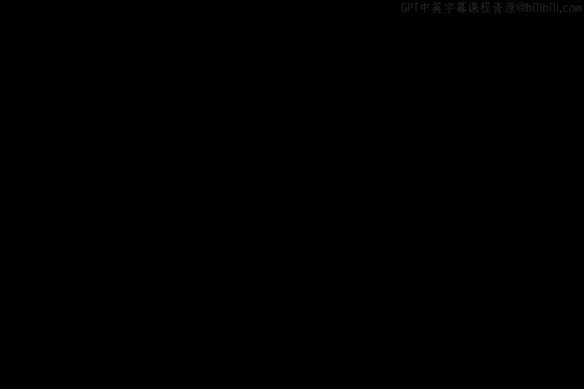

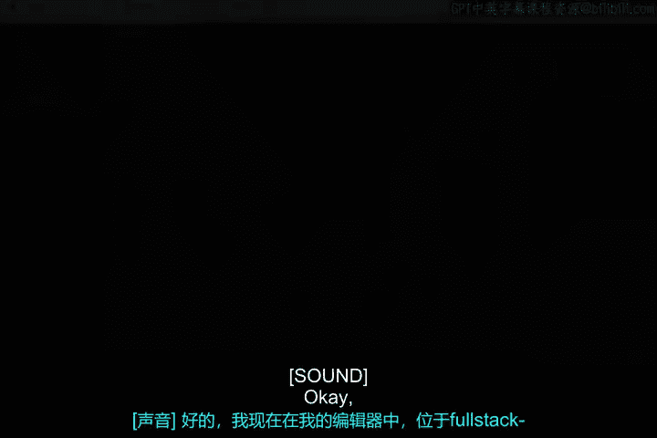

在本节课中，我们将深入学习 JavaScript 中的原型继承机制。我们将通过编写代码示例，逐步理解对象如何通过原型链共享属性和方法，以及如何创建基于原型的对象关系。

---

## 概述

我们将从创建一个简单的父对象开始，然后演示如何基于它创建子对象，从而建立原型继承关系。接着，我们会探索属性查找、属性遮蔽（masking）以及原型链的运作原理。最后，我们会简要介绍函数构造器，为后续理解 AngularJS 的控制器语法打下基础。

---

## 创建父对象与子对象

首先，我们声明一个父对象。这是一个简单的对象字面量，包含一个基本值属性、一个对象属性和一个方法。

```javascript
var parent = {
    value: "parent value",
    obj: {
        objectValue: "parent object value"
    },
    walk: function () {
        console.log("walking!");
    }
};
```

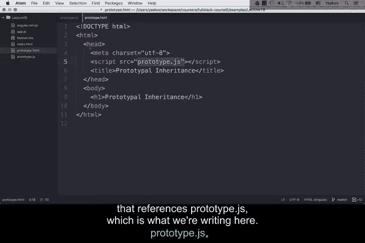

接下来，我们基于这个父对象创建一个子对象。我们使用 `Object.create()` 方法来实现原型继承。这个方法在现代浏览器中都应得到支持。

```javascript
var child = Object.create(parent);
```

执行完这行代码后，`parent` 对象就成了 `child` 对象的原型。

---

## 探索原型链查找

现在，让我们通过控制台输出，观察子对象和父对象中的属性。

以下是我们要输出的内容：

```javascript
console.log("CHILD - child.value: ", child.value);
console.log("CHILD - child.obj.objectValue: ", child.obj.objectValue);
console.log("PARENT - parent.value: ", parent.value);
console.log("PARENT - parent.obj.objectValue: ", parent.obj.objectValue);
console.log("parent: ", parent);
console.log("child: ", child);
```

当 JavaScript 引擎在 `child` 对象上查找 `value` 属性时，由于 `child` 自身没有这个属性，它会沿着原型链向上查找，最终在 `parent` 对象上找到并返回 `"parent value"`。对于 `child.obj.objectValue` 的查找过程也是如此。

在浏览器控制台中，我们可以看到 `child.value` 和 `child.obj.objectValue` 的输出结果确实与父对象的对应属性值相同。同时，打印出的 `child` 对象本身看起来是空的，但它有一个特殊的 `__proto__` 属性，指向其原型——也就是 `parent` 对象。

---

## 属性遮蔽与引用类型的影响

上一节我们看到了原型链的基本查找机制。本节中，我们来看看当子对象定义自己的属性时会发生什么。

我们将在子对象上定义自己的 `value` 属性，并修改从父对象继承来的 `obj.objectValue`。

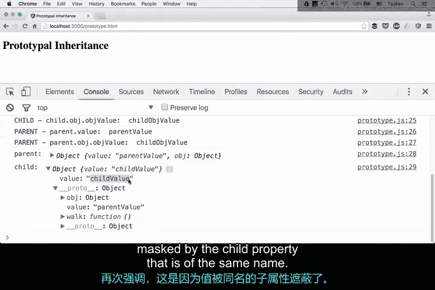

```javascript
child.value = "child value";
child.obj.objectValue = "child object value";
```

修改后，我们再次输出相关值进行对比：

```javascript
console.log("*** CHANGED: child.value = 'child value'");
console.log("*** CHANGED: child.obj.objectValue = 'child object value'");
console.log("CHILD - child.value: ", child.value);
console.log("CHILD - child.obj.objectValue: ", child.obj.objectValue);
console.log("PARENT - parent.value: ", parent.value);
console.log("PARENT - parent.obj.objectValue: ", parent.obj.objectValue);
console.log("parent: ", parent);
console.log("child: ", child);
```

现在，控制台会显示关键区别：
*   `child.value` 现在输出 `"child value"`。因为子对象自身有了 `value` 属性，它**遮蔽**了原型链上的同名属性。父对象的 `parent.value` 保持不变。
*   `child.obj.objectValue` 和 `parent.obj.objectValue` 现在都输出 `"child object value"`。这是因为 `obj` 是一个引用类型的属性，子对象并没有自己的 `obj` 属性，访问 `child.obj` 时依然会查找到原型链上的 `parent.obj`，修改的是**同一个对象**。这证实了 `child.obj` 和 `parent.obj` 是严格相等的。

```javascript
console.log(child.obj === parent.obj); // 输出: true
```

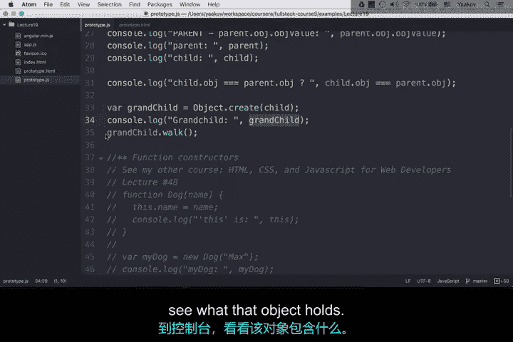

---

## 多级继承与函数构造器简介

原型链可以不止一层。我们可以基于 `child` 对象再创建一个 `grandchild` 对象。

```javascript
var grandchild = Object.create(child);
console.log("Grandchild: ", grandchild);
grandchild.walk(); // 输出: walking!
```

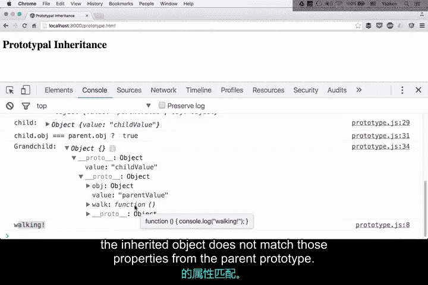

`grandchild` 对象可以成功调用 `walk` 方法，即使这个方法定义在原型链顶端的 `parent` 对象中。这展示了原型继承的强大之处。

在进入 AngularJS 控制器语法之前，我们还需要理解一个相关概念：**函数构造器**。

函数在 JavaScript 中也是对象，可以用作构造新对象的“类”。函数名首字母大写是一种约定，表示它将被用作构造器。

```javascript
// 函数构造器
function Dog(name) {
    this.name = name;
    console.log("'this' is: ", this);
}

// 正确用法：使用 new 关键字
var myDog = new Dog("Max");
console.log("myDog: ", myDog);

// 错误用法：省略 new 关键字
var myDog2 = Dog("Max2"); // this 将指向全局对象（如 window）
console.log("myDog2: ", myDog2);
```

使用 `new` 关键字调用函数时，函数内部的 `this` 会指向新创建的对象。如果忘记使用 `new`，`this` 将指向全局作用域，这通常会导致错误。

---

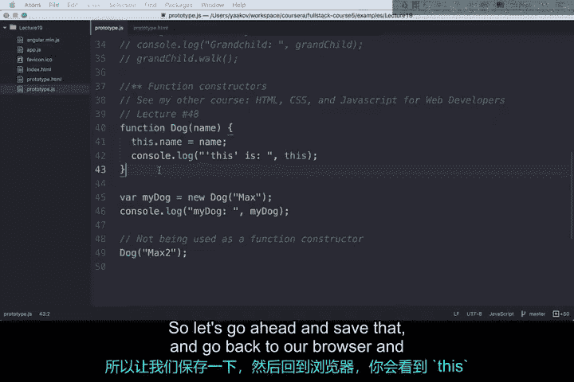

## 总结

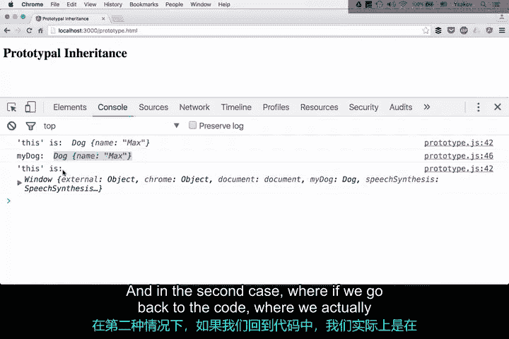

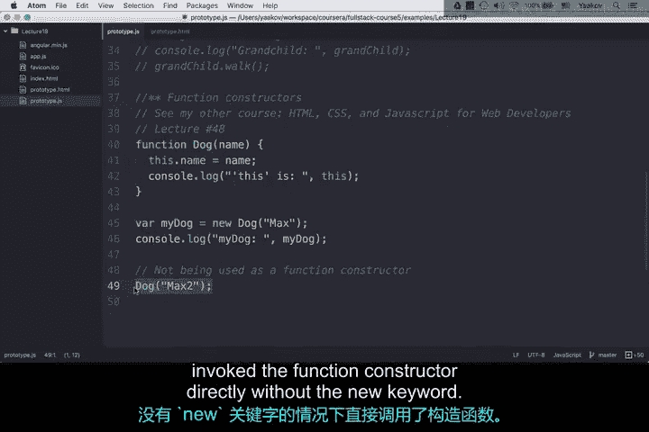

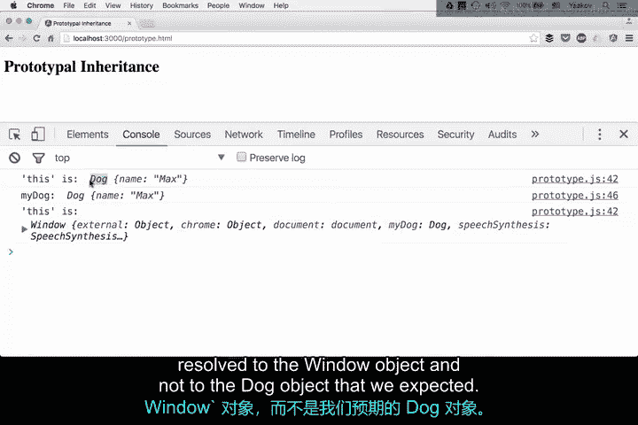

本节课我们一起学习了 JavaScript 原型继承的核心机制。
1.  我们使用 `Object.create()` 建立了对象间的原型继承关系。
2.  我们理解了属性查找会沿原型链向上进行。
3.  我们看到了子对象定义同名属性会遮蔽原型属性，而修改继承来的引用类型属性会影响原型。
4.  我们了解了原型链可以有多级，并简要介绍了函数构造器的用法。

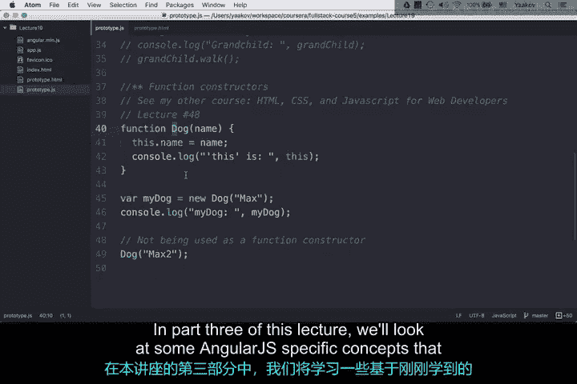

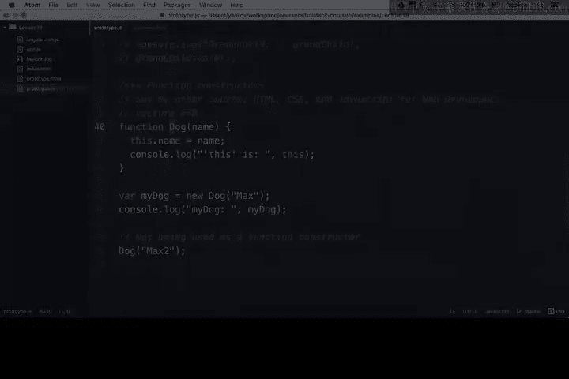

这些关于对象、原型和继承的概念，是理解接下来 AngularJS 中控制器和作用域工作原理的重要基础。在下一部分，我们将把这些知识应用到 AngularJS 的具体语境中。